# 机灵助手 (jiling.cc) 图像模板提示词合集

来源: https://www.jiling.cc/image-templates ｜ 模板数: 217 ｜ 抓取时间: 2026-10-27 10:50

## 目录

- [24K矢量金线提示词与教程](#24k-gold-vector-lines)（Logo/字体 · Logo概念）
- [3D卡通错觉效果提示词与教程](#3d-cartoon-illusion-effect)（社媒内容 · 趣味滤镜）
- [3D图标提示词与教程](#3d-icon-set)（广告创意 · 品牌KV）
- [3D卡通贴纸包提示词与教程](#3d-sticker-pack)（IP形象/手办 · 3D卡通形象）
- [抽象头像九宫格提示词与教程](#abstract-avatar-nine-grid)（二次元/漫画 · 角色插画）
- [吸塑盒装手办提示词与教程](#action-figure-blister-pack)（IP形象/手办 · Action Figure）
- [AI换模特主图提示词与教程](#ai-model-swap)（电商 · AI换模特）
- [AI人才评估提示词与教程](#ai-talent-assessment)（社媒内容 · 信息图）
- [亚马逊A+详情页提示词与教程](#amazon-a-plus-detail-page)（电商 · 详情页设计）
- [现代动画概念美术提示词与教程](#anime-concept)（二次元/漫画 · 游戏立绘）
- [明星影视作品海报提示词与教程](#annual-filmography-collage-poster)（社媒内容 · 拼贴海报）
- [爆款主图6张套图提示词与教程](#bestseller-main-image-six-pack)（电商 · 合规主图）
- [宝莱坞沙丽复古风提示词与教程](#bollywood-sari-retro)（AI变装 · 复古胶片）
- [品牌联名主视觉提示词与教程](#brand-collab)（广告创意 · 品牌联名海报）
- [破屏穿越风格提示词与教程](#breaking-screen-social-style)（AI变装 · 杂志/海报）
- [商务档案头像提示词与教程](#business-profile-headshot)（AI变装 · 杂志/海报）
- [3D/C4D多巴胺提示词与教程](#c4d-dopamine-product-shot)（电商 · 3D场景）
- [书法临摹贴提示词与教程](#calligraphy-copybook)（广告创意 · 字帖模板）
- [职业专属配件手办提示词与教程](#career-accessory-blindbox-figure)（IP形象/手办 · 职业IP）
- [卡通蜡笔风格提示词与教程](#cartoon-crayon-style)（二次元/漫画 · 角色插画）
- [CCD校园风提示词与教程](#ccd-campus-photo)（AI变装 · 千禧Y2K）
- [角色360度全景提示词与教程](#character-360-panorama)（人物写真 · 多视角）
- [角色设定图提示词与教程](#character-design-sheet)（IP形象/手办 · 3D卡通形象）
- [Q版克隆贴纸照片提示词与教程](#chibi-clone-sticker-photo)（AI变装 · 生活记录）
- [Q版掌心小气包提示词与教程](#chibi-palm-pouty-figure)（IP形象/手办 · 3D卡通形象）
- [儿童蜡笔涂鸦提示词与教程](#children-crayon-scribble-doodle)（AI变装 · 二次元变身）
- [儿童蜡笔风格提示词与教程](#children-crayon-style)（AI变装 · 二次元变身）
- [儿童涂鸦风插画提示词与教程](#children-doodle-style-illustration)（AI变装 · 二次元变身）
- [电影肖像照提示词与教程](#cinematic-portrait)（人物写真 · 情绪大片）
- [透明窗盲盒提示词与教程](#classic-window-box-blindbox-figure)（IP形象/手办 · 盲盒包装）
- [彩色线条手绘提示词与教程](#colorful-doodle-line-art)（AI变装 · 杂志/海报）
- [超市特价传单提示词与教程](#community-supermarket-flyer)（广告创意 · 促销传单）
- [情侣双人盲盒收藏提示词与教程](#couple-blindbox-collection-set)（IP形象/手办 · 情侣套装）
- [情侣漫步拼贴画提示词与教程](#couple-stroll-collage)（人物写真 · 情绪大片）
- [水晶露珠肌效果提示词与教程](#crystal-dew-skin-effect)（AI变装 · 写真）
- [自定义娃娃机提示词与教程](#custom-claw-machine)（IP形象/手办 · 毛绒公仔）
- [服装上身提示词与教程](#custom-clothing-upperbody)（电商 · 鞋帽上身）
- [Q版萌系盲盒提示词与教程](#cute-chibi-blindbox-figure)（IP形象/手办 · 萌系盲盒）
- [赛博机械头像提示词与教程](#cyber-mechanical-avatar)（AI变装 · 杂志/海报）
- [赛博霓虹机能提示词与教程](#cyber-neon-functional-visual)（二次元/漫画 · 机能海报）
- [赛博科技提示词与教程](#cyber-tech-product-shot)（产品摄影 · 科技渲染）
- [拆解信息图提示词与教程](#deconstruction-infographic)（社媒内容 · 信息图）
- [潮玩新品官宣提示词与教程](#designer-toy-launch-poster)（IP形象/手办 · 新品官宣）
- [桌面建模工作室提示词与教程](#desktop-modeling-studio-figure)（IP形象/手办 · 工作室展示）
- [甜点促销海报提示词与教程](#dessert-sale-poster)（广告创意 · 促销海报）
- [商品细节特写图提示词与教程](#detail-shot-generator)（电商 · 细节图）
- [数码科技爆款提示词与教程](#digital-tech-bestseller)（产品摄影 · 数码产品）
- [收藏柜手办提示词与教程](#display-cabinet-collectible-figure)（IP形象/手办 · 收藏陈列）
- [抖音直播提示词与教程](#douyin-live)（社媒内容 · 直播截图）
- [梦幻逆光天空系提示词与教程](#dream-backlit-sky-poster)（二次元/漫画 · 天空叙事）
- [东方幻想风格女性提示词与教程](#eastern-fantasy-female)（二次元/漫画 · 角色插画）
- [电商商品海报提示词与教程](#ecommerce)（电商 · 商品主图）
- [电商爆款海报提示词与教程](#ecommerce-bestseller-poster-template)（电商 · 风格海报）
- [电商详情图提示词与教程](#ecommerce-detail-image)（电商 · 详情页设计）
- [电商产品介绍图提示词与教程](#ecommerce-product-intro-image)（电商 · 详情页设计）
- [电商促销海报设计提示词与教程](#ecommerce-sale-poster-design)（电商 · 风格海报）
- [科普百科图提示词与教程](#encyclopedia-infographic)（社媒内容 · 百科信息图）
- [分层解构展示提示词与教程](#exploded-selling-point-product-shot)（电商 · 卖点解构）
- [贴纸失败品可爱风提示词与教程](#failed-sticker-cute-style)（AI变装 · 二次元变身）
- [狂热角色速写提示词与教程](#fanatic-character-sketchbook)（广告创意 · 草图细化）
- [时尚双栏电商图册提示词与教程](#fashion-catalog)（电商 · Banner横幅）
- [节日倒计时海报提示词与教程](#festival-countdown-poster)（社媒内容 · 拼贴海报）
- [扁平手绘涂鸦插画提示词与教程](#flat-handdrawn-doodle-illustration)（AI变装 · 二次元变身）
- [商品平铺图生成提示词与教程](#flat-lay-generator)（电商 · 平铺图）
- [45度悬浮动态图提示词与教程](#floating-45-degree-product-shot)（电商 · 悬浮展示）
- [电商产品悬浮渲染提示词与教程](#floating-product-render)（产品摄影 · 高级静物）
- [餐饮菜单大片提示词与教程](#food)（广告创意 · 菜单头图）
- [食品商业海报提示词与教程](#food-commercial-poster)（电商 · 食品饮料）
- [清新蓝底证件照提示词与教程](#fresh-blue-id-photo)（AI变装 · 写真）
- [半透明毛玻璃视觉提示词与教程](#frosted-glass-logo-visual)（Logo/字体 · Logo概念）
- [搞笑抽象涂鸦插画提示词与教程](#funny-abstract-doodle-illustration)（AI变装 · 二次元变身）
- [搞笑笨拙涂鸦插画提示词与教程](#funny-clumsy-doodle-illustration)（AI变装 · 二次元变身）
- [搞笑涂鸦风格提示词与教程](#funny-doodle-style)（二次元/漫画 · 角色插画）
- [未来潮玩盲盒风提示词与教程](#future-designer-toy-avatar)（社媒内容 · 社媒头像）
- [未来的自己提示词与教程](#future-self-2041)（AI变装 · 写真）
- [高考海报设计提示词与教程](#gaokao-poster-design)（广告创意 · 品牌海报）
- [吉卜力旅行照提示词与教程](#ghibli-travel-photo)（AI变装 · 二次元变身）
- [巨型人物脚手架提示词与教程](#giant-scaffold-person)（场景创意 · 不可能场景）
- [玻璃瓶纪念品提示词与教程](#glass-bottle-souvenir)（场景创意 · 微缩世界）
- [光环叙事提示词与教程](#halo-narrative)（AI变装 · 杂志/海报）
- [手绘风注解提示词与教程](#hand-drawn-annotation-style)（社媒内容 · 拼贴海报）
- [手绘涂鸦卡通肖像提示词与教程](#hand-drawn-doodle-cartoon-portrait)（二次元/漫画 · 角色插画）
- [手绘包装提案提示词与教程](#hand-drawn-packaging-proposal)（广告创意 · 包装提案）
- [手提产品包装设计提示词与教程](#handled-product-packaging-design)（广告创意 · 包装提案）
- [手工纸雕插画提示词与教程](#handmade-paper-sculpture-illustration)（AI变装 · 二次元变身）
- [治愈系动画水彩提示词与教程](#healing-watercolor-brand-poster)（二次元/漫画 · 品牌海报）
- [高端电商模特生成提示词与教程](#high-end-ecommerce-model-generation)（电商 · AI换模特）
- [高级时装人像提示词与教程](#high-fashion-editorial-portrait)（人物写真 · 杂志封面）
- [港风夜店胶片风提示词与教程](#hong-kong-nightclub-film)（AI变装 · 港风夜色）
- [超写实概念肖像提示词与教程](#hyperreal-concept-portrait)（AI变装 · 杂志/海报）
- [超写实迷你娃娃提示词与教程](#hyperreal-mini-doll)（IP形象/手办 · 收藏手办）
- [制作证件照提示词与教程](#id-photo)（人物写真 · 证件照/职业照）
- [印象派风格油画提示词与教程](#impressionist-oil-painting)（AI变装 · 二次元变身）
- [充气软糖美学提示词与教程](#inflatable-gummy-type)（Logo/字体 · 标题字）
- [水墨手绘插画提示词与教程](#ink-handdrawn-illustration)（二次元/漫画 · 角色插画）
- [对童年的自己治疗提示词与教程](#inner-child-healing)（人物写真 · 情绪大片）
- [海报生成提示词与教程](#japanese-tea-drink-poster)（广告创意 · 茶饮海报）
- [手账涂鸦头像卡提示词与教程](#journal-doodle-avatar-card)（二次元/漫画 · 角色插画）
- [K-pop舞蹈编排提示词与教程](#k-pop-dance-choreography)（二次元/漫画 · 角色插画）
- [儿童绘本插画提示词与教程](#kids)（二次元/漫画 · 绘本封面）
- [幼儿园蜡笔翻车风提示词与教程](#kindergarten-crayon-fail-style)（AI变装 · 二次元变身）
- [韩系手绘涂鸦海报提示词与教程](#korean-handdrawn-doodle-poster)（AI变装 · 杂志/海报）
- [韩风手绘爆款插画提示词与教程](#korean-handdrawn-viral-illustration)（二次元/漫画 · 角色插画）
- [韩系个人色彩诊断提示词与教程](#korean-personal-color-diagnosis)（社媒内容 · 信息图）
- [LEGO乐高积木世界提示词与教程](#lego-brick-world)（IP形象/手办 · 3D卡通形象）
- [人生九宫格提示词与教程](#life-stage-nine-grid)（AI变装 · 写真）
- [生活方式场景提示词与教程](#lifestyle-seeding-product-shot)（电商 · 种草场景）
- [线面结合图标提示词与教程](#line-fill-icon-set)（广告创意 · 品牌KV）
- [线性图标提示词与教程](#linear-icon-set)（广告创意 · 品牌KV）
- [本地超市特价海报提示词与教程](#local-supermarket-poster)（广告创意 · 促销海报）
- [异国旅行海报提示词与教程](#lost-in-country-poster)（社媒内容 · 拼贴海报）
- [低质量鼠标涂鸦提示词与教程](#low-quality-mouse-doodle)（AI变装 · 生活记录）
- [高端产品生成提示词与教程](#luxury-product-shot)（产品摄影 · 高级静物）
- [高奢丝绒提示词与教程](#luxury-velvet-product-shot)（产品摄影 · 高奢静物）
- [杂志剪贴风格提示词与教程](#magazine-cutout-collage-style)（AI变装 · 杂志/海报）
- [AI 变装写真提示词与教程](#makeover)（人物写真 · 上传自拍）
- [奶茶飞溅风格提示词与教程](#milk-tea-splash-style)（AI变装 · 杂志/海报）
- [立方体微缩提示词与教程](#miniature-scene)（场景创意 · 微缩世界）
- [极简2D扁平插画提示词与教程](#minimal-2d-flat-illustration)（二次元/漫画 · 角色插画）
- [极简火柴人互动风提示词与教程](#minimal-stickman-interaction-style)（二次元/漫画 · 角色插画）
- [极简风格插画提示词与教程](#minimalist-editorial-illustration)（二次元/漫画 · 品牌海报）
- [镜面反射冷艳肖像提示词与教程](#mirror-reflection-cold-portrait)（人物写真 · 情绪大片）
- [宫崎骏海街胶片风提示词与教程](#miyazaki-seaside-film-style)（社媒内容 · 胶片叙事）
- [模特换姿势同款图提示词与教程](#model-pose-variation)（电商 · 换姿势）
- [朋友圈动态截图提示词与教程](#moments-feed-screenshot)（社媒内容 · 社交媒体九宫格）
- [电影主角头像提示词与教程](#movie-protagonist-avatar)（AI变装 · 杂志/海报）
- [更换多种发型提示词与教程](#multi-hairstyle-grid)（AI变装 · 写真）
- [自然森系提示词与教程](#natural-forest-product-shot)（产品摄影 · 自然成分）
- [渐变品牌Logo提示词与教程](#neoglo-logo)（Logo/字体 · Logo概念）
- [港片霓虹风提示词与教程](#neon-hk-cinema)（AI变装 · 港风夜色）
- [新中式品牌风提示词与教程](#new-chinese-ink-brand-visual)（社媒内容 · 东方封面）
- [国潮/新中式提示词与教程](#new-chinese-trend-product-poster)（电商 · 风格海报）
- [Nike超现实海报提示词与教程](#nike-surreal-poster)（广告创意 · 品牌海报）
- [九宫格角色包提示词与教程](#nine-grid-character-pack)（社媒内容 · 社交媒体九宫格）
- [90年代叙事胶片提示词与教程](#nineties-film-story-poster)（社媒内容 · 胶片叙事）
- [诺兰电影风格提示词与教程](#nolan-film-style)（社媒内容 · 胶片叙事）
- [北欧民俗装饰插画提示词与教程](#nordic-folk-decorative-illustration)（AI变装 · 二次元变身）
- [官方周边限定手办提示词与教程](#official-limited-edition-figure)（IP形象/手办 · 限定周边）
- [油画棒插画提示词与教程](#oil-pastel-illustration)（AI变装 · 二次元变身）
- [老电影海报风提示词与教程](#old-movie-poster-star)（AI变装 · 杂志/海报）
- [老照片高保真修复提示词与教程](#old-photo-high-fidelity-restoration)（社媒内容 · 胶片叙事）
- [一键换装上新图提示词与教程](#one-click-outfit)（电商 · 一键换装）
- [1/7超写实手办提示词与教程](#one-seventh-collectible-figure)（IP形象/手办 · 收藏手办）
- [OOTD穿搭提示词与教程](#ootd-styling)（电商 · 一键换装）
- [明星狗仔风提示词与教程](#paparazzi-film-snap)（AI变装 · 明星抓拍）
- [纸艺风格提示词与教程](#papercraft-style-filter)（社媒内容 · 趣味滤镜）
- [香水爆款提示词与教程](#perfume-bestseller)（产品摄影 · 香水/美妆）
- [柔美浪漫香水商拍提示词与教程](#perfume-romance)（产品摄影 · 香水/美妆）
- [拼豆像素图纸提示词与教程](#perler-bead-pixel-pattern)（社媒内容 · 趣味滤镜）
- [人物换衣提示词与教程](#person-outfit-swap)（电商 · 一键换装）
- [个人色彩分析提示词与教程](#personal-color-analysis)（社媒内容 · 信息图）
- [个人发型分析提示词与教程](#personal-hairstyle-analysis)（社媒内容 · 信息图）
- [个人形象分析提示词与教程](#personal-image-analysis)（社媒内容 · 信息图）
- [个人妆容分析提示词与教程](#personal-makeup-analysis)（社媒内容 · 信息图）
- [个人穿搭分析提示词与教程](#personal-outfit-analysis)（社媒内容 · 信息图）
- [个人资料卡提示词与教程](#personal-profile-card)（社媒内容 · 社媒头像）
- [萌宠拟人反差身份提示词与教程](#pet-humanized-contrast-identity)（社媒内容 · 趣味滤镜）
- [宠物朋友圈日记提示词与教程](#pet-moments-diary)（社媒内容 · 社交媒体九宫格）
- [宠物瑜伽裤造型提示词与教程](#pet-yoga-pants-style)（社媒内容 · 趣味滤镜）
- [照片变玩偶提示词与教程](#photo-toy)（IP形象/手办 · 潮玩手办）
- [粉调傲娇定格照提示词与教程](#pink-tsundere-portrait)（人物写真 · 情绪大片）
- [皮克斯3D儿童肖像提示词与教程](#pixar-3d-child-portrait)（IP形象/手办 · 3D卡通形象）
- [皮克斯3D肖像提示词与教程](#pixar-3d-portrait)（IP形象/手办 · 3D卡通形象）
- [皮克斯风格提示词与教程](#pixar-avatar)（IP形象/手办 · 3D卡通形象）
- [童趣蜡笔画提示词与教程](#playful-crayon-drawing)（AI变装 · 二次元变身）
- [波普酸性提示词与教程](#pop-acid-product-shot)（产品摄影 · 年轻潮流）
- [节日营销海报提示词与教程](#poster)（广告创意 · 节日营销）
- [高端盲盒包装提示词与教程](#premium-blindbox-retail-packaging)（IP形象/手办 · 盲盒包装）
- [高级灰影棚提示词与教程](#premium-gray-studio-shot)（电商 · 影棚质感）
- [商品广告提示词与教程](#product-advertisement)（广告创意 · 商品广告）
- [产品包装设计提示词与教程](#product-packaging-design)（广告创意 · 包装提案）
- [复古旗袍名媛风提示词与教程](#qipao-gala)（AI变装 · 古风/汉服）
- [高级静奢版提示词与教程](#quiet-luxury-product)（产品摄影 · 高级静物）
- [红底证件照提示词与教程](#red-background-id-photo)（AI变装 · 写真）
- [复古动画海报提示词与教程](#retro-cel-vhs-poster)（二次元/漫画 · 复古动画）
- [迪厅闪光风提示词与教程](#retro-disco-flash)（AI变装 · 复古胶片）
- [胶片女神风提示词与教程](#retro-film-goddess)（AI变装 · 复古胶片）
- [复古未来主义插画提示词与教程](#retro-futurism-pop-poster)（广告创意 · 品牌海报）
- [复古怪诞插画提示词与教程](#retro-grotesque-illustration)（二次元/漫画 · 角色插画）
- [90年代杂志风提示词与教程](#retro-magazine-cover)（AI变装 · 杂志/海报）
- [复古大头贴提示词与教程](#retro-photo-booth-sticker)（AI变装 · 千禧Y2K）
- [复古婚礼录像风提示词与教程](#retro-wedding-video)（AI变装 · 生活记录）
- [粗糙笨拙丑陋风提示词与教程](#rough-ugly-ms-paint-style)（社媒内容 · 趣味滤镜）
- [鞋帽上身展示图提示词与教程](#shoe-hat-styling)（电商 · 鞋帽上身）
- [银翼梦偶提示词与教程](#silver-wing-dream-doll)（AI变装 · 千禧Y2K）
- [让事物焕发活力提示词与教程](#sketch-to-polished-visual)（广告创意 · 草图细化）
- [拟物化图标提示词与教程](#skeuomorphic-icon-set)（广告创意 · 品牌KV）
- [护肤品爆款提示词与教程](#skincare-bestseller)（产品摄影 · 香水/美妆）
- [护肤品促销海报提示词与教程](#skincare-promo-poster)（电商 · 风格海报）
- [潦草涂鸦风插画提示词与教程](#sloppy-doodle-illustration)（AI变装 · 二次元变身）
- [九宫格精致写真提示词与教程](#social-ninegrid)（社媒内容 · 社交媒体九宫格）
- [分屏大变身提示词与教程](#split-screen-transformation)（人物写真 · 多视角写真）
- [影楼级黑白写真提示词与教程](#studio-grade-black-white-portrait)（AI变装 · 写真）
- [超现实自然共生提示词与教程](#surreal-nature-symbiosis)（广告创意 · 品牌KV）
- [技术信息图提示词与教程](#technical-infographic)（社媒内容 · 信息图）
- [三格漫画故事板提示词与教程](#three-panel-comic-story)（二次元/漫画 · 漫画分镜）
- [TikTok爆款素材风提示词与教程](#tiktok-viral-ad-creative)（电商 · 种草场景）
- [俯拍平铺提示词与教程](#top-down-flatlay-product-shot)（电商 · 平铺构图）
- [潮玩玩具包装提示词与教程](#toy)（IP形象/手办 · 盲盒包装）
- [旅游攻略提示词与教程](#travel-guide)（社媒内容 · 攻略长图）
- [潮玩盲盒风提示词与教程](#trendy-designer-blindbox-figure)（IP形象/手办 · 潮玩盲盒）
- [丑萌涂鸦画提示词与教程](#ugly-cute-doodle-drawing)（AI变装 · 二次元变身）
- [丑萌涂鸦九宫格提示词与教程](#ugly-cute-doodle-nine-grid)（二次元/漫画 · 角色插画）
- [极致3D极简美学提示词与教程](#ultra-3d-minimal-aesthetic)（广告创意 · 品牌KV）
- [都市街头动漫海报提示词与教程](#urban-street-anime-poster)（二次元/漫画 · 品牌海报）
- [电商虚拟试穿提示词与教程](#virtual-try-on)（电商 · 虚拟试穿）
- [Vogue封面提示词与教程](#vogue-cover)（人物写真 · 杂志封面）
- [Vogue时尚插画提示词与教程](#vogue-fashion-illustration)（AI变装 · 二次元变身）
- [温暖手工黏土风提示词与教程](#warm-clay-stopmotion-filter)（社媒内容 · 趣味滤镜）
- [白底证件照提示词与教程](#white-background-id-photo)（AI变装 · 写真）
- [白底主图提示词与教程](#white-background-main-shot)（电商 · 合规主图）
- [小红书探店封面提示词与教程](#xiaohongshu-local-shop-cover)（社媒内容 · 拼贴海报）
- [小红书收藏型封面提示词与教程](#xiaohongshu-saveable-cover)（社媒内容 · 拼贴海报）
- [Y2K闪光风提示词与教程](#y2k-flash-selfie)（AI变装 · 千禧Y2K）
- [Y2K赛博液态铬提示词与教程](#y2k-liquid-chrome-type)（Logo/字体 · 3D字体）
- [毛线团小人潦草风提示词与教程](#yarn-ball-figure-doodle-style)（AI变装 · 二次元变身）
- [禅意极简提示词与教程](#zen-minimal-product-shot)（产品摄影 · 极简静物）


---

## 24K矢量金线提示词与教程  <!-- 24k-gold-vector-lines -->

适合正式、商务、专业机构和高端服务品牌的纯金线条 Logo 视觉，强调可靠与昂贵感。

分类: Logo/字体 · Logo概念 ｜ 模型: Gemini 3.1 Flash Image Preview (gemini-3.1-flash-image-preview) ｜ 画幅: 1:1 ｜ 尺寸: 2K ｜ 评分: 4.7/5 ｜ 7,844 条评价

标签: `黄金分割` `拉丝黄金` `商务Logo` `Logo概念` `Logo/字体`

### 提示词

```text
极简几何 Logo，[图形，如：雄鹰或抽象三角形]，由精细的黄金分割线条构成，拉丝黄金材质，侧光照明产生细腻的高光和阴影，背景为深色大理石纹理，大师级构图，极致简约，专业摄影，4K 细节。
```

### 效果图

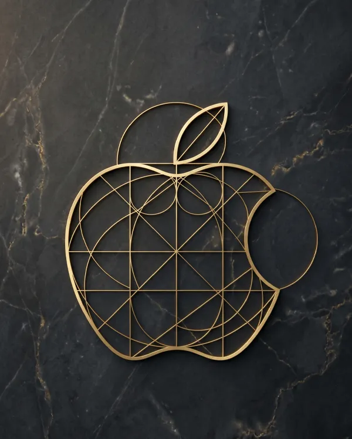

### 使用步骤

打开入口：在微信里搜索小程序“机灵助手”，进入首页后搜索“24K矢量金线”。
准备素材：建议填写图形描述，例如雄鹰、盾牌、抽象三角、字母组合、几何徽章。
提交生成：补充你想要的主体、风格、场景和用途。推荐模型选择 Gemini 3.1 Flash Image Preview (gemini-3.1-flash-image-preview)，画幅可先用 1:1。

### 使用建议

先把 `[图形]` 换成具体符号再生成，不要保留占位描述。
如果你想更克制，保持极简几何、大理石背景和拉丝黄金即可。
这类视觉很适合官网首屏、机构提案和高端服务海报。

详情: https://docs.jiling.cc/templates/24k-gold-vector-lines.html ｜ 在线使用: https://www.jiling.cc/image-templates/24k-gold-vector-lines


---

## 3D卡通错觉效果提示词与教程  <!-- 3d-cartoon-illusion-effect -->

适合把人像照片转换成从螺旋笔记本纸面跃出的半写实 3D 卡通视觉错觉作品，重点保留人物身份并融合石墨素描与立体人物。

分类: 社媒内容 · 趣味滤镜 ｜ 模型: GPT Image 2 (gpt-image-2) ｜ 画幅: 2:3 ｜ 尺寸: 1024x1536 ｜ 评分: 4.7/5 ｜ 13,440 条评价

标签: `趣味滤镜` `3D卡通` `视觉错觉` `社媒内容`

### 提示词

```text
以用户上传的参考照片为唯一人物依据，精准还原人物的面部特征、脸型、五官比例、发型、发色、肤色、神态与整体气质，确保角色具有高度身份一致性和清晰辨识度。不得随意改变人物年龄、性别特征、脸部轮廓或标志性外貌细节。
创作一幅极具创意的3D视觉错觉混合媒介艺术作品：参考图中的人物正从放置在木质书桌上的螺旋装订笔记本页面中迈步而出。笔记本使用真实的横线纸，页面顶部带有自然随性的手写笔记、铅笔痕迹和轻微纸张纹理。
人物采用高质量半写实3D卡通风格，在保留参考图真实身份特征的基础上进行轻微艺术化处理。面部细节自然细腻，眼神生动，表情自信、友善且富有亲和力。头发造型、发际线、眉形、眼睛形状、鼻子、嘴唇和面部轮廓均需与参考照片高度一致，避免生成通用化或陌生面孔。
人物身穿休闲的柔和色调T恤、浅色牛仔夹克、修身浅灰色长裤和干净的白色运动鞋。服装具有真实布料纹理、自然褶皱和细腻缝线，也可根据参考照片中的穿搭进行适度还原。
人物下半身仍是直接绘制在笔记本页面上的精细石墨铅笔素描，双腿与鞋子由交叉排线、轮廓线、擦拭阴影和细腻铅笔纹理构成；从腰部开始，素描逐渐转化为具有真实体积感的立体3D人物。素描线条、石墨阴影与3D皮肤、头发和服装纹理自然无缝融合，形成强烈的“从纸面中走出来”的立体跃出效果。
一只脚仍停留在纸面素描中，另一只脚已经踏出笔记本边缘，强化动作感、空间穿透感和视觉错觉。笔记本页面在人物周围出现轻微弯曲、阴影和纸张受力效果，使人物仿佛真正突破二维纸面进入现实空间。
温暖自然的阳光从侧面照射木质书桌，在人物、笔记本和桌面上形成柔和且方向准确的阴影。真实木纹、细腻纸张纤维、金属螺旋装订细节、浅景深、背景柔和虚化、电影级构图与光影。
超精细，照片级写实，半写实3D人物，混合媒介艺术，真实石墨素描，身份高度一致，精准面部还原，创意视觉错觉，cinematic lighting，shallow depth of field，realistic textures，dynamic perspective，high detail，8K quality，masterpiece composition。
负面提示词：人物身份不一致，陌生脸，五官改变，脸型错误，发型错误，年龄变化，过度卡通化，面部塑料感，表情僵硬，低清晰度，模糊面部，双重五官，眼睛不对称，畸形手指，多余肢体，身体比例错误，双腿错位，素描与3D衔接生硬，悬浮人物，错误阴影，透视错误，纸张变形异常，过度磨皮，过度锐化，文字乱码，水印，标志，低质量。
```

### 效果图

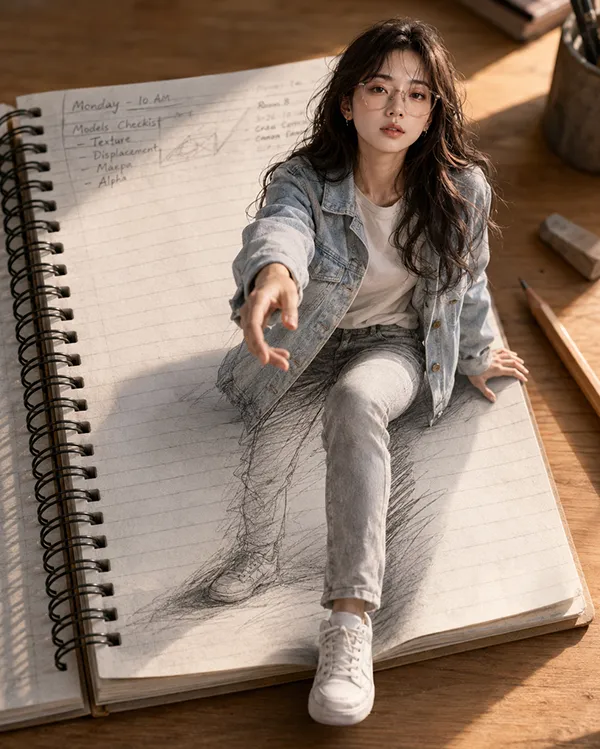

### 使用步骤

打开入口：在微信里搜索小程序“机灵助手”，进入首页后搜索“3D卡通错觉效果”。
准备素材：建议上传五官清晰、发型和肤色可辨的人像照片，最好包含自然表情和上半身信息，方便保持身份一致。
提交生成：补充你想要的主体、风格、场景和用途。推荐模型选择 GPT Image 2 (gpt-image-2)，画幅可先用 2:3。

### 使用建议

适合社媒创意图、视觉错觉人像、3D 卡通改图和混合媒介艺术内容。
想强化立体错觉时，可以补充纸张轻微翘起、脚跨出页面、阴影方向准确等描述。
如果面部相似度不足，建议上传更清晰的人像并强调保留五官比例和标志性外貌细节。

详情: https://docs.jiling.cc/templates/3d-cartoon-illusion-effect.html ｜ 在线使用: https://www.jiling.cc/image-templates/3d-cartoon-illusion-effect


---

## 3D图标提示词与教程  <!-- 3d-icon-set -->

适合生成圆润立体、柔和光影、统一材质的 3D 图标组，面向 APP、网站、PPT、社交媒体、品牌视觉和 PNG 透明素材制作。

分类: 广告创意 · 品牌KV ｜ 模型: GPT Image 2 (gpt-image-2) ｜ 画幅: 1:1 ｜ 尺寸: 1024x1024 ｜ 评分: 4.8/5 ｜ 14,693 条评价

标签: `品牌KV` `3D图标` `UI素材` `广告创意`

### 提示词

```text
生成一组以「{主题}」为主题的3D图标，图标铺满整个页面。每个图标具有圆润立体造型、柔和光影、清晰边缘和统一材质，整体风格可爱、现代、精致。使用协调的配色，画面有空间感但不要杂乱。适合用于APP、网站、PPT、社交媒体和品牌视觉。背景透明；如果无法生成透明背景，则使用纯白色背景或「{背景颜色}」背景。高清3D渲染，干净构图，无文字。
不要文字，不要水印，不要Logo，不要边框，不要人物脸部特写，不要杂乱背景。
图标数量丰富，均匀分布，铺满整个页面，留白较少，但每个图标之间保持清晰间距。
统一视角、统一光源、统一配色、统一粗细、统一风格。
适合生成PNG透明背景素材，高清，边缘干净，可用于后期抠图和排版。
```

### 效果图

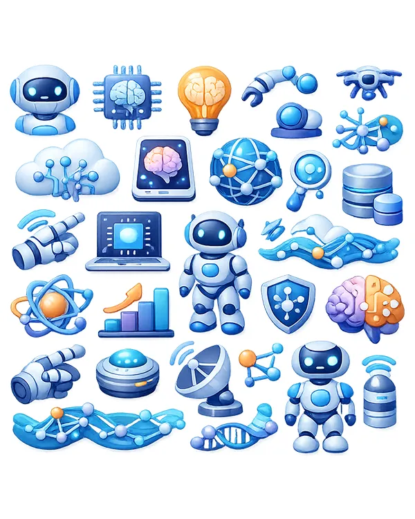

### 使用步骤

打开入口：在微信里搜索小程序“机灵助手”，进入首页后搜索“3D图标”。
准备素材：无需上传参考图也可以生成；如果有品牌色、3D 图标风格参考、应用图标规范或现有视觉体系，可以上传作为参考。
提交生成：补充你想要的主体、风格、场景和用途。推荐模型选择 GPT Image 2 (gpt-image-2)，画幅可先用 1:1。

### 使用建议

适合 APP 图标、网站图标、PPT 视觉、社交媒体素材、品牌视觉和 PNG 透明素材生成。
如果图标数量太多导致识别不清，可以在提示词里限制为 12 到 24 个。
不建议加入文字、Logo 或复杂背景，否则会降低后期抠图和排版可用性。

详情: https://docs.jiling.cc/templates/3d-icon-set.html ｜ 在线使用: https://www.jiling.cc/image-templates/3d-icon-set


---

## 3D卡通贴纸包提示词与教程  <!-- 3d-sticker-pack -->

适合做聊天贴纸包、卡通周边和本人风格化表情套图。

分类: IP形象/手办 · 3D卡通形象 ｜ 模型: Nano Banana Pro (nano-banana-pro) ｜ 画幅: 1:1 ｜ 尺寸: 2K ｜ 评分: 4.8/5 ｜ 15,159 条评价

标签: `3D卡通形象` `表情贴纸` `Pixar风格` `IP形象/手办`

### 提示词

```text
根据上传的人物照片，生成一套以照片本人为原型的 Pixar 风格 3D 卡通贴纸表情包，保留人物五官、发型、脸型和辨识度，做成可爱Q版但仍然明显像本人。整体为高质量3D渲染、白色贴纸描边、光泽材质、柔和阴影、暖米色背景、干净棚拍光、鲜艳色彩、高细节、高分辨率。以整齐网格布局展示12个不同表情贴纸：震惊（捂嘴+OMG）、生气（怒气符号+冒烟）、惊讶（拿手机+张嘴）、大哭流泪、尖叫AAA、点赞Cool、暴怒火焰背景、眨眼爱心、难过雨云、害羞道歉Sorry、疑惑螺旋眼+问号、哇哇大哭WAAH。每个贴纸动作夸张、表情丰富、构图完整、适合聊天软件贴纸包。
```

### 效果图

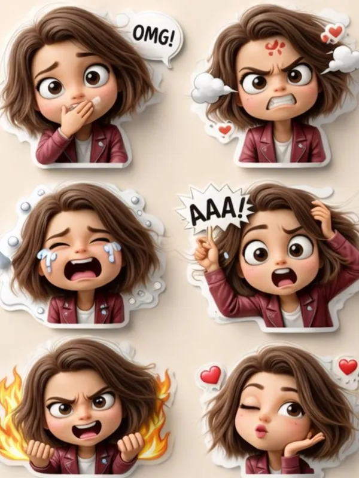

### 使用步骤

打开入口：在微信里搜索小程序“机灵助手”，进入首页后搜索“3D卡通贴纸包”。
准备素材：单人正脸或半身照，五官清晰、发型完整、无遮挡的人像参考图
提交生成：补充你想要的主体、风格、场景和用途。推荐模型选择 Nano Banana Pro (nano-banana-pro)，画幅可先用 1:1。

### 使用建议

适合做聊天贴纸包、卡通周边和本人风格化表情套图。
上传单人照片，快速生成 Pixar 风格的 3D 卡通贴纸表情包。

详情: https://docs.jiling.cc/templates/3d-sticker-pack.html ｜ 在线使用: https://www.jiling.cc/image-templates/3d-sticker-pack


---

## 抽象头像九宫格提示词与教程  <!-- abstract-avatar-nine-grid -->

适合把人像照片转化为 3x3 高度抽象头像合集，重点提取发型、配饰、服装主色等识别符号，并重构为荒诞可爱的卡通生物。

分类: 二次元/漫画 · 角色插画 ｜ 模型: GPT Image 2 (gpt-image-2) ｜ 画幅: 1:1 ｜ 尺寸: 2048x2048 ｜ 评分: 4.7/5 ｜ 11,022 条评价

标签: `角色插画` `抽象头像` `九宫格头像` `二次元/漫画`

### 提示词

```text
根据用户上传的人像照片，创作一张 3×3 九宫格高度抽象头像合集。
不要写实还原人物，不需要准确描绘真实五官。只提取人物最有辨识度的视觉符号，例如发型轮廓、眼镜、帽子、耳饰、服装颜色或标志性配饰，再将人物重新想象成九个荒诞、可爱、怪异的抽象卡通生物。
整体视觉特征：
儿童蜡笔画与油画棒涂鸦质感，粗糙颗粒，明显手绘痕迹，歪斜不规则的黑色轮廓线，大面积高饱和纯色色块。造型极度简化，头部可以变成长方形、椭圆形、三角形或不规则软体形状。
人物拥有夸张的大眼睛、错位的瞳孔、巨大的张嘴表情、细长或扭曲的手臂，表情惊讶、呆滞、紧张、困惑或正在呐喊。整体可爱、幽默、荒诞，不恐怖。
九个格子分别使用九种高度抽象的造型方式：
1. 蓝绿色长方形怪物，大圆眼睛，巨大的黑色嘴巴；
2. 橙红色椭圆软体生物，眼睛左右错位；
3. 紫色三角形角色，细长手臂捂住脸；
4. 黄色椭圆呐喊生物，头部纵向拉长，两只圆点眼睛大小不一，巨大的黑色椭圆嘴巴，细长双手紧贴脸颊；身体和背景共同呈现波浪般扭曲，像被橙红天空与深蓝海浪形成的情绪旋涡拉伸；
5. 红蓝相间的不规则波浪形人物；
6. 几何碎片呐喊头像，由不规则三角形、弧形和破碎色块拼接而成；错位白色眼睛、纵向黑色裂口嘴巴、几何双手贴近脸颊，人物与倾斜桥梁、旋转天空和海浪被相同的弯曲线条贯穿；
7. 黑色粗线条构成的极简涂鸦怪物；
8. 像撕纸拼贴一样错位组合的脸；
9. 像融化颜料一样向下流动的人物。
九格均为同一个人物的抽象变体，通过相同的发型符号、配饰或主色保持角色关联。每格造型明显不同，不能只是更换颜色。
背景参考《呐喊》的情绪氛围：橙色天空、深蓝色海浪、弯曲的桥梁、波浪状地平线，但采用极简儿童画方式重新表达，不复制原画人物。
3×3 整齐排列，九个正方形格子，粗糙手绘，天真、原始、荒诞、强烈、充满情绪，高度抽象，非写实，适合社交媒体头像。
不要文字，不要字幕，不要 Logo，不要水印。
```

### 效果图

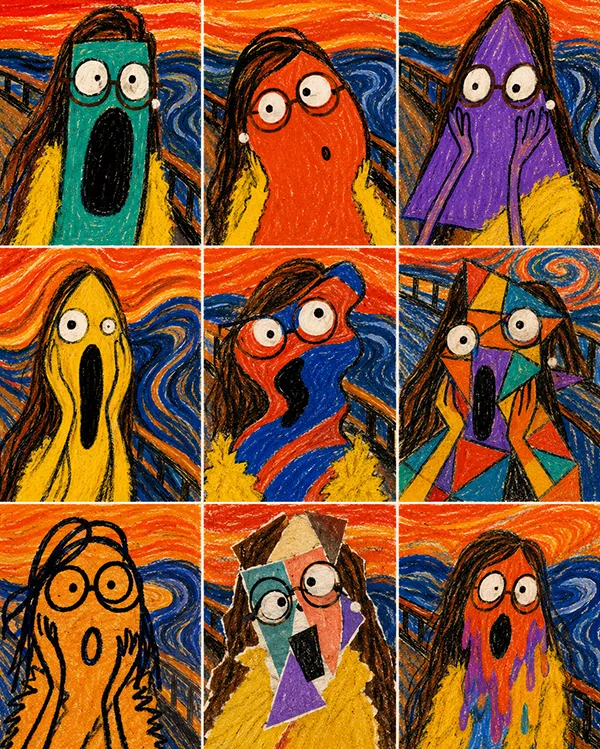

### 使用步骤

打开入口：在微信里搜索小程序“机灵助手”，进入首页后搜索“抽象头像九宫格”。
准备素材：建议上传发型、眼镜、帽子、耳饰、服装颜色或标志性配饰清楚的人像照片，方便提取识别符号。
提交生成：补充你想要的主体、风格、场景和用途。推荐模型选择 GPT Image 2 (gpt-image-2)，画幅可先用 1:1。

### 使用建议

适合社交媒体头像、九宫格头像合集、抽象 IP 形象和荒诞卡通角色实验。
如果想更有情绪冲击，可以强调更强烈的橙色天空、深蓝海浪和弯曲桥梁背景。
如果想更统一，可以补充每格都保留同一发型符号、配饰或主色。

详情: https://docs.jiling.cc/templates/abstract-avatar-nine-grid.html ｜ 在线使用: https://www.jiling.cc/image-templates/abstract-avatar-nine-grid


---

## 吸塑盒装手办提示词与教程  <!-- action-figure-blister-pack -->

适合做“玩具店商品图”风格的透明吸塑 Action Figure 盒装潮玩图。

分类: IP形象/手办 · Action Figure ｜ 模型: Gemini 3.1 Flash Image Preview (gemini-3.1-flash-image-preview) ｜ 画幅: 4:5 ｜ 尺寸: 2K ｜ 评分: 4.8/5 ｜ 15,160 条评价

标签: `Action Figure` `吸塑包装` `玩具货架` `IP形象/手办`

### 提示词

```text
根据上传照片生成透明吸塑包装的Action Figure收藏玩具风格，保留人物辨识度。人物被制作成写实潮玩手办，站立在透明吸塑盒内，包装像商店陈列的正版零售玩具，顶部带挂孔设计，整体为高端玩具货架展示风。包装内设有独立配件区，整齐摆放与人物相关的小道具，如手机、耳机、相机、咖啡杯、电脑、书本等。材质真实，塑料吸塑外壳反光自然，树脂和涂装细节锐利，棚拍灯光专业，整体像爆火的 AI Action Figure 趋势图。
```

### 效果图

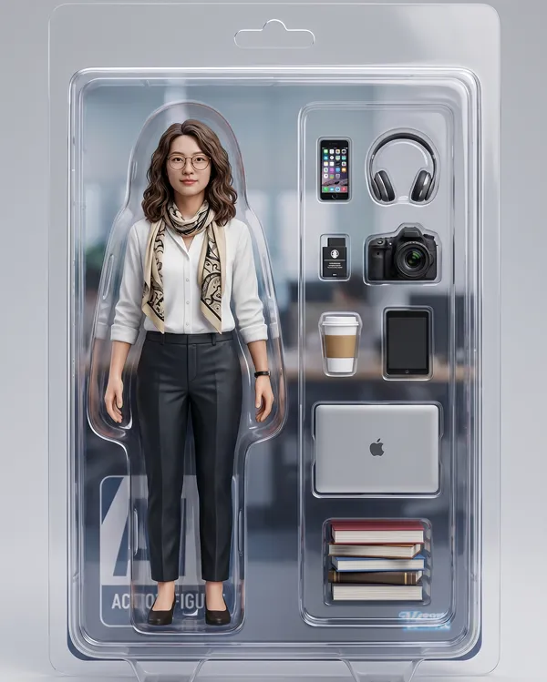

### 使用步骤

打开入口：在微信里搜索小程序“机灵助手”，进入首页后搜索“吸塑盒装手办”。
准备素材：想要更“玩具店商品图”效果
提交生成：补充你想要的主体、风格、场景和用途。推荐模型选择 Gemini 3.1 Flash Image Preview (gemini-3.1-flash-image-preview)，画幅可先用 4:5。

### 使用建议

这个模板的关键不是盒子，而是“人物 + 配件区”的商品化陈列。
如果你已经知道想放哪些配件，直接补进提示词，效果会更稳定。
4:5 比例适合零售玩具商品图，也方便做社媒传播。

详情: https://docs.jiling.cc/templates/action-figure-blister-pack.html ｜ 在线使用: https://www.jiling.cc/image-templates/action-figure-blister-pack


---

## AI换模特主图提示词与教程  <!-- ai-model-swap -->

适合服装品牌批量生成不同模特版本的电商主图。

分类: 电商 · AI换模特 ｜ 模型: Nano Banana Pro (nano-banana-pro) ｜ 画幅: 3:4 ｜ 尺寸: 2K ｜ 评分: 4.8/5 ｜ 18,710 条评价

标签: `AI换模特` `多风格主图` `批量上新` `电商`

### 提示词

```text
生成一张适合电商上新的 AI 换模特主图，保留服装商品的颜色、版型、印花和材质不变，替换成新的模特气质和人群画像。整体像成熟品牌电商主图，人物站姿自然，棚拍级光线，背景简洁，强调服装上身效果和模特呈现的差异化，但不要改变商品本身细节。
```

### 效果图


### 使用步骤

打开入口：在微信里搜索小程序“机灵助手”，进入首页后搜索“AI换模特主图”。
准备素材：原模特图、商品主图、人物风格参考图
提交生成：补充你想要的主体、风格、场景和用途。推荐模型选择 Nano Banana Pro (nano-banana-pro)，画幅可先用 3:4。

### 使用建议

适合服装品牌批量生成不同模特版本的电商主图。
上传商品图或原模特图，快速替换成新的模特和人群版本。

详情: https://docs.jiling.cc/templates/ai-model-swap.html ｜ 在线使用: https://www.jiling.cc/image-templates/ai-model-swap


---

## AI人才评估提示词与教程  <!-- ai-talent-assessment -->

适合生成蓝紫赛博科技风的 AI 人才评估分析报告，围绕人物面部扫描状态展示性格分析、技能评分、职业方向、薪资预测和成长曲线。

分类: 社媒内容 · 信息图 ｜ 模型: GPT Image 2 (gpt-image-2) ｜ 画幅: 2:3 ｜ 尺寸: 1024x1536 ｜ 评分: 4.7/5 ｜ 13,439 条评价

标签: `信息图` `人才评估` `赛博报告` `社媒内容`

### 提示词

```text
人物面部扫描状态，AI人才评估中心，显示性格分析、技能评分、职业方向、薪资预测、成长曲线，蓝紫赛博科技风，真实分析报告。
```

### 效果图

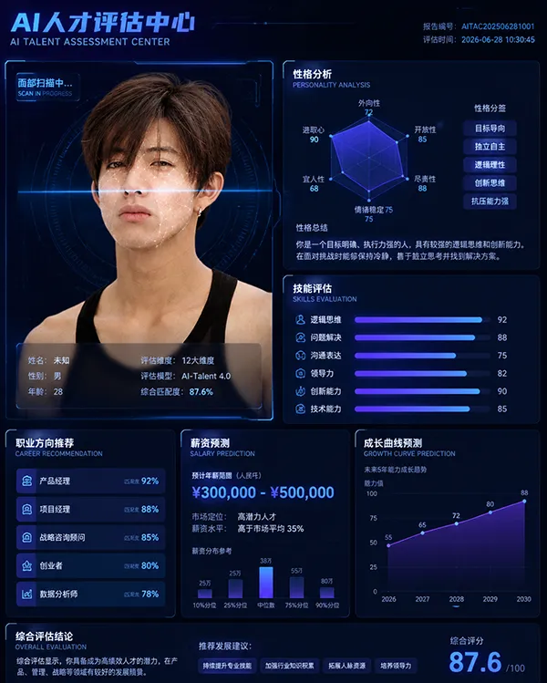

### 使用步骤

打开入口：在微信里搜索小程序“机灵助手”，进入首页后搜索“AI人才评估”。
准备素材：建议上传单人正脸或半身人像照片，脸部清晰、光线稳定时，面部扫描报告效果会更完整。
提交生成：补充你想要的主体、风格、场景和用途。推荐模型选择 GPT Image 2 (gpt-image-2)，画幅可先用 2:3。

### 使用建议

适合社媒趣味报告、个人职业画像、HR 主题内容、科技感封面和互动型分析图。
报告中的文字适合保持短句和大标题，避免一次堆叠过多细小信息。
如果需要更像真实报告，可以强调模块化 UI、数据图表、评分条和清晰中文标签。

详情: https://docs.jiling.cc/templates/ai-talent-assessment.html ｜ 在线使用: https://www.jiling.cc/image-templates/ai-talent-assessment


---

## 亚马逊A+详情页提示词与教程  <!-- amazon-a-plus-detail-page -->

适合基于产品图生成亚马逊 A+ 详情页风格的电商页面视觉，重点展示核心卖点、图文结合、科技感设计、真实材质细节和高级欧美品牌感。

分类: 电商 · 详情页设计 ｜ 模型: GPT Image 2 (gpt-image-2) ｜ 画幅: 3:2 ｜ 尺寸: 1536x1024 ｜ 评分: 4.8/5 ｜ 18,695 条评价

标签: `详情页设计` `亚马逊A+` `欧美品牌` `电商`

### 提示词

```text
设计亚马逊A+详情页。
产品置于高级背景，
展示核心卖点，
图文结合，
布局整洁，
欧美品牌风格，
科技感设计，
商业视觉设计，
真实材质细节，
高转化率页面，
高级品牌感。
```

### 效果图

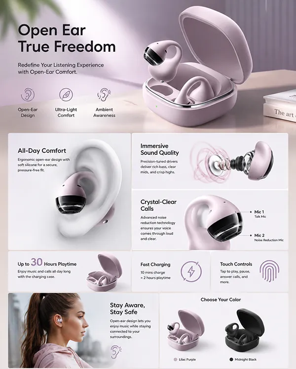

### 使用步骤

打开入口：在微信里搜索小程序“机灵助手”，进入首页后搜索“亚马逊A+详情页”。
准备素材：建议上传主体完整、材质清晰、包装或产品结构可辨的商品图，数码、家居、小家电、户外、工具和科技类商品尤其适合。
提交生成：补充你想要的主体、风格、场景和用途。推荐模型选择 GPT Image 2 (gpt-image-2)，画幅可先用 3:2。

### 使用建议

适合亚马逊 A+ 页面、电商详情页首屏、品牌商品页和跨境电商视觉方案。
这个模板强调页面设计感和卖点表达，不适合直接作为纯白底主图。
如果需要更强转化，可以补充使用场景、对比模块、卖点标题和目标用户痛点。

详情: https://docs.jiling.cc/templates/amazon-a-plus-detail-page.html ｜ 在线使用: https://www.jiling.cc/image-templates/amazon-a-plus-detail-page


---

## 现代动画概念美术提示词与教程  <!-- anime-concept -->

适合角色立绘、插画封面和梦幻动画概念图。

分类: 二次元/漫画 · 游戏立绘 ｜ 模型: Nano Banana Pro (nano-banana-pro) ｜ 画幅: 3:4 ｜ 尺寸: 2K ｜ 评分: 4.7/5 ｜ 11,024 条评价

标签: `游戏立绘` `动画概念` `梦幻插画` `二次元/漫画`

### 提示词

```text
现代动画概念美术风格。融合扎实的角色形体与吉卜力式唯美色调。
柔和且有粗细变化的数字铅笔勾线。
半透明数字水彩叠色，强调通透感，避免硬阴影。
温暖漫射光与明显的边缘轮廓光，营造梦幻感
极浅景深，背景进行大幅度散景虚化，使焦点集中
略夸张的头身比，巨大且富有神采的眼睛，简约的五官线条。
```

### 效果图

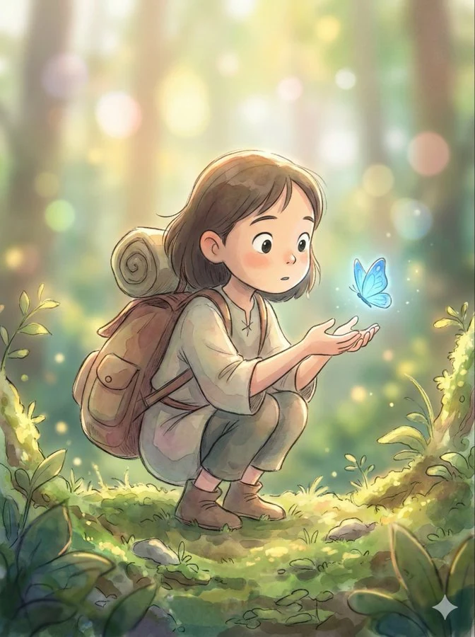

### 使用步骤

打开入口：在微信里搜索小程序“机灵助手”，进入首页后搜索“现代动画概念美术”。
准备素材：角色设定图、人物姿态草图、服装配色参考
提交生成：补充你想要的主体、风格、场景和用途。推荐模型选择 Nano Banana Pro (nano-banana-pro)，画幅可先用 3:4。

### 使用建议

适合角色立绘、插画封面和梦幻动画概念图。
输入人物设定或上传角色参考图，快速起一张现代动画概念图。

详情: https://docs.jiling.cc/templates/anime-concept.html ｜ 在线使用: https://www.jiling.cc/image-templates/anime-concept


---

## 明星影视作品海报提示词与教程  <!-- annual-filmography-collage-poster -->

适合用 1 张风格参考图、1 张主人物图和 6 张电影/剧集图片，做成年度影视作品拼贴海报。

分类: 社媒内容 · 拼贴海报 ｜ 模型: Nano Banana Pro (nano-banana-pro) ｜ 画幅: 3:4 ｜ 尺寸: 2K ｜ 评分: 4.7/5 ｜ 13,437 条评价

标签: `影视合集` `拼贴海报` `年度作品` `社媒内容`

### 提示词

```text
生成一张“明星年度影视作品合集”风格的竖版拼贴海报。
请严格按照参考图顺序理解素材用途：
•第1张图：只作为整体风格、版式、色调、拼贴密度和电影海报氛围参考，不要把这张图中的人物直接当成主角，也不要原样照搬整张图。
•第2张图：主人物主视觉，必须作为海报中心主角，人物最大、最清晰、最突出，身份完全以第2张图为准。必须作为海报中央唯一前景主角，人物显著放大并占据画面核心（建议高度约55%–70%），优先半身到近全身裁切，清晰度最高、视觉最突出，且必须压住周围拼贴作品图层，绝对不能缩小成与其他剧照同等大小。
•第3张到第8张图：6张不同电影/剧集相关图片，作为围绕主角的作品画面，分布在主角四周，形成层次分明的拼贴式年鉴海报。必须严格按照输入顺序一一对应为独立作品画面使用，严禁互换位置、严禁错配片名、严禁把任意两张素材合并，每张图都必须作为单独拼贴区块出现，并固定对应各自指定片名。
画面要求：
• 整体像成熟杂志封面与年度影视作品年鉴海报的结合体，不是九宫格，不是简单平铺贴图。
• 主人物放在中央或偏中央前景，六张作品图围绕排布，前后层次明确，视觉重心稳定。
• 六张作品图可以适度裁切，但每张都要保留最有代表性的主体、氛围或构图，不能混成一张模糊大图。
• 整体统一电影感色调、海报质感和高级拼贴气质，构图紧凑、时尚、精致、适合社交媒体发布。
• 不新增无关人物，不改变第2张图主人物身份，不把第3到第8张素材合并成错误角色。
• 可以保留参考海报里已有的少量原始文字痕迹，但不要额外生成大段新标题、乱码字幕、错误片名或明显Logo水印。
• 输出高清、高细节、人物不变形、海报层次清楚、主体明确。
图片顺序：
•图1：海报氛围参考
•图2：主图（人物主视觉，不加片名，位于中央前景）
•图3：固定放左上区域，对应片名《》
•图4：固定放右上区域，对应片名《》
•图5：固定放左中区域，对应片名《》
•图6：固定放右中区域，对应片名《》
•图7：固定放左下区域，对应片名《》
•图8：固定放右下区域，对应片名《》
强制规则：图3到图8必须严格按上述固定位置使用，素材内容与片名必须完全一致，不能交换位置，不能错标片名，不能翻译，只使用中文，不能把某一张图放到其他编号的位置，也不能让片名出现在错误素材上。每张作品图必须是独立可辨识的小海报区块，片名只对应自己的那一张图。
```

### 效果图

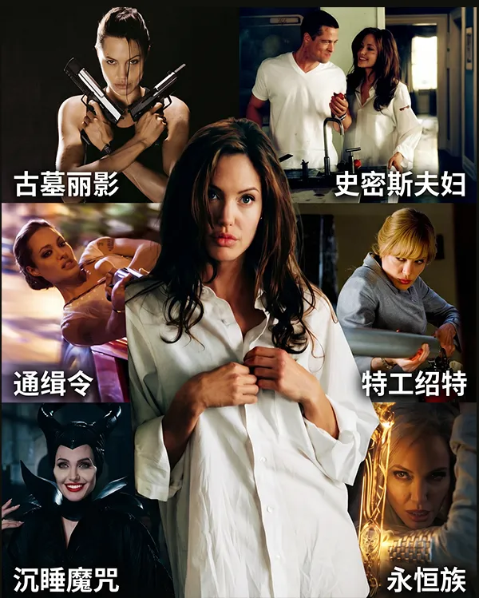

### 使用步骤

打开入口：在微信里搜索小程序“机灵助手”，进入首页后搜索“明星影视作品海报”。
准备素材：第 1 张先放风格参考图，第 2 张放主人物图，第 3 到第 8 张依次上传 6 张电影/剧集图片。
提交生成：补充你想要的主体、风格、场景和用途。推荐模型选择 Nano Banana Pro (nano-banana-pro)，画幅可先用 3:4。

### 使用建议

这个模板最关键的是图片顺序：第 1 张是风格参考，第 2 张是中心主角，第 3 到第 8 张才是六个作品图。
为了避免文字乱码，这版提示词已经去掉“重新生成精确片名”的强要求，重点放在海报结构、人物层级和作品排版上。
如果你想让海报更高级，建议主人物用清晰大片，六张作品图尽量选择色彩和构图差异明显的海报或剧照。

详情: https://docs.jiling.cc/templates/annual-filmography-collage-poster.html ｜ 在线使用: https://www.jiling.cc/image-templates/annual-filmography-collage-poster


---

## 爆款主图6张套图提示词与教程  <!-- bestseller-main-image-six-pack -->

适合基于上传商品图生成电商爆款主图 6 张套图方案，覆盖白底合规主图、场景主图、卖点图、细节图、尺寸对比图和促销封面图。

分类: 电商 · 合规主图 ｜ 模型: GPT Image 2 (gpt-image-2) ｜ 画幅: 2:3 ｜ 尺寸: 1024x1536 ｜ 评分: 4.8/5 ｜ 18,716 条评价

标签: `商品主图` `爆款套图` `电商卖点` `合规主图` `电商`

### 提示词

```text
基于上传商品图，生成一组电商爆款主图套图视觉方案，包含6张不同用途的商品图：
1 白底合规主图：商品居中、主体完整、背景纯净；
2 场景主图：把商品放入真实使用场景，突出使用感；
3 核心卖点图：用3个简短标签展示核心卖点；
4 细节特写图：展示材质、工艺、接口、纹理或包装细节；
5 尺寸对比图：加入手持、桌面或参照物体现大小；
6 促销封面图：加入优惠标签、限时活动和购买引导。
严格保留商品外观、颜色、logo、包装文字和结构，不重新设计产品。整体风格统一，适合淘宝、抖音、小红书、小店商品页。
```

### 效果图

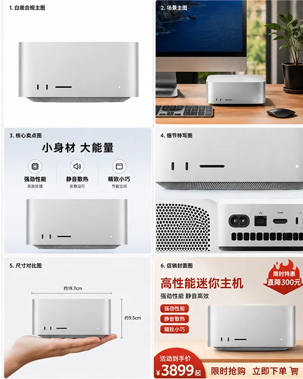

### 使用步骤

打开入口：在微信里搜索小程序“机灵助手”，进入首页后搜索“爆款主图6张套图”。
准备素材：建议上传商品主体清晰、包装文字和 logo 可见、边缘完整的产品图，越接近正面或标准拍摄角度越利于保留结构。
提交生成：补充你想要的主体、风格、场景和用途。推荐模型选择 GPT Image 2 (gpt-image-2)，画幅可先用 2:3。

### 使用建议

适合电商上新、商品页首图、主图套图规划、卖点图和活动封面。
如果产品文字很重要，建议上传高清正面图，并把必须保留的文字单独列出。
想让套图更统一时，可以补充品牌主色、背景风格和促销标签样式。

详情: https://docs.jiling.cc/templates/bestseller-main-image-six-pack.html ｜ 在线使用: https://www.jiling.cc/image-templates/bestseller-main-image-six-pack


---

## 宝莱坞沙丽复古风提示词与教程  <!-- bollywood-sari-retro -->

适合正脸自拍、精致妆容照和民族风穿搭照的宝莱坞复古海报人像。

分类: AI变装 · 复古胶片 ｜ 模型: Gemini 3.1 Flash Image Preview (gemini-3.1-flash-image-preview) ｜ 画幅: 2:3 ｜ 尺寸: 2K ｜ 评分: 4.7/5 ｜ 16,575 条评价

标签: `宝莱坞` `沙丽写真` `电影海报` `复古胶片` `AI变装`

### 提示词

```text
根据上传照片生成 90 年代宝莱坞复古时尚海报风格，保留人物真实五官和辨识度。人物穿华丽亮片沙丽、金属刺绣纱丽或珠片披肩，浓郁眼妆与复古红唇，头发为蓬松大卷发。背景为舞台灯光、彩色光晕、星芒聚光灯、复古摄影棚布景。整体采用老式胶片电影海报质感，色彩轻微褪色但华丽饱满，带胶片颗粒、轻微模糊、边缘漏光、复古印刷感、轻微泛黄，像 90 年代印度电影宣传海报，热烈、梦幻、戏剧化、极具视觉冲击力。
```

### 效果图

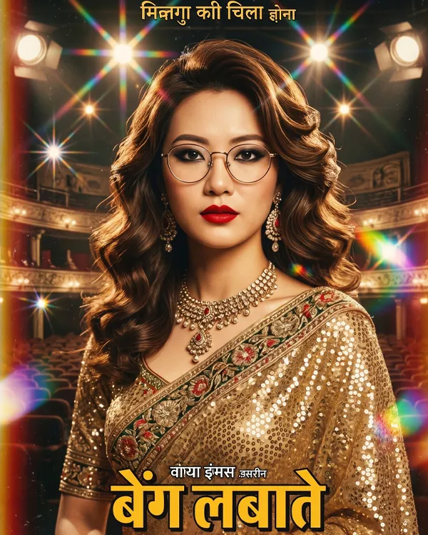

### 使用步骤

打开入口：在微信里搜索小程序“机灵助手”，进入首页后搜索“宝莱坞沙丽复古风”。
准备素材：正脸自拍、精致妆容照、民族风穿搭照
提交生成：补充你想要的主体、风格、场景和用途。推荐模型选择 Gemini 3.1 Flash Image Preview (gemini-3.1-flash-image-preview)，画幅可先用 2:3。

### 使用建议

这个模板非常依赖浓妆和大体量发型的气场，建议用脸部清晰的原图。
如果你想更像宣传海报，可以补“印刷感、套印偏移、复古纸张纹理”。
适合做民族风大片、舞台造型和高饱和复古风格化写真。

详情: https://docs.jiling.cc/templates/bollywood-sari-retro.html ｜ 在线使用: https://www.jiling.cc/image-templates/bollywood-sari-retro


---

## 品牌联名主视觉提示词与教程  <!-- brand-collab -->

适合品牌联名、IP 合作和大型广告主视觉。

分类: 广告创意 · 品牌联名海报 ｜ 模型: Nano Banana Pro (nano-banana-pro) ｜ 画幅: 16:9 ｜ 尺寸: 2K ｜ 评分: 4.8/5 ｜ 14,709 条评价

标签: `品牌联名海报` `Campaign主视觉` `二次元广告` `广告创意`

### 提示词

```text
画幅比例16:9，官方游戏联动海报，杰作，充满活力的《绝区零》动漫风格。 场景: 四位时尚的动漫角色（一位黑夹克粉发女孩是视觉中心，一位银发女孩，一位白发男孩，一位黑发男孩）在未来城市夜晚上摆姿势，每人都拿着一杯可乐。 环境: 这是一个未来城市的夜间街道，整个场景 被巨大、发光的霓虹灯招牌所主导。 一个以风格化的“ZZZ”标志为特色的、巨大且不容错过的霓虹灯招牌，是背景的绝对视觉焦点，在主角们身后闪耀着明亮的光芒。 其他写着“可口可乐”的霓虹灯也同样醒目，将整个场景沐浴在鲜艳的紫色和蓝色光线中。 特殊效果: 草莓和柠檬等水果被包裹在透明气泡中漂浮，发光的粉色和蓝色能量漩涡贯穿画面。 文字元素: 左上角: 显示“绝区零”和“可乐”的Logo，由“X”连接。 底部中央: 一大块醒目的中文文字“绝区零 X 可乐：异能觉醒，双倍快乐！”。字体为粗体、风格化的艺术字，白色填充，带有厚重的紫粉渐变描边。 中文下方: 黑色矩形框内有白色大写英文“LIMITED COLLAB”。 艺术风格: 高度细节，线条干净，来自巨型霓虹灯的电影级光效，动态构图。 负面提示词: 模糊, 低质量, 人体结构崩坏, 手部畸形, 丑陋, 水印, 签名, 乱码文字, 字母变形
```

### 效果图

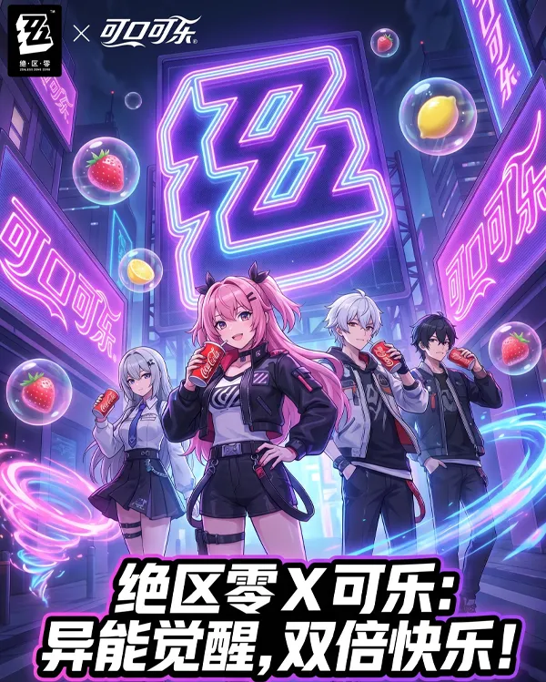

### 使用步骤

打开入口：在微信里搜索小程序“机灵助手”，进入首页后搜索“品牌联名主视觉”。
准备素材：品牌 logo、角色参考图、主色板
提交生成：补充你想要的主体、风格、场景和用途。推荐模型选择 Nano Banana Pro (nano-banana-pro)，画幅可先用 16:9。

### 使用建议

这个模板本身带强烈霓虹和联名广告感，适合活动主视觉和大型宣传图。
如果你想改成更克制的品牌 KV，建议降低霓虹招牌和水果气泡描述。
文字描述已经写得比较满，生成后如果文字不稳定，可以删掉部分文案，只保留 logo 和标题。

详情: https://docs.jiling.cc/templates/brand-collab.html ｜ 在线使用: https://www.jiling.cc/image-templates/brand-collab


---

## 破屏穿越风格提示词与教程  <!-- breaking-screen-social-style -->

适合把人像做成从手机社交媒体界面中破屏而出的高冲击视觉，重点是强透视、原创社媒 UI 和电影级空间分离感。

分类: AI变装 · 杂志/海报 ｜ 模型: GPT Image 2 (gpt-image-2) ｜ 画幅: 2:3 ｜ 尺寸: 1024x1536 ｜ 评分: 4.7/5 ｜ 16,576 条评价

标签: `杂志/海报` `破屏穿越` `社媒视觉` `AI变装`

### 提示词

```text
1.主要概念与姿势（最高优先）
将我放置在一个显示社交媒体帖文的智能手机画面中，并重新调整我的身体姿势，使我看起来像是正从屏幕中突破、进入现实世界。
其中一只脚必须强烈地朝向观者延伸，采用戏剧化的 3D 透视效果，创造出强烈的深度感与沉浸感。
整体姿势需要具有动态感、自然且符合人体结构，就像是在从屏幕中跨步而出的瞬间。
2.社交媒体 App 风格界面（不可直接复制真实品牌）
创建一个受现代照片分享平台启发的真实感手机社交媒体界面。
使用干净、熟悉的版面布局，包含：
顶部标题区域（top header area）
头像与账号名称区域（profile photo and account name area）
帖文图片区域（post image area）
社交互动图标（点赞、评论、分享、收藏）
底部导航栏图标（bottom navigation icons）
用户名需清晰显示为【Jiling】，
并出现在：
顶部标题区域
可见的账号名称区域
不可使用官方 Logo，也不可完全复制真实品牌 UI。
界面必须保持原创，但要高度拟真，并让人一眼辨识为社交媒体 App。
3.破屏效果与视觉冲击
在屏幕破裂的位置加入：
真实感玻璃碎裂效果
漂浮的数字像素碎片
向外爆散的残骸粒子
破裂效果需要与人物和手机自然融合，并具备可信的动态与空间深度。
4.电影级写实与渲染质量
使用：
超写实电影级灯光
自然皮肤质感
高细节材质
浅景深（shallow depth of field）
确保：
真实阴影
精准反射
高级景深层
前景、人物、手机与背景之间具有明确分离感
5.构图
限制要求：
不可裁切（No cropping）
不可有界面元素被截断
不可丢失重要视觉信息
画面必须完整清晰且构图平衡
使用原创、非品牌化的界面设计。
不可精确复制任何具有版权的App UI。
```

### 效果图

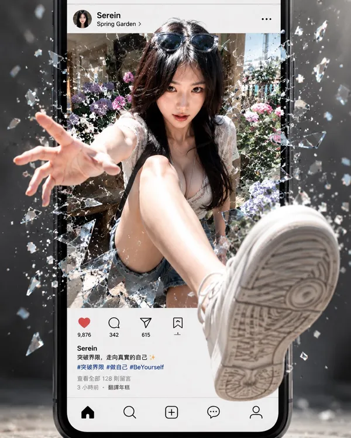

### 使用步骤

打开入口：在微信里搜索小程序“机灵助手”，进入首页后搜索“破屏穿越风格”。
准备素材：建议上传主体清晰、动作轮廓完整的人像，最好能看清腿部、鞋子和身体姿态，破屏跨步的空间感会更稳定。
提交生成：补充你想要的主体、风格、场景和用途。推荐模型选择 GPT Image 2 (gpt-image-2)，画幅可先用 2:3。

### 使用建议

适合做社媒封面、传播海报、人物主视觉和带强互动感的视觉内容。
如果你想更像时尚广告或创作者封面，可以补充穿搭、镜头气质和人物神态。
想让画面更完整时，优先使用构图完整、四肢信息明确的人像原图。

详情: https://docs.jiling.cc/templates/breaking-screen-social-style.html ｜ 在线使用: https://www.jiling.cc/image-templates/breaking-screen-social-style


---

## 商务档案头像提示词与教程  <!-- business-profile-headshot -->

适合把人像照片做成正式、干净、可信赖的商务档案头像海报，重点是职业形象统一和信息栏排版完整。

分类: AI变装 · 杂志/海报 ｜ 模型: GPT Image 2 (gpt-image-2) ｜ 画幅: 2:3 ｜ 尺寸: 1024x1536 ｜ 评分: 4.7/5 ｜ 16,582 条评价

标签: `商务头像` `档案照` `职业形象` `杂志/海报` `AI变装`

### 提示词

```text
请基于我上传的人像照片生成一张正式商务档案头像海报。保留人物真实身份特征、五官比例、脸型基础和整体气质，不要改变人物身份。
可以适度优化面部轮廓，使脸部线条更清晰、自然、上镜；平滑皮肤质感，减少瑕疵、暗沉和肤色不均，但不要过度磨皮，保留真实皮肤细节和自然光影。
请根据人物脸型设计一款匹配的商务发型。发型应干净利落、成熟专业、适合正式场合，发丝自然、有层次，不夸张。请为人物搭配正式商务穿搭，例如深色西装外套、白色或浅色衬衫，可搭配领带。整体造型应高级、简洁、专业、可信赖。
画面为正面半身肖像，人物居中，直视镜头，表情自然自信。背景为纯白色素色背景，光线柔和均匀，类似专业证件照、企业头像摄影或大学官网个人档案照。整体风格干净、正式、商务、高清写实摄影质感。
画面下方预留简洁信息栏，并添加现代简洁排版文字：
姓名：[小泉柚奈]
身份/职位：[高级平面设计]
专业/部门/机构：[国际设计院]
重要文字规则：
如果用户输入的姓名、身份、职位、专业、部门、机构或其他需要显示在图片上的文字是中文或其他语言，请先将这些内容翻译成自然、准确、正式的英文，再放入图片中。除非用户明确要求保留中文，否则图片中不要显示中文文字。
排版要求：
第一行姓名使用深蓝色粗体大字号英文文字；第二行和第三行使用黑色常规字号英文文字。整体排版参考大学官网个人档案、学术会议人物介绍卡片或专业商务头像海报风格。
```

### 效果图

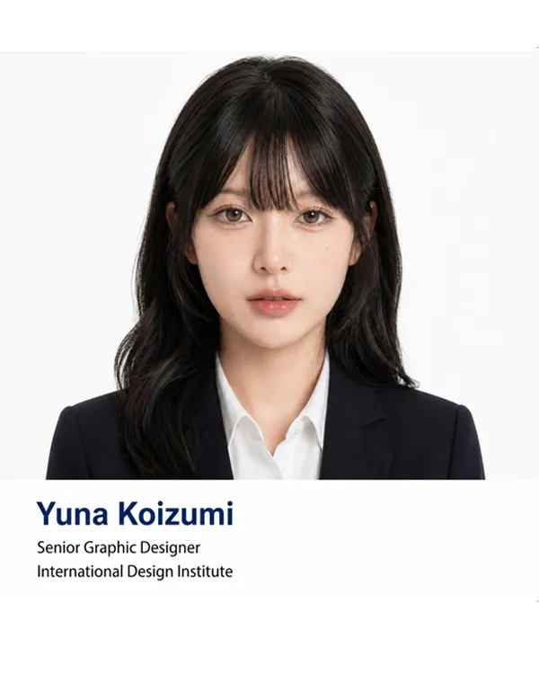

### 使用步骤

打开入口：在微信里搜索小程序“机灵助手”，进入首页后搜索“商务档案头像”。
准备素材：建议上传正面半身或胸像清晰、五官完整、光线自然的人像照片，商务头像会更稳定。
提交生成：补充你想要的主体、风格、场景和用途。推荐模型选择 GPT Image 2 (gpt-image-2)，画幅可先用 2:3。

### 使用建议

适合企业头像、个人档案照、讲师资料卡和大学官网风格的人物展示。
如果你希望更像真实职业形象，可以补充行业气质、服装偏好和职位信息。
做团队系列内容时，建议统一姓名栏样式、服装色调和表情状态。

详情: https://docs.jiling.cc/templates/business-profile-headshot.html ｜ 在线使用: https://www.jiling.cc/image-templates/business-profile-headshot


---

## 3D/C4D多巴胺提示词与教程  <!-- c4d-dopamine-product-shot -->

适合把产品做成马卡龙多巴胺配色的 C4D 几何展示台视觉，适用于活动海报和社媒广告。

分类: 电商 · 3D场景 ｜ 模型: Nano Banana Pro (nano-banana-pro) ｜ 画幅: 1:1 ｜ 尺寸: 2K ｜ 评分: 4.8/5 ｜ 18,718 条评价

标签: `C4D` `多巴胺` `马卡龙配色` `3D场景` `电商`

### 提示词

```text
使用我上传的产品图片作为唯一参考图，严格保留产品的外观、比例、颜色、包装、logo与标签细节，禁止重新设计产品。
将产品置于C4D风格的极简几何展示台中央，3D超真实商业渲染风格，背景为马卡龙多巴胺配色（粉蓝、奶油粉、薄荷绿、淡紫），搭配圆柱与方块几何体、磨砂玻璃和亚克力材质背景，柔和均匀影棚灯光，轻微彩色阴影，整体呈现未来感糖果实验室氛围，画面高级、干净、年轻化，适合电商活动海报与社媒广告，8K。
⚠️ 注意：这种模板本质是“参考图 + 场景风格化”，非常适合包装类产品，但如果产品本身细节特别复杂，建议仍然优先用于辅助图而不是首图。
```

### 效果图

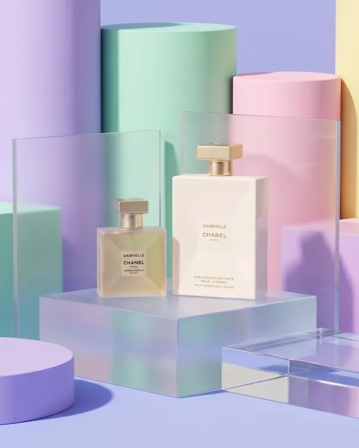

### 使用步骤

打开入口：在微信里搜索小程序“机灵助手”，进入首页后搜索“3D/C4D多巴胺”。
准备素材：上传 1 张包装清晰、结构规整的产品图即可，包装类产品尤其适合。
提交生成：补充你想要的主体、风格、场景和用途。推荐模型选择 Nano Banana Pro (nano-banana-pro)，画幅可先用 1:1。

### 使用建议

这个模板本质是“场景风格化”，适合活动图和社媒图，不是最稳的合规首图。
如果你想更像年轻化促销物料，可以补“糖果感、未来感、实验室展示台”。
1:1 比例适合活动卡片和社媒封面。

详情: https://docs.jiling.cc/templates/c4d-dopamine-product-shot.html ｜ 在线使用: https://www.jiling.cc/image-templates/c4d-dopamine-product-shot


---

## 书法临摹贴提示词与教程  <!-- calligraphy-copybook -->

适合生成书法临摹字帖、练字素材、教学内页和传统文化类设计素材。

分类: 广告创意 · 字帖模板 ｜ 模型: GPT Image 2 (gpt-image-2) ｜ 画幅: 2:3 ｜ 尺寸: 1024x1536 ｜ 评分: 4.8/5 ｜ 14,700 条评价

标签: `书法字帖` `临摹练习` `字体设计` `字帖模板` `广告创意`

### 提示词

```text
生成一张【字体】书法临摹字帖
```

### 效果图

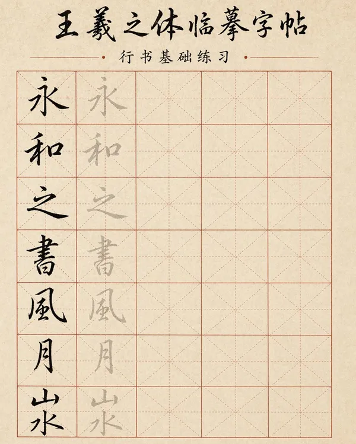

### 使用步骤

打开入口：在微信里搜索小程序“机灵助手”，进入首页后搜索“书法临摹贴”。
准备素材：无需上传参考图也可以直接生成；如需固定某种书法风格，可上传对应字帖或字体参考图。
提交生成：补充你想要的主体、风格、场景和用途。推荐模型选择 GPT Image 2 (gpt-image-2)，画幅可先用 2:3。

### 使用建议

默认尺寸为 1024x1536
可以把【字体】替换为行书、隶书、篆书、瘦金体、颜体或欧体。
如果想更适合儿童练字，可以补充“更大的田字格、浅色描红、每行 4 个字、页面更简洁”。

详情: https://docs.jiling.cc/templates/calligraphy-copybook.html ｜ 在线使用: https://www.jiling.cc/image-templates/calligraphy-copybook


---

## 职业专属配件手办提示词与教程  <!-- career-accessory-blindbox-figure -->

适合做个人 IP、工作室和博主账号包装的职业专属配件盲盒手办图。

分类: IP形象/手办 · 职业IP ｜ 模型: Nano Banana Pro (nano-banana-pro) ｜ 画幅: 4:5 ｜ 尺寸: 2K ｜ 评分: 4.8/5 ｜ 15,144 条评价

标签: `职业配件` `个人IP` `身份道具` `职业IP` `IP形象/手办`

### 提示词

```text
根据上传照片生成职业专属配件盲盒收藏手办，保留人物真实五官和辨识度。将人物转化为高质量 3D 公仔，放置在带透明窗口的高级盲盒包装中，包装内设置独立配件展示区，整齐摆放与人物职业或身份相关的小道具，例如摄影师（相机、镜头、电脑）、设计师（手绘板、笔记本、平板）、博主（手机、补光灯、咖啡杯）、学生（书本、耳机、背包）等。材质真实，塑料与树脂质感高级，包装像官方正版收藏玩具，灯光为产品摄影棚拍，整体极具个人IP感和社交传播感。
```

### 效果图

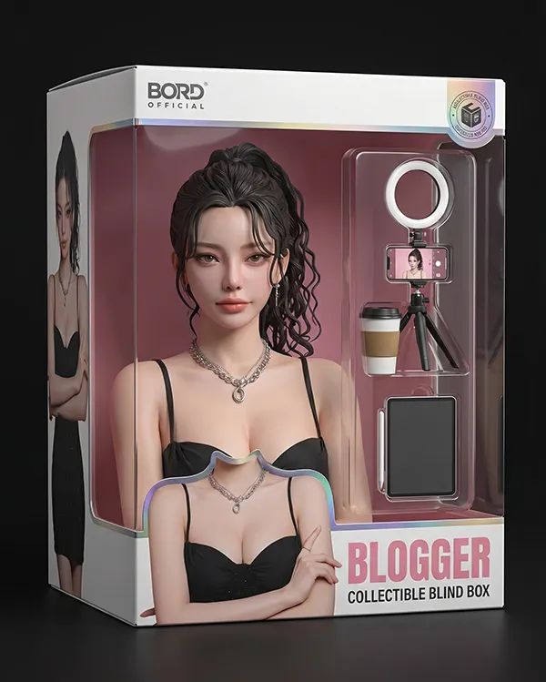

### 使用步骤

打开入口：在微信里搜索小程序“机灵助手”，进入首页后搜索“职业专属配件手办”。
准备素材：个人IP打造、工作室、博主账号、特别容易火
提交生成：补充你想要的主体、风格、场景和用途。推荐模型选择 Nano Banana Pro (nano-banana-pro)，画幅可先用 4:5。

### 使用建议

这类模板最容易出传播感，因为“人物 + 职业配件”很容易形成记忆点。
如果你想更像商店零售玩具，可以补挂孔、条码位和盒面标题区。
4:5 比例适合展示人物和配件区的完整布局。

详情: https://docs.jiling.cc/templates/career-accessory-blindbox-figure.html ｜ 在线使用: https://www.jiling.cc/image-templates/career-accessory-blindbox-figure


---

## 卡通蜡笔风格提示词与教程  <!-- cartoon-crayon-style -->

适合把人像、宠物、物体或日常照片重绘成保留构图和识别元素的童趣卡通蜡笔插画。

分类: 二次元/漫画 · 角色插画 ｜ 模型: GPT Image 2 (gpt-image-2) ｜ 画幅: 2:3 ｜ 尺寸: 1024x1536 ｜ 评分: 4.7/5 ｜ 10,996 条评价

标签: `角色插画` `蜡笔风格` `童趣卡通` `二次元/漫画`

### 提示词

```text
通过适度夸张比例来增强天真烂漫、充满童趣的感觉，同时保持所有元素易于辨认，并呈现柔和、友好、快乐的表情。保留原图的核心构图和可识别元素，但将所有内容重新诠释为简化的卡通蜡笔风格。
```

### 效果图

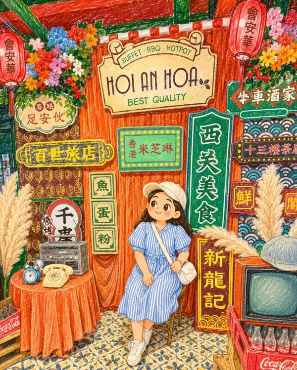

### 使用步骤

打开入口：在微信里搜索小程序“机灵助手”，进入首页后搜索“卡通蜡笔风格”。
准备素材：上传 1 张主体清晰、构图完整的原图，人物、宠物或物体都可以。
提交生成：补充你想要的主体、风格、场景和用途。推荐模型选择 GPT Image 2 (gpt-image-2)，画幅可先用 2:3。

### 使用建议

适合照片改图、角色头像、亲子内容、绘本感封面和轻松可爱的社媒配图。
如果希望主体更像原图，请上传清晰正面或半身参考，并补充需要保留的细节。
想更童趣时，可以补充圆润比例、明亮表情、柔软蜡笔纹理和绘本感背景。

详情: https://docs.jiling.cc/templates/cartoon-crayon-style.html ｜ 在线使用: https://www.jiling.cc/image-templates/cartoon-crayon-style


---

## CCD校园风提示词与教程  <!-- ccd-campus-photo -->

适合校园照、日常抓拍和清新自拍的 CCD 青春旧照片风。

分类: AI变装 · 千禧Y2K ｜ 模型: Gemini 3.1 Flash Image Preview (gemini-3.1-flash-image-preview) ｜ 画幅: 3:4 ｜ 尺寸: 2K ｜ 评分: 4.7/5 ｜ 16,560 条评价

标签: `CCD旧照` `校园风` `青春抓拍` `千禧Y2K` `AI变装`

### 提示词

```text
根据上传照片生成 90 年代末到 2000 年代初的 CCD 校园旧照片风格，保留人物真实辨识度。人物穿白衬衫、针织背心、牛仔外套、运动外套或校服感穿搭，场景为操场、教学楼、楼梯口、天台或走廊。使用老 CCD 数码相机直闪效果，画面略带噪点、轻微模糊、色彩偏冷或偏黄、曝光略高、边缘轻微发虚、构图像朋友随手拍，带青春感、旧相册感、真实生活流胶片氛围。
```

### 效果图

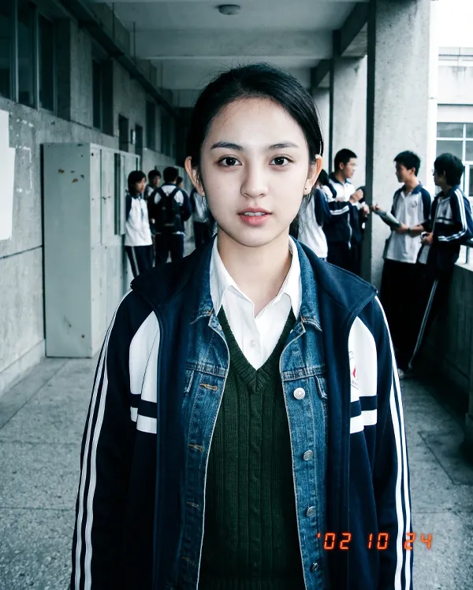

### 使用步骤

打开入口：在微信里搜索小程序“机灵助手”，进入首页后搜索“CCD校园风”。
准备素材：校园照、日常抓拍、清新自拍
提交生成：补充你想要的主体、风格、场景和用途。推荐模型选择 Gemini 3.1 Flash Image Preview (gemini-3.1-flash-image-preview)，画幅可先用 3:4。

### 使用建议

这个模板适合生活流抓拍，不需要太正式的摄影动作。
如果你想更青春，可以补“校服感、书包、运动外套、午后天台”。
过度精修或高级影棚原图，反而会削弱 CCD 旧照片的真实感。

详情: https://docs.jiling.cc/templates/ccd-campus-photo.html ｜ 在线使用: https://www.jiling.cc/image-templates/ccd-campus-photo


---

## 角色360度全景提示词与教程  <!-- character-360-panorama -->

适合做角色设定、多视角人像参考、人物转面展示和统一外观的摄影棚参考图。

分类: 人物写真 · 多视角 ｜ 模型: Nano Banana Pro (nano-banana-pro) ｜ 画幅: 3:2 ｜ 尺寸: 2K ｜ 评分: 4.8/5 ｜ 12,226 条评价

标签: `多视角` `人物转面` `摄影棚人像` `人物写真`

### 提示词

```text
基于上传的人物参考图，生成一张 [人物] 的摄影棚人像照，背景为 [背景]，人物为 [正面直视镜头 / 右侧侧脸 / 左侧侧脸 / 左前 45° / 右前 45° / 背面] 视角，光线均匀，主体清晰，细节真实，保持人物外观一致。
```

### 效果图

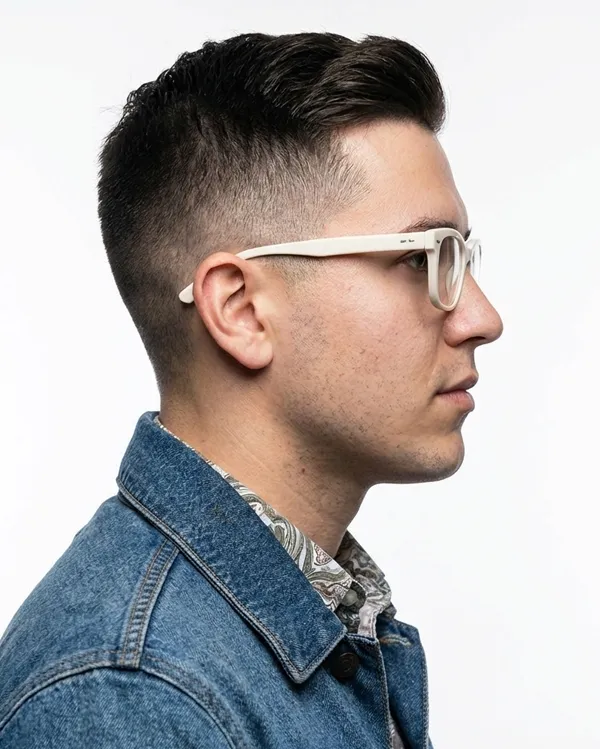

### 使用步骤

打开入口：在微信里搜索小程序“机灵助手”，进入首页后搜索“角色360度全景”。
准备素材：单人清晰参考图，五官、发型、服装轮廓和身形比例尽量完整可见
提交生成：补充你想要的主体、风格、场景和用途。推荐模型选择 Nano Banana Pro (nano-banana-pro)，画幅可先用 3:2。

### 使用建议

适合做角色设定、多视角人像参考、人物转面展示和统一外观的摄影棚参考图。
上传人物参考图，快速生成同一人物在多种视角下保持一致的摄影棚人像参考图。

详情: https://docs.jiling.cc/templates/character-360-panorama.html ｜ 在线使用: https://www.jiling.cc/image-templates/character-360-panorama


---

## 角色设定图提示词与教程  <!-- character-design-sheet -->

适合把人物、宠物或原创主体做成带表情、姿势、配色和角色资料区的可爱角色设定图。

分类: IP形象/手办 · 3D卡通形象 ｜ 模型: GPT Image 2 (gpt-image-2) ｜ 画幅: 2:3 ｜ 尺寸: 1024x1536 ｜ 评分: 4.8/5 ｜ 15,145 条评价

标签: `3D卡通形象` `角色设定图` `社媒传播` `IP形象/手办`

### 提示词

```text
根据上传的图片创建一张可爱的角色设计图表。
风格：温暖、柔和的半写实卡通插画，带有舒适的日式 / kawaii 可爱风。
设计：角色资料海报，包括：
* 大幅主肖像
* 多种面部表情：开心、生气、困倦、惊讶
* 动作姿势：奔跑、玩耍等（根据角色性格设计）
* 小物件图标
* 色彩搭配板块
* 角色资料板块：包含名字和性格特点
```

### 效果图

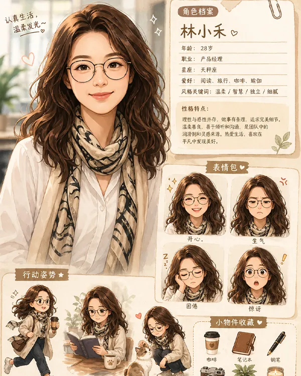

### 使用步骤

打开入口：在微信里搜索小程序“机灵助手”，进入首页后搜索“角色设定图”。
准备素材：建议上传主体清晰、特征明显的单人照片，更容易稳定保留角色气质和细节。
提交生成：补充你想要的主体、风格、场景和用途。推荐模型选择 GPT Image 2 (gpt-image-2)，画幅可先用 2:3。

### 使用建议

适合个人 IP、原创角色、宠物拟人和人设展示类内容。
如果你已经有角色名字和性格设定，建议一并写上，资料板块会更完整。
想让画面更有记忆点时，可以补充代表角色身份的小物件或配色偏好。

详情: https://docs.jiling.cc/templates/character-design-sheet.html ｜ 在线使用: https://www.jiling.cc/image-templates/character-design-sheet


---

## Q版克隆贴纸照片提示词与教程  <!-- chibi-clone-sticker-photo -->

适合把真人照片做成带多个 Q 版迷你克隆、手绘涂鸦和英文短句点缀的高质感社媒日记贴纸照片。

分类: AI变装 · 生活记录 ｜ 模型: GPT Image 2 (gpt-image-2) ｜ 画幅: 2:3 ｜ 尺寸: 1024x1536 ｜ 评分: 4.7/5 ｜ 16,570 条评价

标签: `生活记录` `Q版贴纸` `社媒日记` `AI变装`

### 提示词

```text
根据上传的照片，生成一张高质量的“Q版克隆贴纸日记照片”
【主体定位】模特拍摄场景，以真人模特为中心主体，呈现高分辨率社交媒体生活日记风格，画面需精致俏皮、布局均衡、视觉丰富不杂乱。
【Q版克隆设计】在主体周围添加5—8个Q版迷你克隆体，采用"大头小身+大而富有表现力的眼睛+干净利落数字画风"的可爱贴纸风格。每个克隆体必须与真人保持高度相似性——发型、服装、颜色完全一致，但需设计不同的模特拍摄相关动作和表情（如叉腰、戴帽子、跳起、背身、躺姿等），确保所有姿势各不相同且符合拍摄场景情境。
【视觉效果】每个Q版角色需渲染为带有白色轮廓、柔和阴影及轻微悬浮效果的贴纸样式，排列在主体周围及画面边缘，避免遮挡面部或躯干关键部位。
【涂鸦元素】添加轻盈手绘涂鸦（爱心、闪光、箭头、动态线条、圆圈），采用白色底色+淡粉色点缀，保持简洁剪贴簿日记风格，与整体画面融合自然。
【文字设计】加入5—8句符合拍摄氛围（可爱/活力/鼓舞人心）的简短手写风格英文短语，文字以白色为主，带微粉色高亮及小型装饰符号（如星星、波浪线），位置需与涂鸦元素协调，不遮挡主体。
【构图要求】真人主体居中，Q版贴纸与涂鸦元素呈放射状点缀周围，形成"主体突出、元素环绕"的均衡布局，整体呈现精致俏皮的高分辨率社交媒体生活日记风格，视觉丰富但无杂乱感。
```

### 效果图

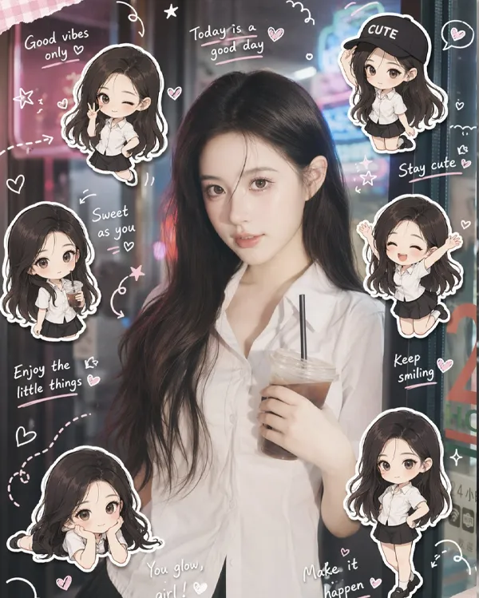

### 使用步骤

打开入口：在微信里搜索小程序“机灵助手”，进入首页后搜索“Q版克隆贴纸照片”。
准备素材：建议上传单人主体清晰、发型和服装完整的人像，方便 Q版克隆体稳定保留同款造型和色彩关系。
提交生成：补充你想要的主体、风格、场景和用途。推荐模型选择 GPT Image 2 (gpt-image-2)，画幅可先用 2:3。

### 使用建议

适合可爱风写真、日常社媒配图、人物贴纸改造和带记录感的视觉内容。
如果你想让人物更像时尚模特日记，可以补充穿搭、拍摄情绪和姿态方向。
想让成图更耐看时，建议优先选择主体清楚、背景不过分复杂的人像照片。

详情: https://docs.jiling.cc/templates/chibi-clone-sticker-photo.html ｜ 在线使用: https://www.jiling.cc/image-templates/chibi-clone-sticker-photo


---

## Q版掌心小气包提示词与教程  <!-- chibi-palm-pouty-figure -->

适合把上传人物或角色参考图转换成坐在掌心的迷你 Q 版形象，强调头大身小、气鼓鼓表情、手指按脸和真实比例感。

分类: IP形象/手办 · 3D卡通形象 ｜ 模型: GPT Image 2 (gpt-image-2) ｜ 画幅: 2:3 ｜ 尺寸: 1024x1536 ｜ 评分: 4.8/5 ｜ 15,154 条评价

标签: `3D卡通形象` `Q版角色` `掌心互动` `IP形象/手办`

### 提示词

```text
上传图片中角色的迷你Q版形象，头大身小，坐在摊开的左手掌心上，以呈现真实的比例感。右手用食指轻轻按压角色的脸颊。角色看起来有些恼火、气鼓鼓的——双颊鼓起，微微皱眉，眼睛眯起。
超精细Q版风格，柔和的粉彩配色，细腻顺滑的质感，干净自然的光线，浅景深，重点突出面部表情与手部互动。
```

### 效果图

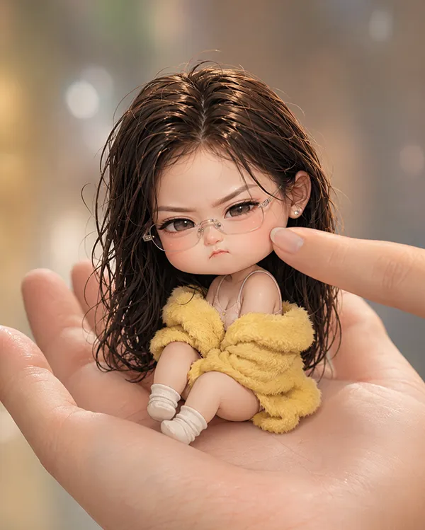

### 使用步骤

打开入口：在微信里搜索小程序“机灵助手”，进入首页后搜索“Q版掌心小气包”。
准备素材：建议上传单人、角色或宠物拟人参考图，面部、发型、服装和标志性特征越清楚，Q 版形象越容易保留识别点。
提交生成：补充你想要的主体、风格、场景和用途。推荐模型选择 GPT Image 2 (gpt-image-2)，画幅可先用 2:3。

### 使用建议

适合 Q 版头像、角色 IP、掌心小人、可爱手办感和社媒趣味图。
如果想让表情更明显，可以强调双颊更鼓、眉头更皱、眼睛更眯。
如果想增强质感，可以补充软萌 3D、细腻皮肤、柔和阴影和干净自然光。

详情: https://docs.jiling.cc/templates/chibi-palm-pouty-figure.html ｜ 在线使用: https://www.jiling.cc/image-templates/chibi-palm-pouty-figure


---

## 儿童蜡笔涂鸦提示词与教程  <!-- children-crayon-scribble-doodle -->

适合把人物或主体照片转换成儿童蜡笔 Scribble 涂鸦插画，保留真实辨识度，并加入太阳、彩虹、花朵、笑脸、小鸟、房子、树木、云朵和小草等童趣元素。

分类: AI变装 · 二次元变身 ｜ 模型: GPT Image 2 (gpt-image-2) ｜ 画幅: 2:3 ｜ 尺寸: 1024x1536 ｜ 评分: 4.7/5 ｜ 16,565 条评价

标签: `二次元变身` `蜡笔涂鸦` `幼儿园绘画` `AI变装`

### 提示词

```text
根据上传参考图，转换为儿童蜡笔Scribble插画。
采用油画棒、蜡笔粗颗粒纹理。
人物保持真实辨识度。
颜色大胆涂抹，不追求边缘精准。
加入：太阳、彩虹、花朵、笑脸、小鸟、房子、树木、云朵、小草
整体像幼儿园儿童绘画作品，童趣、可爱、治愈。
```

### 效果图

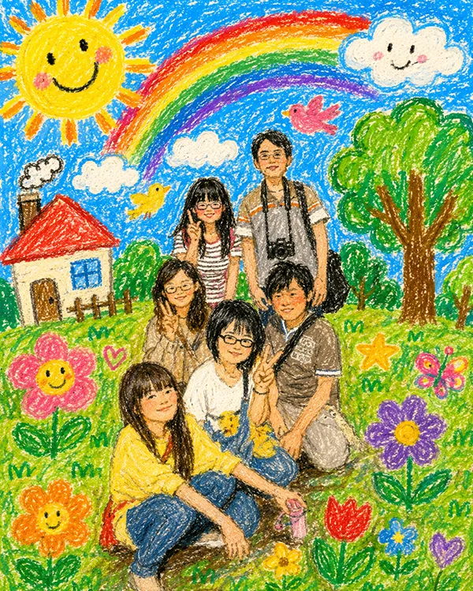

### 使用步骤

打开入口：在微信里搜索小程序“机灵助手”，进入首页后搜索“儿童蜡笔涂鸦”。
准备素材：建议上传人物或主体清晰、轮廓明确的照片，头像、半身照、宠物、亲子或日常场景都适合转换成儿童蜡笔涂鸦。
提交生成：补充你想要的主体、风格、场景和用途。推荐模型选择 GPT Image 2 (gpt-image-2)，画幅可先用 2:3。

### 使用建议

适合亲子内容、头像改造、朋友圈可爱图、社媒童趣封面和治愈系插画。
这个模板会主动保留粗颗粒、涂出边缘和大胆色彩，不追求精致线稿。
如果画面不够童真，可以继续强调幼儿园儿童绘画作品、蜡笔颗粒和更多童趣小元素。

详情: https://docs.jiling.cc/templates/children-crayon-scribble-doodle.html ｜ 在线使用: https://www.jiling.cc/image-templates/children-crayon-scribble-doodle


---

## 儿童蜡笔风格提示词与教程  <!-- children-crayon-style -->

适合把人物、宠物或日常照片改造成白纸上的儿童蜡笔画，重点是简化细节、童趣配色、可爱装饰和俏皮氛围。

分类: AI变装 · 二次元变身 ｜ 模型: GPT Image 2 (gpt-image-2) ｜ 画幅: 2:3 ｜ 尺寸: 1024x1536 ｜ 评分: 4.7/5 ｜ 16,573 条评价

标签: `二次元变身` `儿童蜡笔` `童趣插画` `AI变装`

### 提示词

```text
请把整张图片变成蜡笔风格的画。简化细节，让它看起来像是一个 10 岁小朋友画出来的。不要使用照片中的原始颜色。让它看起来像画在白纸上一样，整体感觉非常可爱、俏皮。你可以添加一些可爱的元素，比如花朵、糖果、星星、云朵等等，让画面更有童趣、更天真可爱。
```

### 效果图

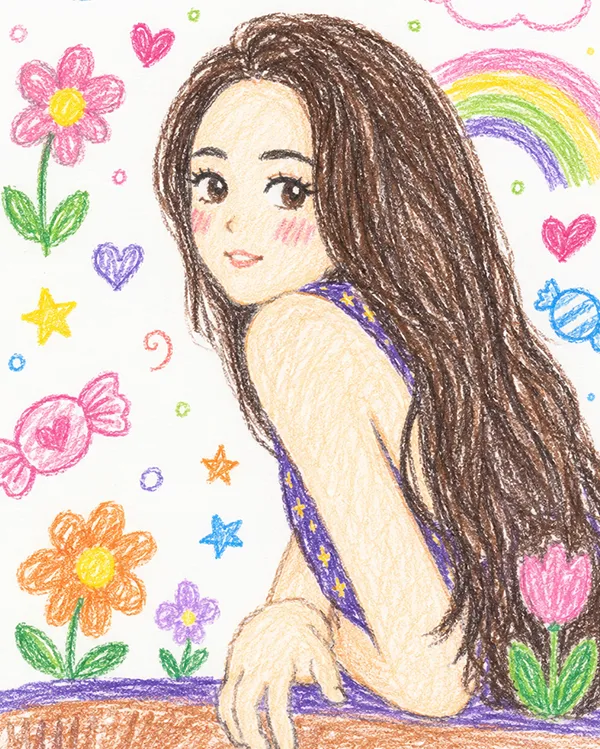

### 使用步骤

打开入口：在微信里搜索小程序“机灵助手”，进入首页后搜索“儿童蜡笔风格”。
准备素材：建议上传主体清晰、轮廓明确的照片，人物、宠物、玩具、食物或日常场景都可以。
提交生成：补充你想要的主体、风格、场景和用途。推荐模型选择 GPT Image 2 (gpt-image-2)，画幅可先用 2:3。

### 使用建议

适合亲子内容、头像改造、社媒可爱配图和轻松童趣风格化内容。
这个模板会主动简化细节并改变原图颜色，重点是像小朋友画出来的可爱蜡笔感。
如果想更像儿童手绘，可以强调线条不必太规整、上色有笔触和比例更天真。

详情: https://docs.jiling.cc/templates/children-crayon-style.html ｜ 在线使用: https://www.jiling.cc/image-templates/children-crayon-style


---

## 儿童涂鸦风插画提示词与教程  <!-- children-doodle-style-illustration -->

适合把人物、宠物或主体照片改绘成笨拙潦草、荒诞搞笑的儿童涂鸦风插画，强调廉价马克笔、蜡笔水笔、比例跑偏和低成本手绘梗图效果。

分类: AI变装 · 二次元变身 ｜ 模型: GPT Image 2 (gpt-image-2) ｜ 画幅: 2:3 ｜ 尺寸: 1024x1536 ｜ 评分: 4.7/5 ｜ 16,584 条评价

标签: `二次元变身` `儿童涂鸦` `低成本梗图` `AI变装`

### 提示词

```text
请将参考照片改绘成一幅笨拙、潦草、荒诞搞笑的儿童涂鸦风插画。保留原照片中人物或主体的核心辨识特征、基本姿势和主要关系，但不要写实还原。
画面质感：
呈现出使用廉价马克笔、蜡笔和彩色水笔随手乱画的效果。线条歪斜、断续、重复且不稳定，轮廓不闭合，带有明显手抖感和随意修改的痕迹。整体像未经训练的人快速完成的草稿，幼稚、粗糙、不讲究。
造型与构图：
故意破坏正常比例和透视关系。人物头身比例失衡，四肢、脸型或物体结构可以略微扭曲，构图不对称、不规整，空间关系带有笨拙的错位感。不要追求解剖准确或画面平衡。
表情与五官：
在保留人物辨识度的基础上，对五官进行适度夸张，例如眼睛大小不一、嘴角歪斜、眉毛高低不平、表情呆滞或莫名兴奋，形成沙雕、滑稽、适合网络表情包的喜剧效果。夸张但不要恐怖。
背景与附加元素：
根据参考照片的场景进行简单联想，添加极简漫画式背景。背景只需用少量歪斜线条和粗糙色块暗示环境，不必完整描绘。画面中加入一些无意义的乱涂线、箭头、圈圈、波浪线、小星星、奇怪符号和细碎涂鸦，使画面显得更加随意和荒诞。
上色方式：
色彩简单、直接、略显俗气。保留上色不均、留白、重叠、涂出轮廓、颜色错位和明显笔触。局部可以故意漏涂或胡乱补色，不要使用平滑渐变、精致光影或统一整洁的配色。
整体氛围：
像是有人敷衍地随手画了几分钟，却意外产生很好笑的效果。画面要有“毫无绘画基础但很有梗”的感觉，轻松、沙雕、幼稚、荒诞，贴近网络趣味表情包和低成本手绘梗图的氛围。
必须避免：
不要写实，不要精细刻画，不要干净流畅的线稿，不要准确透视，不要标准人体比例，不要专业插画感，不要高级设计感，不要精致完整的背景，不要平滑数字绘画质感，不要复杂光影，不要把画面自动美化得整齐漂亮。
```

### 效果图

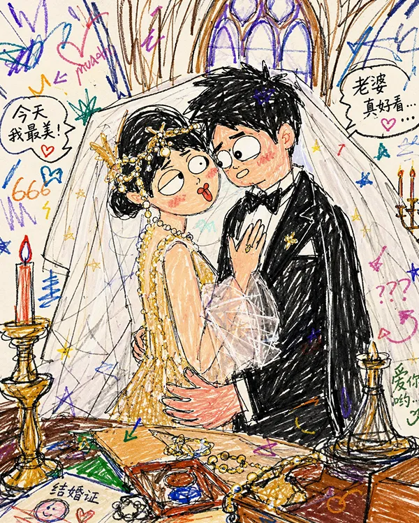

### 使用步骤

打开入口：在微信里搜索小程序“机灵助手”，进入首页后搜索“儿童涂鸦风插画”。
准备素材：建议上传主体清晰、姿势或表情有特点的照片，人物、宠物、玩具或日常主体都适合改成儿童涂鸦风插画。
提交生成：补充你想要的主体、风格、场景和用途。推荐模型选择 GPT Image 2 (gpt-image-2)，画幅可先用 2:3。

### 使用建议

适合表情包、头像恶搞、社媒趣味图和低成本手绘梗图内容。
这个模板会主动降低完成度，强化线条断续、轮廓不闭合、上色错位和比例跑偏。
如果想更荒诞，可以继续强调更不对称、更不规整、更像毫无绘画基础的人随手画。

详情: https://docs.jiling.cc/templates/children-doodle-style-illustration.html ｜ 在线使用: https://www.jiling.cc/image-templates/children-doodle-style-illustration


---

## 电影肖像照提示词与教程  <!-- cinematic-portrait -->

适合做电影感肖像、艺术写真和有故事感的情绪大片。

分类: 人物写真 · 情绪大片 ｜ 模型: Nano Banana Pro (nano-banana-pro) ｜ 画幅: 1:1 ｜ 尺寸: 2K ｜ 评分: 4.8/5 ｜ 12,200 条评价

标签: `情绪大片` `电影感肖像` `艺术人像` `人物写真`

### 提示词

```text
一张电影风格的影棚肖像照，一位女士身着摩卡色缎面衬衫，坐在深色石桌旁。她面前摆放着一尊她本人的陶瓷半身像，表面光滑哑光。柔和的咖啡馆式灯光，营造出亲密而艺术的氛围，浅景深，写实主义风格，温馨的电影色调
```

### 效果图

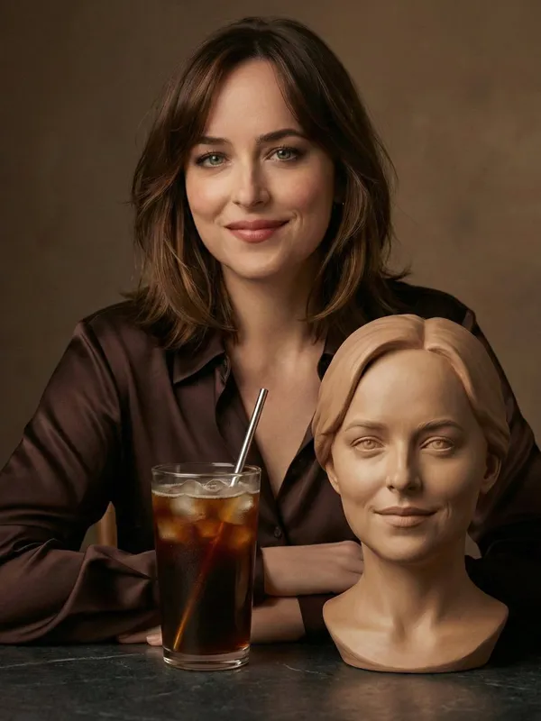

### 使用步骤

打开入口：在微信里搜索小程序“机灵助手”，进入首页后搜索“电影肖像照”。
准备素材：单人正脸或半身照，表情自然、光线柔和、五官清晰
提交生成：补充你想要的主体、风格、场景和用途。推荐模型选择 Nano Banana Pro (nano-banana-pro)，画幅可先用 1:1。

### 使用建议

适合做电影感肖像、艺术写真和有故事感的情绪大片。
上传清晰人像，快速生成带电影灯光和艺术氛围的高级肖像照。

详情: https://docs.jiling.cc/templates/cinematic-portrait.html ｜ 在线使用: https://www.jiling.cc/image-templates/cinematic-portrait


---

## 透明窗盲盒提示词与教程  <!-- classic-window-box-blindbox-figure -->

适合把单人自拍、半身照和正脸照做成透明窗盒装的收藏盲盒手办。

分类: IP形象/手办 · 盲盒包装 ｜ 模型: Nano Banana Pro (nano-banana-pro) ｜ 画幅: 4:5 ｜ 尺寸: 2K ｜ 评分: 4.8/5 ｜ 15,143 条评价

标签: `透明窗包装` `收藏手办` `官方商品图` `盲盒包装` `IP形象/手办`

### 提示词

```text
根据上传的人像照片生成，保留人物真实五官、脸型、发型、穿搭特征和整体辨识度，让公仔明显像照片中的本人。请将照片中的角色转化为一个超写实的 1/7 比例盲盒收藏公仔，放置在带有透明展示窗口和圆角设计的精美包装盒内。公仔站立在透明压克力底座上，底座干净无字，材质呈现细腻的塑料、树脂和涂装质感。包装盒像高端正版收藏玩具，带有高级印刷插画、系列标签和陈列感。背景采用电影级摄影棚灯光，带轻微虚化的收藏柜细节，整体像官方发售的限量版盲盒手办商品图，超真实、高级、精致、强收藏感。
```

### 效果图


### 使用步骤

打开入口：在微信里搜索小程序“机灵助手”，进入首页后搜索“透明窗盲盒”。
准备素材：单人自拍、半身照、正脸照
提交生成：补充你想要的主体、风格、场景和用途。推荐模型选择 Nano Banana Pro (nano-banana-pro)，画幅可先用 4:5。

### 使用建议

这个模板适合想做“像官方盲盒商品图”的效果，人物识别度和包装质感是重点。
4:5 比例更像电商首图和新品宣发图，后续也方便替换为正式效果图。
如果你希望更接近某个品牌的商品感，可以补包装盒配色、表面工艺和徽章标签。

详情: https://docs.jiling.cc/templates/classic-window-box-blindbox-figure.html ｜ 在线使用: https://www.jiling.cc/image-templates/classic-window-box-blindbox-figure


---

## 彩色线条手绘提示词与教程  <!-- colorful-doodle-line-art -->

适合把照片转成童趣、随性、带彩色线条和 doodle 感的手绘插画，重点是轻松感和不刻意的涂鸦气质。

分类: AI变装 · 杂志/海报 ｜ 模型: GPT Image 2 (gpt-image-2) ｜ 画幅: 2:3 ｜ 尺寸: 1024x1536 ｜ 评分: 4.7/5 ｜ 16,583 条评价

标签: `线条手绘` `doodle插画` `童趣涂鸦` `杂志/海报` `AI变装`

### 提示词

```text
彩色潦草小狗线条风格绘制该图，童趣和doodle加入其中，务必使用毫无章法的绘制手法，凌乱和草率即可。
```

### 效果图

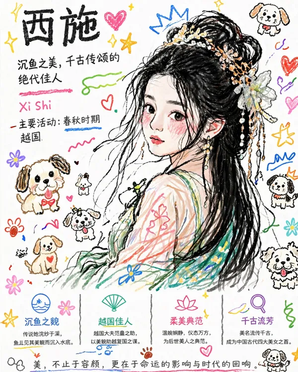

### 使用步骤

打开入口：在微信里搜索小程序“机灵助手”，进入首页后搜索“彩色线条手绘”。
准备素材：建议上传主体轮廓清晰、构图简单的人像或物体照片，线条化之后会更稳定。
提交生成：补充你想要的主体、风格、场景和用途。推荐模型选择 GPT Image 2 (gpt-image-2)，画幅可先用 2:3。

### 使用建议

适合社媒配图、趣味头像、轻松手绘封面和带童趣感的内容表达。
如果你想让画面更有记忆点，可以补充更明确的主体、颜色方向或情绪关键词。
做系列手绘内容时，建议统一线条风格、色彩组合和画面留白。

详情: https://docs.jiling.cc/templates/colorful-doodle-line-art.html ｜ 在线使用: https://www.jiling.cc/image-templates/colorful-doodle-line-art


---

## 超市特价传单提示词与教程  <!-- community-supermarket-flyer -->

适合生成社区超市、便利店、生鲜店和本地门店的特价促销传单。

分类: 广告创意 · 促销传单 ｜ 模型: GPT Image 2 (gpt-image-2) ｜ 画幅: 2:3 ｜ 尺寸: 1024x1536 ｜ 评分: 4.8/5 ｜ 14,705 条评价

标签: `超市传单` `促销广告` `社区门店` `促销传单` `广告创意`

### 提示词

```text
设计一张中文社区超市特价传单，红黄白配色，主标题醒目，价格最大，商品分类整齐，画面热闹但整洁，突出实惠、亲民、真实超市促销感。
```

### 效果图


### 使用步骤

打开入口：在微信里搜索小程序“机灵助手”，进入首页后搜索“超市特价传单”。
准备素材：无需上传参考图也可以直接生成；如果有门店 logo、商品图或以往传单，可以上传作为参考。
提交生成：补充你想要的主体、风格、场景和用途。推荐模型选择 GPT Image 2 (gpt-image-2)，画幅可先用 2:3。

### 使用建议

适合社区超市、便利店、生鲜店、粮油店和本地团购活动。
主标题、价格和活动日期建议放在提示词里写明确，方便形成强促销视觉。
如果商品很多，建议按分类分组描述，避免版面信息过乱。

详情: https://docs.jiling.cc/templates/community-supermarket-flyer.html ｜ 在线使用: https://www.jiling.cc/image-templates/community-supermarket-flyer


---

## 情侣双人盲盒收藏提示词与教程  <!-- couple-blindbox-collection-set -->

适合情侣照、纪念日和生日礼物图的双人盲盒收藏套装风。

分类: IP形象/手办 · 情侣套装 ｜ 模型: Nano Banana Pro (nano-banana-pro) ｜ 画幅: 3:4 ｜ 尺寸: 2K ｜ 评分: 4.8/5 ｜ 15,168 条评价

标签: `双人盲盒` `情侣套装` `纪念礼物` `IP形象/手办`

### 提示词

```text
根据上传的双人照片生成情侣双人盲盒收藏公仔套装，保留两个人的真实五官、发型和辨识度。将两位人物制作成一套高质量 3D 盲盒公仔，放置在同一款双人限定包装盒中，带透明展示窗和精美圆角外盒设计。公仔站在双人透明亚克力底座上，可加入情侣元素配件，如相机、花束、饮品、旅行箱、票根等。整体材质真实，树脂、塑料、透明件和喷涂细腻，背景为柔和高级棚拍灯光和虚化收藏展示环境，像限定情侣系列收藏盲盒。
```

### 效果图

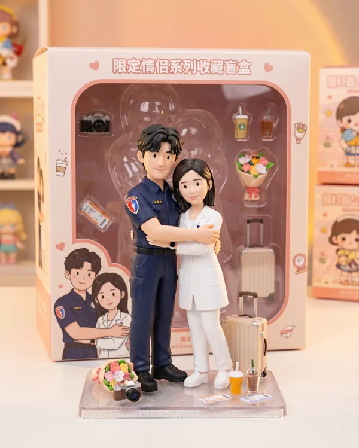

### 使用步骤

打开入口：在微信里搜索小程序“机灵助手”，进入首页后搜索“情侣双人盲盒收藏”。
准备素材：情侣照、纪念日、生日礼物图
提交生成：补充你想要的主体、风格、场景和用途。推荐模型选择 Nano Banana Pro (nano-banana-pro)，画幅可先用 3:4。

### 使用建议

这个模板很适合做礼物图和纪念日图，比普通情侣写真更有收藏感。
如果你想更像限定礼盒，可以补“周年限定、情侣系列、纪念徽章”。
双人照建议尽量用正面或半身照，识别度会更稳定。

详情: https://docs.jiling.cc/templates/couple-blindbox-collection-set.html ｜ 在线使用: https://www.jiling.cc/image-templates/couple-blindbox-collection-set


---

## 情侣漫步拼贴画提示词与教程  <!-- couple-stroll-collage -->

适合把情侣照片做成带手机抓拍感、绿色胶片氛围和 4x4 多格叙事的漫步拼贴写真。

分类: 人物写真 · 情绪大片 ｜ 模型: GPT Image 2 (gpt-image-2) ｜ 画幅: 2:3 ｜ 尺寸: 1024x1536 ｜ 评分: 4.8/5 ｜ 12,216 条评价

标签: `情绪大片` `情侣写真` `生活记录` `人物写真`

### 提示词

```text
一个 4x4 拼贴画面，由 16 张随手拍的智能手机抓拍照片组成，排列成紧凑的正方形网格，照片之间用细白色分隔线隔开。整体风格像是一对情侣在郁郁葱葱的住宅区傍晚散步时 spontaneous 拍下的自拍。画面具有柔和梦幻的质感，带有轻微运动模糊、浅景深、轻微鱼眼或广角手机镜头畸变，以及带怀旧感的绿色调胶片美学。
反复出现的主体是一位可爱的年轻女性和一位更高的年轻男性，女性有一头金色长卷发，扎成双马尾，并系着夸张的薄荷绿色丝带蝴蝶结；肤色白皙；穿着一条浅鼠尾草绿色细肩带吊带裙，裙身上部为褶皱收腰设计。男性有一头深色短发，穿着宽松的深炭灰色 T 恤。
整个拼贴应呈现出俏皮、亲密、偶然抓拍的感觉，仿佛是在户外边走边开玩笑时拍下的。准确展示 16 张不同照片：
1）两人肩并肩的近距离自拍；
2）略微高角度自拍，背景是绿色植物；
3）非常近的模糊自拍，男性从左侧探入画面；
4）女性独自一人，从高角度拍摄，位于花坛和树篱旁；
5）侧面自拍，女性比出剪刀手；
6）女性站在狭窄的花园小路上，一只手伸向镜头；
7）两人同框自拍，女性比出剪刀手；
8）倾斜角度的两人近景，带有明显运动模糊；
9）女性独自一人的近景肖像，正在比剪刀手；
10）情侣沿路边行走时的自拍；
11）女性独自一人的背影，展示裙子的背部和双马尾；
12）两人自拍，女性在男性身旁比出剪刀手；
13）极近距离裁切，突出女性的头发和蝴蝶结；
14）情侣沿安静街道走远的全身背影；
15）近距离模糊自拍，画面主要被脸部遮挡模糊块占据；
16）两人并肩的另一张近距离自拍。
拼贴中的背景细节应包括茂密的绿色树篱、花园花朵、狭窄小路、路边草地、电线杆，以及安静的郊区街道。使用自然的户外环境光、柔和的高光、低对比度，并营造出随手发布在社交媒体上的照片合集氛围。
```

### 效果图

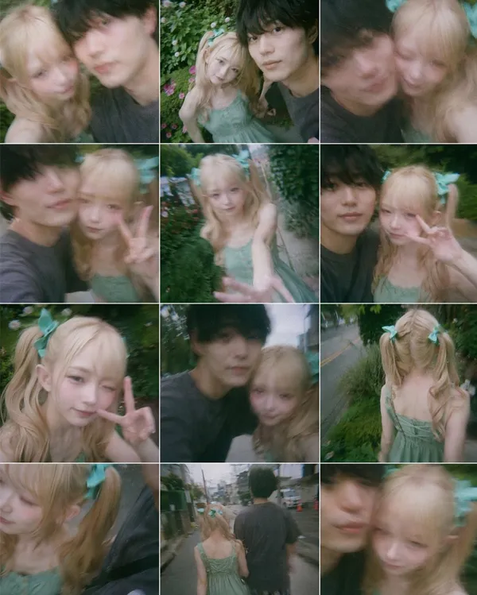

### 使用步骤

打开入口：在微信里搜索小程序“机灵助手”，进入首页后搜索“情侣漫步拼贴画”。
准备素材：建议上传双人同框且五官清晰的照片，方便同时保留两个人的辨识度和互动感。
提交生成：补充你想要的主体、风格、场景和用途。推荐模型选择 GPT Image 2 (gpt-image-2)，画幅可先用 2:3。

### 使用建议

适合纪念日、情侣日常、恋爱记录和社媒照片合集类内容。
如果你希望画面更有故事感，可以补充傍晚、散步、玩笑打闹或回头抓拍这类状态描述。
想让拼贴更统一时，建议选服装特征明确、互动关系自然的双人照片。

详情: https://docs.jiling.cc/templates/couple-stroll-collage.html ｜ 在线使用: https://www.jiling.cc/image-templates/couple-stroll-collage


---

## 水晶露珠肌效果提示词与教程  <!-- crystal-dew-skin-effect -->

适合把清晰人像升级成水晶露珠肌概念的超近景高端美妆大片，重点是身份特征保留、通透水光肤质、精致眼唇妆和珍珠浅粉影棚光。

分类: AI变装 · 写真 ｜ 模型: GPT Image 2 (gpt-image-2) ｜ 画幅: 2:3 ｜ 尺寸: 1024x1536 ｜ 评分: 4.7/5 ｜ 16,582 条评价

标签: `写真` `水晶露珠肌` `美妆大片` `AI变装`

### 提示词

```text
编辑这张参考图像，必须保留原人物的脸部身份特征，不改变五官结构、脸型、表情基础和面部比例。仅优化妆容、光线、肤质、服装质感和整体美妆大片氛围。
高清超近景美妆人像，水晶露珠肌概念。肌肤呈现透明水晶般的通透质感，带有清晨露珠般的柔亮光泽。柔和光线轻轻反射在肌肤表面，形成细腻、克制的棱镜感反光，营造纯净、清新、空灵、奢华的高端美妆广告氛围。整体风格干净、现代、时尚编辑感强。
构图为极致超近景美妆裁切，画面聚焦于眼睛到下巴区域，突出肌肤光泽、眼妆、唇妆和手部细节。头部略微向左倾斜，下巴轻轻抬起以捕捉柔和高光。手指自然轻触脸颊，指甲为长杏仁形，透明亮泽美甲，干净精致。眼神柔和、梦幻、平静，表情安宁空灵，双唇自然微张。
服装为珍珠白色轻透半透明面料，如欧根纱或真丝雪纺，露肩设计，质感轻盈如薄雾，干净高级。头发柔顺服帖，带自然光泽，略微偏分，少量细发丝自然垂落在脸侧，呈现丝滑反光质感，整体具有仙气、纯净、高级时尚编辑风格。
妆容重点为水晶露珠肌：超保湿发光底妆，玻璃般通透妆效，肌肤湿润但精致，不油腻不过度磨皮。面部高点带有微反光水光质感，无明显闪粉。颧骨、鼻梁、内眼角、丘比特弓和眼皮处呈现细腻水晶光泽。眼妆为极淡香槟色水晶微光，湿润眼皮效果，几乎看不见的灰褐色内眼线。睫毛纤长、浓密、根根分明，带精致漫画感。眉毛自然上扬，保留毛流感，用柔和亮泽眉胶定型。腮红为水润半透明粉色，像从肌肤内部自然透出。唇妆为半透明粉色水晶玻璃唇，高亮玻璃反光，饱满、水润、自然。
背景为柔和白色到珍珠浅粉彩的渐变影棚背景，干净奢华，带轻微空气雾感。灯光为大型正面漫射柔光箱，配合轻微侧面轮廓光和柔和银色反光板，制造水晶般的皮肤反射。画面具有温柔高光晕染、微露珠般细小镜面高光、高调明亮调色、珍珠肤色增强、轻微冷粉底调、清透平滑质感、柔和光晕和高级水晶反光效果。
避免改变人物身份，避免改变脸型和五官，避免夸张妆容，避免厚重闪粉，避免油腻皮肤，避免塑料感，避免过度磨皮，避免过度锐化，避免低清晰度，避免脏乱背景，避免夸张表情，避免手指变形，避免指甲畸形。
```

### 效果图

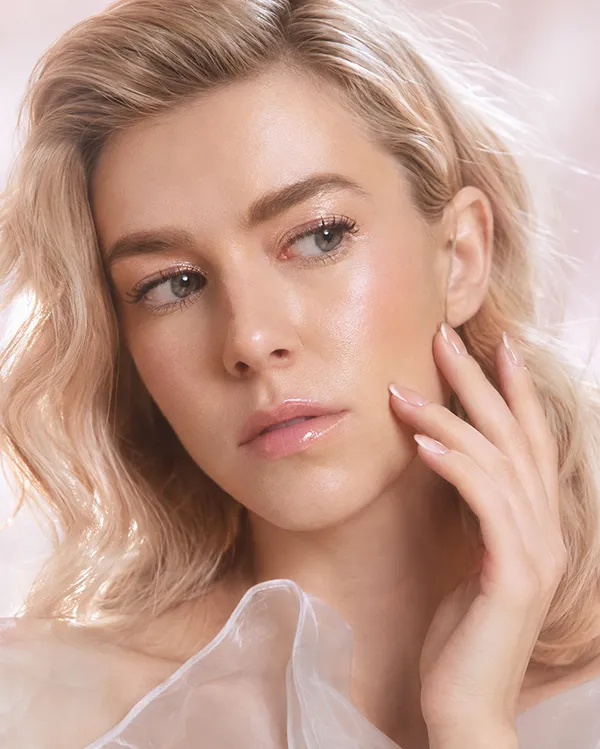

### 使用步骤

打开入口：在微信里搜索小程序“机灵助手”，进入首页后搜索“水晶露珠肌效果”。
准备素材：建议上传单人、面部清晰、五官无遮挡的人像照片，最好能看清眼睛、唇部、脸型和肤色。
提交生成：补充你想要的主体、风格、场景和用途。推荐模型选择 GPT Image 2 (gpt-image-2)，画幅可先用 2:3。

### 使用建议

适合美妆大片、时尚头像、妆容展示和高端社媒视觉内容。
这个模板强调湿润通透但不油腻的肤质，不适合厚重闪粉或夸张舞台妆方向。
如果想更清冷高级，可以强调珍珠白、冷粉底调、银色反光板和更干净的影棚背景。

详情: https://docs.jiling.cc/templates/crystal-dew-skin-effect.html ｜ 在线使用: https://www.jiling.cc/image-templates/crystal-dew-skin-effect


---

## 自定义娃娃机提示词与教程  <!-- custom-claw-machine -->

适合把宠物、动物照片做成日系娃娃机里的毛绒公仔展示图。

分类: IP形象/手办 · 毛绒公仔 ｜ 模型: Nano Banana Pro (nano-banana-pro) ｜ 画幅: 3:4 ｜ 尺寸: 2K ｜ 评分: 4.8/5 ｜ 15,135 条评价

标签: `毛绒公仔` `娃娃机` `宠物玩偶化` `IP形象/手办`

### 提示词

```text
生成一张图像，展示该动物被简化并变形为动漫风格的毛绒玩具（材质为短绒、触感柔软的聚酯针织布），放置在 UFO 捞娃娃机中。
两侧各有一台额外的 UFO 捞娃娃机，里面摆放着不同动物的毛绒玩具，与主图像的动物不同。
场景设定在日本游戏中心，整体明亮。UFO 捞娃娃机的上部涂有鲜艳颜色，下部涂为白色。背景为墙面，UFO 捞娃娃机背后的区域模糊处理。地面铺有地毯。
拍摄角度为正面。最重要的是，图像中绝对不要出现任何文字或标志。
```

### 效果图

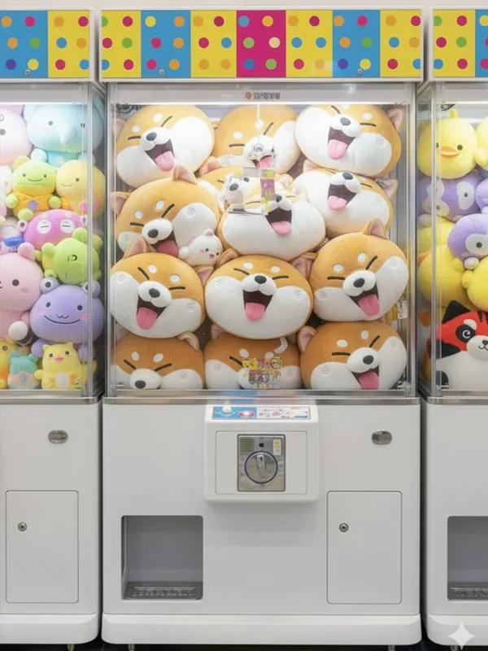

### 使用步骤

打开入口：在微信里搜索小程序“机灵助手”，进入首页后搜索“自定义娃娃机”。
准备素材：单只动物主体清晰、面部完整、光线自然、无遮挡的参考图
提交生成：补充你想要的主体、风格、场景和用途。推荐模型选择 Nano Banana Pro (nano-banana-pro)，画幅可先用 3:4。

### 使用建议

适合把宠物、动物照片做成日系娃娃机里的毛绒公仔展示图。
上传单只动物参考图，快速生成日系游戏中心里的 UFO 捞娃娃机毛绒玩具图。

详情: https://docs.jiling.cc/templates/custom-claw-machine.html ｜ 在线使用: https://www.jiling.cc/image-templates/custom-claw-machine


---

## 服装上身提示词与教程  <!-- custom-clothing-upperbody -->

适合使用机灵助手制作电商主图、鞋帽上身等内容。

分类: 电商 · 鞋帽上身 ｜ 模型: Nano Banana Pro (nano-banana-pro) ｜ 画幅: 3:4 ｜ 尺寸: 2K ｜ 评分: 4.8/5 ｜ 18,707 条评价

标签: `鞋帽上身` `自定义上传` `服装搭配` `电商`

### 提示词

```text
请根据上传的模特图和服装参考图生成自然的服装上身效果，保留人物身份、体型、姿势和真实光影，准确还原服装版型、颜色、材质和搭配关系，画面适合电商上新展示。
```

### 效果图

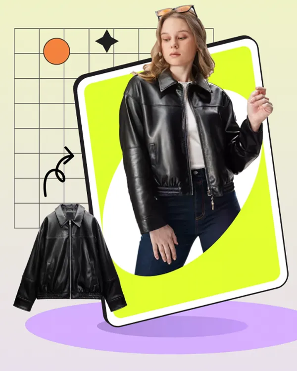

### 使用步骤

打开入口：在微信里搜索小程序“机灵助手”，进入首页后搜索“服装上身”。
准备素材：上传主体清晰、构图完整、光线稳定的参考图，生成效果会更稳定。
提交生成：补充你想要的主体、风格、场景和用途。推荐模型选择 Nano Banana Pro (nano-banana-pro)，画幅可先用 3:4。

### 使用建议

适合快速生成可用于社媒、电商、头像或视觉提案的 AI 图片。
可以先使用默认提示词生成一版，再根据实际画面继续微调。

详情: https://docs.jiling.cc/templates/custom-clothing-upperbody.html ｜ 在线使用: https://www.jiling.cc/image-templates/custom-clothing-upperbody


---

## Q版萌系盲盒提示词与教程  <!-- cute-chibi-blindbox-figure -->

适合女生自拍、可爱系头像和情侣单人版照片的 Q 版萌系盲盒公仔图。

分类: IP形象/手办 · 萌系盲盒 ｜ 模型: Nano Banana Pro (nano-banana-pro) ｜ 画幅: 4:5 ｜ 尺寸: 2K ｜ 评分: 4.8/5 ｜ 15,150 条评价

标签: `Q版公仔` `萌系盲盒` `治愈潮玩` `IP形象/手办`

### 提示词

```text
根据上传照片生成可爱Q版盲盒公仔风格，保留人物五官辨识度与发型特征，让角色明显像本人。将人物转化为头身比偏萌系的收藏级潮玩公仔，放置在带透明窗口的圆角盲盒包装中，包装整体可爱但高级，像热门潮玩品牌发售款。公仔底座为透明亚克力材质，表面干净通透。材质为高级树脂和塑料，表面有柔和光泽和细腻喷涂。背景为柔和电影级棚拍灯光，轻微虚化的收藏品环境，整体可爱、治愈、精致，像爆款盲盒新品宣传图。
```

### 效果图

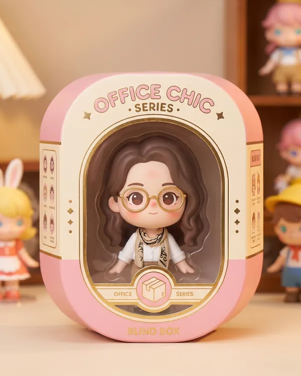

### 使用步骤

打开入口：在微信里搜索小程序“机灵助手”，进入首页后搜索“Q版萌系盲盒”。
准备素材：女生自拍、可爱系头像、情侣单人版
提交生成：补充你想要的主体、风格、场景和用途。推荐模型选择 Nano Banana Pro (nano-banana-pro)，画幅可先用 4:5。

### 使用建议

这个模板强调“可爱但不廉价”，建议保留高级树脂和细腻喷涂的描述。
如果你要做情侣单人版，可以先各自生成，再后续拼成系列。
4:5 比例适合潮玩商品首图和社媒宣传图。

详情: https://docs.jiling.cc/templates/cute-chibi-blindbox-figure.html ｜ 在线使用: https://www.jiling.cc/image-templates/cute-chibi-blindbox-figure


---

## 赛博机械头像提示词与教程  <!-- cyber-mechanical-avatar -->

适合把参考人物转换成未来感赛博机械头像，重点保留真实五官比例、脸型特征与身份辨识度，并融合克制精密的半透明机械结构。

分类: AI变装 · 杂志/海报 ｜ 模型: GPT Image 2 (gpt-image-2) ｜ 画幅: 1:1 ｜ 尺寸: 1024x1024 ｜ 评分: 4.7/5 ｜ 16,557 条评价

标签: `杂志/海报` `赛博机械` `科幻头像` `AI变装`

### 提示词

```text
基于参考人物生成未来感赛博机械头像，保留真实五官比例、脸型特征与身份辨识度，人物正面或微侧脸构图。面部一侧保持自然真实的人类皮肤、毛孔与细微纹理；另一侧融合精密但克制的半透明机械结构，可见层叠金属骨架、微型关节、光纤线路与低亮度能量节点。机械结构符合人体面部解剖与工程逻辑，不夸张外扩，不遮挡双眼，不改变原有脸型与表情。
整体采用深蓝、靛紫与少量冷青色环境光，柔和轮廓光勾勒面部和机械边缘。背景为浅景深、散景化的未来都市夜景，带少量霓虹灯牌、悬浮光点与雨雾氛围，但不过度抢眼。金属、玻璃、皮肤和发光线路材质真实，反射与透光自然，机械部分细节丰富但视觉干净。
高端科幻电影概念设计，写实摄影质感，电影级布光，冷峻克制，细腻皮肤，高动态范围，锐利眼神，超精细细节，真实材质，浅景深，8K，photorealistic，cinematic sci-fi portrait，premium character design。
负面提示词：
卡通，动漫，塑料皮肤，过度磨皮，脸型改变，五官变形，身份丢失，双眼被遮挡，机械结构覆盖整张脸，夸张外骨骼，杂乱电线，廉价机甲，过曝霓虹，过度发光，不合理机械结构，多余零件，左右眼不对称，模糊，低清晰度，文字，水印。
```

### 效果图

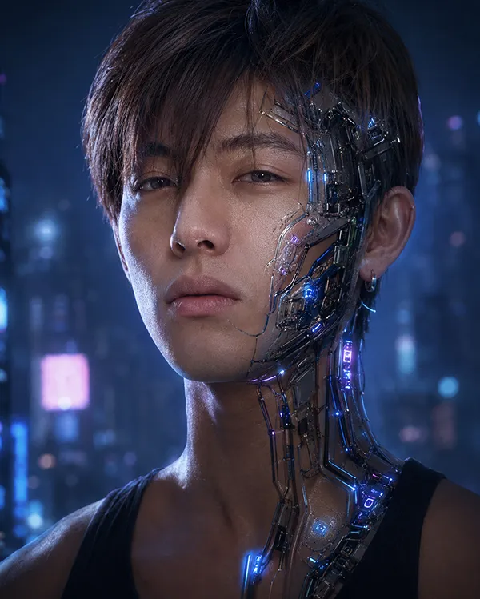

### 使用步骤

打开入口：在微信里搜索小程序“机灵助手”，进入首页后搜索“赛博机械头像”。
准备素材：建议上传五官清晰、脸型和发型可辨的人像照片，正面或轻微侧脸都适合生成赛博机械头像。
提交生成：补充你想要的主体、风格、场景和用途。推荐模型选择 GPT Image 2 (gpt-image-2)，画幅可先用 1:1。

### 使用建议

适合社媒头像、科幻角色设定、未来感人像和高端概念头像。
这个模板强调克制机械结构和真实材质，不适合夸张机甲或整张脸机械化。
如果结果过亮，可以继续强调低亮度能量节点、不过曝霓虹和视觉干净。

详情: https://docs.jiling.cc/templates/cyber-mechanical-avatar.html ｜ 在线使用: https://www.jiling.cc/image-templates/cyber-mechanical-avatar


---

## 赛博霓虹机能提示词与教程  <!-- cyber-neon-functional-visual -->

适合 3C 数码、球鞋、能量饮料、智能穿戴、潮牌、游戏周边和年轻快消的赛博霓虹机能海报。

分类: 二次元/漫画 · 机能海报 ｜ 模型: Gemini 3.1 Flash Image Preview (gemini-3.1-flash-image-preview) ｜ 画幅: 3:4 ｜ 尺寸: 2K ｜ 评分: 4.7/5 ｜ 11,015 条评价

标签: `赛博霓虹` `未来都市` `机能风` `机能海报` `二次元/漫画`

### 提示词

```text
使用我上传的产品图片作为唯一参考图（reference image），严格保持产品本体完全一致。必须保留产品的外观造型、尺寸比例、颜色、材质、包装结构、品牌logo、标签文字、图案位置和所有细节。不得重新设计产品。
将该产品置于未来都市机能风品牌广告场景中，整体为高对比度赛博霓虹视觉，背景是雨后都市街头或未来感城市空间，霓虹灯牌、电子屏、冷色调蓝紫霓虹与局部洋红高光交织，地面有湿润水洼反射，空气中带有轻微雨雾与体积光。构图采用动态透视或倾斜海报构图，产品以悬浮、放大特写或前景英雄位呈现，周围加入少量科技感 HUD 图形、发光线条、机能感结构元素，整体具有强烈速度感、科技感和夜间都市能量。
生成高完成度品牌级广告视觉（brand campaign visual），具有强烈情绪氛围、传播性和记忆点，主体清晰，产品识别度高，材质信息保留准确，构图具有海报张力，适合品牌主视觉 KV / 社媒广告 / 新品发布海报 / 电商活动 Banner / 封面图，超高清，8K，极致细节。
```

### 效果图

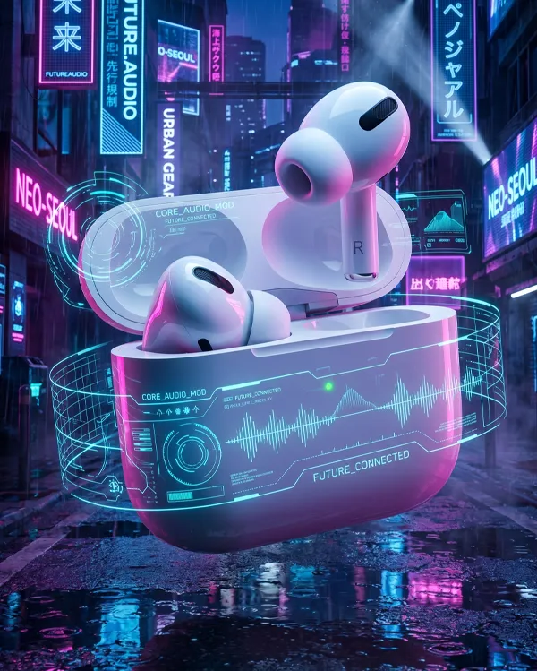

### 使用步骤

打开入口：在微信里搜索小程序“机灵助手”，进入首页后搜索“赛博霓虹机能”。
准备素材：上传 1 张产品图即可，建议轮廓明确、包装清晰、品牌信息完整。
提交生成：补充你想要的主体、风格、场景和用途。推荐模型选择 Gemini 3.1 Flash Image Preview (gemini-3.1-flash-image-preview)，画幅可先用 3:4。

### 使用建议

赛博霓虹模板更依赖高对比光影和夜景氛围，产品轮廓越清晰越有优势。
如果你想更像游戏周边或年轻潮牌海报，可以保留 HUD、电子屏和倾斜构图。
3:4 竖版适合社媒竖版广告和新品活动海报。

详情: https://docs.jiling.cc/templates/cyber-neon-functional-visual.html ｜ 在线使用: https://www.jiling.cc/image-templates/cyber-neon-functional-visual


---

## 赛博科技提示词与教程  <!-- cyber-tech-product-shot -->

适合数码电子、运动鞋、耳机、键盘、智能穿戴和能量饮料等产品的赛博科技风摄影。

分类: 产品摄影 · 科技渲染 ｜ 模型: Gemini 3.1 Flash Image Preview (gemini-3.1-flash-image-preview) ｜ 画幅: 1:1 ｜ 尺寸: 2K ｜ 评分: 4.8/5 ｜ 14,002 条评价

标签: `赛博朋克` `未来科技` `蓝紫霓虹` `科技渲染` `产品摄影`

### 提示词

```text
使用我上传的产品图片作为唯一参考图（reference image），严格保持产品外观、结构、比例、颜色、材质、logo、标签和所有细节完全一致。不得重绘产品，不得改变设计。
将该产品以悬浮状态展示在画面中央，采用45度动态角度，背景为霓虹交错的未来都市感空间，冷色调蓝色与紫色形成强烈对比，局部加入焦散光效、玻璃反射与金属高光，环境具有赛博朋克未来科技氛围，整体呈现 Unreal Engine 5 级别的高真实感渲染质感。突出科技感、速度感、未来感与高对比视觉冲击力。
生成高真实感商业级产品摄影，材质准确，阴影自然，空间可信，主体清晰，构图干净高级，电商可用，适合详情页第二张/广告Banner/活动海报/社媒传播图，超高清，8K，极致细节。
```

### 效果图

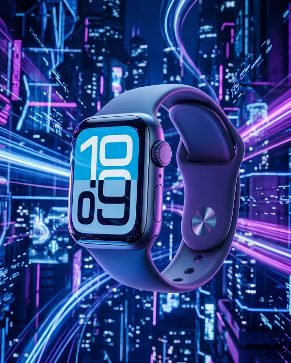

### 使用步骤

打开入口：在微信里搜索小程序“机灵助手”，进入首页后搜索“赛博科技”。
准备素材：上传 1 张产品图即可，建议结构清楚、轮廓规整、适合做 45 度动态展示。
提交生成：补充你想要的主体、风格、场景和用途。推荐模型选择 Gemini 3.1 Flash Image Preview (gemini-3.1-flash-image-preview)，画幅可先用 1:1。

### 使用建议

这个模板更适合详情页第二张、活动海报和社媒传播，不建议直接替代合规主图。
如果你想更像游戏引擎渲染感，可以补充更强的边缘光和空间透视。
1:1 比例适合方图广告位和社媒卡片传播。

详情: https://docs.jiling.cc/templates/cyber-tech-product-shot.html ｜ 在线使用: https://www.jiling.cc/image-templates/cyber-tech-product-shot


---

## 拆解信息图提示词与教程  <!-- deconstruction-infographic -->

适合生成文博图鉴、历史服饰拆解、器物结构说明和可收藏的中文知识信息图。

分类: 社媒内容 · 信息图 ｜ 模型: GPT Image 2 (gpt-image-2) ｜ 画幅: 2:3 ｜ 尺寸: 1024x1536 ｜ 评分: 4.7/5 ｜ 13,443 条评价

标签: `拆解信息图` `博物馆图鉴` `文博展板` `信息图` `社媒内容`

### 提示词

```text
请根据【主题】自动生成一张“博物馆图鉴式中文拆解信息图”。
要求整张图兼具真实写实主视觉、结构拆解、中文标注、材质说明、纹样寓意、色彩含义和核心特征总结。你需要根据【主题】自动判断最合适的主体对象、服饰体系、器物结构、时代风格、关键部件、材质工艺、颜色方案与版式结构，用户无需再提供其他信息。
整体风格应为：国家博物馆展板、历史服饰图鉴、文博专题信息图，而不是普通海报、古风写真、电商详情页或动漫插画。背景采用米白、绢纸白、浅茶色等纸张质感，整体高级、克制、专业、可收藏。
版式固定为：
- 顶部：中文主标题 + 副标题 + 导语
- 左侧：结构拆解区，中文引线标注关键部件，并配局部特写
- 右上：材质 / 工艺 / 质感区，展示真实纹理小样并附说明
- 右中：纹样 / 色彩 / 寓意区，展示主色板、纹样样本和文化解释
- 底部：穿着顺序 / 构成流程图 + 核心特征总结
若主题适合人物展示，则以真实人物全身站姿为中央主体；若更适合器物或单体结构，则改为中心主体拆解图，但整体仍保持完整中文信息图形式。所有文字必须为简体中文，清晰、规整、可读，不要乱码、错字、英文或拼音。重点突出真实结构、材质差异、文化说明与图鉴气质。
避免：海报感、影楼感、电商感、动漫感、cosplay感、乱标注、错结构、糊字、假材质、过度装饰。
```

### 效果图

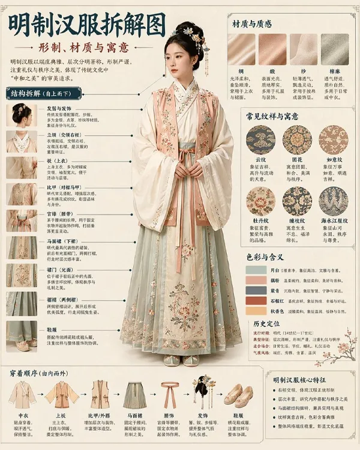

### 使用步骤

打开入口：在微信里搜索小程序“机灵助手”，进入首页后搜索“拆解信息图”。
准备素材：无需上传参考图也可以直接生成；如果有明确参考对象，可上传服饰、器物或展板图片帮助锁定结构。
提交生成：补充你想要的主体、风格、场景和用途。推荐模型选择 GPT Image 2 (gpt-image-2)，画幅可先用 2:3。

### 使用建议

把【主题】替换成具体对象，例如“明制马面裙”“唐代圆领袍”“宋代瓷器”。
如果想要更像文博展板，可以补充时代背景、材质、纹样名称和使用场景。
如果要做系列图鉴，建议固定标题结构、纸张底色和标注风格。

详情: https://docs.jiling.cc/templates/deconstruction-infographic.html ｜ 在线使用: https://www.jiling.cc/image-templates/deconstruction-infographic


---

## 潮玩新品官宣提示词与教程  <!-- designer-toy-launch-poster -->

适合做封面图、海报图和社媒宣传图的潮玩品牌新品发布风。

分类: IP形象/手办 · 新品官宣 ｜ 模型: Nano Banana Pro (nano-banana-pro) ｜ 画幅: 2:3 ｜ 尺寸: 2K ｜ 评分: 4.8/5 ｜ 15,150 条评价

标签: `新品发布` `潮玩海报` `品牌官宣` `新品官宣` `IP形象/手办`

### 提示词

```text
根据上传照片生成潮玩品牌新品发布海报风格，保留人物真实五官和辨识度。人物被转化为高端设计师玩具风格的 3D收藏公仔，置于精美盲盒包装盒前，公仔站在透明亚克力底座上，包装盒采用高级插画印刷、圆角结构和透明展示窗设计。画面采用品牌发布海报式构图，背景有高级渐变灯光、轻微虚化的收藏柜和柔和光斑，整体像 POP MART 风格新品官宣图，潮流、精致、极具收藏欲。
```

### 效果图

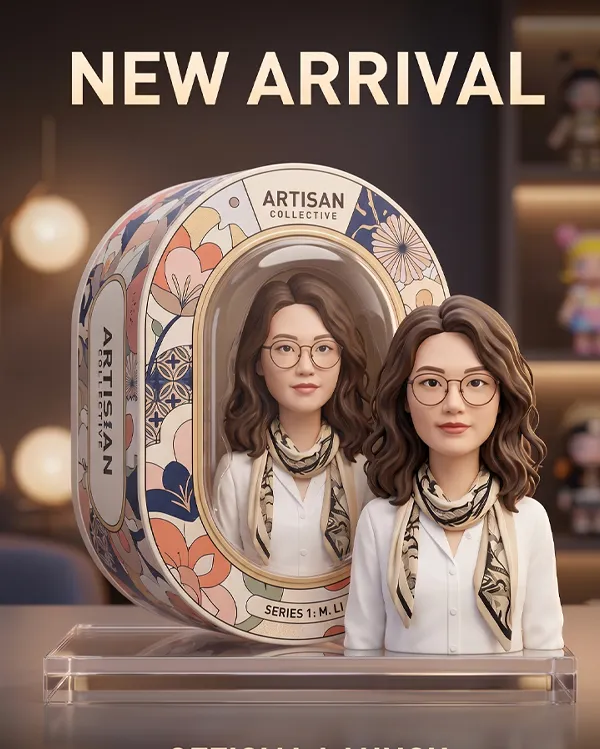

### 使用步骤

打开入口：在微信里搜索小程序“机灵助手”，进入首页后搜索“潮玩新品官宣”。
准备素材：封面图、海报图、社媒宣传图
提交生成：补充你想要的主体、风格、场景和用途。推荐模型选择 Nano Banana Pro (nano-banana-pro)，画幅可先用 2:3。

### 使用建议

这个模板比普通盲盒图更强调“发布海报”而不是纯商品陈列。
如果你想更像品牌视觉，可补渐变主色、主题文案区和系列名。
适合做社媒封面和朋友圈传播图。

详情: https://docs.jiling.cc/templates/designer-toy-launch-poster.html ｜ 在线使用: https://www.jiling.cc/image-templates/designer-toy-launch-poster


---

## 桌面建模工作室提示词与教程  <!-- desktop-modeling-studio-figure -->

适合个人 IP、设计师和博主，把人物照片做成带建模屏幕和工作室桌面的高级手办展示图。

分类: IP形象/手办 · 工作室展示 ｜ 模型: Nano Banana Pro (nano-banana-pro) ｜ 画幅: 16:9 ｜ 尺寸: 2K ｜ 评分: 4.8/5 ｜ 15,136 条评价

标签: `设计师桌面` `建模屏幕` `工作室展示` `IP形象/手办`

### 提示词

```text
根据上传照片生成超写实 3D 收藏手办工作室展示风格，保留人物辨识度。将人物制作成 1/7 比例商业化公仔，摆放在现代电脑桌上，站在透明圆形压克力底座上。电脑屏幕上显示该角色在 ZBrush 或 3D 建模软件中的建模过程，旁边放置同系列高质量包装盒，包装盒带角色插画和收藏品风格印刷。整体环境为现代工作室或设计师桌面，背景虚化但高级，灯光为电影级产品摄影布光，材质呈现真实塑料、树脂、涂装、亚克力反光和桌面反射，像潮玩设计师工作室幕后展示图。
```

### 效果图

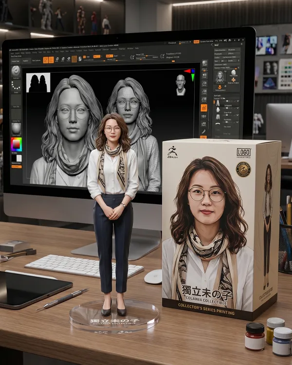

### 使用步骤

打开入口：在微信里搜索小程序“机灵助手”，进入首页后搜索“桌面建模工作室”。
准备素材：个人IP、设计师、博主、超级容易出“高级感”
提交生成：补充你想要的主体、风格、场景和用途。推荐模型选择 Nano Banana Pro (nano-banana-pro)，画幅可先用 16:9。

### 使用建议

这个模板更偏“桌面场景 + 公仔展示”，不是纯商品主图。
如果你想让职业属性更强，可以补职业工具和桌面陈列。
16:9 横版很适合做封面、横幅和工作室宣传图。

详情: https://docs.jiling.cc/templates/desktop-modeling-studio-figure.html ｜ 在线使用: https://www.jiling.cc/image-templates/desktop-modeling-studio-figure


---

## 甜点促销海报提示词与教程  <!-- dessert-sale-poster -->

适合生成带复古暖色调、甜点特写和节日促销氛围的烘焙活动海报，适用于门店宣传和电商活动推广。

分类: 广告创意 · 促销海报 ｜ 模型: GPT Image 2 (gpt-image-2) ｜ 画幅: 2:3 ｜ 尺寸: 1024x1536 ｜ 评分: 4.8/5 ｜ 14,706 条评价

标签: `甜点海报` `促销海报` `烘焙品牌` `广告创意`

### 提示词

```text
一款甜点促销海报，采用暖色调复古风格设计。背景为米黄色网格纹理，营造出温馨怀旧感。主标题"金丝酥单品限时7折 松塔甜点」"以醒目的橙色粗体字横跨上方，其中"单品限时7折"置于蓝色倾斜标签上形成色彩对比。画面中央展示两个精美的杏仁松塔甜点特写，顶部撒有杏仁片，呈现出金黄酥脆的质感。甜点左侧标注"香甜可口"，右侧标注"浓郁诱人"，均为橙色小字配以星形装饰。右上角有淡黄色对话框注释"DELUXE ALMOND PASTRY LIMITED OFFER"和"SWEET AROMA RICH FLAVOR"。整体构图简洁明快，点缀有小星星和简约线条装饰，色彩以橙黄为主调，蓝色作为点缀，完美展现出甜品的诱人质感和促销信息的紧迫感。
```

### 效果图

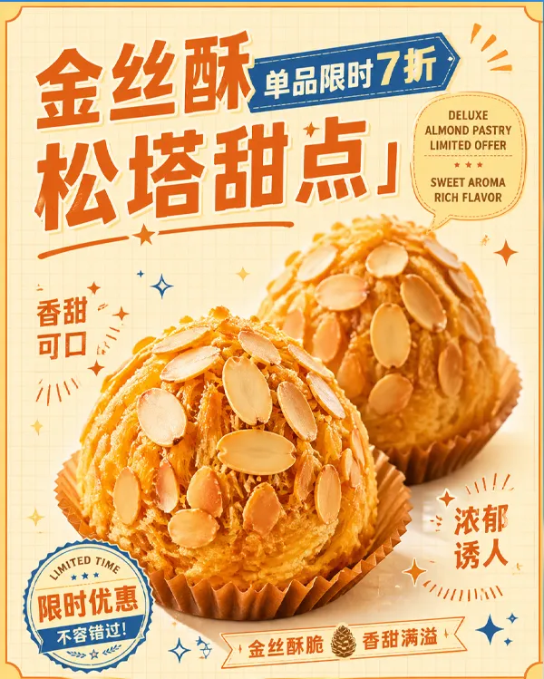

### 使用步骤

打开入口：在微信里搜索小程序“机灵助手”，进入首页后搜索“甜点促销海报”。
准备素材：无需上传参考图也可以直接生成；如果有真实产品图、品牌海报或门店视觉，也可以上传作为参考。
提交生成：补充你想要的主体、风格、场景和用途。推荐模型选择 GPT Image 2 (gpt-image-2)，画幅可先用 2:3。

### 使用建议

适合甜点店、烘焙品牌、节日活动和电商促销宣传场景。
如果你想更像真实品牌活动页，可以补充主推卖点、活动时间和目标人群。
做系列活动内容时，建议统一文案口吻、产品摆放方式和色彩节奏。

详情: https://docs.jiling.cc/templates/dessert-sale-poster.html ｜ 在线使用: https://www.jiling.cc/image-templates/dessert-sale-poster


---

## 商品细节特写图提示词与教程  <!-- detail-shot-generator -->

适合服饰、箱包、鞋帽和配件的局部细节展示图。

分类: 电商 · 细节图 ｜ 模型: Nano Banana Pro (nano-banana-pro) ｜ 画幅: 4:5 ｜ 尺寸: 2K ｜ 评分: 4.8/5 ｜ 18,693 条评价

标签: `细节图` `材质展示` `工艺特写` `电商`

### 提示词

```text
生成一张适合电商详情页的商品细节特写图，重点突出商品局部做工、面料纹理、五金、拉链、纽扣或材质细节。画面为 4:5，构图干净，背景简洁，柔和商业布光，细节锐利，整体像高端电商详情页的局部展示图。需要强化质感、清晰度和层次感，不要加入无关道具和复杂背景。
```

### 效果图

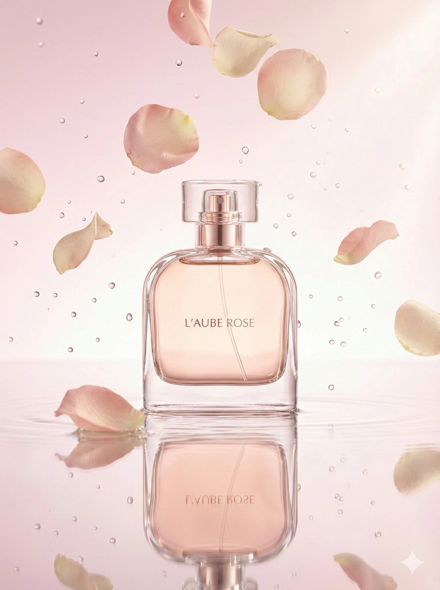

### 使用步骤

打开入口：在微信里搜索小程序“机灵助手”，进入首页后搜索“商品细节特写图”。
准备素材：商品主图、局部材质图、五金和做工特写
提交生成：补充你想要的主体、风格、场景和用途。推荐模型选择 Nano Banana Pro (nano-banana-pro)，画幅可先用 4:5。

### 使用建议

适合服饰、箱包、鞋帽和配件的局部细节展示图。
上传商品图或局部图，快速生成突出做工和材质的细节特写图。

详情: https://docs.jiling.cc/templates/detail-shot-generator.html ｜ 在线使用: https://www.jiling.cc/image-templates/detail-shot-generator


---

## 数码科技爆款提示词与教程  <!-- digital-tech-bestseller -->

适合数码科技、电器设备和高端工业设计类产品广告图。

分类: 产品摄影 · 数码产品 ｜ 模型: Nano Banana Pro (nano-banana-pro) ｜ 画幅: 1:1 ｜ 尺寸: 2K ｜ 评分: 4.8/5 ｜ 13,995 条评价

标签: `数码产品` `科技感` `商业渲染` `产品摄影`

### 提示词

```text
基于上传的数码产品图片，生成未来科技感商业渲染图。产品主体悬浮在深色空间中，周围环绕细密光轨、微粒、能量线条和冷色发光结构。采用精准轮廓光与反射控制，突出金属边框、玻璃面板、磨砂外壳和工业设计细节。背景简洁高级、层次分明，景深自然，整体呈现高端科技品牌广告大片质感，锐利、真实、具有强烈购买欲。
```

### 效果图

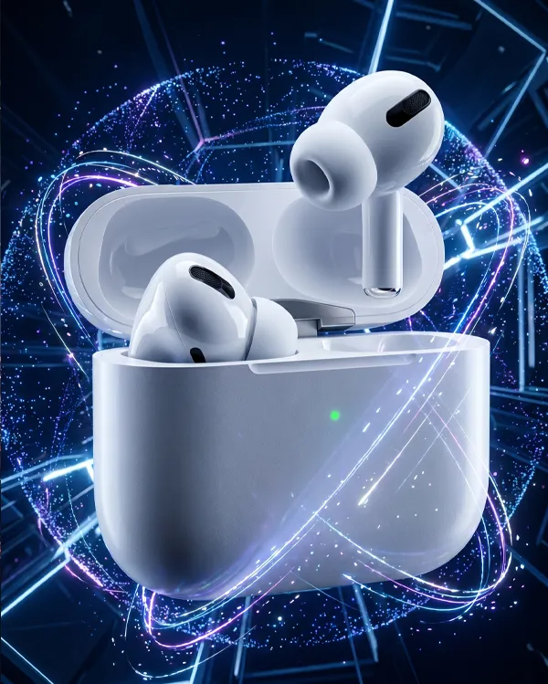

### 使用步骤

打开入口：在微信里搜索小程序“机灵助手”，进入首页后搜索“数码科技爆款”。
准备素材：边框完整、材质清晰、正面或三分之二视角明确的数码产品参考图
提交生成：补充你想要的主体、风格、场景和用途。推荐模型选择 Nano Banana Pro (nano-banana-pro)，画幅可先用 1:1。

### 使用建议

这个模板不太适合生活化拍摄，更适合耳机、手机、相机、键盘和智能设备类商业展示。
如果原图背景太复杂，建议先裁出主体再上传，会更稳。
如果后续你想换成自己的数码案例图，模板预览和首页封面会一起跟着更新。

详情: https://docs.jiling.cc/templates/digital-tech-bestseller.html ｜ 在线使用: https://www.jiling.cc/image-templates/digital-tech-bestseller


---

## 收藏柜手办提示词与教程  <!-- display-cabinet-collectible-figure -->

适合做“收藏玩家晒柜”感觉的高级手办陈列图。

分类: IP形象/手办 · 收藏陈列 ｜ 模型: Gemini 3.1 Flash Image Preview (gemini-3.1-flash-image-preview) ｜ 画幅: 3:4 ｜ 尺寸: 2K ｜ 评分: 4.8/5 ｜ 15,141 条评价

标签: `收藏柜` `高级手办` `陈列展示` `收藏陈列` `IP形象/手办`

### 提示词

```text
根据上传照片生成收藏柜陈列款高级手办风格，保留人物真实辨识度。将人物转化为超写实 3D 收藏公仔，站在透明亚克力底座上，置于精致包装盒前方，包装盒部分打开或半展示状态，背景为高端收藏柜，内有虚化的其他潮玩、手办和灯带光影。整体灯光为电影级摄影棚光与柜内展示灯结合，材质表现极致真实，塑料、树脂、喷漆、透明件和阴影层次丰富，像资深收藏玩家展示的限量版新品。
```

### 效果图

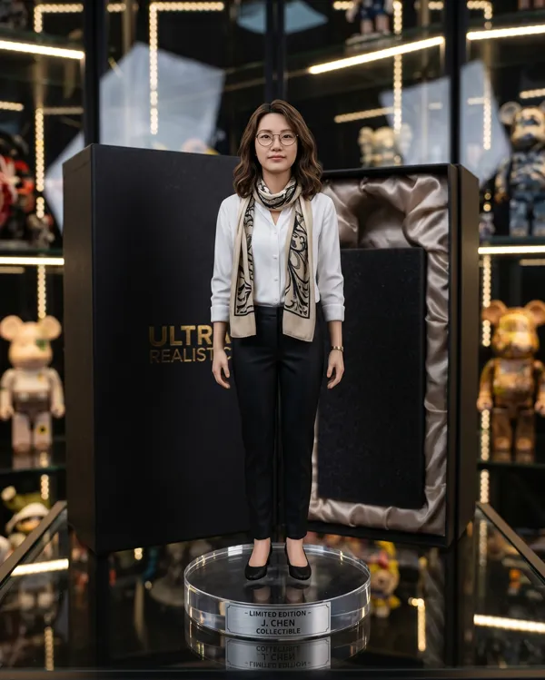

### 使用步骤

打开入口：在微信里搜索小程序“机灵助手”，进入首页后搜索“收藏柜手办”。
准备素材：想做“收藏玩家晒柜”感觉
提交生成：补充你想要的主体、风格、场景和用途。推荐模型选择 Gemini 3.1 Flash Image Preview (gemini-3.1-flash-image-preview)，画幅可先用 3:4。

### 使用建议

适合社媒上展示“新收手办/盲盒”的陈列感照片。
如果你想更豪华，可以补“玻璃柜、高级木纹、暖白灯带、收藏级陈列”。
3:4 比例在展示人物、包装和收藏柜环境之间比较均衡。

详情: https://docs.jiling.cc/templates/display-cabinet-collectible-figure.html ｜ 在线使用: https://www.jiling.cc/image-templates/display-cabinet-collectible-figure


---

## 抖音直播提示词与教程  <!-- douyin-live -->

适合生成抖音直播间截图、直播预热视频、社媒内容封面和主播人设图。

分类: 社媒内容 · 直播截图 ｜ 模型: GPT Image 2 (gpt-image-2) ｜ 画幅: 9:16 ｜ 尺寸: 1024x1536 ｜ 评分: 4.7/5 ｜ 13,468 条评价

标签: `抖音直播` `直播截图` `女主播` `社媒内容`

### 提示词

```text
生成一张高真实感的抖音直播截图。一位年轻漂亮的女主播正在电脑桌前直播，二次元科技感风格，长发，戴圆框眼镜，头戴白色兔耳发箍，脖子上挂着黑色耳机，穿黑白运动风外套和深色上衣，面对镜头自然讲话，表情亲切，手势正在讲解。直播间界面呈现真实手机竖屏抖音直播截图质感，在线人数显示99996，热度显示18+。弹幕和礼物区域自然叠加，有个叫“机灵助手”的大哥，给她刷了一个飞机礼物。画面保留直播 UI 层级、互动气泡、评论滚动、礼物动效、主播画面、顶部信息栏和底部互动区，整体真实、清晰、商业级、竖屏构图，1024x1536，高细节。
```

### 效果图

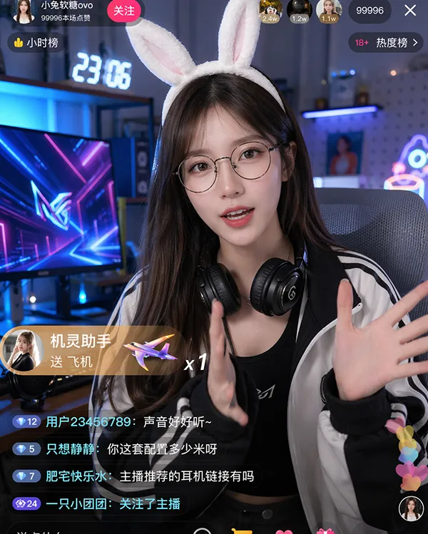

### 使用步骤

打开入口：在微信里搜索小程序“机灵助手”，进入首页后搜索“抖音直播”。
准备素材：无需上传参考图也可以直接生成；如需固定主播长相或服装，可上传 1 张清晰人物参考图。
提交生成：补充你想要的主体、风格、场景和用途。推荐模型选择 GPT Image 2 (gpt-image-2)，画幅可先用 9:16。

### 使用建议

人物描述越具体越稳定：发型、眼镜、发箍、耳机、服装、表情和手势建议写清楚，必要时上传人物参考图锁定长相。
想减少 UI 文字错误，建议把关键数字、昵称和礼物名称写得更明确。
如果需要品牌直播间，可补充品牌色、直播品类、主播话术和屏幕中的活动卖点。

详情: https://docs.jiling.cc/templates/douyin-live.html ｜ 在线使用: https://www.jiling.cc/image-templates/douyin-live


---

## 梦幻逆光天空系提示词与教程  <!-- dream-backlit-sky-poster -->

适合饮料、文创、轻护肤、校园系品牌和青春向节日 Campaign 的梦幻逆光天空品牌海报。

分类: 二次元/漫画 · 天空叙事 ｜ 模型: Gemini 3.1 Flash Image Preview (gemini-3.1-flash-image-preview) ｜ 画幅: 3:4 ｜ 尺寸: 2K ｜ 评分: 4.7/5 ｜ 11,018 条评价

标签: `逆光天空` `黄昏丁达尔` `青春电影感` `天空叙事` `二次元/漫画`

### 提示词

```text
使用我上传的产品图片作为唯一参考图（reference image），严格保持产品本体完全一致。必须保留产品的外观造型、尺寸比例、颜色、材质、包装结构、品牌logo、标签文字、图案位置与所有细节。不得重新设计产品。
将该产品置于梦幻逆光天空叙事场景中，背景为黄昏时刻的城市天台 / 校园屋顶 / 电车站台 / 开阔高地，天空占据大面积画面，呈现极高饱和度的紫蓝、金黄、橙粉渐变色，云层层次丰富，逆光强烈，空气中有明显的丁达尔光束与体积光效果，整体光影极具戏剧性与梦幻感。构图采用壁纸级海报式大留白，产品位于前景英雄位置或漂浮在画面视觉焦点，整体兼具青春感、希望感、浪漫感与情绪张力。
生成高完成度品牌级广告视觉（brand campaign visual），具有强烈情绪氛围、传播性和记忆点，主体清晰，产品识别度高，材质信息保留准确，构图具有海报张力，适合品牌主视觉 KV / 社媒广告 / 新品发布海报 / 电商活动 Banner / 封面图，超高清，8K，极致细节。
```

### 效果图

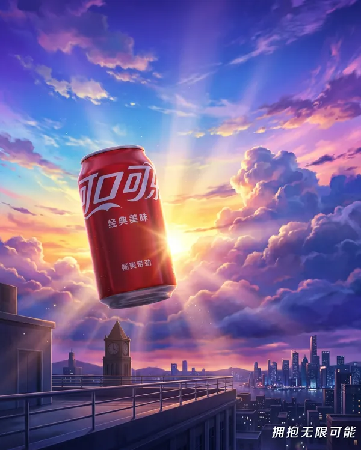

### 使用步骤

打开入口：在微信里搜索小程序“机灵助手”，进入首页后搜索“梦幻逆光天空系”。
准备素材：上传 1 张产品图即可，建议主体清晰、品牌信息完整，适合放在海报前景英雄位。
提交生成：补充你想要的主体、风格、场景和用途。推荐模型选择 Gemini 3.1 Flash Image Preview (gemini-3.1-flash-image-preview)，画幅可先用 3:4。

### 使用建议

这个模板最大的卖点是“天空层次”和“逆光情绪”，不是复杂场景堆料。
如果你想更像青春电影海报，可以保留站台、天台、屋顶和大面积留白。
3:4 比例适合活动海报、封面图和社媒竖版广告。

详情: https://docs.jiling.cc/templates/dream-backlit-sky-poster.html ｜ 在线使用: https://www.jiling.cc/image-templates/dream-backlit-sky-poster


---

## 东方幻想风格女性提示词与教程  <!-- eastern-fantasy-female -->

适合东方幻想、空灵神性、梦境氛围和高完成度女性角色插画创作。

分类: 二次元/漫画 · 角色插画 ｜ 模型: GPT Image 2 (gpt-image-2) ｜ 画幅: 2:3 ｜ 尺寸: 1024x1536 ｜ 评分: 4.7/5 ｜ 10,993 条评价

标签: `东方幻想` `女性肖像` `CG插画` `角色插画` `二次元/漫画`

### 提示词

```text
东方幻想风格女性，半身肖像，回眸侧脸，气质空灵优雅，柔和神性美感，细腻五官，微垂眼神，冷白细腻肌肤，淡雅橘粉妆容，金色高光点缀
长发飘动，发丝中融入彩色花朵与光粒（红、蓝、橙、紫），头发具有流动感与空气感
身穿半透明丝绸礼服与披肩，材质轻盈通透，布料随风飘动，表面带有鎏金纹理与闪耀颗粒。
整体光影为暖金色逆光，强边缘光，体积光明显，光粒漂浮，柔光泛光，梦幻氛围
背景干净浅色渐变，带微光与粒子效果，整体氛围空灵、梦境、神圣
风格：高端CG插画，超精细，电影级光影，柔光渲染，8K细节，artstation 热门作品风格
```

### 效果图

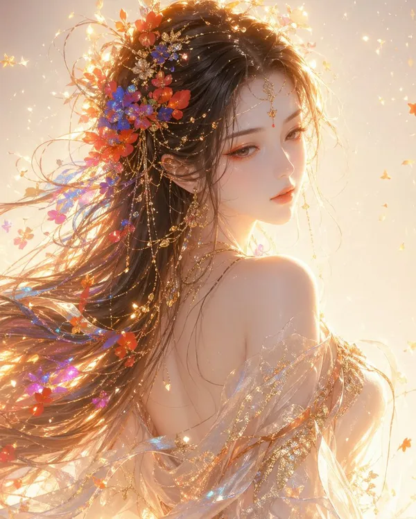

### 使用步骤

打开入口：在微信里搜索小程序“机灵助手”，进入首页后搜索“东方幻想风格女性”。
准备素材：无需上传参考图也可以直接生成；如果想固定脸型、发型或服装轮廓，可以上传 1 张人物参考图。
提交生成：补充你想要的主体、风格、场景和用途。推荐模型选择 GPT Image 2 (gpt-image-2)，画幅可先用 2:3。

### 使用建议

适合角色立绘、封面图、设定图和高完成度女性幻想插画。
如果你想让人物更温柔或更冷艳，可以直接补充眼神、嘴角和妆容的细节描述。
想增强画面记忆点时，可以补充花朵类型、饰品、披肩层次或光粒颜色方向。

详情: https://docs.jiling.cc/templates/eastern-fantasy-female.html ｜ 在线使用: https://www.jiling.cc/image-templates/eastern-fantasy-female


---

## 电商商品海报提示词与教程  <!-- ecommerce -->

适合护肤品、饮品、数码配件、电商主图。

分类: 电商 · 商品主图 ｜ 模型: Nano Banana Pro (nano-banana-pro) ｜ 画幅: 4:5 ｜ 尺寸: 2K ｜ 评分: 4.8/5 ｜ 18,709 条评价

标签: `商品主图` `广告质感` `突出卖点` `电商`

### 提示词

```text
一张高转化电商主图海报，主体商品居中展示，柔和高级棚拍光影，干净背景，悬浮元素点缀，突出质感与卖点，品牌广告视觉，细节锐利
```

### 效果图


### 使用步骤

打开入口：在微信里搜索小程序“机灵助手”，进入首页后搜索“电商商品海报”。
准备素材：商品白底图、包装图、局部质感图
提交生成：补充你想要的主体、风格、场景和用途。推荐模型选择 Nano Banana Pro (nano-banana-pro)，画幅可先用 4:5。

### 使用建议

适合护肤品、饮品、数码配件、电商主图。
输入卖点或上传产品图，直接起电商主图和详情页风格。

详情: https://docs.jiling.cc/templates/ecommerce.html ｜ 在线使用: https://www.jiling.cc/image-templates/ecommerce


---

## 电商爆款海报提示词与教程  <!-- ecommerce-bestseller-poster-template -->

适合基于产品图生成电商爆款促销海报，突出巨大产品主体、强视觉冲击、高端商业广告风格、动态光效、粒子特效和高级品牌感。

分类: 电商 · 风格海报 ｜ 模型: GPT Image 2 (gpt-image-2) ｜ 画幅: 2:3 ｜ 尺寸: 1024x1536 ｜ 评分: 4.8/5 ｜ 18,723 条评价

标签: `风格海报` `促销海报` `高点击广告` `电商`

### 提示词

```text
电商促销海报，
产品主体巨大突出，
视觉冲击力强，
高端商业广告风格，
动态光效，
粒子特效，
高级渐变背景，
促销氛围浓厚，
品牌感强，
电影级灯光，
商业设计，
高点击率广告视觉。
```

### 效果图

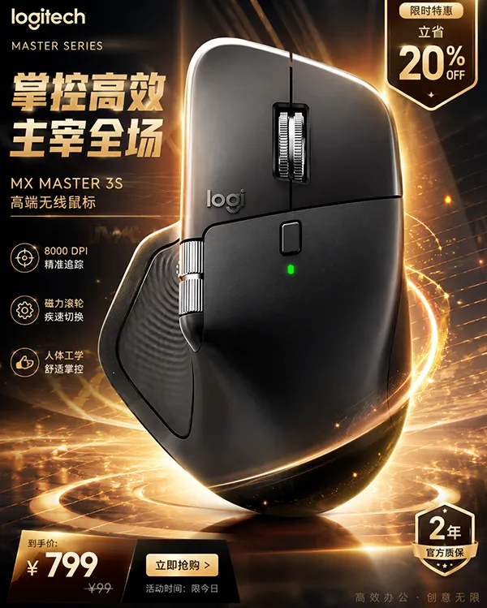

### 使用步骤

打开入口：在微信里搜索小程序“机灵助手”，进入首页后搜索“电商爆款海报模板”。
准备素材：建议上传主体完整、包装清晰、边缘明确的产品图，适合做新品促销、爆款转化、活动海报和信息流广告主视觉。
提交生成：补充你想要的主体、风格、场景和用途。推荐模型选择 GPT Image 2 (gpt-image-2)，画幅可先用 2:3。

### 使用建议

适合电商促销海报、活动页主视觉、信息流广告和社媒投放封面。
这个模板偏高冲击广告视觉，不适合直接作为平台合规白底主图。
如果想更像爆款海报，可以补充限时、上新、热卖、爆款推荐等具体促销语气。

详情: https://docs.jiling.cc/templates/ecommerce-bestseller-poster-template.html ｜ 在线使用: https://www.jiling.cc/image-templates/ecommerce-bestseller-poster-template


---

## 电商详情图提示词与教程  <!-- ecommerce-detail-image -->

适合快速生成商品卖点展示、详情页视觉和适合电商场景的产品介绍图。

分类: 电商 · 详情页设计 ｜ 模型: GPT Image 2 (gpt-image-2) ｜ 画幅: 2:3 ｜ 尺寸: 1024x1536 ｜ 评分: 4.8/5 ｜ 18,695 条评价

标签: `电商详情图` `详情页` `商品卖点` `详情页设计` `电商`

### 提示词

```text
生成【产品名称】电商详情图
```

### 效果图

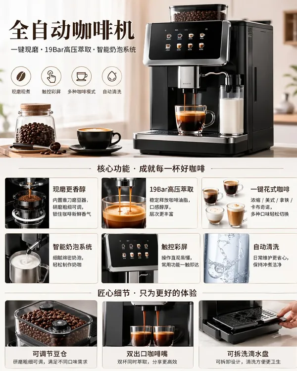

### 使用步骤

打开入口：在微信里搜索小程序“机灵助手”，进入首页后搜索“电商详情图”。
准备素材：无需上传参考图也可以直接生成；如果有真实产品图、包装图或品牌物料，可上传作为参考。
提交生成：补充你想要的主体、风格、场景和用途。推荐模型选择 GPT Image 2 (gpt-image-2)，画幅可先用 2:3。

### 使用建议

适合护肤、零食、饮料、数码配件、家居用品和各类标准电商商品。
如果你想让详情图更像真实商品页，可以补充核心卖点、使用场景和目标人群。
做系列商品时，建议统一标题语气、信息分区和页面气质。

详情: https://docs.jiling.cc/templates/ecommerce-detail-image.html ｜ 在线使用: https://www.jiling.cc/image-templates/ecommerce-detail-image


---

## 电商产品介绍图提示词与教程  <!-- ecommerce-product-intro-image -->

适合快速生成商品介绍页视觉，重点展示产品卖点、使用价值和适合电商阅读的内容结构。

分类: 电商 · 详情页设计 ｜ 模型: GPT Image 2 (gpt-image-2) ｜ 画幅: 2:3 ｜ 尺寸: 1024x1536 ｜ 评分: 4.8/5 ｜ 18,705 条评价

标签: `产品介绍图` `电商详情页` `商品介绍` `详情页设计` `电商`

### 提示词

```text
生成一个【产品名称】的电商产品介绍图
```

### 效果图


### 使用步骤

打开入口：在微信里搜索小程序“机灵助手”，进入首页后搜索“电商产品介绍图”。
准备素材：无需上传参考图也可以直接生成；如果有真实产品图、包装图或品牌物料，可上传作为参考。
提交生成：补充你想要的主体、风格、场景和用途。推荐模型选择 GPT Image 2 (gpt-image-2)，画幅可先用 2:3。

### 使用建议

适合零食饮料、日用品、数码配件、护肤品和各类标准电商商品。
如果你想让介绍图更像真实商品页，可以补充核心卖点、适用场景和目标人群。
做系列商品时，建议统一标题语气、信息分区和页面气质。

详情: https://docs.jiling.cc/templates/ecommerce-product-intro-image.html ｜ 在线使用: https://www.jiling.cc/image-templates/ecommerce-product-intro-image


---

## 电商促销海报设计提示词与教程  <!-- ecommerce-sale-poster-design -->

适合生成带 618 大促氛围、玻璃数字主视觉和优惠券模块的电商促销海报，适用于活动预热和节点宣传。

分类: 电商 · 风格海报 ｜ 模型: GPT Image 2 (gpt-image-2) ｜ 画幅: 2:3 ｜ 尺寸: 1024x1536 ｜ 评分: 4.8/5 ｜ 18,720 条评价

标签: `促销海报` `电商活动` `618大促` `风格海报` `电商`

### 提示词

```text
电商促销海报设计，整体采用粉红色渐变背景，覆盖着网格线纹理以创造3D空间感。海报呈圆角矩形设计。主要元素：顶部文案：细小白色文字"欢乐购物 与 您 同行"居中排列主视觉区域：大型半透明玻璃质感的"618"数字位于中央，具有3D立体效果上方有倾斜的白色粗体文字"季度盛典"，带有投影效果下方小字为"618大促 精选好物等你抢购"装饰元素：多条红色斜向横幅环绕主视觉，上面印有"SPECIAL OFFER"和"限时特惠"等循环文字几枚金色/橙色圆形装饰元素散布在页面上方和两侧底部区域：白色文字标语："—— 限时XYZ 购满即享优惠 ——"三个红色优惠券区块并排排列，分别显示："10￥ 满100元可用 限时抢购""20￥ 满200元可用 限时抢购""40￥ 满300元可用 限时抢购"整体设计色彩鲜明，层次分明，利用透明效果和立体感营造节日氛围，适合作为电商促销主题海报使用。
```

### 效果图


### 使用步骤

打开入口：在微信里搜索小程序“机灵助手”，进入首页后搜索“电商促销海报设计”。
准备素材：无需上传参考图也可以直接生成；如果有真实品牌视觉、活动物料或产品图，也可以上传作为参考。
提交生成：补充你想要的主体、风格、场景和用途。推荐模型选择 GPT Image 2 (gpt-image-2)，画幅可先用 2:3。

### 使用建议

适合 618、周年庆、节日促销和电商活动预热场景。
如果你想更像真实活动页，可以补充主推卖点、活动时间和目标人群。
做系列活动内容时，建议统一文案口吻、促销模块和色彩节奏。

详情: https://docs.jiling.cc/templates/ecommerce-sale-poster-design.html ｜ 在线使用: https://www.jiling.cc/image-templates/ecommerce-sale-poster-design


---

## 科普百科图提示词与教程  <!-- encyclopedia-infographic -->

适合把植物、动物、食材、用品、材料和各类知识主题做成可阅读、可收藏、可传播的百科信息图。

分类: 社媒内容 · 百科信息图 ｜ 模型: GPT Image 2 (gpt-image-2) ｜ 画幅: 2:3 ｜ 尺寸: 1024x1536 ｜ 评分: 4.7/5 ｜ 13,441 条评价

标签: `科普百科图` `百科信息图` `知识卡片` `社媒内容`

### 提示词

```text
请根据【主题】生成一张高质量竖版「科普百科图」。
这张图不是普通海报，也不是单纯插画，而是一张兼具“图鉴感、百科感、信息结构感、收藏感”的模块化科普信息图。整体风格参考高级博物图鉴、现代百科书页、生活方式知识卡和社交媒体高传播信息图的结合。
请让画面包含：
- 一个清晰漂亮的主题主视觉
- 若干局部特征放大细节
- 多个圆角模块化信息分区
- 清楚的标题层级与重点标签
- 简洁但丰富的百科内容
- 可视化评分、要点总结或Top 5模块
内容栏目请根据主题自动适配，优先从这些方向中选择并合理组合：
基础档案、分类信息、外观特征、习性/生态、形成机制/结构组成、生长或使用条件、养护或维护建议、风险与注意事项、适合人群或适用场景、优缺点对比、快速评分卡。
视觉要求：
浅色干净背景，柔和配色，轻阴影，精致小图标，圆角信息框，整洁排版，信息密度高但不拥挤，阅读体验好。整体必须像真正可以发布、阅读、收藏、系列化生产的科普百科卡，而不是广告图。
请不要做成普通商业宣传海报。要突出“知识整理 + 模块信息 + 图鉴式展示”的特征。
```

### 效果图


### 使用步骤

打开入口：在微信里搜索小程序“机灵助手”，进入首页后搜索“科普百科图”。
准备素材：无需上传参考图也可以直接生成；如果有指定对象、图鉴风格或版式方向，可上传参考图帮助锁定主视觉。
提交生成：补充你想要的主体、风格、场景和用途。推荐模型选择 GPT Image 2 (gpt-image-2)，画幅可先用 2:3。

### 使用建议

适合植物、动物、器物、食材、生活用品、自然现象和各类知识主题。
如果你希望内容更偏实用，可以补充使用条件、适合人群、风险提醒或维护建议。
想让整组内容更统一时，建议固定栏目结构、标签样式和配色方向。

详情: https://docs.jiling.cc/templates/encyclopedia-infographic.html ｜ 在线使用: https://www.jiling.cc/image-templates/encyclopedia-infographic


---

## 分层解构展示提示词与教程  <!-- exploded-selling-point-product-shot -->

适合做电商详情页核心卖点、成分分层和结构解构展示图。

分类: 电商 · 卖点解构 ｜ 模型: Nano Banana Pro (nano-banana-pro) ｜ 画幅: 1:1 ｜ 尺寸: 2K ｜ 评分: 4.8/5 ｜ 18,697 条评价

标签: `分层展示` `卖点解构` `成分展示` `电商`

### 提示词

```text
使用我上传的产品图片作为唯一参考图，保持产品本体完全一致。
将产品作为底部主成品展示，在其上方垂直悬浮分层展示【成分/结构/功能部件】，如【原料1】【原料2】【原料3】或【零件1】【零件2】。背景为纯黑或深色高级影棚环境，45度超写实商业摄影，强对比轮廓光，突出真实材质、颜色与光泽，层次清晰，空间透视强烈，适合电商详情页“核心卖点展示”，生成专业级商业广告图，8K。
```

### 效果图


### 使用步骤

打开入口：在微信里搜索小程序“机灵助手”，进入首页后搜索“分层解构展示”。
准备素材：上传 1 张产品图即可，建议主体清晰、适合做 45 度广告摄影；提交前补全成分或部件占位。
提交生成：补充你想要的主体、风格、场景和用途。推荐模型选择 Nano Banana Pro (nano-banana-pro)，画幅可先用 1:1。

### 使用建议

这个模板更像详情页卖点大图，不适合首图。
如果你的卖点很多，建议只留 2 到 3 层，不然画面会太拥挤。
1:1 比例适合详情页模块图和社媒卖点卡片。

详情: https://docs.jiling.cc/templates/exploded-selling-point-product-shot.html ｜ 在线使用: https://www.jiling.cc/image-templates/exploded-selling-point-product-shot


---

## 贴纸失败品可爱风提示词与教程  <!-- failed-sticker-cute-style -->

适合把人物、宠物或主体照片改绘成自制贴纸失败品风格的可爱涂鸦，强调粗黑描边、歪斜白边、笨笨贴纸造型和手工剪坏的收藏感。

分类: AI变装 · 二次元变身 ｜ 模型: GPT Image 2 (gpt-image-2) ｜ 画幅: 2:3 ｜ 尺寸: 1024x1536 ｜ 评分: 4.7/5 ｜ 16,584 条评价

标签: `二次元变身` `失败贴纸` `可爱涂鸦` `AI变装`

### 提示词

```text
将参考照片改绘成一张自制贴纸失败品风格的可爱涂鸦。保留人物或主体的基本姿势与特征，把轮廓压缩成简单、圆润、笨笨的贴纸造型。
外轮廓使用粗黑马克笔反复描边，线条宽窄不一，边缘抖动，白色贴纸边框也要歪斜、不均匀，像用剪刀手工剪坏了一点。人物头部偏大，五官挤在一起，手脚短小，动作略显僵硬。
表情可以是开心到呆住、尴尬微笑、委屈鼓脸或小心翼翼地挥手。加入爱心、星星、小花、蝴蝶结、迷你水果和奇怪的小伙伴作为装饰。
使用明亮但柔和的颜色，涂色出界，局部出现漏色、重叠和笔触。背景保持简单，像贴在旧笔记本、纸箱或练习册封面上。
整体像一个人第一次尝试制作角色贴纸，虽然剪歪了、画糊了，却因为笨拙而显得更加可爱、有趣、有收藏感。
不要商业贴纸质感，不要矢量图，不要平滑描边，不要完美白边，不要精致排版，不要高级渲染。
```

### 效果图


### 使用步骤

打开入口：在微信里搜索小程序“机灵助手”，进入首页后搜索“贴纸失败品可爱风”。
准备素材：建议上传主体清晰、姿势简单、轮廓明确的照片，人物、宠物、玩具或日常主体都适合变成失败品贴纸。
提交生成：补充你想要的主体、风格、场景和用途。推荐模型选择 GPT Image 2 (gpt-image-2)，画幅可先用 2:3。

### 使用建议

适合头像贴纸、社媒趣味图、表情包和可爱收藏感角色涂鸦。
这个模板会主动保留剪歪、画糊、描边抖动和涂色出界的失败品质感。
如果想更可爱，可以补充更多爱心、星星、小花、蝴蝶结或迷你水果装饰。

详情: https://docs.jiling.cc/templates/failed-sticker-cute-style.html ｜ 在线使用: https://www.jiling.cc/image-templates/failed-sticker-cute-style


---

## 狂热角色速写提示词与教程  <!-- fanatic-character-sketchbook -->

适合根据角色参考图生成整页日系漫画速写本，呈现同一角色的多姿势、多表情、Q版、特写、涂鸦文字和粉丝笔记式狂热氛围。

分类: 广告创意 · 草图细化 ｜ 模型: GPT Image 2 (gpt-image-2) ｜ 画幅: 2:3 ｜ 尺寸: 1024x1536 ｜ 评分: 4.8/5 ｜ 14,700 条评价

标签: `草图细化` `角色速写` `日系漫画` `广告创意`

### 提示词

```text
根据用户上传的角色参考图生成同一人物。像狂热粉丝画师凭着情绪把一整页速写本填满的感觉。
画面是一整页日系漫画速写本插画，像狂热粉丝画师凭着情绪把整张纸画满。白色速写本背景，左侧可见螺旋装订边或速写本边缘。整页反复出现同一个参考图角色的不同画法和瞬间。
构图极度密集、杂乱、重叠，没有整齐排列，几乎没有留白。包含多个全身姿势、半身像、背影、侧脸、坐姿、跳跃动作、奔跑动作、迷你Q版角色、手部特写、眼睛特写、脸部大特写。表情丰富夸张：害羞脸红、开心微笑、惊讶、慌张、眼睛发光、紧张流汗、被夸到不知所措。
周围布满手写感日文涂鸦、中文涂鸦、爱心、星星、感叹号、速度线、汗滴、脸红符号和漫画气泡，像粉丝笔记一样疯狂赞美角色：“太可爱了”“最喜欢”等词。整体有强烈速写感、草稿感和手绘能量，线条灵动，彩色马克笔上色，局部像未完成涂鸦。画面热闹、混乱、信息量爆炸，充满粉丝滤镜和狂热喜爱。
负面提示词：
不要改变参考图人物特征，不要换发色，不要换服装，不要成人化，不要性感化，不要暴露服装，不要写实风格，不要整齐网格排版，不要单一人物，不要单一姿势，不要大面积留白，不要干净海报设计，不要背景场景过复杂，不要低细节，不要恐怖血腥。
```

### 效果图


### 使用步骤

打开入口：在微信里搜索小程序“机灵助手”，进入首页后搜索“狂热角色速写”。
准备素材：建议上传清晰角色参考图，优先包含发型、服装、脸部特征和标志性配件，方便保持同一人物识别。
提交生成：补充你想要的主体、风格、场景和用途。推荐模型选择 GPT Image 2 (gpt-image-2)，画幅可先用 2:3。

### 使用建议

适合角色设定延展、漫画速写本、粉丝向视觉、头像/IP宣传和社媒内容创作。
如果画面过乱，可以要求减少涂鸦文字或限定主要姿势数量。
如果人物变化过大，建议补充“严格保留发色、服装和标志性配件”。

详情: https://docs.jiling.cc/templates/fanatic-character-sketchbook.html ｜ 在线使用: https://www.jiling.cc/image-templates/fanatic-character-sketchbook


---

## 时尚双栏电商图册提示词与教程  <!-- fashion-catalog -->

适合服装品牌上新、电商 Banner 和 lookbook 首图。

分类: 电商 · Banner横幅 ｜ 模型: Nano Banana Pro (nano-banana-pro) ｜ 画幅: 3:2 ｜ 尺寸: 2K ｜ 评分: 4.8/5 ｜ 18,705 条评价

标签: `Banner横幅` `时尚上新` `服装图册` `电商`

### 提示词

```text
一张精致的时尚大片，宽高比为 3:2，清晰地分为两个部分。
右侧：
一位时尚、自信、充满魅力的女士，在现代建筑风格的空间中随意地站立或行走，温暖的木质墙壁和柔和的自然光线营造出舒适的氛围。她身着一件深V领上衣，胸前有一颗小痣，身材比例完美，下身搭配一条高腰白色修身短裙。脚上是一双优雅简约的黑色细高跟鞋。她手提一只小巧精致的黑色手提包。
她的头发利落地梳成一个低髻，凸显了她精致的脸型。她戴着黑色窄框太阳镜和简约的耳环，整体造型优雅、现代，又不失随性时尚感。自然的光线、柔和的阴影、真实的肌肤纹理，营造出一种休闲时尚摄影的质感，同时又不失高端大片的氛围。中性色调、暖色调、浅景深，以及电影般的真实感，共同成就了这组照片。
风格与氛围：
现代优雅，低调奢华，自信，简约，时尚休闲。
摄影细节：
平视角度，自然姿态，35mm镜头，自然光，高细节，照片级真实感。
左侧：
简洁的极简主义产品展示布局，背景中性。女士身上穿着的每件时尚单品都单独展示，整齐排列，并辅以柔和的阴影效果。每件单品都配有小巧精致的价格标签，采用优雅的无衬线字体。
米色深V领针织上衣——180美元
白色高腰修身迷你裙——220美元
黑色尖头细高跟鞋——350美元
- 小号黑色硬挺手提包 — 480 美元
黑色窄框太阳镜——160美元
左侧的设计风格类似于奢侈时尚产品目录或电商产品图册，布局清晰，呈现方式高端大气，视觉效果平衡。
整体风格与氛围：
低调奢华，现代优雅，时尚杂志风格，高端零售美学。
照明和质量：
柔和的自然光，产品面清晰如影楼，照片真实感强，超高分辨率，专业时尚摄影。
否定提示：
布局杂乱，文字过大，标志花哨，模特，左侧有人，光线刺眼，分辨率低，卡通风格。
```

### 效果图


### 使用步骤

打开入口：在微信里搜索小程序“机灵助手”，进入首页后搜索“时尚双栏电商图册”。
准备素材：服装参考图、穿搭自拍、单品平铺图
提交生成：补充你想要的主体、风格、场景和用途。推荐模型选择 Nano Banana Pro (nano-banana-pro)，画幅可先用 3:2。

### 使用建议

适合服装品牌上新、电商 Banner 和 lookbook 首图。
上传人物或服装参考图，快速起一张“人物大片 + 单品目录”的电商视觉。

详情: https://docs.jiling.cc/templates/fashion-catalog.html ｜ 在线使用: https://www.jiling.cc/image-templates/fashion-catalog


---

## 节日倒计时海报提示词与教程  <!-- festival-countdown-poster -->

适合生成节日热点倒计时内容封面，重点是强情绪主视觉、倒计时数字、清单模块、贴纸和适合社媒转发的精致节日氛围。

分类: 社媒内容 · 拼贴海报 ｜ 模型: GPT Image 2 (gpt-image-2) ｜ 画幅: 2:3 ｜ 尺寸: 1024x1536 ｜ 评分: 4.7/5 ｜ 13,434 条评价

标签: `节日海报` `倒计时封面` `热点内容` `拼贴海报` `社媒内容`

### 提示词

```text
生成一张节日热点内容封面：
节日是：端午节
主题是：端午安康
倒计时：02天
画面中心是强情绪主视觉，周围有倒计时数字、清单模块、贴纸和仪式感小物。整体适合小红书和朋友圈转发，温暖、精致、有当下感，不要传统节庆红金堆砌。
```

### 效果图


### 使用步骤

打开入口：在微信里搜索小程序“机灵助手”，进入首页后搜索“节日倒计时海报”。
准备素材：无需上传参考图也可以直接生成；如果有节日物件、品牌素材、配色或封面排版参考，可以上传帮助锁定主视觉。
提交生成：补充你想要的主体、风格、场景和用途。推荐模型选择 GPT Image 2 (gpt-image-2)，画幅可先用 2:3。

### 使用建议

适合节日热点、倒计时预热、小红书封面、朋友圈转发图和品牌内容日历。
想增强仪式感时，可以补充粽叶、香囊、茶点、花束、便签或节日清单等小物。
如果不想太传统，可以继续强调浅色背景、现代贴纸、博主感排版和克制节庆色。

详情: https://docs.jiling.cc/templates/festival-countdown-poster.html ｜ 在线使用: https://www.jiling.cc/image-templates/festival-countdown-poster


---

## 扁平手绘涂鸦插画提示词与教程  <!-- flat-handdrawn-doodle-illustration -->

适合把人物或生活场景照片转换成充满童趣的民俗风扁平手绘涂鸦插画，保留原图构图和主要场景，并强化马卡龙配色、可爱装饰和温馨城市背景。

分类: AI变装 · 二次元变身 ｜ 模型: GPT Image 2 (gpt-image-2) ｜ 画幅: 2:3 ｜ 尺寸: 1024x1536 ｜ 评分: 4.7/5 ｜ 16,575 条评价

标签: `二次元变身` `扁平插画` `童趣涂鸦` `AI变装`

### 提示词

```text
将这张照片转换为充满童趣的民俗风扁平插画，融合手绘涂鸦元素。
保留原始照片的构图、人物及主要场景，但将所有细节简化为干净、鲜艳的扁平色块，呈现温暖自然、富有手工感和童真气息的视觉效果。
采用柔和的马卡龙色与明快鲜艳的配色相结合，为人物加入红润脸颊，搭配轻松随性的手绘线条。画面中点缀丰富可爱的装饰元素，如花朵、小鸟、旋涡纹样、星星、爱心等童趣符号，并保留充满生活气息的温馨城市背景细节。
整体氛围应温暖、欢乐、富有艺术感与治愈感，宛如一本现代儿童绘本中的精美插画，充满想象力与亲和力。
```

### 效果图


### 使用步骤

打开入口：在微信里搜索小程序“机灵助手”，进入首页后搜索“扁平手绘涂鸦插画”。
准备素材：建议上传人物和生活场景都清晰的照片，街道、校园、旅行、亲子、日常记录类画面都适合转换成童趣扁平插画。
提交生成：补充你想要的主体、风格、场景和用途。推荐模型选择 GPT Image 2 (gpt-image-2)，画幅可先用 2:3。

### 使用建议

适合社媒封面、头像插画、生活记录转绘、亲子内容和治愈系手绘图。
这个模板会主动简化细节，强化干净扁平色块、手工感线条和可爱装饰。
如果希望画面更像儿童绘本，可以继续强调温暖欢乐、现代绘本插画、亲和力和想象力。

详情: https://docs.jiling.cc/templates/flat-handdrawn-doodle-illustration.html ｜ 在线使用: https://www.jiling.cc/image-templates/flat-handdrawn-doodle-illustration


---

## 商品平铺图生成提示词与教程  <!-- flat-lay-generator -->

适合服饰、配件和组合套装的平铺陈列图。

分类: 电商 · 平铺图 ｜ 模型: Nano Banana Pro (nano-banana-pro) ｜ 画幅: 1:1 ｜ 尺寸: 2K ｜ 评分: 4.8/5 ｜ 18,697 条评价

标签: `平铺图` `商品陈列` `组合套装` `电商`

### 提示词

```text
生成一张适合电商详情页的商品平铺图，画面为 1:1，商品整齐排布，背景干净统一，柔和顶光，阴影克制，突出服装或商品的轮廓、材质和颜色。整体像专业商品平拍或品牌陈列图，布局整洁清楚，可以包含一套搭配或多个单品组合，不要出现人物，不要复杂道具。
```

### 效果图


### 使用步骤

打开入口：在微信里搜索小程序“机灵助手”，进入首页后搜索“商品平铺图生成”。
准备素材：商品正面图、套装图、局部材质图
提交生成：补充你想要的主体、风格、场景和用途。推荐模型选择 Nano Banana Pro (nano-banana-pro)，画幅可先用 1:1。

### 使用建议

适合服饰、配件和组合套装的平铺陈列图。
上传单品图或套装图，快速生成整齐干净的商品平铺图。

详情: https://docs.jiling.cc/templates/flat-lay-generator.html ｜ 在线使用: https://www.jiling.cc/image-templates/flat-lay-generator


---

## 45度悬浮动态图提示词与教程  <!-- floating-45-degree-product-shot -->

适合做电商详情页第二张、广告 Banner 和更有冲击力的悬浮产品图。

分类: 电商 · 悬浮展示 ｜ 模型: Nano Banana Pro (nano-banana-pro) ｜ 画幅: 1:1 ｜ 尺寸: 2K ｜ 评分: 4.8/5 ｜ 18,708 条评价

标签: `45度悬浮` `视觉冲击` `广告Banner` `悬浮展示` `电商`

### 提示词

```text
使用我上传的产品图片作为唯一参考图，产品必须与参考图完全一致，不得变形、改色、改logo、改包装。
将产品以45度角悬浮展示在干净中性背景中，保持真实比例与几何结构，下方添加柔和真实投影，增强空间深度与轻盈感，采用商业摄影灯光，边缘高光清晰，材质真实，画面具有现代感与视觉冲击力，适合作为电商详情页第二张或广告Banner，生成超真实商业产品摄影，8K。
```

### 效果图


### 使用步骤

打开入口：在微信里搜索小程序“机灵助手”，进入首页后搜索“45度悬浮动态图”。
准备素材：上传 1 张产品图即可，建议几何结构清楚、包装规整、轮廓完整。
提交生成：补充你想要的主体、风格、场景和用途。推荐模型选择 Nano Banana Pro (nano-banana-pro)，画幅可先用 1:1。

### 使用建议

这个模板适合做更有动感的辅助展示图，不建议直接替代合规主图。
如果产品是长方体、瓶罐或规则几何形体，悬浮表现会更强。
1:1 比例适合详情页卡位和广告位裁切。

详情: https://docs.jiling.cc/templates/floating-45-degree-product-shot.html ｜ 在线使用: https://www.jiling.cc/image-templates/floating-45-degree-product-shot


---

## 电商产品悬浮渲染提示词与教程  <!-- floating-product-render -->

适合做悬浮产品广告、电商主图升级和品牌级商业产品渲染。

分类: 产品摄影 · 高级静物 ｜ 模型: Nano Banana Pro (nano-banana-pro) ｜ 画幅: 1:1 ｜ 尺寸: 2K ｜ 评分: 4.8/5 ｜ 13,993 条评价

标签: `高级静物` `悬浮渲染` `商业广告` `产品摄影`

### 提示词

```text
基于用户上传的产品图片，生成一张高端商业广告级产品渲染图。产品主体精准还原原始外观、颜色、材质、结构与品牌细节，悬浮在半空中，周围环绕与产品属性相关的动态元素，如旋转水花、植物成分、雾气、玻璃碎光、金属粒子或丝绸流线。整体采用电影感轮廓光与高级棚拍布光，极浅景深，背景柔和虚化。光线穿过透明或半透明材质时产生自然折射、反射、高光与阴影变化，突出玻璃、金属、塑料、液体等材质质感。画面达到 4K 高端商业大片品质，构图简洁高级，彻底摆脱 AI 贴纸感，呈现真实产品摄影与CG广告融合的视觉效果。
```

### 效果图


### 使用步骤

打开入口：在微信里搜索小程序“机灵助手”，进入首页后搜索“电商产品悬浮渲染”。
准备素材：单个产品主体清晰、轮廓完整、材质细节明显的产品参考图
提交生成：补充你想要的主体、风格、场景和用途。推荐模型选择 Nano Banana Pro (nano-banana-pro)，画幅可先用 1:1。

### 使用建议

适合做悬浮产品广告、电商主图升级和品牌级商业产品渲染。
上传产品图，快速生成高端商业广告级的悬浮产品渲染图。

详情: https://docs.jiling.cc/templates/floating-product-render.html ｜ 在线使用: https://www.jiling.cc/image-templates/floating-product-render


---

## 餐饮菜单大片提示词与教程  <!-- food -->

适合菜单封面、外卖活动图、门店海报。

分类: 广告创意 · 菜单头图 ｜ 模型: Nano Banana Pro (nano-banana-pro) ｜ 画幅: 4:3 ｜ 尺寸: 2K ｜ 评分: 4.8/5 ｜ 14,715 条评价

标签: `菜单头图` `暖光美食` `活动海报` `广告创意`

### 提示词

```text
高端餐饮广告大片风格，主体食物特写，热气氛围，暖色环境光，质感餐具与桌面陈设，突出诱人色泽与层次，商业摄影级清晰度
```

### 效果图


### 使用步骤

打开入口：在微信里搜索小程序“机灵助手”，进入首页后搜索“餐饮菜单大片”。
准备素材：菜品实拍、摆盘参考、门店桌面氛围图
提交生成：补充你想要的主体、风格、场景和用途。推荐模型选择 Nano Banana Pro (nano-banana-pro)，画幅可先用 4:3。

### 使用建议

适合菜单封面、外卖活动图、门店海报。
做菜单封面、团购海报和门店活动图时很顺手。

详情: https://docs.jiling.cc/templates/food.html ｜ 在线使用: https://www.jiling.cc/image-templates/food


---

## 食品商业海报提示词与教程  <!-- food-commercial-poster -->

适合把食品、零食、饮品等商品图生成真实场景中的商业海报，重点保留包装识别并突出陪伴感、满足感和情绪价值。

分类: 电商 · 食品饮料 ｜ 模型: GPT Image 2 (gpt-image-2) ｜ 画幅: 2:3 ｜ 尺寸: 1024x1536 ｜ 评分: 4.8/5 ｜ 18,707 条评价

标签: `食品饮料` `商业海报` `商品广告` `电商`

### 提示词

```text
根据商品图生成一张食品商业海报。保留商品包装、主体形状、颜色和品牌识别，不改变产品核心外观。
主题：{{主题场景}}。
例如：学习补给、下午茶、运动后能量、玩乐派对、早餐陪伴、办公室加餐。
画面中商品作为主角，放置在符合主题的真实场景里。
背景可以包含{{背景元素}}，但不能喧宾夺主。
整体风格为{{视觉风格}}，光影自然，高级商业摄影质感。
表达重点：突出食品带来的陪伴感、满足感、能量感和情绪价值。
文案如果出现，使用简洁、温和、合规的中文广告语，不使用绝对化功效，不暗示医疗或保健治疗效果。
```

### 效果图


### 使用步骤

打开入口：在微信里搜索小程序“机灵助手”，进入首页后搜索“食品商业海报”。
准备素材：建议上传包装清晰、品牌识别完整、主体边缘明确的食品商品图，最好能看到正面标签、颜色和包装形状。
提交生成：补充你想要的主体、风格、场景和用途。推荐模型选择 GPT Image 2 (gpt-image-2)，画幅可先用 2:3。

### 使用建议

适合食品饮料、零食快消、新品种草和电商场景海报。
背景元素应该服务商品和主题，不建议堆太多与食品无关的道具。
如需更像广告投放素材，可以补充主标题、辅助卖点和简短购买引导。

详情: https://docs.jiling.cc/templates/food-commercial-poster.html ｜ 在线使用: https://www.jiling.cc/image-templates/food-commercial-poster


---

## 清新蓝底证件照提示词与教程  <!-- fresh-blue-id-photo -->

适合把人像照片生成清新蓝底证件照，重点是保留真实长相、自然表情、柔和蓝色背景、白衬衫和专业影楼质感。

分类: AI变装 · 写真 ｜ 模型: GPT Image 2 (gpt-image-2) ｜ 画幅: 2:3 ｜ 尺寸: 1024x1536 ｜ 评分: 4.7/5 ｜ 16,559 条评价

标签: `写真` `蓝底证件照` `白衬衫` `AI变装`

### 提示词

```text
将上传的人像照片转换为一张高质量、专业风格的证件照。保持人物面部五官、脸型、发型特征和自然表情不变，保留真实肤色与自然笑容。背景替换为柔和渐变的蓝色纯色背景，干净无杂物，呈现专业影楼证件照质感。可进行轻微自然美化修饰，例如适度磨皮、提亮肤色、减少暗沉，但不要过度修图，不要改变人物真实长相。将原有服装自然替换为正式白色衬衫，衣领整洁，风格端正。人物正面面向镜头，头部居中，肩膀自然平衡，头顶上方预留适当空间，头部占画面高度约 70%，整体清晰锐利，光线均匀，适合作为正式证件照使用。
```

### 效果图


### 使用步骤

打开入口：在微信里搜索小程序“机灵助手”，进入首页后搜索“清新蓝底证件照”。
准备素材：建议上传单人正脸、五官清晰、无遮挡、表情自然的人像照片，方便保留真实长相和证件照构图。
提交生成：补充你想要的主体、风格、场景和用途。推荐模型选择 GPT Image 2 (gpt-image-2)，画幅可先用 2:3。

### 使用建议

适合求职、报名照、个人资料头像和正式证件照风格化内容。
这个模板默认保留真实长相，只做轻微自然美化和蓝底证件照整理。
如果需要更标准，可以补充具体用途、底色要求、头肩裁切范围或服装细节。

详情: https://docs.jiling.cc/templates/fresh-blue-id-photo.html ｜ 在线使用: https://www.jiling.cc/image-templates/fresh-blue-id-photo


---

## 半透明毛玻璃视觉提示词与教程  <!-- frosted-glass-logo-visual -->

适合科技、金融、高端服务业的半透明磨砂玻璃 Logo 视觉，强调轻盈透光和高级呼吸感。

分类: Logo/字体 · Logo概念 ｜ 模型: Nano Banana Pro (nano-banana-pro) ｜ 画幅: 1:1 ｜ 尺寸: 2K ｜ 评分: 4.7/5 ｜ 7,858 条评价

标签: `磨砂玻璃` `半透明` `科技感Logo` `Logo概念` `Logo/字体`

### 提示词

```text
极简 Logo 设计，[图形描述，如：字母 A 或圆环]，采用半透明磨砂玻璃材质，具有柔和的光折射和焦散效果，色彩柔和（如淡蓝与紫罗兰），背景为纯净的白色，8K 分辨率，C4D 渲染质感，光线追踪，高雅而充满现代感。
```

### 效果图


### 使用步骤

打开入口：在微信里搜索小程序“机灵助手”，进入首页后搜索“半透明毛玻璃视觉”。
准备素材：建议填写图形描述或品牌首字母，例如字母 A、圆环、抽象翼形、双层几何图标。
提交生成：补充你想要的主体、风格、场景和用途。推荐模型选择 Nano Banana Pro (nano-banana-pro)，画幅可先用 1:1。

### 使用建议

第一步先把 `[图形描述]` 换成具体的字母或图形，不要直接原样提交。
如果你想更轻盈，可以保留淡蓝、紫罗兰和白底大留白。
如果你更在意落地性，生成后建议再做一版简化矢量稿。

详情: https://docs.jiling.cc/templates/frosted-glass-logo-visual.html ｜ 在线使用: https://www.jiling.cc/image-templates/frosted-glass-logo-visual


---

## 搞笑抽象涂鸦插画提示词与教程  <!-- funny-abstract-doodle-illustration -->

适合把人物照片改绘成抽象搞笑潦草涂鸦插画，保留人物基本特征、动作和服装，并强化草稿本乱画、豆豆眼、懵圈表情、旋转眼和高饱和撞色。

分类: AI变装 · 二次元变身 ｜ 模型: GPT Image 2 (gpt-image-2) ｜ 画幅: 2:3 ｜ 尺寸: 1024x1536 ｜ 评分: 4.7/5 ｜ 16,590 条评价

标签: `二次元变身` `抽象涂鸦` `搞笑插画` `AI变装`

### 提示词

```text
根据参考照片生成，保留人物基本特征、动作和服装，改绘成抽象搞笑潦草涂鸦插画。
像草稿本随手乱画，线条歪扭杂乱，头大身小，五官位置略偏，透视扭曲。人物表情改成呆滞懵圈，豆豆眼、微张嘴、汗滴、问号、旋转眼。
高饱和亮黄、荧光绿、热粉、橙红、湖蓝、紫色，涂色随意、粗糙、出界。背景加入旋转线、问号、星星、奇怪小动物、歪笑脸、乱写字。
不要写实、不要精致、不要高级渲染、不要画得太认真。
```

### 效果图


### 使用步骤

打开入口：在微信里搜索小程序“机灵助手”，进入首页后搜索“搞笑抽象涂鸦插画”。
准备素材：建议上传人物主体清晰、动作和服装可辨的照片，姿态越明确，生成后的抽象搞笑反差越强。
提交生成：补充你想要的主体、风格、场景和用途。推荐模型选择 GPT Image 2 (gpt-image-2)，画幅可先用 2:3。

### 使用建议

适合表情包、头像恶搞、朋友圈趣味图、小红书搞笑封面和抽象涂鸦梗图。
这个模板会主动降低精致度，强调线条歪扭杂乱、透视扭曲、涂色出界和五官位置跑偏。
如果想更抽象，可以继续强调头更大、眼神更懵、问号更多和背景更乱。

详情: https://docs.jiling.cc/templates/funny-abstract-doodle-illustration.html ｜ 在线使用: https://www.jiling.cc/image-templates/funny-abstract-doodle-illustration


---

## 搞笑笨拙涂鸦插画提示词与教程  <!-- funny-clumsy-doodle-illustration -->

适合把人物照片改绘成笨拙搞笑的潦草涂鸦插画，保留人物基本特征、服装、姿势和构图，并强化廉价马克笔、蜡笔、圆珠笔质感、夸张大笑和高饱和撞色。

分类: AI变装 · 二次元变身 ｜ 模型: GPT Image 2 (gpt-image-2) ｜ 画幅: 2:3 ｜ 尺寸: 1024x1536 ｜ 评分: 4.7/5 ｜ 16,566 条评价

标签: `二次元变身` `笨拙涂鸦` `搞笑插画` `AI变装`

### 提示词

```text
根据参考照片生成，保留人物基本特征、服装、姿势和构图，改绘成笨拙搞笑的潦草涂鸦插画。
廉价马克笔、蜡笔、圆珠笔质感，线条歪扭、重复描边、比例不协调、透视轻微扭曲。人物表情改成夸张大笑，嘴巴张大，眼睛眯起，五官滑稽变形。
高饱和撞色，亮黄、荧光粉、湖蓝、草绿、橙红，涂色粗糙出界。背景加入星星、箭头、感叹号、手写小字、乱涂符号。
不要写实、不要精致、不要干净线稿、不要高级渲染。
```

### 效果图


### 使用步骤

打开入口：在微信里搜索小程序“机灵助手”，进入首页后搜索“搞笑笨拙涂鸦插画”。
准备素材：建议上传人物清晰、服装和姿势可辨的照片，表情或动作越明显，生成后的搞笑涂鸦反差越强。
提交生成：补充你想要的主体、风格、场景和用途。推荐模型选择 GPT Image 2 (gpt-image-2)，画幅可先用 2:3。

### 使用建议

适合表情包、头像恶搞、朋友圈趣味图、小红书搞笑封面和低成本手绘梗图。
这个模板会主动降低精致度，强调线条歪扭、重复描边、比例不协调和涂色出界。
如果想更好笑，可以继续强调嘴巴更大、眼睛更眯、表情更夸张和撞色更强。

详情: https://docs.jiling.cc/templates/funny-clumsy-doodle-illustration.html ｜ 在线使用: https://www.jiling.cc/image-templates/funny-clumsy-doodle-illustration


---

## 搞笑涂鸦风格提示词与教程  <!-- funny-doodle-style -->

适合把照片改造成低成本儿童画式搞笑涂鸦，强调头大身小、歪扭线条、随便上色、尴尬符号和丑萌梗图喜感。

分类: 二次元/漫画 · 角色插画 ｜ 模型: GPT Image 2 (gpt-image-2) ｜ 画幅: 2:3 ｜ 尺寸: 1024x1536 ｜ 评分: 4.7/5 ｜ 10,994 条评价

标签: `角色插画` `搞笑涂鸦` `表情包风` `二次元/漫画`

### 提示词

```text
把这张照片画成一幅更搞笑、更丑萌、更懒散的互联网表情包涂鸦：像是随手乱画出来的低成本儿童画，用廉价马克笔、蜡笔和圆珠笔涂涂改改。人物比例故意画歪，头大身小，四肢僵硬，表情呆滞又傻乎乎，五官轻微夸张但不要恐怖。透视非常糟糕，线条歪歪扭扭，涂色随便、溢出边框、颜色不均，有明显笔触和乱七八糟的草稿线。
背景做成极简粗糙的卡通场景，加入随意的火柴人、问号、汗滴、小星星、尴尬速度线、奇怪涂鸦符号，让画面看起来像一张故意画坏但很好笑的梗图。整体要不精致、不高级、不认真、不写实，有一种“画得很烂但莫名好笑”的丑萌喜剧感。
–no realism, realistic details, shading, polished art, masterpiece, beautiful, elegant, 3D, cinematic, high detail, smooth lines, perfect anatomy, clean coloring
```

### 效果图


### 使用步骤

打开入口：在微信里搜索小程序“机灵助手”，进入首页后搜索“搞笑涂鸦风格”。
准备素材：建议上传主体清晰、表情或姿势有特点的人物、宠物或日常照片，轮廓越明确，转成涂鸦梗图后越容易保留识别点。
提交生成：补充你想要的主体、风格、场景和用途。推荐模型选择 GPT Image 2 (gpt-image-2)，画幅可先用 2:3。

### 使用建议

适合表情包、社媒趣味图、头像和故意画坏的丑萌涂鸦内容。
这个模板会主动弱化精致度和真实感，重点是不好好画但好笑的互联网感。
想让效果更离谱时，可以强调线条更歪、上色更乱、背景符号更尴尬。

详情: https://docs.jiling.cc/templates/funny-doodle-style.html ｜ 在线使用: https://www.jiling.cc/image-templates/funny-doodle-style


---

## 未来潮玩盲盒风提示词与教程  <!-- future-designer-toy-avatar -->

适合社媒头像、品牌 IP 形象、潮流联名视觉、美妆饰品拟人化广告和虚拟代言人形象。

分类: 社媒内容 · 社媒头像 ｜ 模型: Gemini 3.1 Flash Image Preview (gemini-3.1-flash-image-preview) ｜ 画幅: 3:4 ｜ 尺寸: 2K ｜ 评分: 4.7/5 ｜ 13,452 条评价

标签: `潮玩头像` `Q版角色` `品牌IP` `社媒头像` `社媒内容`

### 提示词

```text
使用我上传的图片作为唯一参考图（reference image），严格保持主体核心特征完全一致。必须保留原始人物或主体的脸部识别特征、发型轮廓、姿态逻辑、服饰关键特征与配色倾向，不得改变主体身份。
将主体转化为高端收藏级未来潮玩盲盒角色，整体采用 Q 版比例与高级树脂潮玩质感，头身比偏可爱化但保留原始识别特征，皮肤或表面呈现介于陶瓷与高光树脂之间的细腻质感，带有轻微磨砂与高光反射，配色以【主色：薄荷绿 / 樱花粉 / 奶油白 / 冷灰】为主，服饰保留原始造型但升级为未来感潮流版本。周围漂浮透明几何体、亚克力碎片、半透明气泡或极简科幻配件，背景为干净的高端工作室环境，采用聚光灯与柔和轮廓光，整体呈现高级潮玩广告摄影风格，清新、昂贵、精致、极具社媒辨识度。
生成高完成度品牌级广告视觉（brand campaign visual），具有强烈传播性、社媒吸引力与记忆点，主体清晰，材质语言统一，构图具有封面感，适合品牌主视觉 KV / 社媒头像 / 封面图 / Campaign 海报 / 小红书封面 / 联名款视觉，超高清，8K，极致细节。
```

### 效果图


### 使用步骤

打开入口：在微信里搜索小程序“机灵助手”，进入首页后搜索“未来潮玩盲盒风”。
准备素材：上传 1 张主体图即可。人物建议面部清晰，宠物或产品拟人化建议轮廓明确、主体完整。
提交生成：补充你想要的主体、风格、场景和用途。推荐模型选择 Gemini 3.1 Flash Image Preview (gemini-3.1-flash-image-preview)，画幅可先用 3:4。

### 使用建议

这个模板更适合做头像、封面和 IP 形象，不是传统商品图。
想减少视觉漂移，原图最好主体单一、轮廓清晰、识别点明确。
如果你要连续做一组角色资产，建议固定主色、姿态逻辑和服饰关键词。

详情: https://docs.jiling.cc/templates/future-designer-toy-avatar.html ｜ 在线使用: https://www.jiling.cc/image-templates/future-designer-toy-avatar


---

## 未来的自己提示词与教程  <!-- future-self-2041 -->

适合根据上传照片生成 2041 年未来自己的成熟商务写真，重点保持面部识别特征一致，并呈现真实老化、高级商务形象和都市未来感背景。

分类: AI变装 · 写真 ｜ 模型: GPT Image 2 (gpt-image-2) ｜ 画幅: 2:3 ｜ 尺寸: 1024x1536 ｜ 评分: 4.7/5 ｜ 16,566 条评价

标签: `写真` `未来肖像` `商务形象` `AI变装`

### 提示词

```text
参考上传照片。
生成2041年的我。
年龄增加15岁。
保持面部识别特征一致。
更成熟、更有阅历感。
高级商务形象。
都市未来感背景。
cinematic future portrait, realistic aging, premium lifestyle photography, photorealistic
```

### 效果图


### 使用步骤

打开入口：在微信里搜索小程序“机灵助手”，进入首页后搜索“未来的自己”。
准备素材：建议上传五官清晰、脸型和发型可辨的人像照片，正脸或轻微侧脸都适合生成未来自己的成熟肖像。
提交生成：补充你想要的主体、风格、场景和用途。推荐模型选择 GPT Image 2 (gpt-image-2)，画幅可先用 2:3。

### 使用建议

适合未来自己写真、个人头像升级、职业形象和社媒封面。
这个模板强调真实老化和成熟阅历感，不适合夸张变老或大幅改变五官。
如果结果太年轻，可以继续强调年龄增加 15 岁、眼神更成熟、面部纹理更自然。

详情: https://docs.jiling.cc/templates/future-self-2041.html ｜ 在线使用: https://www.jiling.cc/image-templates/future-self-2041


---

## 高考海报设计提示词与教程  <!-- gaokao-poster-design -->

适合生成 2026 年高考主题祝福海报，围绕旗开得胜、金榜题名、升学祝福和校园励志氛围进行视觉设计。

分类: 广告创意 · 品牌海报 ｜ 模型: GPT Image 2 (gpt-image-2) ｜ 画幅: 2:3 ｜ 尺寸: 1024x1536 ｜ 评分: 4.8/5 ｜ 14,709 条评价

标签: `品牌海报` `高考海报` `金榜题名` `广告创意`

### 提示词

```text
做一张2026年高考「旗开得胜·金榜题名」主题的海报
```

### 效果图


### 使用步骤

打开入口：在微信里搜索小程序“机灵助手”，进入首页后搜索“高考海报设计”。
准备素材：无需上传参考图也可以生成；如果有学校视觉、校徽、主色调或过往活动海报，可以上传作为参考。
提交生成：补充你想要的主体、风格、场景和用途。推荐模型选择 GPT Image 2 (gpt-image-2)，画幅可先用 2:3。

### 使用建议

适合高考祝福海报、校园活动海报、班级社媒海报和升学季宣传物料。
如果需要加入学校或班级信息，建议把文字内容写短并分清主次。
如果生成文字不稳定，可以先生成无小字版本，再单独做排版。

详情: https://docs.jiling.cc/templates/gaokao-poster-design.html ｜ 在线使用: https://www.jiling.cc/image-templates/gaokao-poster-design


---

## 吉卜力旅行照提示词与教程  <!-- ghibli-travel-photo -->

适合把旅行纪念照变成吉卜力动画电影感的治愈系旅行画面。

分类: AI变装 · 二次元变身 ｜ 模型: Nano Banana Pro (nano-banana-pro) ｜ 画幅: 3:4 ｜ 尺寸: 2K ｜ 评分: 4.7/5 ｜ 16,582 条评价

标签: `二次元变身` `旅行照` `吉卜力风格` `AI变装`

### 提示词

```text
将上传的旅行照片转换为吉卜力动画电影风格，保留人物辨识度与原场景构图，整体为手绘动画+柔和水彩质感，低饱和清新配色，天空通透，阳光温暖，风景层次丰富，人物自然融入画面，带有宫崎骏电影般的夏日冒险感、治愈感与童话感，电影感构图，高细节，高分辨率。
```

### 效果图


### 使用步骤

打开入口：在微信里搜索小程序“机灵助手”，进入首页后搜索“吉卜力旅行照”。
准备素材：优先上传人物清晰、场景完整、光线自然的旅行照或户外纪念照
提交生成：补充你想要的主体、风格、场景和用途。推荐模型选择 Nano Banana Pro (nano-banana-pro)，画幅可先用 3:4。

### 使用建议

适合把旅行纪念照变成吉卜力动画电影感的治愈系旅行画面。
上传旅行照片，快速生成吉卜力动画电影感的治愈系旅行画面。

详情: https://docs.jiling.cc/templates/ghibli-travel-photo.html ｜ 在线使用: https://www.jiling.cc/image-templates/ghibli-travel-photo


---

## 巨型人物脚手架提示词与教程  <!-- giant-scaffold-person -->

适合做巨型人物、超现实尺度反差和城市场景海报。

分类: 场景创意 · 不可能场景 ｜ 模型: Nano Banana Pro (nano-banana-pro) ｜ 画幅: 9:16 ｜ 尺寸: 2K ｜ 评分: 4.7/5 ｜ 7,009 条评价

标签: `不可能场景` `巨型人物` `城市奇观` `场景创意`

### 提示词

```text
图片中人物站着自拍的超写实3D渲染图。画面里这个巨型人物全身环绕着庞大的脚手架，脚手架上有许多身形微小的建筑工人正在作业。场景设定在一个城市广场，周围是现代化建筑，还有行驶中的交通工具（轿车、公交车）、行人，以及晴朗明亮的湛蓝天空。整体细节丰富，呈现出照片级的真实质感，且采用了电影级灯光效果。
```

### 效果图


### 使用步骤

打开入口：在微信里搜索小程序“机灵助手”，进入首页后搜索“巨型人物脚手架”。
准备素材：单人全身或半身人像，五官清晰、服装明确、姿态自然
提交生成：补充你想要的主体、风格、场景和用途。推荐模型选择 Nano Banana Pro (nano-banana-pro)，画幅可先用 9:16。

### 使用建议

适合做巨型人物、超现实尺度反差和城市场景海报。
上传人物参考图，快速生成“巨型人物被脚手架包围”的超现实城市场景。

详情: https://docs.jiling.cc/templates/giant-scaffold-person.html ｜ 在线使用: https://www.jiling.cc/image-templates/giant-scaffold-person


---

## 玻璃瓶纪念品提示词与教程  <!-- glass-bottle-souvenir -->

适合做旅行纪念、微缩收藏和高端瓶中场景创意图。

分类: 场景创意 · 微缩世界 ｜ 模型: Nano Banana Pro (nano-banana-pro) ｜ 画幅: 3:4 ｜ 尺寸: 2K ｜ 评分: 4.7/5 ｜ 7,002 条评价

标签: `微缩世界` `玻璃瓶模型` `收藏人偶` `场景创意`

### 提示词

```text
1/7比例的商品化收藏级人偶，以照片中人物为原型，高度写实的风格打造。人偶置于细致的沙滩环境中，沙滩、贝壳和轻柔的海浪交织在一起。整个玩具展示架被封装在一个透明的纪念品玻璃瓶中，使其呈现出高端的微缩立体模型效果，并拥有逼真的光影效果。
```

### 效果图


### 使用步骤

打开入口：在微信里搜索小程序“机灵助手”，进入首页后搜索“玻璃瓶纪念品”。
准备素材：单人全身或半身参考图，人物清晰、服装明确、光线自然
提交生成：补充你想要的主体、风格、场景和用途。推荐模型选择 Nano Banana Pro (nano-banana-pro)，画幅可先用 3:4。

### 使用建议

适合做旅行纪念、微缩收藏和高端瓶中场景创意图。
上传人物参考图，快速生成“透明玻璃瓶中的沙滩微缩纪念品”创意效果。

详情: https://docs.jiling.cc/templates/glass-bottle-souvenir.html ｜ 在线使用: https://www.jiling.cc/image-templates/glass-bottle-souvenir


---

## 光环叙事提示词与教程  <!-- halo-narrative -->

适合把人像改造成带灰度故事板光环、金色夕阳光晕和高级时装摄影感的超现实奢华概念人像。

分类: AI变装 · 杂志/海报 ｜ 模型: GPT Image 2 (gpt-image-2) ｜ 画幅: 2:3 ｜ 尺寸: 1024x1536 ｜ 评分: 4.7/5 ｜ 16,580 条评价

标签: `杂志/海报` `故事板光环` `时尚人像` `AI变装`

### 提示词

```text
请根据参考图片中的五官特征、脸型、神态与整体气质来生成主体人物，保持人物面部辨识度与参考图一致，同时融合以下画面风格：
一张竖版时尚人像：一位年轻、时髦的日本女孩，穿着黑白单色系设计师服装。背景由一圈灰度故事板画面组成，像光环一样环绕着她的头部和上半身。每一帧都展现细腻的情绪瞬间：温柔微笑、行走的剪影、发丝飘动、凝望城市天际线。中心光线带有金色夕阳般的光晕，营造出神圣的高级时装大片氛围。整体是超现实的奢华时尚概念。
```

### 效果图


### 使用步骤

打开入口：在微信里搜索小程序“机灵助手”，进入首页后搜索“光环叙事”。
准备素材：建议上传单人、面部清晰、表情自然的人像照片，方便保留五官特征、脸型、神态和整体气质。
提交生成：补充你想要的主体、风格、场景和用途。推荐模型选择 GPT Image 2 (gpt-image-2)，画幅可先用 2:3。

### 使用建议

适合高级时装封面、人物概念海报、社媒头像和带叙事感的人像视觉。
上传图建议人物主体明确、五官完整，避免多人同框或大面积遮挡。
如果想强化故事感，可以补充分镜中的城市、行走、回眸或发丝动态细节。

详情: https://docs.jiling.cc/templates/halo-narrative.html ｜ 在线使用: https://www.jiling.cc/image-templates/halo-narrative


---

## 手绘风注解提示词与教程  <!-- hand-drawn-annotation-style -->

适合为照片中真实存在的人物细节、物品和环境元素添加中文手绘风注解，强调白色细线、箭头圈选、生活感短句和小红书日记式封面氛围。

分类: 社媒内容 · 拼贴海报 ｜ 模型: GPT Image 2 (gpt-image-2) ｜ 画幅: 2:3 ｜ 尺寸: 1024x1536 ｜ 评分: 4.7/5 ｜ 13,451 条评价

标签: `拼贴海报` `手绘注解` `生活碎片` `社媒内容`

### 提示词

```text
请观察上传照片中的真实元素，为画面中可识别的物品、人物细节或环境元素添加「中文手绘风注解」。
要求保留原照片构图和主体，不改变照片内容。使用白色细线手绘线条，风格像随手一笔画，轻松自然、略带不均匀感。可沿物件外围描边，用箭头、虚线、圈选线条做简单引导。
注解文字使用清晰可爱的中文手写字体，句子要短，像日记里的小碎念，有生活感和一点情绪。只标注照片中真实存在的内容，不要凭空添加。注解数量适中，保留留白，不要过度装饰。
常用热门注解示例：
今日份开心、氛围感拉满、好喜欢这个、松弛感瞬间、出片小细节、可爱加分项、刚好被光照到、偷偷记录一下、生活碎片、今日穿搭重点、治愈小角落、普通但喜欢、随手拍也好看、这个颜色很戳我、今天也要发光。
```

### 效果图


### 使用步骤

打开入口：在微信里搜索小程序“机灵助手”，进入首页后搜索“手绘风注解”。
准备素材：建议上传主体明确、细节丰富的生活照、穿搭照、探店照、旅行照或静物照片，真实可识别元素越多，注解越自然。
提交生成：补充你想要的主体、风格、场景和用途。推荐模型选择 GPT Image 2 (gpt-image-2)，画幅可先用 2:3。

### 使用建议

适合小红书封面、朋友圈照片改造、生活记录、穿搭标注和探店内容包装。
这个模板会强调只标注照片中真实存在的元素，避免凭空添加无关内容。
如果照片本身很复杂，可以补充“注解数量少一点”来保持画面干净。

详情: https://docs.jiling.cc/templates/hand-drawn-annotation-style.html ｜ 在线使用: https://www.jiling.cc/image-templates/hand-drawn-annotation-style


---

## 手绘涂鸦卡通肖像提示词与教程  <!-- hand-drawn-doodle-cartoon-portrait -->

适合把人像转换成温暖随性的手绘涂鸦卡通肖像，重点是粗黑马克笔线稿、轻微侧脸头像、蜡笔彩铅质感、平面色块和数字手账氛围。

分类: 二次元/漫画 · 角色插画 ｜ 模型: GPT Image 2 (gpt-image-2) ｜ 画幅: 2:3 ｜ 尺寸: 1024x1536 ｜ 评分: 4.7/5 ｜ 11,019 条评价

标签: `角色插画` `手绘涂鸦` `卡通肖像` `二次元/漫画`

### 提示词

```text
请生成一幅手绘涂鸦风格的卡通肖像。
画面主体是一位人物肖像，采用轻微侧脸角度，但仍然保持清晰的正面肖像感。人物头部和五官可以略微放大，造型简化，表情自然、友好、轻松，带一点温暖的笑意。整体气质可爱、亲切、随性，像日常生活中随手画下的人像小涂鸦。
画风为粗黑色马克笔手绘线稿，线条边缘不规则，略微歪斜和抖动，保留真实手绘的不完美感。轮廓线要明显、厚重，但不要像矢量图一样过于干净锋利。画面中应保留可见的铅笔、蜡笔或彩色铅笔质感，包括轻微的笔触、涂色颗粒和不均匀上色痕迹。
上色方式使用柔和、干净的平面色块，颜色简单温暖，带有轻微蜡笔或彩铅纹理。不要真实光影，不要渐变，不要高光，不要厚重阴影，不要电影感灯光。整体应保持二维平面插画效果，像在手机笔记应用或数字手账中随手画出的头像草图。
背景保持极简、干净、不杂乱，可以加入少量简单的手绘几何线条、家具轮廓、墙面线条或基础室内元素。背景元素也要使用同样的涂鸦手绘风格，不能抢走人物主体的注意力。
整体效果应温暖、可爱、放松、俏皮、有个人感，像一张 spontaneous、cozy、playful 的数字笔记本手绘肖像。
避免：照片写实、真实五官渲染、复杂动漫风、漫画精修风、3D 效果、戏剧化光照、重阴影、过多细节、过度精修 AI 感、高清写实纹理、电影感、锐利完美的矢量线条、光滑塑料质感。
```

### 效果图


### 使用步骤

打开入口：在微信里搜索小程序“机灵助手”，进入首页后搜索“手绘涂鸦卡通肖像”。
准备素材：建议上传单人、五官清晰、脸部无遮挡的人像照片，轮廓和发型越明确，涂鸦化后越容易保留个人感。
提交生成：补充你想要的主体、风格、场景和用途。推荐模型选择 GPT Image 2 (gpt-image-2)，画幅可先用 2:3。

### 使用建议

适合头像、社媒封面、数字手账和温暖卡通肖像内容。
这个模板会主动弱化真实光影和细节，重点是手绘不完美感和平面插画效果。
如果想更随性，可以强调线条更抖动、上色更像蜡笔或背景更像笔记本涂鸦。

详情: https://docs.jiling.cc/templates/hand-drawn-doodle-cartoon-portrait.html ｜ 在线使用: https://www.jiling.cc/image-templates/hand-drawn-doodle-cartoon-portrait


---

## 手绘包装提案提示词与教程  <!-- hand-drawn-packaging-proposal -->

适合包装设计提案、品牌概念展示、新品包装方向探索和创意评审海报。

分类: 广告创意 · 包装提案 ｜ 模型: GPT Image 2 (gpt-image-2) ｜ 画幅: 2:3 ｜ 尺寸: 1024x1536 ｜ 评分: 4.8/5 ｜ 14,718 条评价

标签: `包装设计` `提案板` `手绘草图` `包装提案` `广告创意`

### 提示词

```text
请为【产品名称】生成一张“手绘包装提案板风格”的产品介绍海报。
如果我提供了产品图片，请以该图片为主要参考，保留产品的核心外观特征、包装形态、颜色、材质、品牌识别和整体气质，并优先沿用产品图中的主色调与配色关系进行设计。
如果我没有提供产品图片，请根据【产品名称】自动生成符合该产品定位的产品外观与包装设计，并根据产品属性、品类特征和气质，自动搭配自然合理的主色、辅助色和背景色。
海报整体风格要求：
这不是普通电商详情页，也不是单纯棚拍海报，而是一张融合“产品成品图 + 包装设计草图 + 品牌概念开发过程”的创意提案板。整体呈现为高审美、高完成度的品牌设计展示图，像设计师正在展示一个包装概念方案。
画面要求：
- 竖版构图
- 使用统一且有品牌感的主色调背景，背景颜色根据产品本身自然决定，不固定为某一种颜色
- 配色应与产品属性协调：如果有参考图，优先继承参考图的主色和品牌色；如果没有参考图，则根据产品名称自动生成合理的色彩方案
- 画面中央放置一个最完整、最吸睛的产品主视觉，具有真实质感、立体光影和商业成品效果
- 产品周围加入多个辅助视觉元素：不同角度的包装草图、结构草图、局部造型探索、手持展示小稿、包装展开思路、品牌字样排版试验
- 加入自然随性的黑色或深色手绘线稿、箭头、圈画、符号、手写中文批注，让画面具有强烈“设计过程感”和“创意提案感”
- 成品图要相对精致真实，草图部分要相对随性灵动，形成“完成品 + 设计草图”的对比
- 版式看起来松弛自由，但整体要有秩序、有节奏、有视觉中心，体现高级平面设计感
- 可以适度加入与产品相关的小图形、小符号或趣味元素，增强品牌记忆点
- 最终效果应具有品牌感、创意感、过程感和视觉冲击力
配色原则：
- 不要固定黄色背景
- 要根据产品类型、材质、用途、消费感受和品牌气质自动选择主色调
- 背景色、产品色、文字色、草图线稿色应彼此协调
- 可以使用高饱和单色背景，也可以使用柔和统一色系背景，只要整体有品牌感和视觉冲击力
- 色彩应自然服务于产品，而不是喧宾夺主
风格关键词：
包装设计提案板、品牌概念开发、手绘草图、设计过程感、moodboard、创意评审稿、产品成品渲染、视觉实验、商业设计海报
请特别注意：
- 如果有参考产品图，优先遵循参考图，不要偏离产品本身
- 如果没有参考图，则根据产品名称自动生成合理的产品外观、包装和配色方案，并保持整体风格统一
- 画面重点是“产品介绍 + 创意设计过程展示”
- 不要做成普通电商详情页，不要做成促销海报，不要过度整齐呆板，不要缺少草图和手写批注，不要廉价感，不要低幼卡通感
```

### 效果图


### 使用步骤

打开入口：在微信里搜索小程序“机灵助手”，进入首页后搜索“手绘包装提案”。
准备素材：有产品图时建议上传正面或主视角清晰产品图；没有产品图也可以直接生成。
提交生成：补充你想要的主体、风格、场景和用途。推荐模型选择 GPT Image 2 (gpt-image-2)，画幅可先用 2:3。

### 使用建议

适合饮料、护肤、零食、香氛、文创和礼盒等需要包装概念展示的产品。
如果已有真实产品图，建议直接上传，能更稳定保留产品外观和品牌气质。
想让提案感更强，可以在提示词里补充品牌关键词、目标人群和使用场景。

详情: https://docs.jiling.cc/templates/hand-drawn-packaging-proposal.html ｜ 在线使用: https://www.jiling.cc/image-templates/hand-drawn-packaging-proposal


---

## 手提产品包装设计提示词与教程  <!-- handled-product-packaging-design -->

适合生成带提手结构、手持展示视角和艺术化图案语言的精品烘焙外带包装设计图。

分类: 广告创意 · 包装提案 ｜ 模型: GPT Image 2 (gpt-image-2) ｜ 画幅: 2:3 ｜ 尺寸: 1024x1536 ｜ 评分: 4.8/5 ｜ 14,701 条评价

标签: `手提包装` `烘焙包装` `品牌包装` `包装提案` `广告创意`

### 提示词

```text
一只手拿着一个精美设计的白色烘焙包装盒，背景是蓝色的天空。包装盒采用提手设计，便于携带。盒子正面装饰有现代艺术风格的彩色几何图案，包括黄色、粉红色和黑色条纹作为背景元素。盒面上展示了三个精美的羊角面包图案，每个面包上方都有一个黄色椭圆形标签，标签上显示"甜点坊"字样（替代原文的"bakery"）。面包图案下方有一些小字，包含"精品点心"和"08°-08"等产品信息（替代原文的"CROISSANT PRODUCTS"等内容）。包装左下角有一个简约的品牌标志。整体设计风格简洁现代，色彩明快，突出了产品的高级感和艺术气息，适合作为精品烘焙店的外带包装。
```

### 效果图


### 使用步骤

打开入口：在微信里搜索小程序“机灵助手”，进入首页后搜索“手提产品包装设计”。
准备素材：无需上传参考图也可以直接生成；如果有真实包装、logo 或品牌视觉，也可以上传作为参考。
提交生成：补充你想要的主体、风格、场景和用途。推荐模型选择 GPT Image 2 (gpt-image-2)，画幅可先用 2:3。

### 使用建议

适合烘焙店、甜点礼盒、外带包装和需要门店陈列感的品牌包装内容。
如果你想更像真实品牌包装提案，可以补充品牌调性、产品卖点和目标人群。
做系列包装内容时，建议统一盒型结构、图案体系和信息排版风格。

详情: https://docs.jiling.cc/templates/handled-product-packaging-design.html ｜ 在线使用: https://www.jiling.cc/image-templates/handled-product-packaging-design


---

## 手工纸雕插画提示词与教程  <!-- handmade-paper-sculpture-illustration -->

适合把图片转换成柔和手工纸雕分层插画，重点是圆润形状、可爱角色比例、纸张层叠深度和干净切边质感。

分类: AI变装 · 二次元变身 ｜ 模型: GPT Image 2 (gpt-image-2) ｜ 画幅: 2:3 ｜ 尺寸: 1024x1536 ｜ 评分: 4.7/5 ｜ 16,589 条评价

标签: `二次元变身` `纸雕插画` `分层纸艺` `AI变装`

### 提示词

```text
把这张图片转换成柔和的手工纸雕分层插画风格，灵感来自纸艺立体场景美学。使用光滑圆润的形状、简化的可爱角色比例，以及极简的面部细节（圆点眼睛、腮红脸颊），营造温暖迷人的视觉效果。采用层叠纸张结构，呈现可见的深度、层与层之间的细微阴影，以及类似激光切割卡纸的干净切边。
```

### 效果图


### 使用步骤

打开入口：在微信里搜索小程序“机灵助手”，进入首页后搜索“手工纸雕插画”。
准备素材：建议上传主体明确、轮廓清楚、构图不要过度复杂的图片，人物、宠物、物品或场景都可以。
提交生成：补充你想要的主体、风格、场景和用途。推荐模型选择 GPT Image 2 (gpt-image-2)，画幅可先用 2:3。

### 使用建议

适合头像改造、社媒插画、可爱风封面和纸艺质感视觉内容。
这个模板会主动简化细节，重点是圆润造型、分层纸张和温暖迷人的纸雕质感。
如果需要更像手工卡纸，可以强调哑光纸张、干净切边和层间细微阴影。

详情: https://docs.jiling.cc/templates/handmade-paper-sculpture-illustration.html ｜ 在线使用: https://www.jiling.cc/image-templates/handmade-paper-sculpture-illustration


---

## 治愈系动画水彩提示词与教程  <!-- healing-watercolor-brand-poster -->

适合茶饮、烘焙、家居香氛、文创、轻护肤和治愈系女性向消费品的暖系动画水彩品牌海报。

分类: 二次元/漫画 · 品牌海报 ｜ 模型: Gemini 3.1 Flash Image Preview (gemini-3.1-flash-image-preview) ｜ 画幅: 3:4 ｜ 尺寸: 2K ｜ 评分: 4.7/5 ｜ 11,007 条评价

标签: `动画水彩` `治愈系` `品牌海报` `二次元/漫画`

### 提示词

```text
使用我上传的产品图片作为唯一参考图（reference image），严格保持产品本体完全一致。必须保留产品的外观造型、尺寸比例、颜色、材质、包装结构、品牌logo、标签文字、图案位置与所有细节。不得重新设计产品。
将该产品置于治愈系手绘电影感场景中，整体采用高完成度日系动画背景美术风格，柔和而浓郁的自然色彩，带有细腻纸张纹理与手绘水彩质感。将产品放置在充满生活气息的阳台 / 木质桌面 / 窗边空间中，周围有绿色植物、轻风吹动的窗帘、远处巨大的积雨云与通透蓝天，柔和午后阳光斜射进来，形成温暖的漫射光与平和的情绪氛围。画面具有层次丰富的前景、中景、远景，细节丰富但不喧宾夺主，整体清新、温润、治愈、富有故事感。
生成高完成度品牌级广告视觉（brand campaign visual），具有强烈情绪氛围、传播性和记忆点，主体清晰，产品识别度高，材质信息保留准确，构图具有海报张力，适合品牌主视觉 KV / 社媒广告 / 新品发布海报 / 电商活动 Banner / 封面图，超高清，8K，极致细节。
```

### 效果图


### 使用步骤

打开入口：在微信里搜索小程序“机灵助手”，进入首页后搜索“治愈系动画水彩”。
准备素材：上传 1 张产品图即可，建议包装、logo、标签文字和材质细节完整清晰。
提交生成：补充你想要的主体、风格、场景和用途。推荐模型选择 Gemini 3.1 Flash Image Preview (gemini-3.1-flash-image-preview)，画幅可先用 3:4。

### 使用建议

这个模板的关键是“产品不变”同时“环境很有生活气息”。
想更偏少女感或青春感，可以强化午后阳光、蓝天、绿色植物和纸张纹理。
3:4 比例更适合品牌海报、封面图和社媒竖版内容。

详情: https://docs.jiling.cc/templates/healing-watercolor-brand-poster.html ｜ 在线使用: https://www.jiling.cc/image-templates/healing-watercolor-brand-poster


---

## 高端电商模特生成提示词与教程  <!-- high-end-ecommerce-model-generation -->

适合生成同一成年职业女性模特的六宫格高端电商时尚广告大片，重点保持人物身份、服装款式、商品颜色和六个镜头视角一致。

分类: 电商 · AI换模特 ｜ 模型: GPT Image 2 (gpt-image-2) ｜ 画幅: 2:3 ｜ 尺寸: 1024x1536 ｜ 评分: 4.8/5 ｜ 18,696 条评价

标签: `AI换模特` `电商模特` `广告大片` `电商`

### 提示词

```text
超写实高端电商时尚广告大片，采用六宫格排版，3 行 2 列，画面整齐对称，边框简洁统一。每个分镜展示同一位成年职业女性模特，面部身份、发型、妆容、服装颜色和身材比例始终一致。如用户上传了人物参考图，以参考图中的人物为唯一人物形象依据，准确保留其面部身份特征，包括脸型、五官比例、眉眼特征、鼻形、唇形、肤色、发型、发色和整体气质。
模特拥有自然立体的面部轮廓、利落下颌线、健康自然的肌肤质感、精致淡妆、微卷深色长发，表情自信从容，亲和而高级，符合主流电商爆款广告审美。
模特穿着极简米杏色运动内衣与同色高腰瑜伽紧身裤，服装剪裁清晰，面料纹理真实，弹力结构、腰线、缝线与轮廓完整可见。整体呈现轻奢、简约、现代的高端运动休闲风格，突出服装版型与穿着效果，不过度性感。
摄影棚使用柔和米白色无缝背景，背景干净无杂物。采用大型柔光箱、轮廓光和柔和正面补光，光线明亮均匀，阴影自然，肤色准确，商品颜色真实，无过曝。画面具有高端品牌广告、旗舰店主图和时尚杂志大片质感。
六个画面分别展示：
1. 平视正面：模特正面站立，身体自然舒展，商品轮廓完整，构图平衡，适合作为电商首图。
2. 低角度：镜头略低于腰部向上拍摄，增强气场与腿部线条，避免夸张畸变。
3. 高角度：镜头从上方向下拍摄，突出肩颈、腰线和整体搭配。
4. 荷兰式倾斜角度：画面轻微倾斜，形成时尚动感的对角线构图。
5. 鸟瞰视角：从正上方拍摄，模特抬头看向镜头，构图简洁有视觉记忆点。
6. 虫瞰视角：贴近地面的超低机位向上拍摄，营造强烈视觉冲击，同时保持服装比例自然。
整体风格：电商爆款主图、高点击率广告视觉、轻奢运动品牌、干净高级、明亮通透、商品突出、人物自然、商业转化导向、电影级摄影、超写实皮肤纹理、真实布料细节、清晰对焦、8K 高细节、专业色彩管理、现代奢华编辑排版。
画面中不得出现品牌 Logo、水印、价格标签、促销文字或多余装饰。六个分镜中的人物必须是同一张脸，服装款式与颜色完全一致。
```

### 效果图


### 使用步骤

打开入口：在微信里搜索小程序“机灵助手”，进入首页后搜索“高端电商模特生成”。
准备素材：建议上传面部清晰、发型和气质明确的人物参考图；如果更重视服装款式，也可以补充商品图或服装细节说明。
提交生成：补充你想要的主体、风格、场景和用途。推荐模型选择 GPT Image 2 (gpt-image-2)，画幅可先用 2:3。

### 使用建议

适合服饰电商、运动休闲品牌、旗舰店主图和广告投放素材。
六宫格对一致性要求高，建议参考图尽量避免严重遮挡和复杂背景。
如果希望降低性感表达，可以继续强调端正、职业、自然、不过度性感。

详情: https://docs.jiling.cc/templates/high-end-ecommerce-model-generation.html ｜ 在线使用: https://www.jiling.cc/image-templates/high-end-ecommerce-model-generation


---

## 高级时装人像提示词与教程  <!-- high-fashion-editorial-portrait -->

适合把人物照片做成极简摄影棚里的高级时装编辑写真，强调构图、服装结构和现代杂志气质。

分类: 人物写真 · 杂志封面 ｜ 模型: GPT Image 2 (gpt-image-2) ｜ 画幅: 2:3 ｜ 尺寸: 1024x1536 ｜ 评分: 4.8/5 ｜ 12,219 条评价

标签: `杂志封面` `高级时装` `摄影棚人像` `人物写真`

### 提示词

```text
一张高级时装编辑人像，主体为 [女性]，场景设定在 [极简主义摄影棚]。她身体微微前倾，头部侧倾，营造出动态且不对称的构图。她的表情中性而自信，眼神略带深邃地直视镜头。
她身穿一件结构感十足的超大款[灰色西装外套]，内搭柔软的白色连衣裙，外套带有细腻的纹理图案。颈间系着一条黑色透视围巾，松散地垂下，增添了对比感与流动感。她的双手半插在西装口袋中，露出黑色透视手套。
她的发型是略显凌乱、随性的盘发，几缕发丝垂落在脸颊旁。她佩戴着大胆、现代的银色耳环。妆容自然且具有水光感，眼部轮廓柔和，唇色中性。
光线柔和且均匀，营造出细腻的阴影和纯净的编辑感。背景极简，呈现出平滑的浅灰色调，带有微妙的曲线造型，在不分散注意力的情况下增加了深度。
色调柔和且高级：灰色、白色和黑色主导了整个画面。整体氛围优雅、现代且略带忧郁感，如同奢华时尚杂志的拍摄大片。风格关键词：时尚编辑，极简主义，柔光，中性色调，现代优雅，高细节，浅景深，摄影棚摄影，电影感构图。
```

### 效果图


### 使用步骤

打开入口：在微信里搜索小程序“机灵助手”，进入首页后搜索“高级时装人像”。
准备素材：建议上传五官清晰、姿态自然、气质明确的人像，更容易稳定保留人物辨识度和时装感。
提交生成：补充你想要的主体、风格、场景和用途。推荐模型选择 GPT Image 2 (gpt-image-2)，画幅可先用 2:3。

### 使用建议

适合个人形象照、杂志感写真、时尚封面和风格化肖像创作。
如果你已经有明确的服装或妆容方向，建议一并写上，人物气质会更统一。
想让画面更像正式时尚大片，可以补充姿态、首饰或镜头距离等细节。

详情: https://docs.jiling.cc/templates/high-fashion-editorial-portrait.html ｜ 在线使用: https://www.jiling.cc/image-templates/high-fashion-editorial-portrait


---

## 港风夜店胶片风提示词与教程  <!-- hong-kong-nightclub-film -->

适合夜景照、室内自拍和派对照的复古港风胶片人像。

分类: AI变装 · 港风夜色 ｜ 模型: Gemini 3.1 Flash Image Preview (gemini-3.1-flash-image-preview) ｜ 画幅: 3:4 ｜ 尺寸: 2K ｜ 评分: 4.7/5 ｜ 16,561 条评价

标签: `港风复古` `夜店胶片` `霓虹抓拍` `港风夜色` `AI变装`

### 提示词

```text
根据上传照片生成复古港风 90 年代胶片人像，保留人物辨识度。人物穿港风复古套装、皮夹克、吊带裙或丝绒上衣，妆容浓郁精致，卷发或高颅顶造型，背景为霓虹灯、舞厅灯球、KTV 包厢或夜色街头。使用强烈直闪胶片相机效果，带有高光溢出、轻微偏色、胶片颗粒、轻微运动拖影、暗部发灰、复古色偏（洋红+青绿），整体像 90 年代港星私服抓拍 + 老杂志大片，时髦、迷离、复古、电影感强。
```

### 效果图


### 使用步骤

打开入口：在微信里搜索小程序“机灵助手”，进入首页后搜索“港风夜店胶片风”。
准备素材：夜景照、室内自拍、派对照
提交生成：补充你想要的主体、风格、场景和用途。推荐模型选择 Gemini 3.1 Flash Image Preview (gemini-3.1-flash-image-preview)，画幅可先用 3:4。

### 使用建议

这个模板最适合夜色环境和派对妆，不建议用光线很平的人像起图。
如果你想更像老杂志抓拍，可以补“轻微失焦、拖影、抓拍构图”。
港风色偏建议保留，不然画面会更像普通夜景写真。

详情: https://docs.jiling.cc/templates/hong-kong-nightclub-film.html ｜ 在线使用: https://www.jiling.cc/image-templates/hong-kong-nightclub-film


---

## 超写实概念肖像提示词与教程  <!-- hyperreal-concept-portrait -->

适合生成带强概念表达和时尚编辑感的超现实肖像海报，重点是留白构图、反转主视觉和内省气质。

分类: AI变装 · 杂志/海报 ｜ 模型: GPT Image 2 (gpt-image-2) ｜ 画幅: 2:3 ｜ 尺寸: 1024x1536 ｜ 评分: 4.7/5 ｜ 16,585 条评价

标签: `杂志/海报` `超现实概念` `身份认知` `AI变装`

### 提示词

```text
一幅超写实概念肖像：一位年轻男子，卷发、浅胡茬，佩戴黄色镜片的矩形太阳镜，身穿米色极简 T 恤、蓝色牛仔裤和米白色运动鞋。他以放松的姿势随意坐着。
反转设定：
他坐在一个巨大的、超写实版本的自己“分离出来的头部”上，该头部放置在地面上。这个头部被放大，侧躺着，拥有与他相同的面部特征和太阳镜，营造出一种超现实的自我反思概念。
构图：
居中构图，全身镜头，中性色调的摄影棚背景，带有柔和米色氛围，极简美学。画面保留干净的留白空间。
融入背景的排版文字：
* 顶部为手写风格文字：“HEAVY”
* 下方较小文字：“ON MY OWN MIND”，其中“MIND”被划掉
* 黑色大型粗糙涂鸦文字：“HEAD”
光线：
柔和漫射的棚拍灯光，细腻阴影，高细节表现，具有时尚大片编辑质感。
风格：
融合超现实主义与现代街头服饰广告风格，极简但富有表现力，高分辨率、8K、清晰对焦，自然皮肤纹理。
氛围：
内省感、精神负重、身份认知、自我觉察。
```

### 效果图


### 使用步骤

打开入口：在微信里搜索小程序“机灵助手”，进入首页后搜索“超写实概念肖像”。
准备素材：如果你想更贴近某个人物气质，建议补充清晰人像或更明确的五官、发型和穿搭特征。
提交生成：补充你想要的主体、风格、场景和用途。推荐模型选择 GPT Image 2 (gpt-image-2)，画幅可先用 2:3。

### 使用建议

适合个人 IP、概念海报、情绪表达和带传播感的视觉实验内容。
如果你已经有明确的人物原型或服装方向，建议一并写上，整体识别度会更强。
想让系列作品更统一时，可以固定同类构图、排版文字位置和情绪主题持续生成。

详情: https://docs.jiling.cc/templates/hyperreal-concept-portrait.html ｜ 在线使用: https://www.jiling.cc/image-templates/hyperreal-concept-portrait


---

## 超写实迷你娃娃提示词与教程  <!-- hyperreal-mini-doll -->

适合把人像参考图转换成超写实手工迷你收藏娃娃，呈现巨大巧克力棒、真人手指比例、微缩棚拍和高级玩具质感。

分类: IP形象/手办 · 收藏手办 ｜ 模型: GPT Image 2 (gpt-image-2) ｜ 画幅: 2:3 ｜ 尺寸: 1024x1536 ｜ 评分: 4.8/5 ｜ 15,151 条评价

标签: `收藏手办` `迷你娃娃` `超写实玩具` `IP形象/手办`

### 提示词

```text
创建一个超写实、高级手工收藏娃娃，灵感完全来自上传的照片，并以最高准确度保留面部特征，包括脸部结构、比例、眼睛、表情、皮肤细节以及所有自然的不对称特征。娃娃应呈现迷人的手工质感，头部略微偏大，身体小巧纤细，脸颊柔软圆润，眼睛晶莹清澈，并拥有高度精细的毛毡与布料纹理。
这个迷你娃娃正紧紧抱着一块巨大的 Feastables 巧克力棒，巧克力棒几乎和她整个身体一样大。巧克力上已经被咬掉了好几大口。她露出得意又调皮的笑容，同时坚决不肯松开巧克力。她的嘴唇、脸颊、手指和双手上可以看到少量巧克力痕迹。地板周围散落着几滴融化的巧克力和一些巧克力碎屑。
一根巨大的真人手指正轻轻拎起娃娃衣服的背部，营造出强烈的比例感，但她仍然倔强地继续抱着 Feastables 巧克力棒不放。 tiny娃娃与巨大人手之间的尺寸差异应显得戏剧化且极具视觉冲击力。
高级微缩场景微距摄影，极致近距离细节，温暖明亮的灯光，干净简约的摄影棚环境，浅景深，真实的手工玩具材质，电影感对焦，奢华产品摄影，高度写实的纹理，可爱的收藏玩具美学，超清晰 8K 画质，照片级真实渲染，专业商业广告风格，与上传参考图像的面部相似度极高。
```

### 效果图


### 使用步骤

打开入口：在微信里搜索小程序“机灵助手”，进入首页后搜索“超写实迷你娃娃”。
准备素材：建议上传清晰单人人像或角色参考图，优先包含完整五官、发型、表情和服装特征。
提交生成：补充你想要的主体、风格、场景和用途。推荐模型选择 GPT Image 2 (gpt-image-2)，画幅可先用 2:3。

### 使用建议

适合超写实娃娃、收藏手办、IP周边、玩具摄影和人像变装效果。
如果想减少品牌元素，可以把巧克力棒描述替换为普通巧克力棒。
如果面部相似度不足，建议上传更清晰的人像并强调保留五官结构。

详情: https://docs.jiling.cc/templates/hyperreal-mini-doll.html ｜ 在线使用: https://www.jiling.cc/image-templates/hyperreal-mini-doll


---

## 制作证件照提示词与教程  <!-- id-photo -->

适合做求职、考试报名和常规用途的标准证件照。

分类: 人物写真 · 证件照/职业照 ｜ 模型: Nano Banana Pro (nano-banana-pro) ｜ 画幅: 3:4 ｜ 尺寸: 4K ｜ 评分: 4.8/5 ｜ 12,216 条评价

标签: `证件照/职业照` `蓝底证件照` `正装人像` `人物写真`

### 提示词

```text
截取图片人像头部，帮我做成2寸证件照，要求:
1、蓝底
2、职业正装
3、正脸
4、微笑
```

### 效果图


### 使用步骤

打开入口：在微信里搜索小程序“机灵助手”，进入首页后搜索“制作证件照”。
准备素材：单人正脸、五官清晰、无遮挡、光线均匀的人像参考图
提交生成：补充你想要的主体、风格、场景和用途。推荐模型选择 Nano Banana Pro (nano-banana-pro)，画幅可先用 3:4。

### 使用建议

适合做求职、考试报名和常规用途的标准证件照。
上传清晰正脸人像，快速生成标准 2 寸蓝底证件照。

详情: https://docs.jiling.cc/templates/id-photo.html ｜ 在线使用: https://www.jiling.cc/image-templates/id-photo


---

## 印象派风格油画提示词与教程  <!-- impressionist-oil-painting -->

适合把上传人物照片转换为自然诗意的法国印象派油画，重点保留面部特征、发型、服装、姿势、构图和场景关系。

分类: AI变装 · 二次元变身 ｜ 模型: GPT Image 2 (gpt-image-2) ｜ 画幅: 2:3 ｜ 尺寸: 1024x1536 ｜ 评分: 4.7/5 ｜ 16,576 条评价

标签: `二次元变身` `印象派油画` `莫奈风格` `AI变装`

### 提示词

```text
以用户上传图片为主要参考，保留原人物的面部特征、发型、服装、姿势、构图和场景关系，仅进行轻微艺术化调整。将画面转化为克劳德·莫奈式法国印象派油画，使用松散灵动的短笔触、明亮自然的户外光线、柔和蓝绿色调、可见的颜料肌理和轻盈空气感。人物轮廓略微柔化，但保持清晰可辨，整体效果自然、诗意，类似《撑阳伞的女人》的光影氛围。
```

### 效果图


### 使用步骤

打开入口：在微信里搜索小程序“机灵助手”，进入首页后搜索“印象派风格油画”。
准备素材：建议上传人物清晰、姿势完整、构图关系明确的照片，户外、半身、全身或有自然光氛围的图片更适合这个风格。
提交生成：补充你想要的主体、风格、场景和用途。推荐模型选择 GPT Image 2 (gpt-image-2)，画幅可先用 2:3。

### 使用建议

适合人物写真转绘、头像艺术化、诗意封面和印象派风格图。
这个模板会做轻微艺术化调整，但会尽量保留原图人物和场景关系。
如果想更有油画质感，可以补充短笔触、可见颜料肌理和柔化轮廓。

详情: https://docs.jiling.cc/templates/impressionist-oil-painting.html ｜ 在线使用: https://www.jiling.cc/image-templates/impressionist-oil-painting


---

## 充气软糖美学提示词与教程  <!-- inflatable-gummy-type -->

适合零食、潮玩、社交平台和年轻化品牌的 3D 充气软糖标题字，强调亲和力和解压感。

分类: Logo/字体 · 标题字 ｜ 模型: Gemini 3.1 Flash Image Preview (gemini-3.1-flash-image-preview) ｜ 画幅: 1:1 ｜ 尺寸: 2K ｜ 评分: 4.7/5 ｜ 7,868 条评价

标签: `3D充气` `可爱字体` `马卡龙色` `标题字` `Logo/字体`

### 提示词

```text
3D 字母设计，[文字，如：PLAY]，看起来像充气的气球或柔软的糖果，具有高光泽的塑料质感，鲜艳的马卡龙色调（粉色和薄荷绿），圆润的边缘，柔和的全局照明，可爱风格，Octane 渲染，高度细节化。
```

### 效果图


### 使用步骤

打开入口：在微信里搜索小程序“机灵助手”，进入首页后搜索“充气软糖美学”。
准备素材：建议填写短词、品牌名或活动标题，例如 PLAY、POP、YUM、HELLO。
提交生成：补充你想要的主体、风格、场景和用途。推荐模型选择 Gemini 3.1 Flash Image Preview (gemini-3.1-flash-image-preview)，画幅可先用 1:1。

### 使用建议

先把 `[文字]` 换成真实内容再提交生成。
如果你想更可爱，保留马卡龙色、圆润边缘和柔和全局照明。
这类风格特别适合做年轻品牌封面、活动海报和社媒传播图。

详情: https://docs.jiling.cc/templates/inflatable-gummy-type.html ｜ 在线使用: https://www.jiling.cc/image-templates/inflatable-gummy-type


---

## 水墨手绘插画提示词与教程  <!-- ink-handdrawn-illustration -->

适合把人物灵感、角色设定或个人形象转成带墨水飞溅和韩风情绪的高完成度手绘插画。

分类: 二次元/漫画 · 角色插画 ｜ 模型: GPT Image 2 (gpt-image-2) ｜ 画幅: 2:3 ｜ 尺寸: 1024x1536 ｜ 评分: 4.7/5 ｜ 11,003 条评价

标签: `角色插画` `水墨手绘` `韩风人物` `二次元/漫画`

### 提示词

```text
创作一幅你想象中“我的”插图：
韩风插图，拥有鲜明且难忘的角色设计，自然且富有表现力的面部情感，半身构图，以及动态姿势。服装应具有复杂而精致的细节。采用手绘涂鸦风格，带有墨水飞溅、松散而自发的线条，以及柔和的粉彩色调与墨水阴影的混合。目标是漫画草图般的质感。背景保持简约纯白，围绕角色散布象征性的装饰元素。整体氛围应强烈且引人入胜，细节丰富且品质极高。
```

### 效果图


### 使用步骤

打开入口：在微信里搜索小程序“机灵助手”，进入首页后搜索“水墨手绘插画”。
准备素材：如果你上传参考图，建议选择五官、发型和服装轮廓清晰的人像或角色图，人物气质会更容易稳定下来。
提交生成：补充你想要的主体、风格、场景和用途。推荐模型选择 GPT Image 2 (gpt-image-2)，画幅可先用 2:3。

### 使用建议

适合角色海报、社媒配图、封面插画和个人视觉表达。
如果你想更有故事感，可以继续补充情绪词、象征元素或角色背景设定。
想让人物更抓眼时，通常加强发型、服装轮廓和表情细节会更有效。

详情: https://docs.jiling.cc/templates/ink-handdrawn-illustration.html ｜ 在线使用: https://www.jiling.cc/image-templates/ink-handdrawn-illustration


---

## 对童年的自己治疗提示词与教程  <!-- inner-child-healing -->

适合做疗愈感人像、成长对话和自我和解主题的情绪大片。

分类: 人物写真 · 情绪大片 ｜ 模型: Nano Banana Pro (nano-banana-pro) ｜ 画幅: 3:4 ｜ 尺寸: 2K ｜ 评分: 4.8/5 ｜ 12,213 条评价

标签: `情绪大片` `疗愈场景` `成长对话` `人物写真`

### 提示词

```text
超逼真极简主义治疗室场景：
墙面浅色，灰色沙发，木质咖啡桌，上面放置纸巾盒、笔记本和一杯水；简约的装饰画和落地灯。
柔和自然光照射室内。
同一人以两种年龄状态并排而坐：左侧为成年人，双手打开交谈；右侧为儿童，微微低头倾听。
两人穿相同 [服装]（颜色与款式一致）。
风格干净，具有工作室氛围，构图居中，浅景深，50mm 镜头效果。
场景中无其他人物，无文字，无水印。
```

### 效果图


### 使用步骤

打开入口：在微信里搜索小程序“机灵助手”，进入首页后搜索“对童年的自己治疗”。
准备素材：单人正脸或半身照、五官清晰、情绪自然的人像参考
提交生成：补充你想要的主体、风格、场景和用途。推荐模型选择 Nano Banana Pro (nano-banana-pro)，画幅可先用 3:4。

### 使用建议

适合做疗愈感人像、成长对话和自我和解主题的情绪大片。
上传单人参考图，快速生成“成年自己与童年自己同框”的疗愈场景。

详情: https://docs.jiling.cc/templates/inner-child-healing.html ｜ 在线使用: https://www.jiling.cc/image-templates/inner-child-healing


---

## 海报生成提示词与教程  <!-- japanese-tea-drink-poster -->

适合茶饮新品、季节限定、门店海报、社媒封面和信息流广告的日式清爽茶饮视觉。

分类: 广告创意 · 茶饮海报 ｜ 模型: GPT Image 2 (gpt-image-2) ｜ 画幅: 9:16 ｜ 尺寸: 1024x1536 ｜ 评分: 4.8/5 ｜ 14,702 条评价

标签: `日式茶饮` `茶饮海报` `清爽广告` `广告创意`

### 提示词

```text
生成一张日式的茶饮海报。画面为竖屏商业广告海报，主体是一杯或一瓶精致茶饮，风格清爽、克制、自然，带有日式审美的留白、纸张质感、浅色木纹、竹叶、茶叶、抹茶粉、冰块、水滴和柔和自然光。
画面中心突出茶饮产品，适合绿茶、抹茶、乌龙茶或季节限定茶饮。背景可以是日式茶室、浅木色桌面、夏日窗边、简洁庭院或干净浅色棚拍空间，整体色彩以抹茶绿、米白、浅木色和淡金色为主，形成高级、清爽、治愈的茶饮品牌气质。
加入简洁海报排版和中文主标题，例如“日式茶饮”“清爽一夏”“自然茶香”，保留足够留白，避免文字过多。整体像高端茶饮品牌新品宣传海报，商业摄影质感，产品清晰，层次干净，竖屏构图，1024x1536，高清细节。
```

### 效果图


### 使用步骤

打开入口：在微信里搜索小程序“机灵助手”，进入首页后搜索“海报生成”。
准备素材：无需上传参考图也可以直接生成；如果有真实杯型、瓶型或包装图，建议上传 1 张清晰产品参考图。
提交生成：补充你想要的主体、风格、场景和用途。推荐模型选择 GPT Image 2 (gpt-image-2)，画幅可先用 9:16。

### 使用建议

茶饮类型、口味、杯型或瓶型、主色和主标题越明确，出图越稳定。
想要更高级，建议保留米白、浅木色、抹茶绿、自然光和大留白。
默认尺寸为 1024x1536，模型使用 gpt-image-2，页面只展示图片尺寸，不展示图片比例选择。

详情: https://docs.jiling.cc/templates/japanese-tea-drink-poster.html ｜ 在线使用: https://www.jiling.cc/image-templates/japanese-tea-drink-poster


---

## 手账涂鸦头像卡提示词与教程  <!-- journal-doodle-avatar-card -->

适合把上传人像转换成温暖随性的手账涂鸦头像卡，强调粗黑马克笔线稿、柔和彩铅上色、手账纸页背景和真实手绘不完美感。

分类: 二次元/漫画 · 角色插画 ｜ 模型: GPT Image 2 (gpt-image-2) ｜ 画幅: 2:3 ｜ 尺寸: 1024x1536 ｜ 评分: 4.7/5 ｜ 10,998 条评价

标签: `手账涂鸦` `头像卡` `彩铅手绘` `角色插画` `二次元/漫画`

### 提示词

```text
根据上传人像生成一张手账涂鸦风头像卡。保留人物五官、发型、气质和表情特点，转成粗黑马克笔线稿 + 柔和彩铅上色的二维手绘风。背景像手机备忘录或手账纸页，有日期、天气、小星星、爱心、便签贴纸和一句短文案「今天也很可爱」。画面温暖、随性、真实手绘不完美，线条轻微抖动，颜色有蜡笔颗粒，不要3D，不要精修漫画，不要过度AI感。
```

### 效果图


### 使用步骤

打开入口：在微信里搜索小程序“机灵助手”，进入首页后搜索“手账涂鸦头像卡”。
准备素材：建议上传五官清楚、发型轮廓明确、表情自然的人像照片，方便保留人物识别点并转成头像卡。
提交生成：补充你想要的主体、风格、场景和用途。推荐模型选择 GPT Image 2 (gpt-image-2)，画幅可先用 2:3。

### 使用建议

适合头像、朋友圈配图、手账分享和社媒个人卡片。
这个模板会主动强化真实手绘的不完美线条和蜡笔颗粒，不追求精修漫画感。
想让画面更像备忘录截图时，可以补充日期、天气、贴纸和页面颜色。

详情: https://docs.jiling.cc/templates/journal-doodle-avatar-card.html ｜ 在线使用: https://www.jiling.cc/image-templates/journal-doodle-avatar-card


---

## K-pop舞蹈编排提示词与教程  <!-- k-pop-dance-choreography -->

适合把人物参考图生成 K-pop 独舞编排信息图，重点保持人物、发型、服装一致，并用 4x4 网格展示 16 个连贯舞蹈动作。

分类: 二次元/漫画 · 角色插画 ｜ 模型: GPT Image 2 (gpt-image-2) ｜ 画幅: 2:3 ｜ 尺寸: 1024x1536 ｜ 评分: 4.7/5 ｜ 11,003 条评价

标签: `角色插画` `舞蹈编排` `教程海报` `二次元/漫画`

### 提示词

```text
根据用户上传的参考图片，生成一张 K-pop 独舞编排信息图，保持人物脸型、发型、服装和整体气质在所有画面中一致。
16个动作按整齐的 4×4 网格排列，每格展示一位完整全身人物，并标注编号 1–16。人物为一位长波浪卷发的亚洲少女，穿淡色棒球夹克、白色修身上衣、百褶裙、及膝袜和厚底运动鞋，配色为柔粉、薰衣草紫、婴儿蓝和白色。
每格展示不同且连贯的 K-pop 动作，包括侧步、手臂波浪、扭胯、交叉步、身体波浪、半转身、比心、快速脚步、旋转和结束姿势。加入少量箭头表示动作方向，确保姿势自然、重心准确、肢体清晰，避免重复动作。
风格为精致的手绘彩色铅笔插画，柔和阴影，可见铅笔纹理，清晰线稿，淡雅活力配色，搭配少量星星和闪光装饰。背景为简洁明亮的舞蹈练习室。
顶部标题：
K-POP SOLO DANCE · 16 COUNTS · 10 SECONDS
每格下方预留简短动作说明区域。整体构图清晰、平衡、专业，像时尚杂志级舞蹈教程海报。
负面提示词：模糊，低质量，重复姿势，多余肢体，手脚畸形，解剖错误，比例失调，人物不一致，服装变化，裁切身体，网格混乱，文字乱码，拼写错误，水印。
```

### 效果图


### 使用步骤

打开入口：在微信里搜索小程序“机灵助手”，进入首页后搜索“K-pop舞蹈编排”。
准备素材：建议上传脸型、发型、服装和整体气质清晰的人物参考图，方便 16 个动作格保持同一角色。
提交生成：补充你想要的主体、风格、场景和用途。推荐模型选择 GPT Image 2 (gpt-image-2)，画幅可先用 2:3。

### 使用建议

适合舞蹈教程海报、动作分解图、练习室主题插画和社媒传播视觉。
如果希望更偏广告海报，可以强化标题排版、品牌色和时尚杂志感。
如果希望减少文字错误，可以只保留英文主标题，并让每格说明区域保持短词。

详情: https://docs.jiling.cc/templates/k-pop-dance-choreography.html ｜ 在线使用: https://www.jiling.cc/image-templates/k-pop-dance-choreography


---

## 儿童绘本插画提示词与教程  <!-- kids -->

适合绘本封面、教育内容、品牌故事插画。

分类: 二次元/漫画 · 绘本封面 ｜ 模型: Nano Banana Pro (nano-banana-pro) ｜ 画幅: 4:3 ｜ 尺寸: 2K ｜ 评分: 4.7/5 ｜ 11,016 条评价

标签: `绘本封面` `亲子内容` `温暖色彩` `二次元/漫画`

### 提示词

```text
温暖治愈的儿童绘本插画风格，柔和色彩，大面积留白，可爱角色和场景互动，故事感明显，适合亲子内容，高清插画质感
```

### 效果图


### 使用步骤

打开入口：在微信里搜索小程序“机灵助手”，进入首页后搜索“儿童绘本插画”。
准备素材：角色设定草图、色板、场景参考
提交生成：补充你想要的主体、风格、场景和用途。推荐模型选择 Nano Banana Pro (nano-banana-pro)，画幅可先用 4:3。

### 使用建议

适合绘本封面、教育内容、品牌故事插画。
一段故事梗概，就能做成绘本插画或教育内容封面。

详情: https://docs.jiling.cc/templates/kids.html ｜ 在线使用: https://www.jiling.cc/image-templates/kids


---

## 幼儿园蜡笔翻车风提示词与教程  <!-- kindergarten-crayon-fail-style -->

适合把人物、宠物或主体照片改造成幼儿园小朋友画崩了的蜡笔涂鸦插画，强调比例失调、粗糙笔触、沙雕表情包和儿童画翻车感。

分类: AI变装 · 二次元变身 ｜ 模型: GPT Image 2 (gpt-image-2) ｜ 画幅: 2:3 ｜ 尺寸: 1024x1536 ｜ 评分: 4.7/5 ｜ 16,585 条评价

标签: `二次元变身` `蜡笔涂鸦` `翻车表情包` `AI变装`

### 提示词

```text
把参考照片改绘成一张幼儿园小朋友画崩了的蜡笔涂鸦插画。保留照片中人物或主体最有辨识度的特征、服装和姿势，但故意画得比例失调：脑袋偏大、四肢长短不一、肩膀歪斜，透视关系略微混乱，像一个不太会画画的小孩凭印象随手完成。
使用廉价蜡笔、粗头彩色马克笔和铅笔混合绘制，线条粗糙、断断续续、反复描边，轮廓明显抖动。脸部五官夸张又滑稽，眼睛大小不一致，嘴巴歪向一边，表情呆滞、震惊或莫名自信，具有沙雕表情包效果。
背景改成简单的儿童画场景，根据原照片自由添加歪歪扭扭的太阳、云朵、小花、草地、房子或火柴人。画面四周加入小星星、爱心、问号、箭头、乱七八糟的圈线和不明符号。色彩鲜艳但搭配随意，上色严重不均匀，允许涂出轮廓、留下大块空白和明显蜡笔摩擦痕迹。
整体要像一张被家长勉强贴在冰箱上的儿童作品：笨拙、敷衍、翻车，却莫名可爱又非常好笑。
不要写实，不要精致，不要标准人体结构，不要干净线稿，不要专业儿童插画，不要柔和渐变，不要高级光影，不要完整细化。
```

### 效果图


### 使用步骤

打开入口：在微信里搜索小程序“机灵助手”，进入首页后搜索“幼儿园蜡笔翻车风”。
准备素材：建议上传主体清晰、姿势和服装有辨识度的照片，人物、宠物、玩具或日常主体都适合转成蜡笔翻车风。
提交生成：补充你想要的主体、风格、场景和用途。推荐模型选择 GPT Image 2 (gpt-image-2)，画幅可先用 2:3。

### 使用建议

适合表情包、头像恶搞、社媒趣味图和故意画坏的儿童蜡笔风内容。
这个模板会主动降低精致度，强化比例失调、涂色出界和蜡笔摩擦痕迹。
如果想更像贴在冰箱上的儿童作品，可以继续强调更敷衍、更歪扭和更鲜艳随意的配色。

详情: https://docs.jiling.cc/templates/kindergarten-crayon-fail-style.html ｜ 在线使用: https://www.jiling.cc/image-templates/kindergarten-crayon-fail-style


---

## 韩系手绘涂鸦海报提示词与教程  <!-- korean-handdrawn-doodle-poster -->

适合把人物照片转换成韩系手绘涂鸦人物海报，突出真实五官辨识度、半写实插画、漫画草稿线条、柔和粉彩和小红书/Instagram 社媒质感。

分类: AI变装 · 杂志/海报 ｜ 模型: GPT Image 2 (gpt-image-2) ｜ 画幅: 2:3 ｜ 尺寸: 1024x1536 ｜ 评分: 4.7/5 ｜ 16,565 条评价

标签: `杂志/海报` `韩系手绘` `社媒海报` `AI变装`

### 提示词

```text
参考原图人物，创作韩系手绘涂鸦人物海报。保留真实五官辨识度、发型轮廓与气质神态，采用半身构图与轻微动态姿态。风格为韩系半写实插画+漫画草稿感，黑色墨线勾勒，松散手绘线条、涂鸦笔触、局部未完成感。柔和粉彩配色，轻水彩晕染与墨迹肌理。简约留白背景，点缀手写文字、星星、爱心、箭头等涂鸦元素。整体高级、轻盈、松弛、有态度，Instagram / 小红书爆款人物海报质感。避免写实照片感、3D感、过度精修。
```

### 效果图


### 使用步骤

打开入口：在微信里搜索小程序“机灵助手”，进入首页后搜索“韩系手绘涂鸦海报”。
准备素材：建议上传五官清晰、发型轮廓明确、肩颈和上半身可辨的人像照片，气质越明确，手绘海报越稳定。
提交生成：补充你想要的主体、风格、场景和用途。推荐模型选择 GPT Image 2 (gpt-image-2)，画幅可先用 2:3。

### 使用建议

适合人物海报、小红书封面、Instagram 插画头像和个人社媒视觉。
这个模板会主动降低写实照片感，强化手绘线条、漫画草稿笔触和涂鸦装饰。
如果想更像爆款社媒图，可以补充更明确的情绪关键词、手写短句或贴纸元素。

详情: https://docs.jiling.cc/templates/korean-handdrawn-doodle-poster.html ｜ 在线使用: https://www.jiling.cc/image-templates/korean-handdrawn-doodle-poster


---

## 韩风手绘爆款插画提示词与教程  <!-- korean-handdrawn-viral-illustration -->

适合把人物照片转成韩系半写实手绘人物海报，强调真实五官辨识度、漫画草图线条、柔和粉彩、涂鸦装饰和高级社媒爆款感。

分类: 二次元/漫画 · 角色插画 ｜ 模型: GPT Image 2 (gpt-image-2) ｜ 画幅: 2:3 ｜ 尺寸: 1024x1536 ｜ 评分: 4.7/5 ｜ 11,006 条评价

标签: `角色插画` `韩风手绘` `社媒海报` `二次元/漫画`

### 提示词

```text
请基于用户上传的人物照片，创作一张具有韩风手绘涂鸦插画感的人物海报。
保留人物的真实身份特征、五官辨识度、发型轮廓、整体气质与神态印象，但不要做成写实照片转绘。整体应明显偏向“画出来的插画”，具有韩系半写实插图的角色感、漫画草图感和高级社媒海报感。
画面为半身人物构图，人物姿态可以加入轻微动态感，例如微微侧身、自然转头、肩颈放松、手部轻轻入镜或衣摆发丝带有轻微动势。面部表情要自然、有情绪、有呼吸感，可以根据原照片气质自由强化为清冷、温柔、俏皮、松弛、酷感或少年感，但不要夸张变形。
风格重点：松散自发的黑色墨水勾线、手绘草稿线、随性涂鸦笔触、局部未完成感、可见笔刷纹理、墨迹飞溅、线条重叠、边缘松弛、服装与头发细节丰富但不过度工整。色彩使用柔和粉彩色调，结合淡淡墨水阴影与轻微水彩晕染，整体轻盈、精致、灵动，有韩风插画师手稿海报的质感。
背景保持简约高级，可使用纯白、米白、浅灰、淡粉、浅蓝或纸张纹理背景。围绕人物自由加入少量手写短句、星星、爱心、箭头、墨点、小贴纸、胶带、随手圈画、涂鸦符号等装饰元素。装饰要自然分布，不要喧宾夺主。文案内容请根据人物气质自由发挥，像社交媒体上会被转发收藏的韩系人物海报。
整体氛围：高级、轻盈、松弛、灵动、有态度，像Instagram / 小红书上容易爆火的韩系手绘人物海报。画面应兼具精致完成度与随性涂鸦感，人物要有鲜明角色记忆点。
避免：高度写实、照片感太强、AI精修写真感、厚重油画感、过度光滑皮肤、五官失真、表情僵硬、线条太干净工整、背景过满、装饰杂乱、塑料质感、3D感、过度商业海报感、低质动漫头像感。
```

### 效果图


### 使用步骤

打开入口：在微信里搜索小程序“机灵助手”，进入首页后搜索“韩风手绘爆款插画”。
准备素材：建议上传五官、发型和肩颈轮廓清晰的人物照片，表情和气质越明确，韩风插画角色记忆点越稳定。
提交生成：补充你想要的主体、风格、场景和用途。推荐模型选择 GPT Image 2 (gpt-image-2)，画幅可先用 2:3。

### 使用建议

适合头像封面、人物海报、小红书配图、Instagram 风插画和个人视觉表达。
这个模板会主动降低照片写实感，强化画出来的手绘线条、笔刷纹理和涂鸦装饰。
想更爆款时，可以补充更明确的情绪关键词、手写短句风格或贴纸装饰方向。

详情: https://docs.jiling.cc/templates/korean-handdrawn-viral-illustration.html ｜ 在线使用: https://www.jiling.cc/image-templates/korean-handdrawn-viral-illustration


---

## 韩系个人色彩诊断提示词与教程  <!-- korean-personal-color-diagnosis -->

适合把人物照片生成韩系 Personal Color 个人色彩诊断报告，包含肤色冷暖、明度彩度对比度、四季色彩类型、推荐色卡、避雷色、彩妆、发色、服装配色和配饰建议。

分类: 社媒内容 · 信息图 ｜ 模型: GPT Image 2 (gpt-image-2) ｜ 画幅: 2:3 ｜ 尺寸: 1024x1536 ｜ 评分: 4.7/5 ｜ 13,448 条评价

标签: `信息图` `个人色彩诊断` `美妆顾问` `社媒内容`

### 提示词

```text
根据上传的人物照片，生成韩国专业级 Personal Color（个人色彩诊断）分析报告，保留人物原始五官特征、脸型、发型、肤色、气质和真实长相，不改变人物身份特征。
整体采用韩国高端美容院色彩顾问视觉风格与美妆杂志排版设计，人物照片居中展示，奶白色高级背景，韩系极简美学，真实摄影质感，干净通透肤质，自然柔光，高级时尚氛围。
自动分析并展示：
• 肤色冷暖属性（冷皮 / 暖皮 / 中性皮）
• 明度分析
• 彩度分析
• 对比度分析
• 四季色彩类型判断（春季型 / 夏季型 / 秋季型 / 冬季型）
• 个人色彩关键词总结
版面内容包含：
【个人色彩诊断结果】
* 色彩季型结论
* 肤色分析图表
* 冷暖皮判定
* 明度、彩度、对比度数据可视化
【适合色系】
展示16-24个推荐颜色色块，并标注中文色名：
雾霾粉、奶油白、灰紫色、燕麦色、雾蓝色、鼠尾草绿等
【避雷色系】
展示不适合的颜色色块，并标注中文色名：
荧光黄、亮橙色、高饱和玫红、亮绿色等
【彩妆推荐】
* 口红推荐（中文色号名称）
* 腮红推荐
* 眼影推荐
* 美瞳色推荐
【发色推荐】
展示适合与不适合发色对比：
黑茶色、冷棕色、亚麻棕、摩卡棕等
【服装配色推荐】
展示上衣、裙装、大衣、针织衫等适合配色方案
【配饰推荐】
银饰 / 金饰适配度分析
设计要求：
* 所有文字内容、标题、标签、说明、图表名称、色卡名称全部使用简体中文
* 禁止出现英文、韩文、日文
* 中文字体高级精致，符合高端美容院和时尚杂志风格
* 精致UI信息卡设计
* 小红书爆款封面风格
* 高级感、专业感、可信赖的美容顾问视觉效果
* 超高清细节
* 真实摄影质感
* 版式整洁留白充足
```

### 效果图


### 使用步骤

打开入口：在微信里搜索小程序“机灵助手”，进入首页后搜索“韩系个人色彩诊断”。
准备素材：建议上传五官清晰、肤色自然、光线柔和且没有明显滤镜偏色的人像照片，色彩诊断视觉会更稳定。
提交生成：补充你想要的主体、风格、场景和用途。推荐模型选择 GPT Image 2 (gpt-image-2)，画幅可先用 2:3。

### 使用建议

适合个人色彩诊断、美妆咨询、小红书封面、形象顾问报告和社媒收藏型内容。
这个模板会强调中文信息图和色卡展示，建议上传肤色真实的人像作为参考。
若想更聚焦实用建议，可以补充“重点推荐口红和发色”或“重点看通勤服装配色”。

详情: https://docs.jiling.cc/templates/korean-personal-color-diagnosis.html ｜ 在线使用: https://www.jiling.cc/image-templates/korean-personal-color-diagnosis


---

## LEGO乐高积木世界提示词与教程  <!-- lego-brick-world -->

适合把人物或场景照片转换成 LEGO 乐高积木世界，保留人物识别特征，并把城市、树木、车辆和环境都重塑为鲜艳积木材质与微缩摄影质感。

分类: IP形象/手办 · 3D卡通形象 ｜ 模型: GPT Image 2 (gpt-image-2) ｜ 画幅: 2:3 ｜ 尺寸: 1024x1536 ｜ 评分: 4.8/5 ｜ 15,145 条评价

标签: `3D卡通形象` `乐高积木` `微缩摄影` `IP形象/手办`

### 提示词

```text
根据上传参考图生成LEGO积木世界，保留人物特征，整体由乐高积木拼搭而成，城市、树木、车辆全部积木材质，鲜艳配色，微缩摄影，超真实积木质感。
```

### 效果图


### 使用步骤

打开入口：在微信里搜索小程序“机灵助手”，进入首页后搜索“LEGO乐高积木世界”。
准备素材：建议上传人物清晰、主体和背景关系明确的照片，街景、旅行照、生活场景或人像照片都适合转换成积木世界。
提交生成：补充你想要的主体、风格、场景和用途。推荐模型选择 GPT Image 2 (gpt-image-2)，画幅可先用 2:3。

### 使用建议

适合社媒趣味图、头像改造、玩具世界、IP 角色场景和微缩积木摄影内容。
这个模板会主动把场景材质转换为积木质感，重点不是写实照片，而是完整的玩具世界观。
如果想更有收藏玩具感，可以强调棚拍微距、浅景深、积木颗粒反光和干净桌面场景。

详情: https://docs.jiling.cc/templates/lego-brick-world.html ｜ 在线使用: https://www.jiling.cc/image-templates/lego-brick-world


---

## 人生九宫格提示词与教程  <!-- life-stage-nine-grid -->

适合根据上传照片生成同一个人的人生九宫格，覆盖 5 岁、10 岁、15 岁、20 岁、30 岁、40 岁、50 岁、60 岁和 80 岁九个年龄阶段。

分类: AI变装 · 写真 ｜ 模型: GPT Image 2 (gpt-image-2) ｜ 画幅: 2:3 ｜ 尺寸: 1024x1536 ｜ 评分: 4.7/5 ｜ 16,587 条评价

标签: `写真` `人生九宫格` `年龄变化` `AI变装`

### 提示词

```text
使用上传照片作为人物参考。
生成同一个人的9个年龄阶段：
5岁、10岁、15岁、20岁、30岁、40岁、50岁、60岁、80岁。
九宫格布局。
每个年龄阶段保留同样的五官特征和气质。
真实成长轨迹。
高端杂志摄影风格。
realistic age transformation, same identity, timeline evolution, photorealistic, 8k portrait
```

### 效果图


### 使用步骤

打开入口：在微信里搜索小程序“机灵助手”，进入首页后搜索“人生九宫格”。
准备素材：建议上传五官清晰、脸型和气质可辨的人像照片，正脸或轻微侧脸更适合保持全龄段身份一致。
提交生成：补充你想要的主体、风格、场景和用途。推荐模型选择 GPT Image 2 (gpt-image-2)，画幅可先用 2:3。

### 使用建议

适合人生时间线、社媒九宫格、成长轨迹封面和个人视觉内容。
这个模板会强调同一身份和真实成长变化，不适合夸张变形或明显换脸。
如果某个年龄段不像同一个人，可以继续强调 same identity、same facial features 和真实成长轨迹。

详情: https://docs.jiling.cc/templates/life-stage-nine-grid.html ｜ 在线使用: https://www.jiling.cc/image-templates/life-stage-nine-grid


---

## 生活方式场景提示词与教程  <!-- lifestyle-seeding-product-shot -->

适合把产品做进居家、办公、餐桌、浴室或梳妆台等真实生活方式种草图。

分类: 电商 · 种草场景 ｜ 模型: Nano Banana Pro (nano-banana-pro) ｜ 画幅: 1:1 ｜ 尺寸: 2K ｜ 评分: 4.8/5 ｜ 18,699 条评价

标签: `生活方式` `真实场景` `社媒种草` `种草场景` `电商`

### 提示词

```text
使用我上传的产品图片作为唯一参考图，保持产品外观、颜色、包装、标签与品牌元素完全一致。不要改变产品本体，只改变场景与环境。
将产品自然融入【居家/办公/餐桌/浴室/梳妆台】真实使用场景中，产品为视觉中心，搭配少量合理配饰【配饰1】【配饰2】，柔和自然窗光，背景轻微虚化，构图整洁，氛围真实温暖，突出产品在真实生活中的使用感与高级感，生成社论级商业电商摄影，适合详情页和社媒种草图，8K。
```

### 效果图


### 使用步骤

打开入口：在微信里搜索小程序“机灵助手”，进入首页后搜索“生活方式场景”。
准备素材：上传 1 张产品图即可，建议主体完整、包装清晰、适合放入生活场景。
提交生成：补充你想要的主体、风格、场景和用途。推荐模型选择 Nano Banana Pro (nano-banana-pro)，画幅可先用 1:1。

### 使用建议

生活方式场景最重要的是氛围真实和产品仍然是视觉中心。
如果你不想场景太杂，配饰最好只留 1 到 2 个。
1:1 比例适合种草图封面和详情页辅助位。

详情: https://docs.jiling.cc/templates/lifestyle-seeding-product-shot.html ｜ 在线使用: https://www.jiling.cc/image-templates/lifestyle-seeding-product-shot


---

## 线面结合图标提示词与教程  <!-- line-fill-icon-set -->

适合生成由清晰线条和简洁色块组成的线面结合图标组，面向 APP、网页、PPT、宣传视觉和 PNG 透明素材制作。

分类: 广告创意 · 品牌KV ｜ 模型: GPT Image 2 (gpt-image-2) ｜ 画幅: 1:1 ｜ 尺寸: 1024x1024 ｜ 评分: 4.8/5 ｜ 14,694 条评价

标签: `品牌KV` `线面结合图标` `UI素材` `广告创意`

### 提示词

```text
生成一组以「{主题}」为主题的线面结合图标，图标铺满整个页面。每个图标由清晰线条和简洁色块组成，线条用于轮廓和细节，色块用于重点区域填充。整体风格现代、活泼、清晰，颜色统一协调，适合用于APP、网页、PPT和宣传视觉。背景透明；如果无法生成透明背景，则使用纯白色背景或「{背景颜色}」背景。高清矢量插画感，边缘干净。
不要文字，不要水印，不要Logo，不要边框，不要人物脸部特写，不要杂乱背景。
图标数量丰富，均匀分布，铺满整个页面，留白较少，但每个图标之间保持清晰间距。
统一视角、统一光源、统一配色、统一粗细、统一风格。
适合生成PNG透明背景素材，高清，边缘干净，可用于后期抠图和排版。
```

### 效果图


### 使用步骤

打开入口：在微信里搜索小程序“机灵助手”，进入首页后搜索“线面结合图标”。
准备素材：无需上传参考图也可以生成；如果有品牌色、图标风格参考或现有 UI 规范，可以上传作为视觉参考。
提交生成：补充你想要的主体、风格、场景和用途。推荐模型选择 GPT Image 2 (gpt-image-2)，画幅可先用 1:1。

### 使用建议

适合 APP 图标、网页图标、PPT 视觉、宣传素材和 PNG 透明素材生成。
如果图标数量太多导致识别不清，可以在提示词里限制为 12 到 24 个。
不建议加入文字、Logo 或复杂背景，否则会降低后期抠图和排版可用性。

详情: https://docs.jiling.cc/templates/line-fill-icon-set.html ｜ 在线使用: https://www.jiling.cc/image-templates/line-fill-icon-set


---

## 线性图标提示词与教程  <!-- linear-icon-set -->

适合生成统一视觉语言的线性图标组，面向 UI 界面、信息图表、品牌视觉和透明 PNG 素材制作。

分类: 广告创意 · 品牌KV ｜ 模型: GPT Image 2 (gpt-image-2) ｜ 画幅: 1:1 ｜ 尺寸: 1024x1024 ｜ 评分: 4.8/5 ｜ 14,725 条评价

标签: `品牌KV` `线性图标` `UI素材` `广告创意`

### 提示词

```text
生成一组以「{主题}」为主题的线性图标，图标铺满整个页面。使用简洁流畅的线条表现主题元素，线条粗细统一，轮廓清晰，细节适中，整体风格现代、极简、干净。图标之间保持统一视觉语言，适合用于UI界面、信息图表和品牌视觉。背景透明；如果无法生成透明背景，则使用纯白色背景或「{背景颜色}」背景。高清矢量感，无阴影，无复杂纹理。
不要文字，不要水印，不要Logo，不要边框，不要人物脸部特写，不要杂乱背景。
图标数量丰富，均匀分布，铺满整个页面，留白较少，但每个图标之间保持清晰间距。
统一视角、统一光源、统一配色、统一粗细、统一风格。
适合生成PNG透明背景素材，高清，边缘干净，可用于后期抠图和排版。
```

### 效果图


### 使用步骤

打开入口：在微信里搜索小程序“机灵助手”，进入首页后搜索“线性图标”。
准备素材：无需上传参考图也可以生成；如果有品牌色、图标风格参考或现有 UI 规范，可以上传作为视觉参考。
提交生成：补充你想要的主体、风格、场景和用途。推荐模型选择 GPT Image 2 (gpt-image-2)，画幅可先用 1:1。

### 使用建议

适合 UI 图标、信息图表、品牌视觉、运营物料和 PNG 透明素材生成。
如果图标数量太多导致识别不清，可以在提示词里限制为 12 到 24 个。
不建议加入文字、Logo 或复杂背景，否则会降低后期抠图和排版可用性。

详情: https://docs.jiling.cc/templates/linear-icon-set.html ｜ 在线使用: https://www.jiling.cc/image-templates/linear-icon-set


---

## 本地超市特价海报提示词与教程  <!-- local-supermarket-poster -->

适合社区超市、生鲜店、街边便利店和本地团购活动的特价促销海报。

分类: 广告创意 · 促销海报 ｜ 模型: GPT Image 2 (gpt-image-2) ｜ 画幅: 2:3 ｜ 尺寸: 1024x1536 ｜ 评分: 4.8/5 ｜ 14,730 条评价

标签: `超市海报` `特价促销` `生鲜传单` `促销海报` `广告创意`

### 提示词

```text
设计一张中国本地社区超市特价海报，风格接地气、热闹、实惠，红底黄字，大号价格标签，商品丰富，促销氛围强，像街边超市和生鲜店常见的宣传单。
```

### 效果图


### 使用步骤

打开入口：在微信里搜索小程序“机灵助手”，进入首页后搜索“本地超市特价海报”。
准备素材：无需上传参考图也可以直接生成；如果有门店 logo、商品图或历史活动传单，可以上传作为参考。
提交生成：补充你想要的主体、风格、场景和用途。推荐模型选择 GPT Image 2 (gpt-image-2)，画幅可先用 2:3。

### 使用建议

适合社区超市、生鲜店、便利店、粮油店和本地促销活动。
门店名称、活动日期和主推价格建议写清楚，促销感会更强。
如果商品很多，建议先列主推商品，再补充其他分类，避免画面过乱。

详情: https://docs.jiling.cc/templates/local-supermarket-poster.html ｜ 在线使用: https://www.jiling.cc/image-templates/local-supermarket-poster


---

## 异国旅行海报提示词与教程  <!-- lost-in-country-poster -->

适合把人物照片做成带目的地符号、旅行杂志感和平面拼贴层次的异国旅行海报。

分类: 社媒内容 · 拼贴海报 ｜ 模型: GPT Image 2 (gpt-image-2) ｜ 画幅: 2:3 ｜ 尺寸: 1024x1536 ｜ 评分: 4.7/5 ｜ 13,444 条评价

标签: `旅行海报` `平面拼贴` `异国旅行` `拼贴海报` `社媒内容`

### 提示词

```text
国家：[填写国家名称]
基于用户上传的照片，生成一张风格化旅行海报 / 平面拼贴画，主题为「{国家}」。
请保留上传照片中人物的主要身份特征与面部相似度，包括五官、发型、气质和整体神态，但将其重新设计为一位时尚的国际游客，正在游览「{国家}」。人物应清楚呈现为旅行者，而不是当地居民。
让人物穿着现代旅行时尚服装，可加入相机、背包、太阳镜、地图、护照、行李箱等旅行细节，表现其正在探索「{国家}」的文化、城市氛围与当地风景。
将人物置于富有动态感的海报构图中，周围环绕与「{国家}」相关的标志性建筑、街道、自然景观、地标、交通工具、美食、路牌、当地文字标识和文化元素。
画面应融合写实人物细节与平面拼贴背景：使用分层纸张纹理、撕裂海报边缘、复古贴纸、半调网点、杂志编辑风排版、大胆几何图形、地图碎片、票根、邮票等元素，营造高级旅行杂志封面般的视觉效果。
加入真实且有辨识度的「{国家}」视觉符号，但不要让人物看起来像当地居民；人物的服装、姿态和造型应保持全球化、现代、时尚的游客气质，并与当地环境形成自然对比。
添加醒目且易读的大标题：
“LOST IN {国家}”
整体风格：现代、艺术化、高级编辑风旅行海报，视觉层次丰富，色彩大胆但协调，构图平衡，人物突出，背景具有拼贴感与目的地特色，适合印刷输出。
```

### 效果图


### 使用步骤

打开入口：在微信里搜索小程序“机灵助手”，进入首页后搜索“异国旅行海报”。
准备素材：建议上传一张五官清晰、姿态自然的人物照，方便保留本人特征并稳定生成旅行者形象。
提交生成：补充你想要的主体、风格、场景和用途。推荐模型选择 GPT Image 2 (gpt-image-2)，画幅可先用 2:3。

### 使用建议

适合旅行纪念、社媒封面、城市主题内容和杂志感人物海报。
如果你想更像国际游客，可以补充服装风格、旅行道具和拍摄状态。
做系列内容时，建议固定标题形式和拼贴语言，整体会更统一。

详情: https://docs.jiling.cc/templates/lost-in-country-poster.html ｜ 在线使用: https://www.jiling.cc/image-templates/lost-in-country-poster


---

## 低质量鼠标涂鸦提示词与教程  <!-- low-quality-mouse-doodle -->

适合把图片重画成低质量鼠标涂鸦，重点是相近颜色、大致布局、MS Paint 临摹感、像素化线条、笨拙比例和故意保留的失败感。

分类: AI变装 · 生活记录 ｜ 模型: GPT Image 2 (gpt-image-2) ｜ 画幅: 2:3 ｜ 尺寸: 1024x1536 ｜ 评分: 4.7/5 ｜ 16,558 条评价

标签: `生活记录` `鼠标涂鸦` `低质量手绘` `AI变装`

### 提示词

```text
参考附图重新画一张图，但请把它画成一种失控的低质量鼠标涂鸦。使用原图相近的颜色和大致布局，但允许所有形状、比例、线条和细节都以一种奇怪又尴尬的方式跑偏。它应该像是有人一边看原图一边用 MS Paint 临摹，但完全抓不住重点，导致画面变得荒唐、粗糙、像素化、笨拙又莫名其妙。不要让它看起来专业，不要修正错误，不要美化，反而要保留所有失败感、低成本感和令人困惑的丑。
```

### 效果图


### 使用步骤

打开入口：在微信里搜索小程序“机灵助手”，进入首页后搜索“低质量鼠标涂鸦”。
准备素材：建议上传主体明确、轮廓清楚、颜色关系简单的图片，方便保留原图的大致布局和识别点。
提交生成：补充你想要的主体、风格、场景和用途。推荐模型选择 GPT Image 2 (gpt-image-2)，画幅可先用 2:3。

### 使用建议

适合搞笑头像、社媒梗图、生活记录和低成本手绘风格化内容。
这个模板会刻意保留粗糙、笨拙、像素化和失败感，不适合追求精致插画的场景。
如果想更荒唐，可以补充更差的透视、更乱的线条或更不稳定的比例。

详情: https://docs.jiling.cc/templates/low-quality-mouse-doodle.html ｜ 在线使用: https://www.jiling.cc/image-templates/low-quality-mouse-doodle


---

## 高端产品生成提示词与教程  <!-- luxury-product-shot -->

适合做高端静物商拍、电商主图和品牌级产品展示。

分类: 产品摄影 · 高级静物 ｜ 模型: Nano Banana Pro (nano-banana-pro) ｜ 画幅: 1:1 ｜ 尺寸: 2K ｜ 评分: 4.8/5 ｜ 13,990 条评价

标签: `高级静物` `产品摄影` `品牌商拍`

### 提示词

```text
一张高端产品照片，产品平放在[纹理表面]上，采用俯视视角拍摄。表面略微晃动，暗示产品刚刚移动或互动过。产品正面完全可见，方向正确且竖直。产品周围留白，可根据需要放置[辅助物品]以增强视觉效果。左上方的自然光投射出温暖逼真的阴影。照片采用3D逼真效果，展现了高端产品摄影的风格，运用了浅景深和1:1比例。
```

### 效果图


### 使用步骤

打开入口：在微信里搜索小程序“机灵助手”，进入首页后搜索“高端产品生成”。
准备素材：单个产品主体清晰、边缘完整、角度规整的参考图
提交生成：补充你想要的主体、风格、场景和用途。推荐模型选择 Nano Banana Pro (nano-banana-pro)，画幅可先用 1:1。

### 使用建议

生成前建议先改掉 [纹理表面] 和 [辅助物品] 这两个占位词，不然模型会把它们当成泛化描述。
这个模板最适合单个产品图，不建议上传包含太多道具或多个主体的原图。
如果你希望更像电商主图，可以减少辅助物件；如果想更像品牌广告，可以适当增加材质和氛围描述。

详情: https://docs.jiling.cc/templates/luxury-product-shot.html ｜ 在线使用: https://www.jiling.cc/image-templates/luxury-product-shot


---

## 高奢丝绒提示词与教程  <!-- luxury-velvet-product-shot -->

适合珠宝、腕表、烈酒、香水和高端礼盒等高客单产品的高奢丝绒摄影。

分类: 产品摄影 · 高奢静物 ｜ 模型: Gemini 3.1 Flash Image Preview (gemini-3.1-flash-image-preview) ｜ 画幅: 1:1 ｜ 尺寸: 2K ｜ 评分: 4.8/5 ｜ 14,012 条评价

标签: `丝绒静物` `奢侈品摄影` `戏剧光影` `高奢静物` `产品摄影`

### 提示词

```text
使用我上传的产品图片作为唯一参考图（reference image），严格保持产品本体完全一致，包括产品造型、比例、颜色、材质、金属结构、包装细节、品牌logo、标签文字和所有可见细节。不得重绘产品。
将该产品置于深色褶皱丝绒包裹的高级场景中，深酒红、黑色或深墨绿色丝绒形成奢华背景，顶部聚光灯束精准照射产品主体，形成强烈的主光与深邃阴影，局部加入金属拉丝反射、高光切边与戏剧性轮廓光，大师级静物构图，整体风格厚重、深邃、昂贵、极具稀缺感。
生成高真实感商业级产品摄影，材质准确，阴影自然，空间可信，主体清晰，构图干净高级，电商可用，适合高端详情页首屏/品牌广告/节日礼赠海报，超高清，8K，极致细节。
```

### 效果图


### 使用步骤

打开入口：在微信里搜索小程序“机灵助手”，进入首页后搜索“高奢丝绒”。
准备素材：上传 1 张产品图即可，建议金属件、标签文字和包装结构细节清晰完整。
提交生成：补充你想要的主体、风格、场景和用途。推荐模型选择 Gemini 3.1 Flash Image Preview (gemini-3.1-flash-image-preview)，画幅可先用 1:1。

### 使用建议

这个模板更适合高客单和礼赠类产品，不适合做轻快日常种草图。
如果你想更厚重，可保留高反差和戏剧性阴影，不要把光线改得太平。
1:1 比例适合品牌视觉海报和高端产品社媒封面。

详情: https://docs.jiling.cc/templates/luxury-velvet-product-shot.html ｜ 在线使用: https://www.jiling.cc/image-templates/luxury-velvet-product-shot


---

## 杂志剪贴风格提示词与教程  <!-- magazine-cutout-collage-style -->

适合把人像或生活照片转换成极简杂志剪贴拼贴插画，重点是粉彩纸质纹理、撕纸边缘、白色留白、韩系编辑感和温暖生活氛围。

分类: AI变装 · 杂志/海报 ｜ 模型: GPT Image 2 (gpt-image-2) ｜ 画幅: 2:3 ｜ 尺寸: 1024x1536 ｜ 评分: 4.7/5 ｜ 16,556 条评价

标签: `杂志/海报` `剪贴拼贴` `生活记录` `AI变装`

### 提示词

```text
把上传的图片转换成极简杂志剪贴拼贴风格插画。
保留上传图片中的主体、姿势和整体概念，但将其重新诠释为温暖的手工编辑风拼贴画。
风格：极简杂志剪贴拼贴插画、扁平分层纸片形状、柔和的粉彩纸质纹理、撕纸边缘、纸张阴影效果、干净的黑色涂鸦点缀、手工剪贴簿氛围、现代韩系编辑设计、简单可爱的构图、大面积干净的白色留白。
角色：可爱的简化韩系角色、极简面部特征、小小的放松微笑、柔和圆润的比例、简单休闲穿搭、剪纸式分层轮廓。
构图：主体略微偏低且不居中摆放，另一侧保留大面积空白，布局稀疏通透，不拥挤。
物件：只添加少量相关拼贴道具，如纸条、小爱心、植物、咖啡杯、窗户、胶带片、简单涂鸦图标。
文字排版：添加一个优雅的手写标题，并与场景氛围相匹配。使用短语，例如：
“休息一下吧”
“今天也要好心情”
“小小的快乐时光”
“简单也很美好”
“普通但可爱的一天”
氛围：平静、舒适、温暖、可爱、编辑风。
避免：真实照片感、动漫风、水彩、3D 黏土感、过于细致的背景、繁杂拼贴、奢华海报感、深色、强烈阴影、凌乱文字。
```

### 效果图


### 使用步骤

打开入口：在微信里搜索小程序“机灵助手”，进入首页后搜索“杂志剪贴风格”。
准备素材：建议上传主体明确、姿势自然、画面概念清楚的人像或生活照片，背景不需要复杂。
提交生成：补充你想要的主体、风格、场景和用途。推荐模型选择 GPT Image 2 (gpt-image-2)，画幅可先用 2:3。

### 使用建议

适合生活记录封面、社媒配图、头像改造和温暖手账感视觉内容。
这个模板会主动弱化照片真实感，转成可爱、稀疏、留白通透的拼贴插画。
如果想减少文字，可以在补充需求里说明不要标题或只保留简单涂鸦。

详情: https://docs.jiling.cc/templates/magazine-cutout-collage-style.html ｜ 在线使用: https://www.jiling.cc/image-templates/magazine-cutout-collage-style


---

## AI 变装写真提示词与教程  <!-- makeover -->

适合个人写真、形象升级、社交平台封面。

分类: 人物写真 · 上传自拍 ｜ 模型: Nano Banana Pro (nano-banana-pro) ｜ 画幅: 3:4 ｜ 尺寸: 2K ｜ 评分: 4.8/5 ｜ 12,205 条评价

标签: `上传自拍` `时尚大片` `适合小红书` `人物写真`

### 提示词

```text
使用附图，在阳光明媚的户外，以繁花似锦的花田为背景，拍摄一张引人注目的时尚人像。照片采用数码相机拍摄，并使用强光闪光灯。相机角度较低并略微向上倾斜，增强了画面的活力和戏剧性。人物周围环绕着色彩艳丽的大朵虞美人，黄色、粉色和橙色交相辉映，有的位于前景，有的位于背景，营造出沉浸式的花海效果。湛蓝的天空提供了清爽而对比鲜明的背景。整体氛围大胆、时尚且充满奇思妙想，使服装和花朵的鲜艳色彩在宁静的天空映衬下格外醒目。照片的整体构图应营造出一种既俏皮又时尚的氛围，并带有一丝超现实主义色彩，通过直接闪光灯拍摄来强调质感和色彩。
```

### 效果图


### 使用步骤

打开入口：在微信里搜索小程序“机灵助手”，进入首页后搜索“AI 变装写真”。
准备素材：正脸或半身自拍、五官清晰、服装轮廓明确
提交生成：补充你想要的主体、风格、场景和用途。推荐模型选择 Nano Banana Pro (nano-banana-pro)，画幅可先用 3:4。

### 使用建议

适合个人写真、形象升级、社交平台封面。
上传一张半身照，快速做成时尚大片或职业形象照。

详情: https://docs.jiling.cc/templates/makeover.html ｜ 在线使用: https://www.jiling.cc/image-templates/makeover


---

## 奶茶飞溅风格提示词与教程  <!-- milk-tea-splash-style -->

适合把清晰人像迁移成奶茶店低角度动作大片，重点是身份特征保留、草莓奶茶飞溅和高能量社媒视觉。

分类: AI变装 · 杂志/海报 ｜ 模型: GPT Image 2 (gpt-image-2) ｜ 画幅: 2:3 ｜ 尺寸: 1024x1536 ｜ 评分: 4.7/5 ｜ 16,587 条评价

标签: `杂志/海报` `奶茶飞溅` `动作人像` `AI变装`

### 提示词

```text
使用场景：保留人物身份特征的风格迁移
素材类型：用于社交媒体帖子的竖版写实动作人像
主要需求：使用上传的人像照片作为人物外貌参考，创作一张动感十足的奶茶店动作人像。
场景/背景：明亮现代的奶茶店柜台内部，包含不锈钢面板、玻璃展示柜边缘、顶部圆形灯、饮品制作设备，并采用接近地面的戏剧化低角度视角。粉色草莓奶茶在空中飞溅，漂浮的奶茶杯、草莓、珍珠、冰滴和奶油质感液体围绕主体定格在运动瞬间。
人物主体：与上传人像照片中的同一位年轻东亚女性，保留她可识别的柔和椭圆脸、大棕色眼睛、自然的鼻子和嘴唇、肤色、中分发型以及温柔年轻的外貌特征。她完全没有戴口罩，完整面部清晰可见，自然嘴唇可见，任何地方都没有面部遮挡。她戴着一顶带有可爱小别针的黑色棒球帽，穿着奶油色短袖 Polo 衫，领口带绿色滚边，搭配黑色围裙、浅灰色裤子和白色运动鞋。她的深色头发自然造型，帽子下方可见两条辫子或扎起的发束，并有几缕因动作而散落的碎发。
姿势/构图：超广角低视角，主体位于画面中央，向前蹲身，一只手戏剧性地伸向镜头，带有强烈的近大远小透视效果；另一只手臂向上/向后伸展，仿佛被捕捉在一个俏皮、高能量的瞬间。漂浮的杯子和飞溅液体环绕画面，从前景到背景营造出空间纵深感。
风格/媒介：超写实商业动作摄影、凝冻结瞬的飞溅摄影、具有光泽感和病毒式社交媒体视觉效果，高细节、主体清晰、液体物理效果可信、自然皮肤纹理，无塑料感美颜滤镜。
光线/氛围：明亮的室内零售店照明，带有干净反光；氛围活泼有趣；粉色液体和杯子塑料表面带有高调高光；水滴清晰锐利；鲜明的草莓粉色点缀与中性的店铺表面形成对比。
色彩搭配：草莓粉、奶油白、黑色围裙和帽子、绿色滚边点缀、不锈钢灰、明亮的零售白光、温暖中性的背景。
质感/修饰：真实的奶茶飞溅效果、半透明杯子塑料、光亮的珍珠、湿润地面的反射、清晰的手指和面部细节、受控的广角畸变。
限制条件：保留上传人像照片中人物的可识别外貌；完整无遮挡的面部清晰可见；不要口罩；不要水印；不要 logo；不要可读文字；不要字幕；保持充满能量的奶茶飞溅场景。
负面提示词：
水印、logo、文字、字幕、签名、AI 生成标签、口罩、外科口罩、医用口罩、布口罩、嘴巴被遮住、嘴唇被隐藏、下半张脸被遮挡、围巾遮住嘴巴、呼吸器、面部不可读、变成其他人、面部身份不一致、西方化面孔、眼型改变、鼻子改变、嘴唇改变、脸部模糊、塑料感皮肤、过度磨皮、蜡质皮肤、手部变形、多余手指、缺失手指、手指融合、手腕断裂、不自然的手部结构、手臂严重扭曲、多余肢体、重复人物、重复面孔、漂浮的身体部位、低细节、低分辨率、压缩伪影、卡通、动漫、插画、CGI、娃娃脸、虚假的液体物理效果、杂乱的杯身标签、可读品牌文字、杂乱排版、脸部过暗曝光不足、平面光线
```

### 效果图


### 使用步骤

打开入口：在微信里搜索小程序“机灵助手”，进入首页后搜索“奶茶飞溅风格”。
准备素材：建议上传单人、五官清晰、无遮挡的人像照片，最好能看清发型和脸部特征。
提交生成：补充你想要的主体、风格、场景和用途。推荐模型选择 GPT Image 2 (gpt-image-2)，画幅可先用 2:3。

### 使用建议

适合社媒封面、动作人像、饮品主题写真和高传播视觉内容。
上传图建议人物面部清晰、光线均匀，方便保留人物身份特征。
如果需要更强冲击力，可以强调超广角、前景飞溅、手伸向镜头和凝冻结瞬摄影。

详情: https://docs.jiling.cc/templates/milk-tea-splash-style.html ｜ 在线使用: https://www.jiling.cc/image-templates/milk-tea-splash-style


---

## 立方体微缩提示词与教程  <!-- miniature-scene -->

适合微缩世界、场景创意和电影化空间提案。

分类: 场景创意 · 微缩世界 ｜ 模型: Nano Banana Pro (nano-banana-pro) ｜ 画幅: 1:1 ｜ 尺寸: 2K ｜ 评分: 4.7/5 ｜ 6,978 条评价

标签: `微缩世界` `立体模型` `场景切片` `场景创意`

### 提示词

```text
一个超逼真的等距微缩模型，被放置在一个立方体外壳内。
结构：这个立方体由两面实心后墙（描述后墙的纹理/材质，例如砖块、木板、森林绿植、石块）构成（描述场景类型，例如城市背景、舒适的房间角落、地牢牢房），以及两面透明玻璃前墙组成，形成完美的剖面视图。整个场景完全包含在这个立方体内。
立方体内部是[场景描述：描述特定的标志性电影场景环境。提及关键道具、家具、地板纹理以及使场景易于识别的特定杂物]。
角色：一个逼真的微缩人偶，代表[演员姓名]饰演的[角色姓名]。他/她身着[详细描述标志性服装/戏服]。角色处于[动作：描述其姿势/动作，例如：坐着、跳舞、站立]状态，表情为[表情]。[可选：提及任何特定的手持道具]。
材质与纹理：所有元素均采用超逼真的纹理（例如，列出 2-3 种与场景相关的具体纹理，例如，风化的木材、天鹅绒织物、生锈的金属]) 。它看起来像一个精心制作的博物馆级微缩模型。
照明：[氛围名称]: [描述光源和氛围，例如，温暖的金色阳光、刺眼的荧光灯、阴郁的黑色阴影]，在玻璃罩内营造电影般的深度。
背景：干净、纯色的中性灰色背景，完全衬托出立方体。没有桌面纹理，没有模糊的房间环境，也没有外部杂物。
相机：采用略微抬高的等距四分之三视角拍摄的精细微距照片，焦点位于前玻璃角。使用大光圈以确保整个微缩模型清晰对焦。
```

### 效果图


### 使用步骤

打开入口：在微信里搜索小程序“机灵助手”，进入首页后搜索“立方体微缩”。
准备素材：场景参考图、房间布局草图、电影角色参考
提交生成：补充你想要的主体、风格、场景和用途。推荐模型选择 Nano Banana Pro (nano-banana-pro)，画幅可先用 1:1。

### 使用建议

适合微缩世界、场景创意和电影化空间提案。
输入电影、房间或空间设定，快速把它做成立方体微缩模型。

详情: https://docs.jiling.cc/templates/miniature-scene.html ｜ 在线使用: https://www.jiling.cc/image-templates/miniature-scene


---

## 极简2D扁平插画提示词与教程  <!-- minimal-2d-flat-illustration -->

适合把人物或宠物照片转换成极简 2D 扁平插画，强调矢量绘本风、扁平色块、极粗黑色轮廓和完全无表情的胸像肖像。

分类: 二次元/漫画 · 角色插画 ｜ 模型: GPT Image 2 (gpt-image-2) ｜ 画幅: 2:3 ｜ 尺寸: 1024x1536 ｜ 评分: 4.7/5 ｜ 11,019 条评价

标签: `角色插画` `2D扁平` `粗黑轮廓` `二次元/漫画`

### 提示词

```text
将输入图片中的人物转换为极简2D扁平插画。
在保留输入图片中人物/宠物特征的同时，将其绘制成绘本风、矢量艺术风的简单角色。去除所有阴影、渐变、纹理和细节描写，只使用扁平色块和极粗的黑色轮廓线构成。
人物需要进行极端的变形和简化。无论输入图片中的表情如何，最终表情都必须完全无表情：眼睛为小圆点，眉毛为一条线，嘴巴为平直的一条线。发型和服装参考输入图片，但不要绘制细碎的发丝、衣服图案、口袋、纽扣、缝线等细节，而是用大面积的单色块来表现。构图基于输入图片，制作成胸像肖像画。
所有轮廓线都应为均匀、极粗的黑色线条。不要使用细笔线，而要像用粗大的海报马克笔画出的一样，具有厚重感。最终插画的外轮廓需要像向外膨胀了一层一样加粗，让小细节被粗线吞没。禁止使用细线、中细线、精细钢笔线、草图线或带有笔压变化的线条。
关键词：
极简主义、2D扁平插画、矢量艺术、绘本风、极粗黑线、海报马克笔线条、扩展轮廓、膨胀黑色外轮廓、粗黑轮廓、无细线、扁平色、完全无表情、极端简化、非照片写实风格。
```

### 效果图


### 使用步骤

打开入口：在微信里搜索小程序“机灵助手”，进入首页后搜索“极简2D扁平插画”。
准备素材：建议上传主体清晰、脸部或宠物轮廓明确的照片，发型、服装或主体外形越清楚，扁平化后越容易保留识别点。
提交生成：补充你想要的主体、风格、场景和用途。推荐模型选择 GPT Image 2 (gpt-image-2)，画幅可先用 2:3。

### 使用建议

适合头像、社媒封面、角色贴纸和极简扁平风格化内容。
这个模板会故意去除阴影、渐变、纹理和小细节，不适合追求写实或精细插画。
想让结果更统一时，可以强调固定背景色、固定服装主色或更粗的外轮廓。

详情: https://docs.jiling.cc/templates/minimal-2d-flat-illustration.html ｜ 在线使用: https://www.jiling.cc/image-templates/minimal-2d-flat-illustration


---

## 极简火柴人互动风提示词与教程  <!-- minimal-stickman-interaction-style -->

适合把人物参考图生成真实照片与黑色粗马克笔火柴人涂鸦互动融合的搞笑封面，突出小红书爆款构图、奔跑动作、拉扯张力和干净高调棚拍质感。

分类: 二次元/漫画 · 角色插画 ｜ 模型: GPT Image 2 (gpt-image-2) ｜ 画幅: 2:3 ｜ 尺寸: 1024x1536 ｜ 评分: 4.7/5 ｜ 11,027 条评价

标签: `角色插画` `火柴人涂鸦` `小红书封面` `二次元/漫画`

### 提示词

```text
根据用户上传的参考图片生成，保留人物真实五官、脸型、发型、气质和身份辨识度。画面为小红书爆款封面风，浅灰极简摄影棚背景，明亮高调灯光，人物居中偏右，构图干净吸睛。
人物穿宽松浅蓝卫衣、米色阔腿裤、红色棋盘格 Vans 一脚蹬，圆框眼镜放在头顶，手拿彩虹旋涡棒棒糖。人物正在开心奔跑，嘴巴张开大笑，眼睛眯起，表情调皮可爱，身体向前冲，一只脚自然离地。
画面左侧加入黑色粗马克笔手绘火柴人涂鸦，伸出长手臂抓住人物卫衣后背，把衣服用力往后拉。卫衣产生真实褶皱和拉扯张力，人物上半身略微后仰但仍努力往前跑。加入夸张涂鸦运动线、笑声线、小星星和箭头，真实照片与手绘涂鸦融合，高级干净、可爱搞笑、强封面感
```

### 效果图


### 使用步骤

打开入口：在微信里搜索小程序“机灵助手”，进入首页后搜索“极简火柴人互动风”。
准备素材：建议上传五官清晰、发型和气质明确的人像照片，最好是半身或全身构图，方便生成奔跑动作和火柴人互动关系。
提交生成：补充你想要的主体、风格、场景和用途。推荐模型选择 GPT Image 2 (gpt-image-2)，画幅可先用 2:3。

### 使用建议

适合小红书封面、朋友圈趣味图、人物互动改图和轻搞笑社媒内容。
这个模板会强化真实照片与手绘涂鸦的融合效果，不会走纯漫画或纯写实路线。
想让画面更有梗时，可以追加火柴人台词、箭头、速度线或更夸张的拉扯动作。

详情: https://docs.jiling.cc/templates/minimal-stickman-interaction-style.html ｜ 在线使用: https://www.jiling.cc/image-templates/minimal-stickman-interaction-style


---

## 极简风格插画提示词与教程  <!-- minimalist-editorial-illustration -->

适合把人物、物体或产品主题做成留白克制、线条干净、带现代编辑感的极简插画海报。

分类: 二次元/漫画 · 品牌海报 ｜ 模型: GPT Image 2 (gpt-image-2) ｜ 画幅: 2:3 ｜ 尺寸: 1024x1536 ｜ 评分: 4.7/5 ｜ 11,004 条评价

标签: `极简插画` `编辑插画` `品牌海报` `二次元/漫画`

### 提示词

```text
一张极简风格插画，画面主体是【主体/物体】。使用干净纤细的线条描绘轮廓与结构，整体以黑白或低饱和色为主，只在局部加入少量鲜明色彩作为视觉重点。画面有大量留白，构图精致克制，现代杂志编辑插画风格，优雅、简洁、高级。不要复杂背景，不要写实摄影，不要厚重阴影，不要过多装饰。
```

### 效果图


### 使用步骤

打开入口：在微信里搜索小程序“机灵助手”，进入首页后搜索“极简风格插画”。
准备素材：无需上传参考图也可以直接生成；如果你想固定外形轮廓，可以上传 1 张主体清晰的参考图。
提交生成：补充你想要的主体、风格、场景和用途。推荐模型选择 GPT Image 2 (gpt-image-2)，画幅可先用 2:3。

### 使用建议

适合封面图、品牌感海报、社媒配图和高审美内容表达。
如果你想让画面更有记忆点，可以单独强调一处亮色、一个重心物体或某个线条细节。
想做成系列插画时，建议统一主体摆放方式、留白比例和点缀色策略。

详情: https://docs.jiling.cc/templates/minimalist-editorial-illustration.html ｜ 在线使用: https://www.jiling.cc/image-templates/minimalist-editorial-illustration


---

## 镜面反射冷艳肖像提示词与教程  <!-- mirror-reflection-cold-portrait -->

适合把人物照片做成带镜面多重反射、冷白光线和克制疏离气质的高端时尚肖像。

分类: 人物写真 · 情绪大片 ｜ 模型: GPT Image 2 (gpt-image-2) ｜ 画幅: 2:3 ｜ 尺寸: 1024x1536 ｜ 评分: 4.8/5 ｜ 12,215 条评价

标签: `情绪大片` `镜面反射` `冷艳肖像` `人物写真`

### 提示词

```text
惊艳绝伦的女性，带有冷峻、疏离的氛围感，五官精致细腻，冷艳的高级脸，长发飘逸，身姿优雅迷人，（角色特征完全锁定且保持一致） 场景：室内空间，带有镜子（浴室或镜面墙），多重反射，空间层次感深邃 姿势：站在镜子前，一只手轻触镜面或放在台面上，身体微侧，头部轻微转向镜头 表情：冷静且面无表情，透着一丝冷漠与疏离 拍摄角度：低角度或微侧角拍摄，镜面反射在画面中清晰可见 布光：冷白光作为主光源，配合局部阴影，强调结构轮廓与立体感 风格：高端时尚大片，细腻的胶片颗粒感，低对比度 细节：精致逼真的皮肤纹理，清晰但层次柔和且略带模糊的镜面反射 氛围：克制、理性、遥远，带有一丝超现实的虚幻感 画质：超高清 8K，极致细节，电影级光影，唯美的景深虚化。
```

### 效果图


### 使用步骤

打开入口：在微信里搜索小程序“机灵助手”，进入首页后搜索“镜面反射冷艳肖像”。
准备素材：建议上传五官清晰、轮廓明确、发型完整的人像，方便稳定保留人物身份和镜面肖像气质。
提交生成：补充你想要的主体、风格、场景和用途。推荐模型选择 GPT Image 2 (gpt-image-2)，画幅可先用 2:3。

### 使用建议

适合时尚写真、封面人像、冷感肖像和镜面空间氛围创作。
如果你已经有明确的服装或空间方向，建议一并写上，整体气质会更统一。
想让画面更高级时，可以补充视角、镜面材质或人物动作的细节要求。

详情: https://docs.jiling.cc/templates/mirror-reflection-cold-portrait.html ｜ 在线使用: https://www.jiling.cc/image-templates/mirror-reflection-cold-portrait


---

## 宫崎骏海街胶片风提示词与教程  <!-- miyazaki-seaside-film-style -->

适合把人物照片生成保留人物特征的夏日海边小镇动漫电影截图，融合宫崎骏电影质感、35mm 胶片、晚霞、自行车和青春感。

分类: 社媒内容 · 胶片叙事 ｜ 模型: GPT Image 2 (gpt-image-2) ｜ 画幅: 2:3 ｜ 尺寸: 1024x1536 ｜ 评分: 4.7/5 ｜ 13,433 条评价

标签: `胶片叙事` `动漫电影` `海街青春` `社媒内容`

### 提示词

```text
保留参考图人物特征
生成动漫电影截图
宫崎骏电影质感
夏日海边小镇
自行车
晚霞
风吹校服
电影镜头
35mm胶片
日漫构图
真实动画剧场版
电影海报级细节
柔和色彩
青春感
```

### 效果图


### 使用步骤

打开入口：在微信里搜索小程序“机灵助手”，进入首页后搜索“宫崎骏海街胶片风”。
准备素材：建议上传五官清晰、人物轮廓和服装可辨的照片，户外、校园、旅行或日常半身照都适合转换成海街青春电影截图。
提交生成：补充你想要的主体、风格、场景和用途。推荐模型选择 GPT Image 2 (gpt-image-2)，画幅可先用 2:3。

### 使用建议

适合社媒头像封面、青春感海报、动漫电影截图和旅行纪念图。
如果想减少文字不稳定，可以补充不要可读文字、不要 logo、不要水印。
如果画面过于写实，可以继续强调日漫构图、真实动画剧场版和柔和手绘动画色彩。

详情: https://docs.jiling.cc/templates/miyazaki-seaside-film-style.html ｜ 在线使用: https://www.jiling.cc/image-templates/miyazaki-seaside-film-style


---

## 模特换姿势同款图提示词与教程  <!-- model-pose-variation -->

适合服饰同款多姿势、多角度陈列展示。

分类: 电商 · 换姿势 ｜ 模型: Nano Banana Pro (nano-banana-pro) ｜ 画幅: 3:4 ｜ 尺寸: 2K ｜ 评分: 4.8/5 ｜ 18,732 条评价

标签: `换姿势` `多角度展示` `同款图` `电商`

### 提示词

```text
生成一张适合电商同款陈列的模特换姿势图，保留服装版型、颜色和材质不变，只调整人物动作、站姿和展示角度。画面为 3:4，商业棚拍光线，背景简洁，姿势自然，能够更好展示衣服的前后轮廓、侧面线条和上身状态。整体像品牌详情页多姿势展示图，不要夸张动作，不要改变服装主体。
```

### 效果图


### 使用步骤

打开入口：在微信里搜索小程序“机灵助手”，进入首页后搜索“模特换姿势同款图”。
准备素材：模特站姿图、商品主图、动作参考图
提交生成：补充你想要的主体、风格、场景和用途。推荐模型选择 Nano Banana Pro (nano-banana-pro)，画幅可先用 3:4。

### 使用建议

适合服饰同款多姿势、多角度陈列展示。
上传模特图和服装图，快速生成同一套服装的多个姿势版本。

详情: https://docs.jiling.cc/templates/model-pose-variation.html ｜ 在线使用: https://www.jiling.cc/image-templates/model-pose-variation


---

## 朋友圈动态截图提示词与教程  <!-- moments-feed-screenshot -->

适合生成真实感朋友圈动态截图，重点是 3x3 九宫格照片、女孩自拍、网红打卡点景色、点赞评论回复和苹果手机顶部状态栏。

分类: 社媒内容 · 社交媒体九宫格 ｜ 模型: GPT Image 2 (gpt-image-2) ｜ 画幅: 2:3 ｜ 尺寸: 1024x1536 ｜ 评分: 4.7/5 ｜ 13,459 条评价

标签: `社交媒体九宫格` `朋友圈截图` `动态截图` `社媒内容`

### 提示词

```text
生成一张朋友圈动态的截图，3x3排列，中间三张为女孩自拍照，其他为各网红打卡点景色拍照，要求有点赞、评论、回复等，苹果手机顶部时间、灵动岛、电量等
```

### 效果图


### 使用步骤

打开入口：在微信里搜索小程序“机灵助手”，进入首页后搜索“朋友圈动态截图”。
准备素材：可以上传人物自拍、景点照片或参考截图；如果不上传，也可以直接用文字描述生成完整朋友圈动态截图。
提交生成：补充你想要的主体、风格、场景和用途。推荐模型选择 GPT Image 2 (gpt-image-2)，画幅可先用 2:3。

### 使用建议

适合社媒截图、朋友圈素材、旅行分享图和生活记录类内容。
如果想减少可读文字，可以要求评论区只保留短句或模糊化文字。
想让九宫格更像真实发布内容时，可以补充城市、季节、滤镜和拍照时间。

详情: https://docs.jiling.cc/templates/moments-feed-screenshot.html ｜ 在线使用: https://www.jiling.cc/image-templates/moments-feed-screenshot


---

## 电影主角头像提示词与教程  <!-- movie-protagonist-avatar -->

适合把参考人物转换成电影主角头像，重点是近距离头肩构图、暖色侧光、烟雾氛围、真实皮肤纹理、清晰眼神和轻微胶片颗粒。

分类: AI变装 · 杂志/海报 ｜ 模型: GPT Image 2 (gpt-image-2) ｜ 画幅: 1:1 ｜ 尺寸: 1024x1024 ｜ 评分: 4.7/5 ｜ 16,571 条评价

标签: `杂志/海报` `电影主角头像` `胶片人像` `AI变装`

### 提示词

```text
以参考人物为原型制作电影主角头像，
近距离头肩构图，人物微微侧脸看向镜头，
深色背景，一束暖色侧光穿过烟雾照亮面部，
真实皮肤纹理，清晰眼神，轻微胶片颗粒，
成熟、冷静、有故事感，不夸张修饰五官，
电影海报摄影，85mm人像镜头，浅景深。
```

### 效果图


### 使用步骤

打开入口：在微信里搜索小程序“机灵助手”，进入首页后搜索“电影主角头像”。
准备素材：建议上传五官清晰、脸型和发型可辨的人像照片，正脸或轻微侧脸都适合生成电影主角头像。
提交生成：补充你想要的主体、风格、场景和用途。推荐模型选择 GPT Image 2 (gpt-image-2)，画幅可先用 1:1。

### 使用建议

适合社媒头像、电影感人像、个人封面和主角感头像升级。
这个模板强调成熟冷静和故事感，不适合夸张美颜或大幅修改五官。
想增强电影感时，可以补充更明显的侧逆光、烟雾层次和浅景深背景。

详情: https://docs.jiling.cc/templates/movie-protagonist-avatar.html ｜ 在线使用: https://www.jiling.cc/image-templates/movie-protagonist-avatar


---

## 更换多种发型提示词与教程  <!-- multi-hairstyle-grid -->

适合做发型试戴、造型参考和同一人物多风格头像展示。

分类: AI变装 · 写真 ｜ 模型: Nano Banana Pro (nano-banana-pro) ｜ 画幅: 3:4 ｜ 尺寸: 2K ｜ 评分: 4.7/5 ｜ 16,558 条评价

标签: `写真` `发型替换` `九宫格头像` `AI变装`

### 提示词

```text
以九宫格的方式生成这个人不同发型的头像
```

### 效果图


### 使用步骤

打开入口：在微信里搜索小程序“机灵助手”，进入首页后搜索“更换多种发型”。
准备素材：单人正脸或半身人像，五官清晰、无遮挡、头发轮廓完整
提交生成：补充你想要的主体、风格、场景和用途。推荐模型选择 Nano Banana Pro (nano-banana-pro)，画幅可先用 3:4。

### 使用建议

适合做发型试戴、造型参考和同一人物多风格头像展示。
上传一张清晰人像，快速生成同一人物的多种发型九宫格头像。

详情: https://docs.jiling.cc/templates/multi-hairstyle-grid.html ｜ 在线使用: https://www.jiling.cc/image-templates/multi-hairstyle-grid


---

## 自然森系提示词与教程  <!-- natural-forest-product-shot -->

适合有机食品、植萃护肤、精油、茶饮和保健品等产品的自然森系商业摄影。

分类: 产品摄影 · 自然成分 ｜ 模型: Gemini 3.1 Flash Image Preview (gemini-3.1-flash-image-preview) ｜ 画幅: 1:1 ｜ 尺寸: 2K ｜ 评分: 4.8/5 ｜ 14,007 条评价

标签: `自然森系` `丁达尔光` `天然植萃` `自然成分` `产品摄影`

### 提示词

```text
使用我上传的产品图片作为唯一参考图（reference image），严格保持产品本体一致，包括外观、比例、颜色、材质、包装结构、品牌标识、标签文字和所有细节。不得改变产品设计。
将该产品自然放置在长满青苔的岩石表面上，周围点缀晶莹水滴、蕨类植物、湿润苔藓和轻微自然雾气，背景呈现清晨森林氛围，带有明显的丁达尔光束，采用微距商业摄影语言与浅景深效果，画面真实、湿润、富有呼吸感，突出自然生命力、纯净有机感与天然成分感。
生成高真实感商业级产品摄影，材质准确，阴影自然，空间可信，主体清晰，构图干净高级，电商可用，适合详情页卖点图/品牌广告/小红书种草图，超高清，8K，极致细节。
```

### 效果图


### 使用步骤

打开入口：在微信里搜索小程序“机灵助手”，进入首页后搜索“自然森系”。
准备素材：上传 1 张产品图即可，建议包装、品牌标识和成分感信息清晰可见。
提交生成：补充你想要的主体、风格、场景和用途。推荐模型选择 Gemini 3.1 Flash Image Preview (gemini-3.1-flash-image-preview)，画幅可先用 1:1。

### 使用建议

森系模板的关键是湿润和呼吸感，建议保留水滴、苔藓和雾气描述。
如果产品偏玻璃瓶或透明包装，森系微距质感会更出色。
1:1 比例适合种草图封面和详情页卖点卡位。

详情: https://docs.jiling.cc/templates/natural-forest-product-shot.html ｜ 在线使用: https://www.jiling.cc/image-templates/natural-forest-product-shot


---

## 渐变品牌Logo提示词与教程  <!-- neoglo-logo -->

适合科技品牌、数字产品和未来感 Logo 提案。

分类: Logo/字体 · Logo概念 ｜ 模型: Nano Banana Pro (nano-banana-pro) ｜ 画幅: 1:1 ｜ 尺寸: 2K ｜ 评分: 4.7/5 ｜ 7,871 条评价

标签: `科技品牌` `渐变标识` `Logo提案` `Logo概念` `Logo/字体`

### 提示词

```text
为“[INDUSTRY TYPE]”行业中名为 “NAME” 的虚构初创公司设计一个 NeoGradient Soft Tech 风格的现代标志。
徽标必须包含：
•独特的抽象图标
•干净、大胆的无衬线标识
•平滑的发光渐变，混合了蓝色、紫色、粉红色、橙色和蓝绿色等鲜艳的颜色
•符号和文本之间的无缝协调
•极简主义、未来主义的构图
•在纯黑色背景上
•1：1 纵横比 — 超高清
徽标应该具有创意、现代感，并为大胆的数字品牌做好准备。
```

### 效果图


### 使用步骤

打开入口：在微信里搜索小程序“机灵助手”，进入首页后搜索“渐变品牌Logo”。
准备素材：品牌草图、配色参考、行业关键词
提交生成：补充你想要的主体、风格、场景和用途。推荐模型选择 Nano Banana Pro (nano-banana-pro)，画幅可先用 1:1。

### 使用建议

这是占位式 Logo 模板，第一步一定是先改品牌名和行业类型。
如果你已经有颜色体系，建议把配色描述替换成自己的品牌色。
生成后更适合做概念筛选，不建议直接当最终商用交付图。

详情: https://docs.jiling.cc/templates/neoglo-logo.html ｜ 在线使用: https://www.jiling.cc/image-templates/neoglo-logo


---

## 港片霓虹风提示词与教程  <!-- neon-hk-cinema -->

适合夜景街拍、氛围照和旅行街头照的 90 年代霓虹港片风。

分类: AI变装 · 港风夜色 ｜ 模型: Nano Banana Pro (nano-banana-pro) ｜ 画幅: 21:9 ｜ 尺寸: 2K ｜ 评分: 4.7/5 ｜ 16,581 条评价

标签: `港片夜色` `霓虹街头` `宽银幕电影` `港风夜色` `AI变装`

### 提示词

```text
根据上传照片生成 90 年代港片电影截图风格，保留人物辨识度。人物站在霓虹灯街头、雨夜街道、便利店门口或出租车旁，穿皮衣、丝绒套装、吊带裙或港风西装。画面采用胶片电影颗粒、霓虹反射、湿地面高光、轻微动态模糊、暗部颗粒、青绿色与洋红色偏色、电影宽银幕构图，像 90 年代港片爱情片或都市夜戏，氛围迷离、性感、故事感极强。
```

### 效果图


### 使用步骤

打开入口：在微信里搜索小程序“机灵助手”，进入首页后搜索“港片霓虹风”。
准备素材：夜景街拍、氛围照、旅行街头照
提交生成：补充你想要的主体、风格、场景和用途。推荐模型选择 Nano Banana Pro (nano-banana-pro)，画幅可先用 21:9。

### 使用建议

这个模板非常适合旅行夜拍和城市街头照，宽银幕比例会让故事感更强。
如果你想更迷离，可以补烟雾、雨丝、霓虹倒影和更重的暗部颗粒。
原图人物最好不要太小，至少保留清晰轮廓和服饰信息。

详情: https://docs.jiling.cc/templates/neon-hk-cinema.html ｜ 在线使用: https://www.jiling.cc/image-templates/neon-hk-cinema


---

## 新中式品牌风提示词与教程  <!-- new-chinese-ink-brand-visual -->

适合美妆、香氛、珠宝、时尚、汉方护肤、茶饮、节日限定和高端礼盒的新中式写意社媒视觉。

分类: 社媒内容 · 东方封面 ｜ 模型: Gemini 3.1 Flash Image Preview (gemini-3.1-flash-image-preview) ｜ 画幅: 3:4 ｜ 尺寸: 2K ｜ 评分: 4.7/5 ｜ 13,470 条评价

标签: `新中式` `写意插画` `东方高定` `东方封面` `社媒内容`

### 提示词

```text
使用我上传的图片作为唯一参考图（reference image），严格保持主体核心特征完全一致。若为人物，必须保留面部识别特征、发型轮廓、身形比例与服饰关键特征；若为产品，必须保留包装结构、比例、品牌logo、标签与主要视觉符号。
将主体置于新中式写意品牌视觉场景中，整体采用东方高定广告风格：前景主体保留较高真实度与精致细节，背景使用留白充足的水墨山水、宣纸肌理、雾气层叠、山石轮廓或东方建筑线条，以写实主体 + 写意背景的方式形成强烈对比。加入细腻金色丝线、金箔点缀、刺绣纹理、冷暖对比光影与电影级构图，让画面呈现克制、贵气、东方审美与现代时尚融合的品牌气质。整体高贵、安静、贵而不俗，适合高端品牌传播。
生成高完成度品牌级广告视觉（brand campaign visual），具有强烈传播性、社媒吸引力与记忆点，主体清晰，材质语言统一，构图具有封面感，适合品牌主视觉 KV / 社媒头像 / 封面图 / Campaign 海报 / 小红书封面 / 联名款视觉，超高清，8K，极致细节。
```

### 效果图


### 使用步骤

打开入口：在微信里搜索小程序“机灵助手”，进入首页后搜索“新中式品牌风”。
准备素材：上传 1 张人物或产品图即可。人像建议面部清晰，产品建议品牌信息、包装结构和标签完整。
提交生成：补充你想要的主体、风格、场景和用途。推荐模型选择 Gemini 3.1 Flash Image Preview (gemini-3.1-flash-image-preview)，画幅可先用 3:4。

### 使用建议

这个模板不靠元素堆砌，重点是留白、材质和东方气质的克制表达。
如果你要做高端礼盒、美妆、香氛，这种新中式高定感会比普通国潮更稳。
更适合封面和海报，不适合信息量很大的详情页拼版。

详情: https://docs.jiling.cc/templates/new-chinese-ink-brand-visual.html ｜ 在线使用: https://www.jiling.cc/image-templates/new-chinese-ink-brand-visual


---

## 国潮/新中式提示词与教程  <!-- new-chinese-trend-product-poster -->

适合把产品图转成国潮/新中式风格的高端电商海报广告图。

分类: 电商 · 风格海报 ｜ 模型: Nano Banana Pro (nano-banana-pro) ｜ 画幅: 1:1 ｜ 尺寸: 2K ｜ 评分: 4.8/5 ｜ 18,694 条评价

标签: `国潮海报` `新中式` `中式视觉` `风格海报` `电商`

### 提示词

```text
使用我上传的产品图片作为唯一参考图，严格保持产品原始外观、包装、文字、logo与颜色一致，不允许重新设计产品。
将产品置于复古国潮风格海报中心位置，中国传统水墨艺术与现代矢量图形融合，大面积故宫红与琉璃金主色调，辅以孔雀蓝点缀，背景为祥云、仙鹤、如意纹、中式浮雕窗棂等元素，对称构图，背景具有层次浮雕质感，电影感光效，高动态范围，画面华丽但不杂乱，产品依然是唯一视觉焦点，生成高端电商海报级广告图，超清8K。
```

### 效果图


### 使用步骤

打开入口：在微信里搜索小程序“机灵助手”，进入首页后搜索“国潮/新中式”。
准备素材：上传 1 张产品图即可，建议包装信息完整、主体清晰、适合做海报中心主视觉。
提交生成：补充你想要的主体、风格、场景和用途。推荐模型选择 Nano Banana Pro (nano-banana-pro)，画幅可先用 1:1。

### 使用建议

这个模板适合做风格化海报，不建议直接替代纯白首图。
国潮图容易堆元素，建议保留“华丽但不杂乱”的约束。
1:1 比例适合平台活动入口图和社媒封面。

详情: https://docs.jiling.cc/templates/new-chinese-trend-product-poster.html ｜ 在线使用: https://www.jiling.cc/image-templates/new-chinese-trend-product-poster


---

## Nike超现实海报提示词与教程  <!-- nike-surreal-poster -->

适合生成带超现实尺度、极简摄影棚和高级品牌调性的球鞋广告海报。

分类: 广告创意 · 品牌海报 ｜ 模型: GPT Image 2 (gpt-image-2) ｜ 画幅: 2:3 ｜ 尺寸: 1024x1536 ｜ 评分: 4.8/5 ｜ 14,730 条评价

标签: `品牌海报` `不可能场景` `球鞋广告` `广告创意`

### 提示词

```text
使用提供的参考图，几乎完全按照描述重新生成同样的 Nike 超现实时尚广告，并将其呈现为一张精美成品海报：保留冷色调的极简主义摄影棚风格，一只巨大的白色 Nike 运动鞋以陡峭的对角线角度立于鞋跟上，一位身着全白服装的女性模特以右侧四分之三侧面倚靠在鞋子旁，背景为一个巨大的“NIKE”字样，以及光泽感半反射地板。使构图更紧凑、更具电影感，巨大的鞋子占据左半部分，模特全身站立于右半部分，双手插在口袋里。将背景中的“NIKE”文字渲染为一个巨大的粗体白色单词，横跨在主体后方，并被运动鞋和模特部分遮挡。在底部中心添加两行优雅的白色无衬线字体标语：“Made for comfort, worn for confidence.” 以及 “Because life feels better when you move without limits.” 保持右上角留白，不要添加任何额外的文字、Logo、水印、署名、签名或说明文字。超洁净的高级广告质感，柔和的漫反射冷光，细腻的地板倒影，高细节。
```

### 效果图


### 使用步骤

打开入口：在微信里搜索小程序“机灵助手”，进入首页后搜索“Nike超现实海报”。
准备素材：建议保留系统默认带入的参考图，这样更容易稳定贴近目标广告的构图、尺度和整体气质。
提交生成：补充你想要的主体、风格、场景和用途。推荐模型选择 GPT Image 2 (gpt-image-2)，画幅可先用 2:3。

### 使用建议

适合品牌海报、球鞋广告、创意提案和高视觉冲击的宣传图。
如果你想让画面更像正式广告成品，可以补充留白、地板反射和人物姿态等细节。
这类模板更依赖整体构图和气质统一，建议保留默认参考方向再做微调。

详情: https://docs.jiling.cc/templates/nike-surreal-poster.html ｜ 在线使用: https://www.jiling.cc/image-templates/nike-surreal-poster


---

## 九宫格角色包提示词与教程  <!-- nine-grid-character-pack -->

适合根据参考人物生成统一的九宫格数字分身内容包，覆盖正式头像、工作状态、户外生活、咖啡馆、旅行、节日主题等连续发布场景。

分类: 社媒内容 · 社交媒体九宫格 ｜ 模型: GPT Image 2 (gpt-image-2) ｜ 画幅: 1:1 ｜ 尺寸: 1024x1024 ｜ 评分: 4.7/5 ｜ 13,436 条评价

标签: `社交媒体九宫格` `数字分身` `个人视觉` `社媒内容`

### 提示词

```text
根据参考人物创建统一的九宫格数字分身内容包，
九个场景分别为：正式头像、工作状态、户外生活、兴趣爱好、
咖啡馆、旅行、节日主题、正面演讲、轻松日常，
每格构图和动作不同，但必须保持同一张脸、年龄、发型和人物比例，
服装使用统一色彩体系，摄影风格统一，
自然真实、有生活感，避免每张都是相同表情，
适合连续发布的个人社交媒体视觉，1:1九宫格
```

### 效果图


### 使用步骤

打开入口：在微信里搜索小程序“机灵助手”，进入首页后搜索“九宫格角色包”。
准备素材：建议上传五官清晰、发型和年龄感明确的人像照片，正脸或轻微侧脸更适合保持九格人物身份一致。
提交生成：补充你想要的主体、风格、场景和用途。推荐模型选择 GPT Image 2 (gpt-image-2)，画幅可先用 1:1。

### 使用建议

适合个人账号头像组、朋友圈九宫格、小红书内容包和连续发布的社媒视觉。
这个模板会强调统一人物身份和统一摄影风格，同时让九格场景、动作和表情形成变化。
如果生成结果太重复，可以补充更多具体动作、环境和情绪差异。

详情: https://docs.jiling.cc/templates/nine-grid-character-pack.html ｜ 在线使用: https://www.jiling.cc/image-templates/nine-grid-character-pack


---

## 90年代叙事胶片提示词与教程  <!-- nineties-film-story-poster -->

适合时尚、饮料、文创、校园系品牌、青春向 Campaign、联名和社媒封面的 90 年代叙事胶片风格。

分类: 社媒内容 · 胶片叙事 ｜ 模型: Gemini 3.1 Flash Image Preview (gemini-3.1-flash-image-preview) ｜ 画幅: 3:4 ｜ 尺寸: 2K ｜ 评分: 4.7/5 ｜ 13,432 条评价

标签: `90年代胶片` `宝丽来` `真实抓拍` `胶片叙事` `社媒内容`

### 提示词

```text
使用我上传的图片作为唯一参考图（reference image），严格保持主体核心特征完全一致。必须保留人物或产品的主要识别特征、轮廓、配色倾向与品牌信息（如有），不得改变主体身份。
将主体置于 90 年代叙事胶片风格品牌视觉中，整体模拟一次性胶片相机 / 宝丽来 / 旧胶卷拍摄效果：画面具有明显胶片颗粒、轻微柔焦、自然过曝边缘、暖黄或青蓝偏色、光晕、镜头脏污感、轻微失焦和不完美构图。场景建议为窗边、街角、天台、便利店、房间、夏日午后或旧城市角落，光线自然且带有偶然性，强调“抓拍感”和“未经修饰的真实感”。整体叙事性强，像一张从旧相册里翻出的品牌故事照片，真实、稀缺、带情绪、反精致化。
生成高完成度品牌级广告视觉（brand campaign visual），具有强烈传播性、社媒吸引力与记忆点，主体清晰，材质语言统一，构图具有封面感，适合品牌主视觉 KV / 社媒头像 / 封面图 / Campaign 海报 / 小红书封面 / 联名款视觉，超高清，8K，极致细节。
```

### 效果图


### 使用步骤

打开入口：在微信里搜索小程序“机灵助手”，进入首页后搜索“90年代叙事胶片”。
准备素材：上传 1 张主体图即可，建议主体清晰、构图完整、识别特征明确。
提交生成：补充你想要的主体、风格、场景和用途。推荐模型选择 Gemini 3.1 Flash Image Preview (gemini-3.1-flash-image-preview)，画幅可先用 3:4。

### 使用建议

这个模板故意保留颗粒、模糊和光晕，不建议拿它去追求绝对干净的质感。
如果你想做“反 AI 感”的社媒封面，这类不完美胶片叙事会更有效。
3:4 比例很适合小红书封面、青春海报和人物/产品混合叙事图。

详情: https://docs.jiling.cc/templates/nineties-film-story-poster.html ｜ 在线使用: https://www.jiling.cc/image-templates/nineties-film-story-poster


---

## 诺兰电影风格提示词与教程  <!-- nolan-film-style -->

适合把参考图转换成诺兰电影风格的悬疑大片视觉，突出 IMAX 电影画幅、巨大城市空间、史诗级建筑、冷色调、电影级布光和时间错位感。

分类: 社媒内容 · 胶片叙事 ｜ 模型: GPT Image 2 (gpt-image-2) ｜ 画幅: 2:3 ｜ 尺寸: 1024x1536 ｜ 评分: 4.7/5 ｜ 13,460 条评价

标签: `胶片叙事` `悬疑大片` `城市史诗` `社媒内容`

### 提示词

```text
根据上面参考图生成诺兰电影风格，IMAX电影画幅，巨大城市空间，史诗级建筑，冷色调，电影级布光，时间错位感，超真实摄影，悬疑大片氛围。
```

### 效果图


### 使用步骤

打开入口：在微信里搜索小程序“机灵助手”，进入首页后搜索“诺兰电影风格”。
准备素材：建议上传建筑、城市、人像或场景感明确的参考图，空间层次越清楚，电影大片氛围越稳定。
提交生成：补充你想要的主体、风格、场景和用途。推荐模型选择 GPT Image 2 (gpt-image-2)，画幅可先用 2:3。

### 使用建议

适合社媒封面、电影感海报、悬疑主题视觉、城市大片和广告创意概念图。
这个模板会强化冷色调、空间压迫感和电影布光，不追求轻松明亮的生活记录风格。
如果希望更像正式海报，可以补充标题留白、主体站位和更强的建筑纵深。

详情: https://docs.jiling.cc/templates/nolan-film-style.html ｜ 在线使用: https://www.jiling.cc/image-templates/nolan-film-style


---

## 北欧民俗装饰插画提示词与教程  <!-- nordic-folk-decorative-illustration -->

适合把人物或生活场景照片转换成北欧 Folk Art 民俗装饰风格插画，保留人物真实特征、原始构图和主要场景，并强化扁平色块、手绘轮廓线和丰富装饰纹样。

分类: AI变装 · 二次元变身 ｜ 模型: GPT Image 2 (gpt-image-2) ｜ 画幅: 2:3 ｜ 尺寸: 1024x1536 ｜ 评分: 4.7/5 ｜ 16,561 条评价

标签: `二次元变身` `北欧民俗` `装饰插画` `AI变装`

### 提示词

```text
根据上传参考图，保留人物真实特征、原始构图及主要场景，将画面转换为北欧 Folk Art 民俗装饰风格插画。
整体采用大面积纯色扁平色块，粗细变化自然的手绘轮廓线，丰富装饰纹样贯穿整个画面。人物比例自然，五官简洁可爱，加入红润腮红与童趣表情。
背景融合大量民俗装饰元素，如花卉、叶片、小动物、几何纹样、圆点、波浪线、太阳、月亮、星星等，形成充满节奏感的装饰画效果。
色彩采用暖黄色、珊瑚红、湖蓝、森林绿、奶油白、粉橘色等高明度配色，整体像欧洲民俗绘本、儿童故事书封面，温馨、明亮、富有设计感。
```

### 效果图


### 使用步骤

打开入口：在微信里搜索小程序“机灵助手”，进入首页后搜索“北欧民俗装饰插画”。
准备素材：建议上传人物和主要场景都清晰的照片，日常街景、旅行照、亲子照片、校园或生活记录都适合做民俗装饰插画。
提交生成：补充你想要的主体、风格、场景和用途。推荐模型选择 GPT Image 2 (gpt-image-2)，画幅可先用 2:3。

### 使用建议

适合社媒封面、童趣头像、旅行纪念图、亲子内容和治愈系插画转绘。
这个模板会主动强化扁平化、装饰性和民俗绘本氛围，不追求照片写实。
如果画面太空，可以继续强调更多圆点、波浪线、花卉、星月和几何纹样贯穿背景。

详情: https://docs.jiling.cc/templates/nordic-folk-decorative-illustration.html ｜ 在线使用: https://www.jiling.cc/image-templates/nordic-folk-decorative-illustration


---

## 官方周边限定手办提示词与教程  <!-- official-limited-edition-figure -->

适合做“像官方 IP 限定周边”的收藏级盒装手办海报。

分类: IP形象/手办 · 限定周边 ｜ 模型: Nano Banana Pro (nano-banana-pro) ｜ 画幅: 2:3 ｜ 尺寸: 2K ｜ 评分: 4.8/5 ｜ 15,153 条评价

标签: `限定版` `官方周边` `收藏包装` `限定周边` `IP形象/手办`

### 提示词

```text
根据上传照片生成官方周边限定版收藏手办风格，保留人物真实五官、发型和辨识度。人物被制作成高质量 3D 限量版公仔，站立在透明压克力展示底座上，置于精致收藏级包装盒中，包装盒有大面积透明展示窗、品牌风格标题、角色名字、系列编号、限定版徽章和收藏品标签。整体材质真实，塑料、树脂、透明件、金属喷漆和高光涂层表现细腻。背景为高级摄影棚灯光与虚化展示柜，整体像品牌官方发布的正版角色周边海报，极具收藏感、展示感和商业感。
```

### 效果图


### 使用步骤

打开入口：在微信里搜索小程序“机灵助手”，进入首页后搜索“官方周边限定手办”。
准备素材：想做“像官方IP周边”的效果
提交生成：补充你想要的主体、风格、场景和用途。推荐模型选择 Nano Banana Pro (nano-banana-pro)，画幅可先用 2:3。

### 使用建议

这个模板适合做高端限定版商品宣传图，包装信息越完整越像官方周边。
如果你想更像正版收藏盒，可以补更多盒面文案区、徽章位和透明件细节。
想突出展示感时，建议强调展示柜虚化和棚拍轮廓光。

详情: https://docs.jiling.cc/templates/official-limited-edition-figure.html ｜ 在线使用: https://www.jiling.cc/image-templates/official-limited-edition-figure


---

## 油画棒插画提示词与教程  <!-- oil-pastel-illustration -->

适合把人物照片转换成童趣治愈的油画棒插画，保留人物五官、发型、服装和动作，并强化厚重颗粒笔触、颜色大胆叠加、奶油配色、纸张纹理和儿童绘本质感。

分类: AI变装 · 二次元变身 ｜ 模型: GPT Image 2 (gpt-image-2) ｜ 画幅: 2:3 ｜ 尺寸: 1024x1536 ｜ 评分: 4.7/5 ｜ 16,571 条评价

标签: `二次元变身` `油画棒插画` `儿童绘本` `AI变装`

### 提示词

```text
根据上传参考图生成，保留人物五官、发型、服装和动作，整体改绘成油画棒插画，厚重颗粒笔触，颜色大胆叠加，奶油配色，纸张纹理明显，童趣治愈，儿童绘本质感。
```

### 效果图


### 使用步骤

打开入口：在微信里搜索小程序“机灵助手”，进入首页后搜索“油画棒插画”。
准备素材：建议上传人物五官清晰、发型服装和动作明确的照片，半身、全身或生活场景照都适合转成油画棒插画。
提交生成：补充你想要的主体、风格、场景和用途。推荐模型选择 GPT Image 2 (gpt-image-2)，画幅可先用 2:3。

### 使用建议

适合头像改造、朋友圈趣味图、小红书封面、亲子内容和治愈系插画。
这个模板会主动强化油画棒颗粒、纸张纹理和颜色叠加，不追求写实照片感。
如果想更温柔，可以继续强调奶油配色、柔和边缘和儿童绘本氛围。

详情: https://docs.jiling.cc/templates/oil-pastel-illustration.html ｜ 在线使用: https://www.jiling.cc/image-templates/oil-pastel-illustration


---

## 老电影海报风提示词与教程  <!-- old-movie-poster-star -->

适合单人写真、封面图和海报感照片的老电影女主角风格。

分类: AI变装 · 杂志/海报 ｜ 模型: Gemini 3.1 Flash Image Preview (gemini-3.1-flash-image-preview) ｜ 画幅: 2:3 ｜ 尺寸: 2K ｜ 评分: 4.7/5 ｜ 16,591 条评价

标签: `电影海报` `女主角` `戏剧感` `杂志/海报` `AI变装`

### 提示词

```text
根据上传照片生成老式电影海报风格复古人像，保留人物辨识度。人物穿复古礼服、丝绒西装、亮片沙丽或港风裙装，妆容浓郁，姿态戏剧化。背景采用聚光灯、烟雾、舞台幕布、霓虹字牌或城市夜景虚化。整体呈现老电影海报视觉：胶片颗粒、印刷褪色、纸张纹理、边缘磨损、轻微套印错位、暖色偏黄、强烈戏剧光影，像 90 年代经典爱情电影或歌舞电影海报，华丽、怀旧、极具故事感。
```

### 效果图


### 使用步骤

打开入口：在微信里搜索小程序“机灵助手”，进入首页后搜索“老电影海报风”。
准备素材：单人写真、封面图、海报感照片
提交生成：补充你想要的主体、风格、场景和用途。推荐模型选择 Gemini 3.1 Flash Image Preview (gemini-3.1-flash-image-preview)，画幅可先用 2:3。

### 使用建议

这个模板非常适合做封面和主题海报，不需要极强写实，故事感更重要。
2:3 比例更接近竖版电影海报，后续做海报排版也更顺手。
如果你觉得生成结果太新，可以补“旧纸张、老印刷、轻微泛黄、边缘破损”。

详情: https://docs.jiling.cc/templates/old-movie-poster-star.html ｜ 在线使用: https://www.jiling.cc/image-templates/old-movie-poster-star


---

## 老照片高保真修复提示词与教程  <!-- old-photo-high-fidelity-restoration -->

适合把老照片做档案级高保真修复，重点是忠于原图人物、构图和时代氛围，并修复过曝、模糊、噪点、污点、划痕、褪色和低分辨率感。

分类: 社媒内容 · 胶片叙事 ｜ 模型: GPT Image 2 (gpt-image-2) ｜ 画幅: 3:2 ｜ 尺寸: 1536x1024 ｜ 评分: 4.7/5 ｜ 13,435 条评价

标签: `胶片叙事` `老照片修复` `高保真修复` `社媒内容`

### 提示词

```text
请对我提供的老照片进行 “档案级高保真修复 + 现代 Sony Alpha 全画幅真实摄影质感重建”。
核心目标：不是重新绘制，也不是美颜翻新，而是在严格忠于原图人物、构图、表情、姿态、服装、发型、场景道具与时代氛围的前提下，修复老照片中的过曝、发白、模糊、噪点、污点、划痕、褪色、低分辨率感和细节缺失，使画面接近现代高端 Sony Alpha 全画幅相机真实拍摄的清晰度、层次、动态范围与质感。
请重点恢复人物脸部、眼睛、嘴唇、鼻梁、发丝、手部、衣物纹理、玩偶、礼物盒、圣诞树装饰、椅子花纹和室内背景细节。人物必须自然可信，五官结构、年龄气质和身份不能改变，皮肤、发丝、衣料和环境纹理要真实，不要生成假细节。
整体效果应是真实摄影感：高解析力、自然锐度、真实微反差、细腻明暗过渡、干净通透、色彩克制自然。若上色，请采用保守纪实色彩，符合年代、室内光线和家庭场景，不要过饱和、网红滤镜或电影调色。
严格避免：重绘原图、改变人物、修改五官、年轻化、美颜磨皮、塑料皮肤、假毛孔假睫毛、过度锐化、过度 HDR、夸张景深、油画感、插画感、CG 感、AI 生成感、添加原图不存在的重要物件、破坏时代氛围。
最终效果应像：珍贵家庭档案经过顶级人工修复、高清扫描和专业色彩校正后，以现代 Sony Alpha 全画幅影像标准重现的真实照片。
```

### 效果图


### 使用步骤

打开入口：在微信里搜索小程序“机灵助手”，进入首页后搜索“老照片高保真修复”。
准备素材：建议上传人物、场景和主体轮廓仍可辨认的老照片，照片越清楚，身份、时代氛围和细节恢复越稳定。
提交生成：补充你想要的主体、风格、场景和用途。推荐模型选择 GPT Image 2 (gpt-image-2)，画幅可先用 3:2。

### 使用建议

适合家庭档案、纪念照片、老照片翻新和社媒怀旧内容。
这个模板强调修复和真实摄影质感，不适合做大幅换脸、美颜翻新或风格化重绘。
如果需要更忠实原貌，建议在补充需求里强调不要改变五官、年龄、服装和场景道具。

详情: https://docs.jiling.cc/templates/old-photo-high-fidelity-restoration.html ｜ 在线使用: https://www.jiling.cc/image-templates/old-photo-high-fidelity-restoration


---

## 一键换装上新图提示词与教程  <!-- one-click-outfit -->

适合服装上新、换色换款和模特换装展示。

分类: 电商 · 一键换装 ｜ 模型: Nano Banana Pro (nano-banana-pro) ｜ 画幅: 3:4 ｜ 尺寸: 2K ｜ 评分: 4.8/5 ｜ 18,713 条评价

标签: `一键换装` `服饰上新` `模特穿搭` `电商`

### 提示词

```text
生成一张服装电商换装上新图，保留人物脸部气质和自然肢体状态，把参考服装准确替换到模特身上。画面比例为 3:4，模特站姿自然，电商影棚布光，背景简洁干净，突出服装廓形、垂坠感、面料质感和上身效果。整体像品牌上新海报或详情页首图，不要夸张姿势，不要复杂背景。
```

### 效果图


### 使用步骤

打开入口：在微信里搜索小程序“机灵助手”，进入首页后搜索“一键换装上新图”。
准备素材：人物正面照、新款服饰图、面料局部图
提交生成：补充你想要的主体、风格、场景和用途。推荐模型选择 Nano Banana Pro (nano-banana-pro)，画幅可先用 3:4。

### 使用建议

适合服装上新、换色换款和模特换装展示。
上传人物照和新款服饰参考图，一键生成换装上新图。

详情: https://docs.jiling.cc/templates/one-click-outfit.html ｜ 在线使用: https://www.jiling.cc/image-templates/one-click-outfit


---

## 1/7超写实手办提示词与教程  <!-- one-seventh-collectible-figure -->

适合把人物照片做成超写实 1/7 比例收藏手办，强调“像真的官方周边”。

分类: IP形象/手办 · 收藏手办 ｜ 模型: Nano Banana Pro (nano-banana-pro) ｜ 画幅: 3:4 ｜ 尺寸: 2K ｜ 评分: 4.8/5 ｜ 15,157 条评价

标签: `1/7比例` `超写实手办` `官方周边` `收藏手办` `IP形象/手办`

### 提示词

```text
根据上传照片生成超写实 1/7 比例收藏手办风格，保留人物真实五官和辨识度。人物被制作成高精度 3D 公仔模型，站立于透明圆形压克力底座上，旁边摆放同系列高质感包装盒，包装盒为 BANDAI 风格收藏玩具盒设计，盒面印有角色插画与系列信息。材质表现真实细腻，塑料、树脂、喷涂、透明件和金属感配件清晰可见。整体置于真实桌面或展示柜环境中，背景有轻微虚化的建模软件界面或收藏品陈列，灯光为专业摄影棚布光，像官方商品拍摄图，极具收藏价值与潮玩感。
```

### 效果图


### 使用步骤

打开入口：在微信里搜索小程序“机灵助手”，进入首页后搜索“1/7超写实手办”。
准备素材：想要“像真的官方周边”的照片
提交生成：补充你想要的主体、风格、场景和用途。推荐模型选择 Nano Banana Pro (nano-banana-pro)，画幅可先用 3:4。

### 使用建议

想要更像正版周边，建议补角色插画、系列名称和盒面信息。
3:4 比例适合展示人物、底座和包装盒并排出现。
如果你希望更偏展示柜晒物而不是产品图，可以把背景改成更明显的收藏柜环境。

详情: https://docs.jiling.cc/templates/one-seventh-collectible-figure.html ｜ 在线使用: https://www.jiling.cc/image-templates/one-seventh-collectible-figure


---

## OOTD穿搭提示词与教程  <!-- ootd-styling -->

适合做街头穿搭展示、OOTD 种草和社媒风格时尚照片。

分类: 电商 · 一键换装 ｜ 模型: Nano Banana Pro (nano-banana-pro) ｜ 画幅: 3:4 ｜ 尺寸: 2K ｜ 评分: 4.8/5 ｜ 18,715 条评价

标签: `一键换装` `OOTD穿搭` `街头时尚` `电商`

### 提示词

```text
选择图1中的人，让他们穿上图2中的所有服装和配饰。在户外拍摄一系列写实的OOTD风格照片，使用自然光线，时尚的街头风格，清晰的全身镜头。保持图1中人物的身份和姿势，但以连贯时尚的方式展示图2中的完整服装和配饰
```

### 效果图


### 使用步骤

打开入口：在微信里搜索小程序“机灵助手”，进入首页后搜索“OOTD穿搭”。
准备素材：第 1 张上传人物图像，第 2 张上传完整服装图像；人物清晰、服装完整更稳定
提交生成：补充你想要的主体、风格、场景和用途。推荐模型选择 Nano Banana Pro (nano-banana-pro)，画幅可先用 3:4。

### 使用建议

适合做街头穿搭展示、OOTD 种草和社媒风格时尚照片。
上传人物图和服装图，快速生成自然光街头风的完整 OOTD 穿搭图。

详情: https://docs.jiling.cc/templates/ootd-styling.html ｜ 在线使用: https://www.jiling.cc/image-templates/ootd-styling


---

## 明星狗仔风提示词与教程  <!-- paparazzi-film-snap -->

适合街拍照、夜景照和出门穿搭照的明星狗仔抓拍胶片风。

分类: AI变装 · 明星抓拍 ｜ 模型: Gemini 3.1 Flash Image Preview (gemini-3.1-flash-image-preview) ｜ 画幅: 4:5 ｜ 尺寸: 2K ｜ 评分: 4.7/5 ｜ 16,564 条评价

标签: `狗仔抓拍` `明星街拍` `90年代夜拍` `明星抓拍` `AI变装`

### 提示词

```text
根据上传照片生成 90 年代明星狗仔抓拍胶片风格，保留人物真实五官和辨识度。人物穿复古墨镜、皮衣、吊带裙、牛仔套装或时尚私服，场景为夜晚街头、酒店门口、车边或红毯外。使用高反差直闪灯、瞬间抓拍构图、轻微失焦、胶片颗粒、动态模糊、背景暗部、闪光灯反光和过曝高光，画面像 90 年代八卦杂志偷拍明星照，随性、抓马、超有氛围。
```

### 效果图


### 使用步骤

打开入口：在微信里搜索小程序“机灵助手”，进入首页后搜索“明星狗仔风”。
准备素材：街拍照、夜景照、出门穿搭照
提交生成：补充你想要的主体、风格、场景和用途。推荐模型选择 Gemini 3.1 Flash Image Preview (gemini-3.1-flash-image-preview)，画幅可先用 4:5。

### 使用建议

这个模板的重点是“被拍到”的瞬间感，不需要特别规整的构图。
如果你想更狗仔，可以补“画面被裁切、光斑反射、闪光灯反白”。
适合做社媒穿搭图和明星街拍感人像。

详情: https://docs.jiling.cc/templates/paparazzi-film-snap.html ｜ 在线使用: https://www.jiling.cc/image-templates/paparazzi-film-snap


---

## 纸艺风格提示词与教程  <!-- papercraft-style-filter -->

适合把人物、宠物或日常照片转成柔和可爱、细节简化、带手作装饰元素的纸艺风格作品。

分类: 社媒内容 · 趣味滤镜 ｜ 模型: GPT Image 2 (gpt-image-2) ｜ 画幅: 2:3 ｜ 尺寸: 1024x1536 ｜ 评分: 4.7/5 ｜ 13,465 条评价

标签: `趣味滤镜` `纸艺风格` `可爱手作` `社媒内容`

### 提示词

```text
将这张图片重新创作为纸艺风格，简化细节，使其适合纸艺作品。整体构图应视觉上舒适、柔和且可爱。你可以添加一些迷人的装饰元素，例如小鸟、蝴蝶、花朵等，以增强可爱的氛围，同时仍然与原图保持协调。
```

### 效果图


### 使用步骤

打开入口：在微信里搜索小程序“机灵助手”，进入首页后搜索“纸艺风格”。
准备素材：建议上传主体清晰、轮廓明确的图片，纸艺化之后更容易保留主要识别点和整体构图关系。
提交生成：补充你想要的主体、风格、场景和用途。推荐模型选择 GPT Image 2 (gpt-image-2)，画幅可先用 2:3。

### 使用建议

适合社媒配图、温柔日常图、照片风格化改造和轻手作感内容。
如果你想更像纸艺贺卡或手账封面，可以补充装饰元素和氛围关键词。
想让成图更稳定时，建议优先使用主体突出、层次清楚的图片。

详情: https://docs.jiling.cc/templates/papercraft-style-filter.html ｜ 在线使用: https://www.jiling.cc/image-templates/papercraft-style-filter


---

## 香水爆款提示词与教程  <!-- perfume-bestseller -->

适合香水、香氛和高端美妆品牌的浪漫广告级渲染图。

分类: 产品摄影 · 香水/美妆 ｜ 模型: Gemini 3.1 Flash Image Preview (gemini-3.1-flash-image-preview) ｜ 画幅: 1:1 ｜ 尺寸: 2K ｜ 评分: 4.8/5 ｜ 13,997 条评价

标签: `香水/美妆` `奢华商拍` `浪漫香氛` `产品摄影`

### 提示词

```text
基于上传的香水产品图，生成奢华商业海报级渲染。香水瓶悬浮于空中，周围有轻雾、漂浮花瓣、细腻香气流线与柔和高光微粒。采用电影级边缘光和高级棚拍光，背景大面积虚化，突出玻璃折射、液体层次、金属喷头和瓶身切面。整体画面优雅、神秘、浪漫、精致，像国际奢侈品牌香水广告，4K，超清，高级质感。
```

### 效果图


### 使用步骤

打开入口：在微信里搜索小程序“机灵助手”，进入首页后搜索“香水爆款”。
准备素材：单个香水瓶主体清晰、切面完整、玻璃和喷头细节明确的参考图
提交生成：补充你想要的主体、风格、场景和用途。推荐模型选择 Gemini 3.1 Flash Image Preview (gemini-3.1-flash-image-preview)，画幅可先用 1:1。

### 使用建议

这个模板偏广告大片风格，适合单品主视觉，不太适合多产品平铺展示。
如果香水瓶切面复杂，建议上传分辨率更高的产品图，能更稳地保留玻璃折射和边缘线条。
如果后续你想换成自己的香水案例图，模板预览和首页封面会一起跟着更新。

详情: https://docs.jiling.cc/templates/perfume-bestseller.html ｜ 在线使用: https://www.jiling.cc/image-templates/perfume-bestseller


---

## 柔美浪漫香水商拍提示词与教程  <!-- perfume-romance -->

适合香水、美妆、玻璃瓶和高级静物商拍。

分类: 产品摄影 · 香水/美妆 ｜ 模型: Gemini 3.1 Flash Image Preview (gemini-3.1-flash-image-preview) ｜ 画幅: 3:4 ｜ 尺寸: 2K ｜ 评分: 4.8/5 ｜ 13,999 条评价

标签: `香水/美妆` `高级静物` `浪漫花瓣` `产品摄影`

### 提示词

```text
高端商业广告，画面中一个极简主义的玻璃香水瓶盛满了淡玫瑰金色的液体。它静静地躺在如镜面般平静的水面上。漂浮的丝绸玫瑰花瓣和清晨的露珠环绕着香水瓶，仿佛凝固在半空中。柔和的粉白渐变背景，梦幻般的立体阳光洒落在其上。营造出优雅、空灵而浪漫的氛围。
```

### 效果图


### 使用步骤

打开入口：在微信里搜索小程序“机灵助手”，进入首页后搜索“柔美浪漫香水商拍”。
准备素材：产品白底图、包装图、瓶身细节图
提交生成：补充你想要的主体、风格、场景和用途。推荐模型选择 Gemini 3.1 Flash Image Preview (gemini-3.1-flash-image-preview)，画幅可先用 3:4。

### 使用建议

适合香水、美妆、玻璃瓶和高级静物商拍。
上传产品图，快速做高端香水和美妆广告图。

详情: https://docs.jiling.cc/templates/perfume-romance.html ｜ 在线使用: https://www.jiling.cc/image-templates/perfume-romance


---

## 拼豆像素图纸提示词与教程  <!-- perler-bead-pixel-pattern -->

适合把照片或插画主体转成带正方形网格、纯色限制和拼豆颗粒感的像素图纸模板。

分类: 社媒内容 · 趣味滤镜 ｜ 模型: Nano Banana Pro (nano-banana-pro) ｜ 画幅: 3:4 ｜ 尺寸: 2K ｜ 评分: 4.7/5 ｜ 13,458 条评价

标签: `拼豆图纸` `像素手工` `doodle像素` `趣味滤镜` `社媒内容`

### 提示词

```text
参考第一张图片的风格，将第二张图片转换成拼豆像素图纸。
要求：
* 将原始图片转换为适合拼豆制作的像素艺术图案
* 保留原图的主要外形和比例
* 使用清晰的正方形网格，每个像素代表一颗拼豆
* 像素风格参考第二张图片：简单、方块化、有拼豆颗粒感
技术限制：
* 网格尺寸：32×32，也可以指定为 16×16 或 48×48
* 颜色限制：最多使用6种纯色
* 不要渐变、阴影或光影效果
* 只使用扁平纯色
* 正面视角，居中构图
背景：
* 纯白色背景
最终效果应看起来像真实的拼豆制作模板，
而不是插画或平滑的数字绘画。
```

### 效果图

- 图片下载失败: https://img.jiling.cc/static/pindou.webp

### 使用步骤

打开入口：在微信里搜索小程序“机灵助手”，进入首页后搜索“拼豆像素图纸”。
准备素材：第 1 张效果示例图会自动带入。你只需要再上传 1 张主体清晰、轮廓明确的图片作为第 2 张参考图。
提交生成：补充你想要的主体、风格、场景和用途。推荐模型选择 Nano Banana Pro (nano-banana-pro)，画幅可先用 3:4。

### 使用建议

系统会先带入 1 张拼豆示例图，建议你再上传自己的图片作为第 2 张参考图。
这个模板最看重主体轮廓和色块归纳，原图越简单清楚，像素化之后越稳定。
如果你想更适合手工制作，可以在默认提示词里把网格数量改成 16×16、32×32 或 48×48。

详情: https://docs.jiling.cc/templates/perler-bead-pixel-pattern.html ｜ 在线使用: https://www.jiling.cc/image-templates/perler-bead-pixel-pattern


---

## 人物换衣提示词与教程  <!-- person-outfit-swap -->

适合做人物换衣、服饰试穿和快速换装展示。

分类: 电商 · 一键换装 ｜ 模型: Nano Banana Pro (nano-banana-pro) ｜ 画幅: 3:4 ｜ 尺寸: 2K ｜ 评分: 4.8/5 ｜ 18,706 条评价

标签: `一键换装` `服饰替换` `人物试穿` `电商`

### 提示词

```text
将输入图像中人物的服装替换为参考图像中显示的目标服装。保持人物的姿势、面部表情、背景和整体真实感不变。让新服装看起来自然、合身，并与光线和阴影保持一致。不要改变人物的身份或环境——只改变衣服
```

### 效果图


### 使用步骤

打开入口：在微信里搜索小程序“机灵助手”，进入首页后搜索“人物换衣”。
准备素材：第 1 张上传人物图像，第 2 张上传目标服装图像；人物主体清晰、衣服款式明确更稳定
提交生成：补充你想要的主体、风格、场景和用途。推荐模型选择 Nano Banana Pro (nano-banana-pro)，画幅可先用 3:4。

### 使用建议

适合做人物换衣、服饰试穿和快速换装展示。
上传人物图和衣服图，快速生成只换服装不换人的自然试穿效果。

详情: https://docs.jiling.cc/templates/person-outfit-swap.html ｜ 在线使用: https://www.jiling.cc/image-templates/person-outfit-swap


---

## 个人色彩分析提示词与教程  <!-- personal-color-analysis -->

适合把人像照片做成并排对比式的个人色彩分析图卡，直观看出不同颜色对肤色、气色和整体质感的影响。

分类: 社媒内容 · 信息图 ｜ 模型: GPT Image 2 (gpt-image-2) ｜ 画幅: 2:3 ｜ 尺寸: 1024x1536 ｜ 评分: 4.7/5 ｜ 13,458 条评价

标签: `信息图` `色彩分析` `形象建议` `社媒内容`

### 提示词

```text
请根据我上传的人像照片，帮我制作一张高质感个人色彩分析图卡，整体为简体中文。
请保留主角原本五官、肤色、脸型与真实特征，通过左右或并排对比方式，展示不同服装颜色穿在主角身上的效果，清楚区分「适合色」与「不适合色」。
让人一眼看出哪些颜色最衬肤色、提升气色与整体质感。
版面设计需干净时尚，像专业形象顾问报告，整体以视觉呈现为主，只使用简短标签，例如：推荐、普通、避免，不要加入长段文字。
产出的图片需要高解析度，专业且信息清楚，适合社群分享。
一定要准确，我想知道我适合什么风格。
```

### 效果图


### 使用步骤

打开入口：在微信里搜索小程序“机灵助手”，进入首页后搜索“个人色彩分析”。
准备素材：建议上传正脸清晰、肤色真实、没有重度美颜和滤镜偏色的人像照片，色彩分析会更稳定。
提交生成：补充你想要的主体、风格、场景和用途。推荐模型选择 GPT Image 2 (gpt-image-2)，画幅可先用 2:3。

### 使用建议

适合做个人色彩建议、风格认知、形象升级和社媒传播内容。
如果你更在意某类颜色，可以在提示词里单独强调冷色、暖色、低饱和、高饱和或通勤配色方向。
想让分析更实用时，建议上传肤色真实、光线自然、没有重度修图的人像照片。

详情: https://docs.jiling.cc/templates/personal-color-analysis.html ｜ 在线使用: https://www.jiling.cc/image-templates/personal-color-analysis


---

## 个人发型分析提示词与教程  <!-- personal-hairstyle-analysis -->

适合把人像照片做成左右对比式的发型分析图卡，直观看出不同发型对脸型和气质的影响。

分类: 社媒内容 · 信息图 ｜ 模型: GPT Image 2 (gpt-image-2) ｜ 画幅: 2:3 ｜ 尺寸: 1024x1536 ｜ 评分: 4.7/5 ｜ 13,457 条评价

标签: `信息图` `发型分析` `造型建议` `社媒内容`

### 提示词

```text
请根据我上传的人像照片，制作一张高质感个人发型分析图卡，整体为简体中文。
保留主角原本五官、脸型与真实特征，通过左右或并排对比方式，展示不同发型套用在主角身上的效果，清楚区分「最适合」「普通」与「不建议」发型。
让人一眼看出哪些发型最修饰脸型、提升气质与整体颜值。
可比较长发、短发、刘海、卷发、直发、层次剪裁、绑发造型等。
版面设计需干净时尚，像专业造型顾问报告，整体以视觉呈现为主，只使用简短标签，不要加入长段文字。
高解析度，信息清楚，适合社群分享。
```

### 效果图


### 使用步骤

打开入口：在微信里搜索小程序“机灵助手”，进入首页后搜索“个人发型分析”。
准备素材：建议上传正脸清晰、脸型完整、发际线和头顶轮廓清楚的人像照片，发型分析会更稳定。
提交生成：补充你想要的主体、风格、场景和用途。推荐模型选择 GPT Image 2 (gpt-image-2)，画幅可先用 2:3。

### 使用建议

适合做个人发型建议、风格认知、改造参考和社媒传播内容。
如果你更在意某类发型，可以在提示词里单独强调刘海、卷直、长短或绑发方向。
想让分析更实用时，建议上传头型和脸型信息完整、光线自然的人像照片。

详情: https://docs.jiling.cc/templates/personal-hairstyle-analysis.html ｜ 在线使用: https://www.jiling.cc/image-templates/personal-hairstyle-analysis


---

## 个人形象分析提示词与教程  <!-- personal-image-analysis -->

适合把人像照片做成发型、妆容、色彩和珠宝建议合一的个人形象分析图卡。

分类: 社媒内容 · 信息图 ｜ 模型: GPT Image 2 (gpt-image-2) ｜ 画幅: 2:3 ｜ 尺寸: 1024x1536 ｜ 评分: 4.7/5 ｜ 13,440 条评价

标签: `信息图` `个人形象分析` `风格建议` `社媒内容`

### 提示词

```text
请根据我上传的人像照片，做一套个人形象分析图卡，包含发型、妆容、色彩和珠宝。整体为简体中文。
要求：保留五官脸型肤色，不要过度修图，所有变化在同一张脸真实展示，风格干净高级。
发型：
长短、卷直、刘海，对比最适合 / 普通 / 不建议（显脸小、显老）。
妆容：
眉、眼、鼻、唇分析，标注自然、提气色、柔和。
色彩：
不同颜色上身，对比推荐 / 普通 / 不适合（显白、显老）。
珠宝：
短文、翡翠、红蓝宝、钻石、普通 / 不适合（显白、显老）。
```

### 效果图


### 使用步骤

打开入口：在微信里搜索小程序“机灵助手”，进入首页后搜索“个人形象分析”。
准备素材：建议上传正脸清晰、肤色自然、发际线和五官无遮挡的人像照片，分析对比会更稳定。
提交生成：补充你想要的主体、风格、场景和用途。推荐模型选择 GPT Image 2 (gpt-image-2)，画幅可先用 2:3。

### 使用建议

适合做个人风格分析、审美提升、自我形象记录和社媒分享内容。
如果你更在意某个模块，可以在提示词里单独强调发型、妆容、色彩或珠宝。
想让整张图更实用时，建议上传光线自然、五官清晰、肤色真实的人像照片。

详情: https://docs.jiling.cc/templates/personal-image-analysis.html ｜ 在线使用: https://www.jiling.cc/image-templates/personal-image-analysis


---

## 个人妆容分析提示词与教程  <!-- personal-makeup-analysis -->

适合把人像照片做成中文美妆杂志风的妆容分析指南图卡，突出真实长相基础上的风格建议。

分类: 社媒内容 · 信息图 ｜ 模型: GPT Image 2 (gpt-image-2) ｜ 画幅: 2:3 ｜ 尺寸: 1024x1536 ｜ 评分: 4.7/5 ｜ 13,434 条评价

标签: `信息图` `妆容分析` `形象建议` `社媒内容`

### 提示词

```text
请根据我上传的人像照片，制作一张高质感「妆容分析指南」信息图表。
图片需要专业，整体为简体中文版本，风格干净时尚，像美妆杂志专栏。
以上传的图片，也就是原人物五官为基础，保留真实长相与辨识度，不要过度修图。
版面采用视觉优先设计，重点用图像呈现，文字精简，不要长段落，成果图片要适合社群分享。
```

### 效果图


### 使用步骤

打开入口：在微信里搜索小程序“机灵助手”，进入首页后搜索“个人妆容分析”。
准备素材：建议上传正脸清晰、肤色自然、五官无遮挡的人像照片，妆容和脸型分析会更稳定。
提交生成：补充你想要的主体、风格、场景和用途。推荐模型选择 GPT Image 2 (gpt-image-2)，画幅可先用 2:3。

### 使用建议

适合做个人妆容建议、风格认知、美妆分享和社媒传播内容。
如果你更在意某个部位，可以在提示词里补充眉、眼、鼻、唇等重点方向。
想让分析更自然可信时，建议上传肤色真实、光线柔和、五官清晰的人像照片。

详情: https://docs.jiling.cc/templates/personal-makeup-analysis.html ｜ 在线使用: https://www.jiling.cc/image-templates/personal-makeup-analysis


---

## 个人穿搭分析提示词与教程  <!-- personal-outfit-analysis -->

适合把人像照片做成并排对比式的穿搭分析图卡，直观看出不同风格对气质和整体质感的影响。

分类: 社媒内容 · 信息图 ｜ 模型: GPT Image 2 (gpt-image-2) ｜ 画幅: 2:3 ｜ 尺寸: 1024x1536 ｜ 评分: 4.7/5 ｜ 13,432 条评价

标签: `信息图` `穿搭分析` `造型建议` `社媒内容`

### 提示词

```text
请根据我上传的人像照片，制作一张高质感个人穿搭分析图卡，整体为简体中文。
穿搭风格例如：韩系、街头、茶系、时尚、小香、温柔、辣妹、小众、复古、学院、运动风。
保留主角原本五官、肤色、脸型与真实特征，通过左右或并排对比方式，展示不同服装穿在主角身上的效果，清楚区分「风格」，让人一眼看出哪些造型更适合、提升气色与整体质感。
版面设计需干净时尚，像专业形象顾问报告，整体以视觉呈现为主，只使用简短标签，例如：推荐、普通、避免，不要加入长段文字。
高解析度，信息清楚，适合社群分享。
```

### 效果图


### 使用步骤

打开入口：在微信里搜索小程序“机灵助手”，进入首页后搜索“个人穿搭分析”。
准备素材：建议上传正脸清晰、肤色自然、服装轮廓和身形信息较完整的人像照片，穿搭分析会更稳定。
提交生成：补充你想要的主体、风格、场景和用途。推荐模型选择 GPT Image 2 (gpt-image-2)，画幅可先用 2:3。

### 使用建议

适合做个人穿搭建议、风格认知、形象升级和社媒传播内容。
如果你更在意某一类穿搭，可以在提示词里单独强调韩系、街头、小香、学院或运动风方向。
想让分析更实用时，建议上传肤色真实、服装轮廓清楚、光线自然的人像照片。

详情: https://docs.jiling.cc/templates/personal-outfit-analysis.html ｜ 在线使用: https://www.jiling.cc/image-templates/personal-outfit-analysis


---

## 个人资料卡提示词与教程  <!-- personal-profile-card -->

适合把人像做成带社媒资料卡、漂浮互动图标和高端影响者氛围的梦幻个人展示图。

分类: 社媒内容 · 社媒头像 ｜ 模型: GPT Image 2 (gpt-image-2) ｜ 画幅: 2:3 ｜ 尺寸: 1024x1536 ｜ 评分: 4.7/5 ｜ 13,467 条评价

标签: `社媒头像` `个人资料卡` `影响者美学` `社媒内容`

### 提示词

```text
一只手中握着一张微博 / 小红书 风格个人资料卡，卡片中间方形镂空，一个女孩随意地坐在卡片镂空的边缘，温暖的米色和下柔和的粉彩美学背景，逼真的深度和阴影，电影般的柔和光线，闪亮光滑的纹理，推特风格的UI，漂浮的互动图标（点赞、评论、分享）带有发光的霓虹效果，闪光和光晕，背景中温馨的美学布置包括书籍、花瓶里的花和一台复古相机，梦幻氛围，Pixar风格+半现实主义融合，超高品质，4K，居中构图，高端影响者美学
```

### 效果图


### 使用步骤

打开入口：在微信里搜索小程序“机灵助手”，进入首页后搜索“个人资料卡”。
准备素材：建议上传单人主体清晰、发型和服装完整的人像，人物坐在资料卡边缘时会更容易保留整体识别度和气质。
提交生成：补充你想要的主体、风格、场景和用途。推荐模型选择 GPT Image 2 (gpt-image-2)，画幅可先用 2:3。

### 使用建议

适合个人主页封面、资料卡展示、社媒配图和轻梦幻风格的人物内容。
如果你想更像博主视觉，可以补充穿搭、神态和背景陈设方向。
想让成图更稳定时，建议优先使用主体突出、构图完整的人像照片。

详情: https://docs.jiling.cc/templates/personal-profile-card.html ｜ 在线使用: https://www.jiling.cc/image-templates/personal-profile-card


---

## 萌宠拟人反差身份提示词与教程  <!-- pet-humanized-contrast-identity -->

适合把宠物照片生成保留长相的拟人反差身份大片，让宠物化身华尔街基金经理，站在纽约证券交易所敲钟并被记者围拍。

分类: 社媒内容 · 趣味滤镜 ｜ 模型: GPT Image 2 (gpt-image-2) ｜ 画幅: 2:3 ｜ 尺寸: 1024x1536 ｜ 评分: 4.7/5 ｜ 13,453 条评价

标签: `趣味滤镜` `萌宠拟人` `反差身份` `社媒内容`

### 提示词

```text
保留参考图宠物长相
变成华尔街基金经理
穿定制西装
站在纽约证券交易所
敲钟仪式
记者围拍
商业杂志封面
电影级布光
真实摄影
极致细节
严肃表情
反差萌
```

### 效果图


### 使用步骤

打开入口：在微信里搜索小程序“机灵助手”，进入首页后搜索“萌宠拟人反差身份”。
准备素材：建议上传宠物脸部清楚、毛色和表情有辨识度的照片，正脸或半身宠物照更适合保留长相并做拟人身份转换。
提交生成：补充你想要的主体、风格、场景和用途。推荐模型选择 GPT Image 2 (gpt-image-2)，画幅可先用 2:3。

### 使用建议

适合宠物账号、朋友圈转发图、小红书趣味内容和反差萌视觉封面。
如果想更像商业杂志封面，可以补充封面构图、财经杂志气质和高级西装细节。
如果想减少文字不稳定，可以强调不要可读文字、不要 logo、不要水印。

详情: https://docs.jiling.cc/templates/pet-humanized-contrast-identity.html ｜ 在线使用: https://www.jiling.cc/image-templates/pet-humanized-contrast-identity


---

## 宠物朋友圈日记提示词与教程  <!-- pet-moments-diary -->

适合根据上传宠物照片生成朋友圈日记截图，重点是保留宠物可识别特征、生活照九宫格、主人口吻文案、点赞评论、时间地点和可爱贴纸。

分类: 社媒内容 · 社交媒体九宫格 ｜ 模型: GPT Image 2 (gpt-image-2) ｜ 画幅: 2:3 ｜ 尺寸: 1024x1536 ｜ 评分: 4.7/5 ｜ 13,458 条评价

标签: `宠物朋友圈` `宠物日记` `九宫格截图` `社交媒体九宫格` `社媒内容`

### 提示词

```text
根据上传宠物照片生成一张「宠物朋友圈日记」截图风格图片。保留宠物毛色、脸型、眼神和可识别特征。画面包含宠物生活照九宫格、主人口吻文案、点赞评论、时间地点和可爱贴纸。文案风格像宠物自己发朋友圈，轻松搞笑、有生活感。整体真实可爱、适合转发，不要把宠物画成人，不要过度卡通化。
```

### 效果图


### 使用步骤

打开入口：在微信里搜索小程序“机灵助手”，进入首页后搜索“宠物朋友圈日记”。
准备素材：建议上传宠物脸部清楚、毛色明显、眼神有辨识度的照片，方便生成时保留宠物身份特征和生活感。
提交生成：补充你想要的主体、风格、场景和用途。推荐模型选择 GPT Image 2 (gpt-image-2)，画幅可先用 2:3。

### 使用建议

适合宠物朋友圈、社媒转发图、宠物日记、宠物账号内容和轻松搞笑生活记录。
想让文案更像宠物自己发的朋友圈，可以补充宠物性格、口头禅或当天小故事。
如果担心文字不稳定，建议把昵称、评论和主文案控制得更短。

详情: https://docs.jiling.cc/templates/pet-moments-diary.html ｜ 在线使用: https://www.jiling.cc/image-templates/pet-moments-diary


---

## 宠物瑜伽裤造型提示词与教程  <!-- pet-yoga-pants-style -->

适合根据上传宠物照片生成真实摄影感的宠物瑜伽裤造型，重点保留宠物品种、毛色、表情、尾巴、体型比例和原图姿势。

分类: 社媒内容 · 趣味滤镜 ｜ 模型: GPT Image 2 (gpt-image-2) ｜ 画幅: 2:3 ｜ 尺寸: 1024x1536 ｜ 评分: 4.7/5 ｜ 13,450 条评价

标签: `趣味滤镜` `宠物写真` `反差萌` `社媒内容`

### 提示词

```text
根据用户上传的宠物照片生成，保留宠物的品种、毛色、花纹、脸部特征、表情、耳朵、尾巴、体型比例、原图姿势和拍摄角度不变。确保尾巴与腿不要出错。
给所有宠物穿上一条高腰紧身瑜伽裤，裤子真实贴合宠物下半身，紧密包裹腹部、臀部和后腿，面料有明显弹性拉伸感，像柔软莱卡运动布料一样自然贴在身体上。裤腰服帖地包住腹部，裤腿贴合后腿轮廓，臀部区域圆润饱满但自然可爱，布料随着身体曲线产生轻微褶皱、拉伸纹理和缝线细节，不能像漂浮在身上的装饰。
整体效果像真实宠物穿上定制瑜伽裤，搞笑、可爱、反差萌、一本正经的宠物写真风格。真实摄影，高清毛发细节，自然光影，真实阴影，生活化场景，社交媒体爆款，小红书风格，超写实，8K，高品质。
负面词：裤子悬浮、裤子不贴身、布料没有包裹感、身体变形、脸部变形、错误毛色、错误品种、多余肢体、多条尾巴、低清晰度、模糊、卡通、动漫、塑料质感、AI痕迹。
```

### 效果图


### 使用步骤

打开入口：在微信里搜索小程序“机灵助手”，进入首页后搜索“宠物瑜伽裤造型”。
准备素材：建议上传宠物全身或半身清晰照片，最好能看到后腿、尾巴、体型比例和原图姿势，方便裤子贴合身体结构。
提交生成：补充你想要的主体、风格、场景和用途。推荐模型选择 GPT Image 2 (gpt-image-2)，画幅可先用 2:3。

### 使用建议

适合宠物账号、小红书趣味内容、朋友圈转发图和反差萌宠物写真。
想增强真实感时，可以补充自然室内光、地毯、沙发、客厅或户外草地等生活化场景。
如果生成结果裤子不够贴身，可以继续强调裤腰包住腹部、裤腿贴合后腿轮廓和布料有弹性褶皱。

详情: https://docs.jiling.cc/templates/pet-yoga-pants-style.html ｜ 在线使用: https://www.jiling.cc/image-templates/pet-yoga-pants-style


---

## 照片变玩偶提示词与教程  <!-- photo-toy -->

适合潮玩提案、可动人偶包装和人物 IP 视觉化。

分类: IP形象/手办 · 潮玩手办 ｜ 模型: Nano Banana Pro (nano-banana-pro) ｜ 画幅: 1:1 ｜ 尺寸: 2K ｜ 评分: 4.8/5 ｜ 15,141 条评价

标签: `潮玩手办` `人物玩具化` `包装提案` `IP形象/手办`

### 提示词

```text
制作照片中人物的玩具，做成一个可动人偶。人偶旁边要有玩具装备，比如足球、足球鞋和世界杯奖杯。另外，在包装盒顶部写上“LIONEL MESSI”，其下方写上“GOAT”。请以写实的风格呈现这一画面。
```

### 效果图


### 使用步骤

打开入口：在微信里搜索小程序“机灵助手”，进入首页后搜索“照片变玩偶”。
准备素材：人物正面照、角色设定图、想保留的服装或装备参考
提交生成：补充你想要的主体、风格、场景和用途。推荐模型选择 Nano Banana Pro (nano-banana-pro)，画幅可先用 1:1。

### 使用建议

适合潮玩提案、可动人偶包装和人物 IP 视觉化。
上传人物照片，快速把真人或角色转成可动人偶包装效果。

详情: https://docs.jiling.cc/templates/photo-toy.html ｜ 在线使用: https://www.jiling.cc/image-templates/photo-toy


---

## 粉调傲娇定格照提示词与教程  <!-- pink-tsundere-portrait -->

适合做粉调情绪写真、轻傲娇神态头像和社媒定格人像。

分类: 人物写真 · 情绪大片 ｜ 模型: Nano Banana Pro (nano-banana-pro) ｜ 画幅: 3:4 ｜ 尺寸: 2K ｜ 评分: 4.8/5 ｜ 12,200 条评价

标签: `情绪大片` `粉色影棚` `傲娇神态` `人物写真`

### 提示词

```text
[参考方式]
第1张参考图只作为情绪、构图、镜头、姿态、手势、粉色背景和整体氛围参考；第2张参考图作为人物身份参考。最终画面必须严格保留第2张人物的人脸、脸型、五官、肤色、发型、服装和配饰，不要换脸，不要改发型，不要改服装，也不要直接复制第1张里的那个人。
[生成目标]
生成一张高真实感影棚定格肖像。人物保持第2张参考图本人的身份、发型、服装和配饰不变，只调整表情、眼神、头部角度、肩颈姿态、轻微手势和背景。
[情绪]
整体情绪参考第1张图：轻傲娇、克制、害羞中带一点嘴硬，不是真的生气，也不是敌意。人物像是被喜欢的人突然夸奖或偷拍，表面装作“别这样啦”的样子，但心里其实是甜的。眼神略微移开，轻微侧目，眉毛微挑，嘴唇轻轻抿起或微微嘟嘴，嘴角带一点忍住不笑的克制笑意。
[姿态]
参考第1张图的镜头语言和动作：头部轻轻偏转，肩膀略微转向一侧，身体像在微微躲镜头；一只手自然抬起，在胸前做轻柔的“别拍啦/不要啦”手势，动作克制、自然、好看，不夸张，不做作。
[画面]
整体为干净柔和的影棚写实风格，面部清晰对焦，中近景或半身构图，背景替换为纯粉色无缝影棚背景，可有很轻的渐变和柔和补光，照片质感细腻、自然、真实。
[避免]
避免身份改变、发型改变、服装改变、夸张卖萌、愤怒攻击感、二次元化、儿童化、低清晰度、文字、水印、边框、多余手指和肢体变形。
```

### 效果图

- 图片下载失败: https://img.jiling.cc/static/templates/aojiao.webp

### 使用步骤

打开入口：在微信里搜索小程序“机灵助手”，进入首页后搜索“粉调傲娇定格照”。
准备素材：第 1 张效果示例图会自动带入。你只需要再上传 1 张单人清晰人像，五官完整、发型清楚、服装无遮挡更稳定。
提交生成：补充你想要的主体、风格、场景和用途。推荐模型选择 Nano Banana Pro (nano-banana-pro)，画幅可先用 3:4。

### 使用建议

适合做粉调情绪写真、轻傲娇神态头像和社媒定格人像。
系统会自动带入第 1 张效果示例图，你再上传自己的单人照作为人物参考，更容易生成稳定的粉调傲娇定格照。

详情: https://docs.jiling.cc/templates/pink-tsundere-portrait.html ｜ 在线使用: https://www.jiling.cc/image-templates/pink-tsundere-portrait


---

## 皮克斯3D儿童肖像提示词与教程  <!-- pixar-3d-child-portrait -->

适合把儿童照片做成高完成度的 3D 角色肖像，重点是保留真实五官、自然姿态和电影感很强的柔和渲染质感。

分类: IP形象/手办 · 3D卡通形象 ｜ 模型: GPT Image 2 (gpt-image-2) ｜ 画幅: 2:3 ｜ 尺寸: 1024x1536 ｜ 评分: 4.8/5 ｜ 15,145 条评价

标签: `3D卡通形象` `儿童肖像` `皮克斯风` `IP形象/手办`

### 提示词

```text
超精细、超写实、3D皮克斯风格的幼儿肖像（男孩或女孩版本），高保真保留参考图像中的准确面部身份、结构和比例。
姿势（必须完全匹配）：
孩子坐在地板上，双腿交叉。一只手肘靠在膝盖上，手托着脸侧，脸颊压在手掌上。另一只手自然放松地搭在脚踝或小腿附近。头部略微前倾。表情略显恼火、撅嘴或无聊，眉头微皱，嘴角轻微下垂。目光看向镜头。
身体比例：
自然的儿童身体比例，带有轻微风格化的柔和感。保持真实解剖结构，不夸张。
面部与表情：
保留原始眼型、鼻部结构、嘴唇和肤色。表情应体现轻微的沮丧或不耐烦感，如撅嘴、眉间轻微紧张。
头发：
女孩：中长自然发型，略微凌乱，有柔软的蓬松感，可选择加入小发饰，如发夹，或将头发别在耳后。
男孩：短至中等长度的自然发型，柔和纹理，略微凌乱。
服装：
现代休闲穿搭：
随机颜色的长袖毛衣或类似柔软面料上衣。
牛仔裤，可选择卷边裤脚。
干净的白色运动鞋。
光线：
柔和的棚拍灯光，均匀漫射，下巴和身体下方有轻柔阴影，皮肤渲染平滑但不过度处理。
背景：
简洁干净的摄影棚背景，浅灰色或柔和中性色调，无缝且不分散注意力。
细节：
高度细致的皮肤纹理，真实的布料褶皱，自然发丝并带有细微碎发，清晰对焦，具有 8K 分辨率质感。
相机：
视角与眼睛平齐，居中构图，浅景深但主体完全清晰。
强调全身高度，电影海报式布局。
```

### 效果图


### 使用步骤

打开入口：在微信里搜索小程序“机灵助手”，进入首页后搜索“皮克斯3D儿童肖像”。
准备素材：建议使用单人全身或半身较完整、面部清晰、姿态明确的儿童照片，更容易稳定呈现坐姿和神态。
提交生成：补充你想要的主体、风格、场景和用途。推荐模型选择 GPT Image 2 (gpt-image-2)，画幅可先用 2:3。

### 使用建议

适合做儿童成长记录、家庭纪念图、角色化头像和轻 IP 展示内容。
如果你想更突出孩子本人的辨识度，可以补充发型、眉眼特征和常穿服装方向。
想让系列内容更统一时，可以固定同一套姿态结构和背景氛围持续生成。

详情: https://docs.jiling.cc/templates/pixar-3d-child-portrait.html ｜ 在线使用: https://www.jiling.cc/image-templates/pixar-3d-child-portrait


---

## 皮克斯3D肖像提示词与教程  <!-- pixar-3d-portrait -->

适合把人物做成电影感很强的 3D 卡通角色肖像，重点是柔和五官、友好表情和高级渲染质感。

分类: IP形象/手办 · 3D卡通形象 ｜ 模型: GPT Image 2 (gpt-image-2) ｜ 画幅: 2:3 ｜ 尺寸: 1024x1536 ｜ 评分: 4.8/5 ｜ 15,135 条评价

标签: `3D卡通形象` `皮克斯风` `角色肖像` `IP形象/手办`

### 提示词

```text
一个风格化的皮克斯风格3D年轻人肖像：皮肤光滑，蓝色大眼睛富有表现力，面部特征柔和，佩戴圆形透明眼镜；现代发型（短款造型发 / 柔和波波头）；穿着休闲服装（连帽衫或简约毛衣）；头部微微倾斜，带着温暖的微笑；表情友好、平易近人；超干净的角色设计；鲜艳的橙色到粉色渐变背景；柔和的影棚灯光，带有微妙的轮廓光；电影感景深；超精细；8K 渲染；Octane 渲染风格。
```

### 效果图


### 使用步骤

打开入口：在微信里搜索小程序“机灵助手”，进入首页后搜索“皮克斯3D肖像”。
准备素材：建议使用主体清晰、五官完整、发型明确的人像照片，更容易稳定呈现角色神态。
提交生成：补充你想要的主体、风格、场景和用途。推荐模型选择 GPT Image 2 (gpt-image-2)，画幅可先用 2:3。

### 使用建议

适合做个人 IP、社交头像升级、角色化展示和轻品牌人设内容。
如果你想让角色更有辨识度，可以补充眼镜、发型、服装轮廓这类稳定特征。
想让画面更统一时，可以固定同一套表情氛围和背景色系持续生成。

详情: https://docs.jiling.cc/templates/pixar-3d-portrait.html ｜ 在线使用: https://www.jiling.cc/image-templates/pixar-3d-portrait


---

## 皮克斯风格提示词与教程  <!-- pixar-avatar -->

适合做 3D 卡通头像、角色名片图和轻社媒封面。

分类: IP形象/手办 · 3D卡通形象 ｜ 模型: Nano Banana Pro (nano-banana-pro) ｜ 画幅: 1:1 ｜ 尺寸: 2K ｜ 评分: 4.8/5 ｜ 15,163 条评价

标签: `3D卡通形象` `头像` `Pixar风格` `IP形象/手办`

### 提示词

```text
生成一幅 3D 头像：
对象为上传图像中的年轻男性，面带灿烂笑容
背景干净白色
概念数字艺术风格，Pixar 风格
高质量渲染，柔和光照，纹理光滑
色彩鲜明
身体与面部比例真实，但带有卡通感
呈现工作室渲染效果
```

### 效果图


### 使用步骤

打开入口：在微信里搜索小程序“机灵助手”，进入首页后搜索“皮克斯风格”。
准备素材：清晰单人头像、半身照、笑容自然、五官无遮挡
提交生成：补充你想要的主体、风格、场景和用途。推荐模型选择 Nano Banana Pro (nano-banana-pro)，画幅可先用 1:1。

### 使用建议

适合做 3D 卡通头像、角色名片图和轻社媒封面。
上传年轻人物自拍或半身照，快速生成 Pixar 风格头像。

详情: https://docs.jiling.cc/templates/pixar-avatar.html ｜ 在线使用: https://www.jiling.cc/image-templates/pixar-avatar


---

## 童趣蜡笔画提示词与教程  <!-- playful-crayon-drawing -->

适合把人物、动物或主体照片转换成画在白色横线笔记本纸上的童趣蜡笔画，保留主体特征、动作、服装、表情、构图和主要场景，并强化粗蜡笔笔触、蜡笔颗粒和儿童画稚拙感。

分类: AI变装 · 二次元变身 ｜ 模型: GPT Image 2 (gpt-image-2) ｜ 画幅: 2:3 ｜ 尺寸: 1024x1536 ｜ 评分: 4.7/5 ｜ 16,553 条评价

标签: `二次元变身` `童趣蜡笔` `笔记本纸` `AI变装`

### 提示词

```text
根据用户上传的参考图生成一幅儿童蜡笔画风格插画。
保留参考图中的主体特征、人物动作、服装、表情、构图和主要场景，将整体改绘成画在白色横线笔记本纸上的童趣蜡笔画。使用粗蜡笔笔触、歪扭不均的线条和简单扁平的形状表现，色彩明亮大胆，允许涂色出界，保留明显的蜡笔颗粒、用力涂抹痕迹、蜡质污点和不均匀涂鸦阴影。
画面中重要主体可以适度放大，其他元素画得小巧可爱。人物脸部圆润友好，豆豆眼，大大的弯弯笑脸，手部像连指手套一样；动物或物品造型圆滚滚、软乎乎。背景加入大大的黄色太阳、放射状阳光、蓬松云朵、爱心、星星和页边小涂鸦。
整体保持平面构图，不要真实透视，不要写实光影，不要精致线稿。画面风格儿童般、快乐、天真、稚拙，像小朋友用蜡笔在笔记本上认真画出来的作品。
```

### 效果图


### 使用步骤

打开入口：在微信里搜索小程序“机灵助手”，进入首页后搜索“童趣蜡笔画”。
准备素材：建议上传主体清晰、动作和主要场景可辨的照片，人物、动物、日常物品或生活场景都适合转换成童趣蜡笔画。
提交生成：补充你想要的主体、风格、场景和用途。推荐模型选择 GPT Image 2 (gpt-image-2)，画幅可先用 2:3。

### 使用建议

适合亲子内容、头像改造、朋友圈趣味图、小红书童趣封面和治愈系儿童画。
这个模板会主动降低精致度，强调粗蜡笔笔触、涂色出界、蜡质污点和不均匀涂鸦阴影。
如果想更可爱，可以继续强调主体更圆滚滚、太阳更大、云朵更蓬松和页边涂鸦更多。

详情: https://docs.jiling.cc/templates/playful-crayon-drawing.html ｜ 在线使用: https://www.jiling.cc/image-templates/playful-crayon-drawing


---

## 波普酸性提示词与教程  <!-- pop-acid-product-shot -->

适合潮玩、彩妆、零食、饮料和年轻潮流配件等产品的波普酸性商业摄影。

分类: 产品摄影 · 年轻潮流 ｜ 模型: Gemini 3.1 Flash Image Preview (gemini-3.1-flash-image-preview) ｜ 画幅: 1:1 ｜ 尺寸: 2K ｜ 评分: 4.8/5 ｜ 13,996 条评价

标签: `波普艺术` `高饱和撞色` `年轻传播` `年轻潮流` `产品摄影`

### 提示词

```text
使用我上传的产品图片作为唯一参考图（reference image），严格保持产品本体完全一致。保留产品外观、比例、颜色、包装结构、品牌logo、标签和所有细节，不得重新设计产品。
将该产品置于高饱和度波普艺术场景中，采用亮丽撞色背景（荧光黄、亮粉、湖蓝、酸橙绿等），加入孟菲斯设计元素、漂浮几何体、跳跃线条和图形切面，使用硬质商业光影，形成鲜明阴影边界与高对比色块，整体风格活力十足、年轻化、强传播感、超现实主义波普视觉，突出产品的潮流感、趣味感和社交媒体传播力。
生成高真实感商业级产品摄影，材质准确，阴影自然，空间可信，主体清晰，构图干净高级，电商可用，适合活动海报/社媒广告/电商促销图/年轻化品牌传播，超高清，8K，极致细节。
```

### 效果图


### 使用步骤

打开入口：在微信里搜索小程序“机灵助手”，进入首页后搜索“波普酸性”。
准备素材：上传 1 张产品图即可，建议包装颜色鲜明、主体清晰、适合做年轻化传播。
提交生成：补充你想要的主体、风格、场景和用途。推荐模型选择 Gemini 3.1 Flash Image Preview (gemini-3.1-flash-image-preview)，画幅可先用 1:1。

### 使用建议

波普酸性图的关键是强色彩和高对比，不适合走克制静物路线。
如果你想要更年轻、更有社交媒体传播感，可以保留超现实主义波普和孟菲斯元素。
1:1 比例适合电商促销卡、活动封面和社媒广告图。

详情: https://docs.jiling.cc/templates/pop-acid-product-shot.html ｜ 在线使用: https://www.jiling.cc/image-templates/pop-acid-product-shot


---

## 节日营销海报提示词与教程  <!-- poster -->

适合促销节日、上新活动、社媒短图封面。

分类: 广告创意 · 节日营销 ｜ 模型: Nano Banana Pro (nano-banana-pro) ｜ 画幅: 9:16 ｜ 尺寸: 2K ｜ 评分: 4.8/5 ｜ 14,714 条评价

标签: `节日营销` `短视频封面` `活动转化` `广告创意`

### 提示词

```text
节日营销海报，主体突出，节庆氛围浓厚，金属或纸艺装饰元素，画面层次丰富，品牌广告构图，适合活动宣传和社交传播，高清视觉
```

### 效果图


### 使用步骤

打开入口：在微信里搜索小程序“机灵助手”，进入首页后搜索“节日营销海报”。
准备素材：品牌主视觉、活动 KV、节日配色参考
提交生成：补充你想要的主体、风格、场景和用途。推荐模型选择 Nano Banana Pro (nano-banana-pro)，画幅可先用 9:16。

### 使用建议

适合促销节日、上新活动、社媒短图封面。
适合活动节点、上新节奏和社媒封面图。

详情: https://docs.jiling.cc/templates/poster.html ｜ 在线使用: https://www.jiling.cc/image-templates/poster


---

## 高端盲盒包装提示词与教程  <!-- premium-blindbox-retail-packaging -->

适合把日常照、可爱风和女生照片做成高端潮玩零售包装盲盒商品图。

分类: IP形象/手办 · 盲盒包装 ｜ 模型: Nano Banana Pro (nano-banana-pro) ｜ 画幅: 4:5 ｜ 尺寸: 2K ｜ 评分: 4.8/5 ｜ 15,146 条评价

标签: `高端包装` `潮玩盲盒` `电商主图` `盲盒包装` `IP形象/手办`

### 提示词

```text
根据上传照片生成高端潮玩盲盒零售包装风格，保留人物辨识度。将人物制作成精致 Q版但高质感的 3D 收藏公仔，头身比略可爱化，放置在带透明开窗的盲盒包装中。包装盒采用圆角结构、厚卡纸与透明吸塑内托设计，外盒有高级印刷图案、系列编号、收藏款标签。公仔材质呈现真实树脂、塑料和细腻喷涂质感，光泽自然，细节锐利。背景为产品摄影棚拍灯光，轻微景深虚化，像潮玩品牌电商主图，极具购买欲与爆款商品感。
```

### 效果图


### 使用步骤

打开入口：在微信里搜索小程序“机灵助手”，进入首页后搜索“高端盲盒包装”。
准备素材：日常照、可爱风、女生照
提交生成：补充你想要的主体、风格、场景和用途。推荐模型选择 Nano Banana Pro (nano-banana-pro)，画幅可先用 4:5。

### 使用建议

这个模板偏零售商品感，比单纯手办更强调包装和购买欲。
如果你想更像潮玩品牌电商图，可以补“主图、白底棚拍、包装展示窗高光”。
4:5 比例适合商品图展示，也方便后续做替换图。

详情: https://docs.jiling.cc/templates/premium-blindbox-retail-packaging.html ｜ 在线使用: https://www.jiling.cc/image-templates/premium-blindbox-retail-packaging


---

## 高级灰影棚提示词与教程  <!-- premium-gray-studio-shot -->

适合把产品图转成浅灰无缝影棚里的高端品牌官网风商拍图。

分类: 电商 · 影棚质感 ｜ 模型: Nano Banana Pro (nano-banana-pro) ｜ 画幅: 1:1 ｜ 尺寸: 2K ｜ 评分: 4.8/5 ｜ 18,704 条评价

标签: `高级灰` `专业影棚` `官网视觉` `影棚质感` `电商`

### 提示词

```text
使用我上传的产品图片作为唯一参考图，严格保持产品设计、包装、品牌元素、颜色与材质一致，不得修改产品本体。
将产品置于浅灰色无缝摄影棚背景中，背景呈现细腻高级灰渐变，采用柔和漫射布光，微妙自然阴影，产品完整可见，边缘清晰，若有亮面材质则保留真实镜面反射，整体风格克制高级，适合高端品牌官网视觉，生成商业级电商产品摄影，真实感强，超清8K。
```

### 效果图


### 使用步骤

打开入口：在微信里搜索小程序“机灵助手”，进入首页后搜索“高级灰影棚”。
准备素材：上传 1 张产品图即可，建议轮廓完整、材质清楚、亮面细节可见。
提交生成：补充你想要的主体、风格、场景和用途。推荐模型选择 Nano Banana Pro (nano-banana-pro)，画幅可先用 1:1。

### 使用建议

如果你不想要纯白底的电商感，而想更像官网商拍，这个模板更合适。
亮面产品建议保留镜面反射相关描述，画面会更真实。
1:1 比例适合官网卡片、详情页首屏和社媒静态物料。

详情: https://docs.jiling.cc/templates/premium-gray-studio-shot.html ｜ 在线使用: https://www.jiling.cc/image-templates/premium-gray-studio-shot


---

## 商品广告提示词与教程  <!-- product-advertisement -->

适合饮料、食品、快消新品、夏季促销和社媒投放的高点击商品广告海报。

分类: 广告创意 · 商品广告 ｜ 模型: GPT Image 2 (gpt-image-2) ｜ 画幅: 9:16 ｜ 尺寸: 1024x1536 ｜ 评分: 4.8/5 ｜ 14,700 条评价

标签: `商品广告` `夏日饮料` `高CTA海报` `广告创意`

### 提示词

```text
商品广告照片，适合夏天的季节商品，主体为碳酸饮料，名称="机灵助手 COOL"，形状=PET瓶500ml。研究并参考 2025 年饮料广告中高 CTA 转化设计的视觉规律，设计并生成一张竖屏商品广告图。
画面以夏季清凉、冰爽气泡、强烈购买冲动为核心：500ml PET 瓶作为中心主体，瓶身标签清晰展示“机灵助手 COOL”，冷凝水珠、冰块、碳酸气泡、柑橘或青柠元素、飞溅水花围绕商品形成动势。背景为高饱和夏日渐变或清爽海滩、泳池、冰柜场景，光线明亮，商业摄影质感，主体锐利，视觉层级清晰。
加入醒目的促销 CTA 区域，包含简洁中文卖点和购买引导，例如“夏日冰爽来一瓶”“限时尝鲜”“立即下单”。整体排版符合 2025 年饮料广告高点击率海报风格，现代、年轻、清爽、高转化、社媒传播感强，竖屏构图，1024x1536，高清商业广告照片。
```

### 效果图


### 使用步骤

打开入口：在微信里搜索小程序“机灵助手”，进入首页后搜索“商品广告”。
准备素材：无需上传参考图也可以直接生成；如需固定真实商品包装，建议上传 1 张正面清晰产品图。
提交生成：补充你想要的主体、风格、场景和用途。推荐模型选择 GPT Image 2 (gpt-image-2)，画幅可先用 9:16。

### 使用建议

商品名称、规格、口味、目标人群和 CTA 文案要写清楚，能显著提升广告图稳定性。
如果需要减少文字错误，可以把复杂促销信息改成短词，例如“立即下单”“限时尝鲜”。
默认尺寸为 1024x1536，模型使用 gpt-image-2，页面只展示图片尺寸，不展示图片比例选择。

详情: https://docs.jiling.cc/templates/product-advertisement.html ｜ 在线使用: https://www.jiling.cc/image-templates/product-advertisement


---

## 产品包装设计提示词与教程  <!-- product-packaging-design -->

适合生成整齐陈列、系列化强、带品牌识别和信息排版感的产品包装设计展示图。

分类: 广告创意 · 包装提案 ｜ 模型: GPT Image 2 (gpt-image-2) ｜ 画幅: 2:3 ｜ 尺寸: 1024x1536 ｜ 评分: 4.8/5 ｜ 14,700 条评价

标签: `包装设计` `系列包装` `健康饮品` `包装提案` `广告创意`

### 提示词

```text
一系列精美包装的健康饮品盒子，摆放在浅色背景上形成整齐的排列。包装采用简约现代的设计风格，主体为米白色盒身搭配鲜明的蓝色顶部条带。每个盒子正面都印有"菊花决明子茶饮"的产品名称，顶部蓝色区域有"清和园"品牌标识。包装上还标注了"天然采集 匠心萃取精华"和"传统配方"等产品特点，同时包含中英文双语说明。盒子底部有净含量标示和其他产品信息。整体排列呈现出规律的网格状布局，展现出产品系列化的专业感，色彩以蓝色和米白色为主，给人以清新、健康的视觉印象。设计简洁大方，字体清晰，强调了产品的传统草本特性。
```

### 效果图


### 使用步骤

打开入口：在微信里搜索小程序“机灵助手”，进入首页后搜索“产品包装设计”。
准备素材：无需上传参考图也可以直接生成；如果有真实包装、品牌视觉或配色物料，也可以上传作为参考。
提交生成：补充你想要的主体、风格、场景和用途。推荐模型选择 GPT Image 2 (gpt-image-2)，画幅可先用 2:3。

### 使用建议

适合健康饮品、礼盒、草本产品和需要系列化展示的包装设计内容。
如果你想更像真实品牌包装提案，可以补充品牌调性、核心卖点和目标人群。
做系列包装内容时，建议统一盒型结构、配色体系和信息排版逻辑。

详情: https://docs.jiling.cc/templates/product-packaging-design.html ｜ 在线使用: https://www.jiling.cc/image-templates/product-packaging-design


---

## 复古旗袍名媛风提示词与教程  <!-- qipao-gala -->

适合节日大片、旗袍换装和东方复古人像。

分类: AI变装 · 古风/汉服 ｜ 模型: Nano Banana Pro (nano-banana-pro) ｜ 画幅: 3:4 ｜ 尺寸: 2K ｜ 评分: 4.7/5 ｜ 16,559 条评价

标签: `古风/汉服` `旗袍变装` `复古大片` `AI变装`

### 提示词

```text
[参考方式]
第1张参考图作为服装、妆容、发型、布景、灯光和姿态参考；第2张参考图作为人物身份参考。最终画面必须严格保留第2张人物的人脸、脸型、五官、年龄感和本人识别度，同时尽量继承第1张的旗袍造型、发饰、布景氛围与镜头语言。
[关键]
保持精确的面部特征，保留原始脸部结构，图中角色与第2张上传参考图完全一致；参考第1张图的红色凤凰刺绣旗袍、金色薄纱披风、典雅盘发、凤凰步摇、红色珠花与金色流苏发饰、深红色天鹅绒幕布、复古留声机、红色立柱与金色花瓶梅花布景。
精致工作室立姿肖像，人物拥有如凝脂般细腻白皙的肌肤，淡雅妆容强调通透感和裸粉唇妆。她身着传统红色凤凰刺绣旗袍，高开叉设计展现修长美腿，袖口和领口绣满金线祥云纹样，外搭金色薄纱长披风从肩部垂落至地面。发型是典雅的侧边低盘发，用金色凤凰步摇、红色珠花和长长的金色流苏装饰，一侧留出波浪卷发修饰脸型。她站立在红色地毯上呈经典旗袍站姿，一只手叉腰展现自信，另一只手拿着金色烟斗式长杆烟嘴优雅置于唇边，头部微侧展现精致侧颜，眼神冷艳高贵。背景是深红色天鹅绒幕布，中央悬挂金色书法装置和节庆年份立体字，两侧对称布置红色立柱、金色花瓶插梅花、复古留声机。伦勃朗光营造经典好莱坞氛围，强调明暗对比和戏剧张力。Phase One拍摄系统，色彩浓烈复古，顶级工作室 vintage 大片质感。
```

### 效果图

- 图片下载失败: https://img.jiling.cc/static/templates/qipao-gala/cover.webp

### 使用步骤

打开入口：在微信里搜索小程序“机灵助手”，进入首页后搜索“复古旗袍名媛风”。
准备素材：第 1 张示例图已自动带入，你只需再上传一张五官清晰的半身照或正脸自拍。
提交生成：补充你想要的主体、风格、场景和用途。推荐模型选择 Nano Banana Pro (nano-banana-pro)，画幅可先用 3:4。

### 使用建议

适合节日大片、旗袍换装和东方复古人像。
可以先使用默认提示词生成一版，再根据实际画面继续微调。

详情: https://docs.jiling.cc/templates/qipao-gala.html ｜ 在线使用: https://www.jiling.cc/image-templates/qipao-gala


---

## 高级静奢版提示词与教程  <!-- quiet-luxury-product -->

适合高端品牌、电商首图和静奢风产品 KV 展示。

分类: 产品摄影 · 高级静物 ｜ 模型: Nano Banana Pro (nano-banana-pro) ｜ 画幅: 1:1 ｜ 尺寸: 2K ｜ 评分: 4.8/5 ｜ 13,976 条评价

标签: `高级静物` `静奢风` `品牌KV` `产品摄影`

### 提示词

```text
基于上传产品，生成极简静奢风高端商业产品图。产品以悬浮方式置于干净空间中，背景简洁柔和，仅保留少量高级材质元素，如丝绸、雾面石材、磨砂玻璃、柔光金属。整体色调克制高级，灯光精确，强调材质对比、轮廓线条与光影层次，画面安静但充满奢侈品广告感，适合高端品牌、电商首图、宣传KV。
```

### 效果图


### 使用步骤

打开入口：在微信里搜索小程序“机灵助手”，进入首页后搜索“高级静奢版”。
准备素材：主体规整、材质清晰、包装完整的高端产品参考图
提交生成：补充你想要的主体、风格、场景和用途。推荐模型选择 Nano Banana Pro (nano-banana-pro)，画幅可先用 1:1。

### 使用建议

这个模板强调“少”和“静”，不适合做强动态、强粒子、强爆炸效果的产品广告图。
如果你要做高端主图和品牌 KV，这个模板会比常规爆款风更克制、更高级。
当前效果图先用占位图，后续替换真实案例后更适合拿来做首页封面。

详情: https://docs.jiling.cc/templates/quiet-luxury-product.html ｜ 在线使用: https://www.jiling.cc/image-templates/quiet-luxury-product


---

## 红底证件照提示词与教程  <!-- red-background-id-photo -->

适合把人像照片生成标准红底证件照，重点是纯红背景、正面免冠、五官无遮挡、深色西装和真实自然肤色。

分类: AI变装 · 写真 ｜ 模型: GPT Image 2 (gpt-image-2) ｜ 画幅: 2:3 ｜ 尺寸: 1024x1536 ｜ 评分: 4.7/5 ｜ 16,589 条评价

标签: `写真` `红底证件照` `深色西装` `AI变装`

### 提示词

```text
将上传的人像照片转换为一张标准红底证件照。背景为纯红色（色号 #FF0000），无阴影、无纹理、无杂物。人物保持正面免冠拍摄，不佩戴帽子、头巾或其他遮挡头部的物品。保持五官不变，五官无遮挡，双眼自然睁开，双唇自然闭合，露出双耳和眉毛。面部表情自然、端正，不能大笑或做夸张表情。将服装替换为正式深色西装，内搭白色衬衫，衣领整洁，肩部自然平衡。光线均匀柔和，面部清晰，肤色真实自然，可进行轻微修饰但不得改变真实长相。
```

### 效果图


### 使用步骤

打开入口：在微信里搜索小程序“机灵助手”，进入首页后搜索“红底证件照”。
准备素材：建议上传单人正脸、五官清晰、眉眼无遮挡、表情自然端正的人像照片，方便生成规范红底证件照。
提交生成：补充你想要的主体、风格、场景和用途。推荐模型选择 GPT Image 2 (gpt-image-2)，画幅可先用 2:3。

### 使用建议

适合报名照、证件照、个人资料头像和正式职业形象照。
这个模板默认不改变真实长相，只做轻微修饰并整理为红底证件照。
如果需要更标准，可以补充具体尺寸、头部占比、肩部范围或证件用途。

详情: https://docs.jiling.cc/templates/red-background-id-photo.html ｜ 在线使用: https://www.jiling.cc/image-templates/red-background-id-photo


---

## 复古动画海报提示词与教程  <!-- retro-cel-vhs-poster -->

适合潮牌、球鞋、饮料、文创、复古联名和青年文化品牌的 90 年代复古动画海报视觉。

分类: 二次元/漫画 · 复古动画 ｜ 模型: Gemini 3.1 Flash Image Preview (gemini-3.1-flash-image-preview) ｜ 画幅: 3:4 ｜ 尺寸: 2K ｜ 评分: 4.7/5 ｜ 11,031 条评价

标签: `赛璐璐` `VHS 怀旧` `动画海报` `复古动画` `二次元/漫画`

### 提示词

```text
使用我上传的产品图片作为唯一参考图（reference image），严格保持产品本体完全一致。必须保留产品的外观造型、尺寸比例、颜色、材质、包装结构、品牌logo、标签文字、图案位置和所有细节。不得重新设计产品。
将该产品置于 90 年代复古动画海报场景中，整体呈现经典赛璐璐动画感与 VHS 时代屏幕质感，色调略微泛黄或轻微褪色，整体饱和度适度降低，带有胶片颗粒、轻微柔焦、扫描线、老电视屏幕噪点和复古录像带滤镜效果。构图可以是旧车站、城市街角、天台、街机厅或复古街景，画面具有粗线条轮廓、强烈明暗关系和旧时代动画海报感，营造出怀旧、青春、热血、带点孤独感的品牌叙事氛围。
生成高完成度品牌级广告视觉（brand campaign visual），具有强烈情绪氛围、传播性和记忆点，主体清晰，产品识别度高，材质信息保留准确，构图具有海报张力，适合品牌主视觉 KV / 社媒广告 / 新品发布海报 / 电商活动 Banner / 封面图，超高清，8K，极致细节。
```

### 效果图


### 使用步骤

打开入口：在微信里搜索小程序“机灵助手”，进入首页后搜索“复古动画海报”。
准备素材：上传 1 张产品图即可，建议主体完整、logo 清晰、包装和材质信息准确。
提交生成：补充你想要的主体、风格、场景和用途。推荐模型选择 Gemini 3.1 Flash Image Preview (gemini-3.1-flash-image-preview)，画幅可先用 3:4。

### 使用建议

这个模板的重点是“旧时代动画海报感”，不是纯现代二次元插画。
如果你想更像 90 年代文化海报，可以保留街机厅、旧车站、天台这些场景词。
3:4 比例适合复古联名海报、新品官宣和青年文化内容封面。

详情: https://docs.jiling.cc/templates/retro-cel-vhs-poster.html ｜ 在线使用: https://www.jiling.cc/image-templates/retro-cel-vhs-poster


---

## 迪厅闪光风提示词与教程  <!-- retro-disco-flash -->

适合派对照、夜店照和节日妆容照的复古迪厅舞池闪光风。

分类: AI变装 · 复古胶片 ｜ 模型: Gemini 3.1 Flash Image Preview (gemini-3.1-flash-image-preview) ｜ 画幅: 4:5 ｜ 尺寸: 2K ｜ 评分: 4.7/5 ｜ 16,583 条评价

标签: `迪厅派对` `舞池闪光` `夜生活胶片` `复古胶片` `AI变装`

### 提示词

```text
根据上传照片生成 90 年代复古迪厅舞池胶片风格，保留人物真实五官和辨识度。人物穿亮片沙丽、金属感礼服、亮面衬衫或港风派对套装，背景为 disco 灯球、彩色聚光灯、舞池烟雾与星芒光斑。使用强烈直闪和低环境光，画面带胶片颗粒、闪光灯高光溢出、轻微拖影、彩色偏色和褪色色调，像 90 年代舞厅派对海报或朋友拍的夜生活胶片照，华丽、复古、热烈、极具冲击力。
```

### 效果图


### 使用步骤

打开入口：在微信里搜索小程序“机灵助手”，进入首页后搜索“迪厅闪光风”。
准备素材：派对照、夜店照、节日妆容照
提交生成：补充你想要的主体、风格、场景和用途。推荐模型选择 Gemini 3.1 Flash Image Preview (gemini-3.1-flash-image-preview)，画幅可先用 4:5。

### 使用建议

4:5 比例适合社媒派对大片，也方便突出人物和灯球氛围。
如果你想更炸裂，可以补更明显的彩色偏色、拖影和烟雾浓度。
这个模板最好用夜景或室内派对原图，舞池氛围会更真实。

详情: https://docs.jiling.cc/templates/retro-disco-flash.html ｜ 在线使用: https://www.jiling.cc/image-templates/retro-disco-flash


---

## 胶片女神风提示词与教程  <!-- retro-film-goddess -->

适合单人自拍、写真和半身照的 90 年代胶片女神风人像。

分类: AI变装 · 复古胶片 ｜ 模型: Gemini 3.1 Flash Image Preview (gemini-3.1-flash-image-preview) ｜ 画幅: 4:5 ｜ 尺寸: 2K ｜ 评分: 4.7/5 ｜ 16,577 条评价

标签: `90年代` `胶片写真` `女神风` `复古胶片` `AI变装`

### 提示词

```text
根据上传的人像照片生成，保留人物真实五官、脸型、发型和整体辨识度，让角色明显像照片中的本人。创建一张 90 年代复古胶片时尚人像，人物身穿华丽亮片沙丽或 90 年代复古礼服，蓬松大波浪卷发，浓郁复古妆容，强烈直闪闪光灯拍摄效果。背景为舞厅式聚光灯投影与星芒光斑，画面带轻微动态模糊、胶片颗粒、轻微褪色、边缘暗角、闪光灯过曝高光，呈现老式电影海报般的复古时尚氛围，华丽、张扬、带明星感，像 90 年代杂志封面，高清，高质感。
```

### 效果图


### 使用步骤

打开入口：在微信里搜索小程序“机灵助手”，进入首页后搜索“胶片女神风”。
准备素材：单人自拍、写真、半身照
提交生成：补充你想要的主体、风格、场景和用途。推荐模型选择 Gemini 3.1 Flash Image Preview (gemini-3.1-flash-image-preview)，画幅可先用 4:5。

### 使用建议

这类模板吃妆容和发型完整度，建议用清晰自拍或精修写真起图。
如果你想更华丽，可以补充亮片、珠宝、金属刺绣和更强的闪光灯高光。
如果你想更像老杂志封面，可以把构图改成中近景并强调封面感。

详情: https://docs.jiling.cc/templates/retro-film-goddess.html ｜ 在线使用: https://www.jiling.cc/image-templates/retro-film-goddess


---

## 复古未来主义插画提示词与教程  <!-- retro-futurism-pop-poster -->

适合运动品牌、潮牌、球鞋、能量饮料和年轻快消产品的复古未来主义赛博波普品牌海报。

分类: 广告创意 · 品牌海报 ｜ 模型: Gemini 3.1 Flash Image Preview (gemini-3.1-flash-image-preview) ｜ 画幅: 1:1 ｜ 尺寸: 2K ｜ 评分: 4.8/5 ｜ 14,714 条评价

标签: `赛博波普` `复古未来主义` `年轻潮流` `品牌海报` `广告创意`

### 提示词

```text
使用我上传的产品图片作为唯一参考图（reference image），严格保持产品本体完全一致。必须保留产品的外观造型、尺寸比例、颜色、材质、包装结构、品牌logo、标签文字、图案位置和所有可见细节。不得重新设计产品，不得改变产品设计语言。
将该产品置于复古未来主义品牌海报场景中，整体采用赛博波普艺术风格，融合 70-80 年代复古未来主义视觉语言与 2077 感构图，高饱和度霓虹配色，颗粒感胶片质感，拼贴艺术风格，背景由抽象几何线条、巨大的落日圆盘、波普色块、霓虹光带和未来感图形组成，画面采用动感倾斜构图或海报式留白构图，具有 80 年代科幻杂志封面般的潮流感和视觉冲击力。整体色彩跳跃、年轻、街头、极具传播属性。
生成高真实感品牌级商业广告视觉（brand campaign visual），兼具高级感、记忆点和传播性，材质准确，阴影自然，空间可信，主体清晰，构图具有品牌张力，适合品牌海报 / 社媒广告 / 电商活动KV / Banner / 新品发布视觉，超高清，8K，极致细节。
```

### 效果图


### 使用步骤

打开入口：在微信里搜索小程序“机灵助手”，进入首页后搜索“复古未来主义插画”。
准备素材：上传 1 张产品图即可，建议包装、logo 和产品轮廓清晰明确。
提交生成：补充你想要的主体、风格、场景和用途。推荐模型选择 Gemini 3.1 Flash Image Preview (gemini-3.1-flash-image-preview)，画幅可先用 1:1。

### 使用建议

这个模板的重点是潮流传播感，而不是克制写实。
如果你想更像杂志封面，可保留倾斜构图和颗粒胶片质感。
1:1 比例适合社媒封面、活动传播图和品牌联动视觉。

详情: https://docs.jiling.cc/templates/retro-futurism-pop-poster.html ｜ 在线使用: https://www.jiling.cc/image-templates/retro-futurism-pop-poster


---

## 复古怪诞插画提示词与教程  <!-- retro-grotesque-illustration -->

适合把照片转换成带复古苏联儿童书气质的怪诞插画，强调颤抖墨线、笨拙比例、褪色水彩、旧纸张纹理和荒诞手写文字。

分类: 二次元/漫画 · 角色插画 ｜ 模型: GPT Image 2 (gpt-image-2) ｜ 画幅: 2:3 ｜ 尺寸: 1024x1536 ｜ 评分: 4.7/5 ｜ 11,009 条评价

标签: `角色插画` `复古怪诞` `旧书插画` `二次元/漫画`

### 提示词

```text
把这张照片变成一幅奇怪的复古苏联儿童书插画，带有怪诞、幽默的卡通能量。使用细而颤抖的黑色墨线、笨拙的人体结构、拉长的四肢、不自然的面部表情、混乱的动态、奇怪的比例、稀疏的构图，以及刻意拙劣的绘画风格。让角色看起来有点荒唐、紧张、滑稽，而不是可爱。
使用苍白褪色的水彩渲染、脏旧纸张纹理、不均匀的上色、洗旧的低饱和色彩、大量留白、随意潦草的线条，以及粗糙的老式印刷插画质感。背景保持极简且随机，加入一些小而奇怪的细节和松散的涂鸦。整体氛围应该怪异、幽默、略微令人不安，并真实地像一本 1980 年代东欧儿童书里的旧插画。
不要让它看起来精致、美观、现代、可爱、细节丰富或写实。
写一段荒诞的文字，和插画稍微有关，但不要太相关，并带有令人困惑的押韵。字体要像插画风格一样，是手写的、笨拙的。
```

### 效果图


### 使用步骤

打开入口：在微信里搜索小程序“机灵助手”，进入首页后搜索“复古怪诞插画”。
准备素材：建议上传主体清楚、轮廓明确、表情或姿势有辨识度的照片，人物、宠物或日常主体都可以。
提交生成：补充你想要的主体、风格、场景和用途。推荐模型选择 GPT Image 2 (gpt-image-2)，画幅可先用 2:3。

### 使用建议

适合个性头像、趣味封面、社媒梗图和带复古旧书气质的插画内容。
这个模板故意保留笨拙、怪异、紧张和不精致的绘画感，不适合追求现代精修插画。
想让画面更有记忆点时，可以强调荒诞手写文字、怪比例和随机小涂鸦。

详情: https://docs.jiling.cc/templates/retro-grotesque-illustration.html ｜ 在线使用: https://www.jiling.cc/image-templates/retro-grotesque-illustration


---

## 90年代杂志风提示词与教程  <!-- retro-magazine-cover -->

适合正式写真、半身照和时装感照片的 90 年代杂志封面风。

分类: AI变装 · 杂志/海报 ｜ 模型: Gemini 3.1 Flash Image Preview (gemini-3.1-flash-image-preview) ｜ 画幅: 4:5 ｜ 尺寸: 2K ｜ 评分: 4.7/5 ｜ 16,591 条评价

标签: `杂志封面` `90年代超模` `时尚大片` `杂志/海报` `AI变装`

### 提示词

```text
根据上传照片生成 90 年代时尚杂志封面风格，保留人物真实五官和辨识度。人物化身 90 年代超模氛围，穿极简吊带裙、修身西装、缎面衬衫或复古礼服，妆容精致克制，发型蓬松但高级。采用复古胶片棚拍效果，强烈主光 + 辅助轮廓光，背景为纯色摄影棚布景或纸背景，带胶片颗粒、轻微偏色、边缘暗角、褪色质感、老杂志印刷感，构图干净有力量，像 90 年代《Vogue》或时尚刊物封面，极简、高级、复古。
```

### 效果图


### 使用步骤

打开入口：在微信里搜索小程序“机灵助手”，进入首页后搜索“90年代杂志风”。
准备素材：正式写真、半身照、时装感照片
提交生成：补充你想要的主体、风格、场景和用途。推荐模型选择 Gemini 3.1 Flash Image Preview (gemini-3.1-flash-image-preview)，画幅可先用 4:5。

### 使用建议

4:5 比例更适合封面感构图，也方便后续做社媒封面和海报延展。
如果你想更像老 Vogue，可以补冷调纸背景、克制妆容和更强轮廓光。
这个模板不适合背景很杂的原图，建议选干净自拍或影棚感照片。

详情: https://docs.jiling.cc/templates/retro-magazine-cover.html ｜ 在线使用: https://www.jiling.cc/image-templates/retro-magazine-cover


---

## 复古大头贴提示词与教程  <!-- retro-photo-booth-sticker -->

适合自拍、多张连拍和闺蜜照的大头贴机复古贴纸风。

分类: AI变装 · 千禧Y2K ｜ 模型: Gemini 3.1 Flash Image Preview (gemini-3.1-flash-image-preview) ｜ 画幅: 9:16 ｜ 尺寸: 2K ｜ 评分: 4.7/5 ｜ 16,576 条评价

标签: `大头贴` `拍贴机` `拼贴照片` `千禧Y2K` `AI变装`

### 提示词

```text
根据上传照片生成 90 年代末到 2000 年代初复古大头贴机风格，保留人物真实五官和可爱辨识度。画面为多格拼贴大头贴布局，人物做不同表情与姿势，使用强烈直闪、轻微曝光过度、柔焦、粉紫色偏、胶片噪点、轻微褪色，背景为简洁纯色幕布或拍贴机小空间。整体像老式韩系拍贴机、日系プリクラ、大头贴贴纸相纸，带可爱贴纸边框、手写日期、爱心星星元素，复古可爱、社交感强、非常适合爆款头像和朋友圈。
```

### 效果图


### 使用步骤

打开入口：在微信里搜索小程序“机灵助手”，进入首页后搜索“复古大头贴”。
准备素材：自拍、多张连拍、闺蜜照
提交生成：补充你想要的主体、风格、场景和用途。推荐模型选择 Gemini 3.1 Flash Image Preview (gemini-3.1-flash-image-preview)，画幅可先用 9:16。

### 使用建议

9:16 比例更适合多格拼贴布局，也更像手机里常见的大头贴长条图。
如果你想更可爱，可以补“嘟嘴、wink、比心、托脸”等表情动作。
这个模板本质是拼贴感，不追求完全写实，保留可爱的贴纸元素会更出效果。

详情: https://docs.jiling.cc/templates/retro-photo-booth-sticker.html ｜ 在线使用: https://www.jiling.cc/image-templates/retro-photo-booth-sticker


---

## 复古婚礼录像风提示词与教程  <!-- retro-wedding-video -->

适合情侣照、家庭感照片和纪念照的复古婚礼录像截图风。

分类: AI变装 · 生活记录 ｜ 模型: Gemini 3.1 Flash Image Preview (gemini-3.1-flash-image-preview) ｜ 画幅: 4:3 ｜ 尺寸: 2K ｜ 评分: 4.7/5 ｜ 16,570 条评价

标签: `婚礼录像` `DV截图` `家庭纪念` `生活记录` `AI变装`

### 提示词

```text
根据上传照片生成 90 年代家庭婚礼录像截图风格，保留人物辨识度。画面模拟老式 DV/录像带截图，带轻微隔行扫描感、时间戳、低对比度、偏暖偏黄、画质柔软、轻微噪点、边缘模糊、闪光灯或室内钨丝灯光。人物穿复古礼服、丝绸裙、衬衫西装或传统服饰，表情自然，构图像家人随手拍。整体怀旧、真实、温柔，像翻到旧录像带里的高光瞬间。
```

### 效果图


### 使用步骤

打开入口：在微信里搜索小程序“机灵助手”，进入首页后搜索“复古婚礼录像风”。
准备素材：情侣照、家庭感照片、纪念照
提交生成：补充你想要的主体、风格、场景和用途。推荐模型选择 Gemini 3.1 Flash Image Preview (gemini-3.1-flash-image-preview)，画幅可先用 4:3。

### 使用建议

4:3 比例最接近老式 DV 和家庭录像截图的画面习惯。
如果你想更柔和温暖，可以补“泛黄、低饱和、老电视播放感”。
这类模板不适合太强的时尚妆面，越自然越像家庭录像里的高光瞬间。

详情: https://docs.jiling.cc/templates/retro-wedding-video.html ｜ 在线使用: https://www.jiling.cc/image-templates/retro-wedding-video


---

## 粗糙笨拙丑陋风提示词与教程  <!-- rough-ugly-ms-paint-style -->

适合把照片、截图或人物图重绘成低质量、鼠标涂鸦感、故意粗糙笨拙的社媒趣味改图。

分类: 社媒内容 · 趣味滤镜 ｜ 模型: GPT Image 2 (gpt-image-2) ｜ 画幅: 2:3 ｜ 尺寸: 1024x1536 ｜ 评分: 4.7/5 ｜ 13,444 条评价

标签: `趣味滤镜` `MS Paint` `丑萌重绘` `社媒内容`

### 提示词

```text
把附上的图片重新画一遍，画得尽可能笨拙、潦草、惨不忍睹。使用相同的颜色，让它看起来像是用鼠标在 MS Paint 里画出来的。它应该有点像原图，但又不太像；有点匹配，但又以一种令人困惑、尴尬的方式偏掉，并带有那种低质量、逐像素绘制的感觉，充分突出它到底有多离谱地糟糕。算了，其实你想怎么画就怎么画吧。
```

### 效果图


### 使用步骤

打开入口：在微信里搜索小程序“机灵助手”，进入首页后搜索“粗糙笨拙丑陋风”。
准备素材：建议上传主体明确、颜色关系清楚的图片，人物、宠物、商品或截图都可以。
提交生成：补充你想要的主体、风格、场景和用途。推荐模型选择 GPT Image 2 (gpt-image-2)，画幅可先用 2:3。

### 使用建议

适合梗图、头像恶搞、社媒趣味配图和反精致风格内容。
这类效果故意保留粗糙、笨拙和低质量感，不适合追求精修写实。
想让结果更好笑时，可以强调比例偏掉、线条潦草和颜色近似但不准确。

详情: https://docs.jiling.cc/templates/rough-ugly-ms-paint-style.html ｜ 在线使用: https://www.jiling.cc/image-templates/rough-ugly-ms-paint-style


---

## 鞋帽上身展示图提示词与教程  <!-- shoe-hat-styling -->

适合鞋帽、包袋和服饰单品的上身展示图。

分类: 电商 · 鞋帽上身 ｜ 模型: Nano Banana Pro (nano-banana-pro) ｜ 画幅: 3:4 ｜ 尺寸: 2K ｜ 评分: 4.8/5 ｜ 18,699 条评价

标签: `鞋帽上身` `模特展示` `单品穿搭` `电商`

### 提示词

```text
生成一张适合电商上新的模特上身展示图，重点保留参考商品的版型、颜色、材质和品牌调性。画面为竖版 3:4，模特自然站姿，棚拍级柔光，背景干净高级。鞋帽或配饰需要自然穿戴在人物身上，整体像成熟电商详情页或品牌 lookbook 首图。强调服装和配饰的真实贴合度、材质纹理和穿搭完整性，避免多余装饰和复杂背景。
```

### 效果图


### 使用步骤

打开入口：在微信里搜索小程序“机灵助手”，进入首页后搜索“鞋帽上身展示图”。
准备素材：商品单图、模特参考图、局部材质图
提交生成：补充你想要的主体、风格、场景和用途。推荐模型选择 Nano Banana Pro (nano-banana-pro)，画幅可先用 3:4。

### 使用建议

适合鞋帽、包袋和服饰单品的上身展示图。
上传鞋帽、包袋或服装参考图，快速生成完整上身展示。

详情: https://docs.jiling.cc/templates/shoe-hat-styling.html ｜ 在线使用: https://www.jiling.cc/image-templates/shoe-hat-styling


---

## 银翼梦偶提示词与教程  <!-- silver-wing-dream-doll -->

适合把人像改造成冷白银色调、新未来主义 Y2K 气质的 K-pop 偶像时尚大片，重点是身份特征保留、铬金属环境和梦幻柔焦影棚光。

分类: AI变装 · 千禧Y2K ｜ 模型: GPT Image 2 (gpt-image-2) ｜ 画幅: 2:3 ｜ 尺寸: 1024x1536 ｜ 评分: 4.7/5 ｜ 16,566 条评价

标签: `千禧Y2K` `K-pop偶像` `银色时装大片` `AI变装`

### 提示词

```text
使用上传的图片作为主体基础。严格保留原始面部特征、身份特征、肤色和身体比例。移除所有无关元素，并对场景进行彻底重新风格化。
[主体与气质]
一位世界级女性 K-pop 偶像，拥有新未来主义 Y2K 美学。气质空灵、优雅，带有些许疏离感。韩系偶像妆容：光泽感“玻璃肌”、香槟色微闪眼妆、利落眼线，以及柔和渐变的水润唇妆。
[姿势与手势]
优雅的对立式站姿，身体呈现柔和曲线。头部微微后仰，眼神柔和梦幻。一只手抬至脸部附近，手指放松而精致。颈部与锁骨线条有轻微清晰的轮廓感。
[电影摄影感]
荷兰式倾斜角度，35mm 时尚大片风格，带有轻微胶片颗粒感。浅景深，前景以模糊的铬金属元素框住主体。构图干净，具有高级时装摄影感。
[灯光与光学效果]
高调影棚灯光，带有柔和箱灯高光与轮廓光。使用 Pro-Mist 柔焦泛光效果，营造梦幻光晕。真实的皮肤半透明质感（SSS）。整体为冷白与银色调，并带有轻微青色阴影。
[环境]
前景：模糊的铬金属形状与液态金属触须
中景：光滑的铬金属生物机械结构，灵感来自脊柱/龙形造型
背景：过曝白色无缝影棚背景，营造无限延展的洁净视觉效果
```

### 效果图


### 使用步骤

打开入口：在微信里搜索小程序“机灵助手”，进入首页后搜索“银翼梦偶”。
准备素材：建议上传单人、面部清晰、肩颈和身体比例完整的人像照片，方便保留五官、肤色和整体身份特征。
提交生成：补充你想要的主体、风格、场景和用途。推荐模型选择 GPT Image 2 (gpt-image-2)，画幅可先用 2:3。

### 使用建议

适合偶像写真、时尚头像、Y2K 风格封面和银色未来感人像内容。
上传图建议面部清晰、身体比例完整，方便保留人物身份与姿态逻辑。
如果需要更梦幻，可以强调柔焦泛光、浅景深和前景铬金属虚化。

详情: https://docs.jiling.cc/templates/silver-wing-dream-doll.html ｜ 在线使用: https://www.jiling.cc/image-templates/silver-wing-dream-doll


---

## 让事物焕发活力提示词与教程  <!-- sketch-to-polished-visual -->

适合把草图、简笔画或概念线稿快速细化成广告感更强的完整成品图。

分类: 广告创意 · 草图细化 ｜ 模型: Nano Banana Pro (nano-banana-pro) ｜ 画幅: 1:1 ｜ 尺寸: 2K ｜ 评分: 4.8/5 ｜ 14,725 条评价

标签: `草图细化` `简笔画成品` `创意转化` `广告创意`

### 提示词

```text
基于上传的草图/简笔画，将其中的 [主体] 细化并生成一张 [风格描述] 风格的成品图片。保留草图中的 [特定特征]，并加入 [新的细节/材质]，使画面更完整、更精致、更具真实感。
```

### 效果图


### 使用步骤

打开入口：在微信里搜索小程序“机灵助手”，进入首页后搜索“让事物焕发活力”。
准备素材：上传草图、简笔画或概念线稿即可，轮廓越清晰、结构越明确，细化结果通常越稳定。
提交生成：补充你想要的主体、风格、场景和用途。推荐模型选择 Nano Banana Pro (nano-banana-pro)，画幅可先用 1:1。

### 使用建议

使用前一定要先替换 4 个占位词，否则成图里会保留模板占位描述。
这个模板很适合从“想法草稿”走到“可展示成图”，但不等于工程制图级精确还原。
1:1 比例适合广告创意卡片、社媒封面和提案缩略图。

详情: https://docs.jiling.cc/templates/sketch-to-polished-visual.html ｜ 在线使用: https://www.jiling.cc/image-templates/sketch-to-polished-visual


---

## 拟物化图标提示词与教程  <!-- skeuomorphic-icon-set -->

适合生成具有真实材质、高光阴影和立体层次的拟物化图标组，面向高级视觉设计、应用图标、海报、展示页和 PNG 透明素材制作。

分类: 广告创意 · 品牌KV ｜ 模型: GPT Image 2 (gpt-image-2) ｜ 画幅: 1:1 ｜ 尺寸: 1024x1024 ｜ 评分: 4.8/5 ｜ 14,716 条评价

标签: `品牌KV` `拟物化图标` `UI素材` `广告创意`

### 提示词

```text
生成一组以「{主题}」为主题的拟物化图标，图标铺满整个页面。图标具有真实材质感和细节表现，包含自然的高光、阴影、纹理和立体层次，但整体保持简洁美观，不要过度复杂。每个图标都像精致的真实小物件，适合用于高级视觉设计、应用图标、海报和展示页。背景透明；如果无法生成透明背景，则使用纯白色背景或「{背景颜色}」背景。高清细节，质感真实，边缘清晰。
不要文字，不要水印，不要Logo，不要边框，不要人物脸部特写，不要杂乱背景。
图标数量丰富，均匀分布，铺满整个页面，留白较少，但每个图标之间保持清晰间距。
统一视角、统一光源、统一配色、统一粗细、统一风格。
适合生成PNG透明背景素材，高清，边缘干净，可用于后期抠图和排版。
```

### 效果图


### 使用步骤

打开入口：在微信里搜索小程序“机灵助手”，进入首页后搜索“拟物化图标”。
准备素材：无需上传参考图也可以生成；如果有品牌色、材质参考、应用图标规范或现有视觉体系，可以上传作为参考。
提交生成：补充你想要的主体、风格、场景和用途。推荐模型选择 GPT Image 2 (gpt-image-2)，画幅可先用 1:1。

### 使用建议

适合应用图标、高级视觉设计、海报展示页、运营物料和 PNG 透明素材生成。
如果图标数量太多导致识别不清，可以在提示词里限制为 12 到 24 个。
不建议加入文字、Logo 或复杂背景，否则会降低后期抠图和排版可用性。

详情: https://docs.jiling.cc/templates/skeuomorphic-icon-set.html ｜ 在线使用: https://www.jiling.cc/image-templates/skeuomorphic-icon-set


---

## 护肤品爆款提示词与教程  <!-- skincare-bestseller -->

适合护肤品、电商首图和品牌级美妆产品渲染展示。

分类: 产品摄影 · 香水/美妆 ｜ 模型: Nano Banana Pro (nano-banana-pro) ｜ 画幅: 1:1 ｜ 尺寸: 2K ｜ 评分: 4.8/5 ｜ 13,979 条评价

标签: `香水/美妆` `护肤品商拍` `产品渲染` `产品摄影`

### 提示词

```text
基于用户上传的护肤品图片，生成高端商业广告级产品渲染图。产品瓶身精准还原原始外观与品牌细节，悬浮在半空中，周围环绕旋转水花、透明精华液轨迹、植物提取成分和细小气泡。采用电影感轮廓光与高级棚拍布光，极浅景深，背景柔和虚化。光线穿过玻璃瓶与液体产生自然折射、高光与阴影变化，突出玻璃、金属瓶盖与液体质感。整体呈现 4K 商业大片品质，纯净、高级、真实，彻底摆脱 AI 贴纸感。
```

### 效果图


### 使用步骤

打开入口：在微信里搜索小程序“机灵助手”，进入首页后搜索“护肤品爆款”。
准备素材：单个主体清晰、瓶身完整、品牌信息明确的护肤品参考图
提交生成：补充你想要的主体、风格、场景和用途。推荐模型选择 Nano Banana Pro (nano-banana-pro)，画幅可先用 1:1。

### 使用建议

这个模板更适合单个产品主体，不建议一次上传多个瓶身或复杂套装图。
如果原图本身拍摄角度过斜，生成后也可能保留类似视角，建议尽量上传正面或轻侧角参考图。
如果后续你想换成自己的品牌案例图，模板预览和首页封面会一起跟着更新。

详情: https://docs.jiling.cc/templates/skincare-bestseller.html ｜ 在线使用: https://www.jiling.cc/image-templates/skincare-bestseller


---

## 护肤品促销海报提示词与教程  <!-- skincare-promo-poster -->

适合生成带春夏活力、花朵装饰和促销信息主视觉的护肤品活动海报，适用于电商大促和上新宣传。

分类: 电商 · 风格海报 ｜ 模型: GPT Image 2 (gpt-image-2) ｜ 画幅: 2:3 ｜ 尺寸: 1024x1536 ｜ 评分: 4.8/5 ｜ 18,705 条评价

标签: `护肤品海报` `促销海报` `美妆电商` `风格海报` `电商`

### 提示词

```text
护肤品促销海报，采用梦幻唯美风格。背景为蓝天白云与山脉的渐变景观，底部点缀着黄色花丛与流水，营造出自然清新氛围。中央摆放着巨大半透明渐变色"SALE"立体字母，周围装饰有粉色与黄色花朵。顶部设有品牌名"BEAUTY ESSENCE"，右上角有"PREMIUM"圆角按钮。主标题"深层焕颜Lumi"采用白色与金色混合字体横跨画面上方，副标题"臻享肌肤奢宠 塑造光采容颜"以小号白色字体排列于下。底部醒目展示促销信息"全场每满280减35"，数字采用黄金色强调。整体构图层次分明，色彩以蓝色、黄色和粉色为主，呈现出高级感与春夏活力，适合美妆护肤产品的促销活动。
```

### 效果图


### 使用步骤

打开入口：在微信里搜索小程序“机灵助手”，进入首页后搜索“护肤品促销海报”。
准备素材：无需上传参考图也可以直接生成；如果有真实产品图、品牌包装或活动视觉物料，也可以上传作为参考。
提交生成：补充你想要的主体、风格、场景和用途。推荐模型选择 GPT Image 2 (gpt-image-2)，画幅可先用 2:3。

### 使用建议

适合护肤品、美妆套装、节日活动和春夏促销场景。
如果你想更像真实品牌活动页，可以补充主推卖点、折扣机制和目标人群。
做系列促销内容时，建议统一标题口吻、配色氛围和信息层级。

详情: https://docs.jiling.cc/templates/skincare-promo-poster.html ｜ 在线使用: https://www.jiling.cc/image-templates/skincare-promo-poster


---

## 潦草涂鸦风插画提示词与教程  <!-- sloppy-doodle-illustration -->

适合把参考照片改绘成笨拙搞笑的潦草涂鸦风插画，强调廉价马克笔、蜡笔、圆珠笔质感、手绘失误感和沙雕表情包效果。

分类: AI变装 · 二次元变身 ｜ 模型: GPT Image 2 (gpt-image-2) ｜ 画幅: 2:3 ｜ 尺寸: 1024x1536 ｜ 评分: 4.7/5 ｜ 16,581 条评价

标签: `二次元变身` `潦草涂鸦` `表情包插画` `AI变装`

### 提示词

```text
把参考照片改绘成一张笨拙、搞笑、潦草的涂鸦风插画。整体像是用廉价马克笔、蜡笔、圆珠笔随手乱画出来的速写，线条杂乱、不稳定、孩子气，带有明显的手绘失误感。
保留照片中人物/主体的基本特征和姿势，但让整体比例变得不协调，透视略微扭曲，构图看起来随性又不太会画。脸部五官可以适度夸张：眼睛、嘴巴、表情做得滑稽一点，制造沙雕搞笑的表情包效果。
背景改成简约漫画风背景，可根据参考照片内容自由联想添加简单场景元素。画面中加入无意义的乱涂线条、小星星、小箭头、奇怪符号、随手写下的涂鸦小细节。上色要不均匀，允许涂色出界、色块粗糙、笔触明显，保持敷衍潦草、毫无用心却很有趣的感觉。
不要写实，不要精致，不要专业插画感，不要干净规整的线稿，不要高级渲染，不要细腻光影，不要画得太完整
```

### 效果图


### 使用步骤

打开入口：在微信里搜索小程序“机灵助手”，进入首页后搜索“潦草涂鸦风插画”。
准备素材：建议上传主体清晰、姿势和表情有特点的照片，人物、宠物、玩具或日常主体都适合转成潦草涂鸦风。
提交生成：补充你想要的主体、风格、场景和用途。推荐模型选择 GPT Image 2 (gpt-image-2)，画幅可先用 2:3。

### 使用建议

适合表情包、社媒趣味图、头像改造和故意画坏的二次元涂鸦内容。
这个模板会主动降低精致度，强化线条杂乱、比例跑偏和上色不均。
如果想更离谱，可以继续强调透视更糟糕、涂色更出界、符号更无意义。

详情: https://docs.jiling.cc/templates/sloppy-doodle-illustration.html ｜ 在线使用: https://www.jiling.cc/image-templates/sloppy-doodle-illustration


---

## 九宫格精致写真提示词与教程  <!-- social-ninegrid -->

适合社媒九宫格、人像封面和明星感内容物料。

分类: 社媒内容 · 社交媒体九宫格 ｜ 模型: Nano Banana Pro (nano-banana-pro) ｜ 画幅: 1:1 ｜ 尺寸: 2K ｜ 评分: 4.7/5 ｜ 13,472 条评价

标签: `社交媒体九宫格` `小红书封面` `写真拼贴` `社媒内容`

### 提示词

```text
杰作，最佳品质，照片级逼真，超高分辨率，色彩鲜艳，专业MV工作室摄影，3x3照片网格拼贴画。
一组九张同一位人物的精美肖像照：一位二十出头的绝世佳人，拥有迷人的双眼皮、无瑕的瓷白肌肤和一头浓密乌黑的波浪长发。她身着一袭优雅亮丽的红色抹胸礼服。
她的妆容完美无瑕，灵感来自韩国流行音乐视频：闪亮的眼影、精致的眼线和光泽渐变的唇妆。
每个网格单元格都捕捉到不同的富有魅力的表情和姿态：
1. 左上角:拿着手机在镜头外自拍，露出甜美的、讨好粉丝的笑容。
2. 顶部中心:俏皮地眨眨眼，闭上一只眼睛，露出迷人的微笑。
3. 右上角:一个惊讶的表情，眼睛睁得大大的，嘴巴张成“O”形，看起来很可爱。
4. 左中:一张可爱的嘟嘴脸，嘴唇撅起，头微微倾斜，展现出她的“撒娇”（可爱）。
5. 中间:一个快乐、灿烂的笑容，眼睛眯成一条缝，散发着纯粹的幸福。
6. 中间偏右:一张调皮的、皱着的脸，顽皮地皱着鼻子。
7. 左下角:回头望去，俏皮地伸出舌尖。
8. 底部中心:一张开怀大笑的照片，笑容灿烂地仰望着天空，仿佛捕捉到了一个真实的瞬间。
9. 右下角:害羞、温柔的微笑，目光看向一旁，营造出“初恋”的感觉。
完美无瑕、明亮动感的影棚灯光，营造出高预算音乐录影带的拍摄效果。柔光箱打造干净的基础光，而柔和的主光则为她的肌肤和秀发增添层次感和迷人光泽。干净、无缝、纯色的浅灰色影棚背景，衬托出红色礼服的耀眼光芒。使用高端人像镜头（等效焦距 85mm f/1.2）拍摄，营造出柔美细腻的散景，使主体更加突出。色彩丰富饱满，礼服的鲜艳红色成为视觉焦点。整体氛围充满魅力、精致优雅，尽显明星风范。
```

### 效果图


### 使用步骤

打开入口：在微信里搜索小程序“机灵助手”，进入首页后搜索“九宫格精致写真”。
准备素材：清晰正脸自拍、妆面参考、社媒人像图
提交生成：补充你想要的主体、风格、场景和用途。推荐模型选择 Nano Banana Pro (nano-banana-pro)，画幅可先用 1:1。

### 使用建议

适合社媒九宫格、人像封面和明星感内容物料。
上传清晰人像，快速做一张九宫格社媒封面或写真拼贴。

详情: https://docs.jiling.cc/templates/social-ninegrid.html ｜ 在线使用: https://www.jiling.cc/image-templates/social-ninegrid


---

## 分屏大变身提示词与教程  <!-- split-screen-transformation -->

适合把人物照片做成真实版与搞笑卡通版左右分屏对比图，重点是同一姿势、同一服装和背景下形成强烈有趣的变身反差。

分类: 人物写真 · 多视角写真 ｜ 模型: GPT Image 2 (gpt-image-2) ｜ 画幅: 2:3 ｜ 尺寸: 1024x1536 ｜ 评分: 4.8/5 ｜ 12,228 条评价

标签: `多视角写真` `分屏对比` `卡通变身` `人物写真`

### 提示词

```text
根据用户上传的参考图片，生成一张左右分屏并排人像图。左侧为写实版本，准确保留原图人物的外貌特征、发型、发色、表情、服装、配饰、姿势、手势、背景和光影氛围，呈现自然真实、细节清晰的高质量人像效果。右侧为同一人物的搞笑夸张卡通版本，保持与左侧完全相同的姿势、服装、发型、配饰、背景和构图，但将脸部表情夸张化，加入超大眼睛、夸张笑容或惊讶表情、红润脸颊、俏皮比例和幽默动画感。整体形成“真实版 vs 卡通版”的有趣对比，采用柔和色彩、温暖美学灯光、精致数字插画质感、动漫卡通融合风格，画面可爱、搞笑、高清、细节丰富。不要改变人物身份，不要添加额外人物，不要让左右两侧的服装、背景或动作不一致。
```

### 效果图


### 使用步骤

打开入口：在微信里搜索小程序“机灵助手”，进入首页后搜索“分屏大变身”。
准备素材：建议上传单人清晰照片，五官、服装、姿势和背景越明确，左右分屏的一致性和变身反差越稳定。
提交生成：补充你想要的主体、风格、场景和用途。推荐模型选择 GPT Image 2 (gpt-image-2)，画幅可先用 2:3。

### 使用建议

适合真实 vs 卡通对比、头像变身、趣味写真、社媒分享图和二次元漫画化内容。
如果想更搞笑，可以强调更夸张的眼睛、笑容、脸颊和动画表情。
如果想更像同一张照片的对照，请强调左右两侧背景、服装、动作完全一致。

详情: https://docs.jiling.cc/templates/split-screen-transformation.html ｜ 在线使用: https://www.jiling.cc/image-templates/split-screen-transformation


---

## 影楼级黑白写真提示词与教程  <!-- studio-grade-black-white-portrait -->

适合把人像照片生成高级影楼级黑白时尚写真，重点是保留人物辨识度、伦勃朗侧光、深灰摄影棚背景和真实皮肤纹理。

分类: AI变装 · 写真 ｜ 模型: GPT Image 2 (gpt-image-2) ｜ 画幅: 2:3 ｜ 尺寸: 1024x1536 ｜ 评分: 4.7/5 ｜ 16,552 条评价

标签: `写真` `黑白写真` `影楼质感` `AI变装`

### 提示词

```text
基于上传的参考图片，生成一张高级影楼级黑白时尚写真。保留参考图中人物的身份特征、五官比例、脸型气质与整体辨识度，不改变性别。
动作与构图：
【可填写；如未填写，保留参考照片中的原始动作姿势、身体角度、手部位置与构图关系】
穿搭：
【可填写；如未填写，保留参考照片中的原始穿搭、服装版型、材质特征与整体搭配】
外貌与修饰：
【可填写；如未填写，默认保留原图人物真实五官特征，轻微优化面部轮廓与皮肤状态，突出自然骨相、眼神和面部立体感，发型保持自然但更精致】
场景：
极简高级摄影棚，深灰色微斑驳纹理背景墙。人物与背景保持距离，通过光影制造前后层次和浮雕感。
摄影风格：
High-end studio fashion editorial，高级商业时尚杂志内页风格，极简主义，冷峻、克制、暗调、有故事感。
镜头与光影：
Hasselblad medium format camera aesthetic，85mm lens，f/1.8。伦勃朗光结合柔光箱，强烈侧向定向光，高对比明暗法，半边脸进入深邃阴影，保留高级影楼质感。
质感要求：
高级黑白摄影，真实自然的皮肤纹理，保留轻微瑕疵，避免过度磨皮、过度锐化、蜡像感和 AI 塑料感。加入轻微 Kodak Portra 400 film grain，模拟真实光学镜头质感。
```

### 效果图


### 使用步骤

打开入口：在微信里搜索小程序“机灵助手”，进入首页后搜索“影楼级黑白写真”。
准备素材：建议上传单人、五官清晰、脸部无遮挡的人像照片，方便保留身份特征、面部比例和整体气质。
提交生成：补充你想要的主体、风格、场景和用途。推荐模型选择 GPT Image 2 (gpt-image-2)，画幅可先用 2:3。

### 使用建议

适合个人写真、职业形象、时尚头像和高级感黑白人像内容。
这个模板默认保留原始动作、穿搭和人物性别，适合做身份一致的人像升级。
如果需要更冷峻克制，可以补充更强侧光、更深阴影和更极简的背景。

详情: https://docs.jiling.cc/templates/studio-grade-black-white-portrait.html ｜ 在线使用: https://www.jiling.cc/image-templates/studio-grade-black-white-portrait


---

## 超现实自然共生提示词与教程  <!-- surreal-nature-symbiosis -->

适合香水、饮料、植萃护肤、精油、茶饮和可持续品牌的超现实自然共生广告视觉。

分类: 广告创意 · 品牌KV ｜ 模型: Gemini 3.1 Flash Image Preview (gemini-3.1-flash-image-preview) ｜ 画幅: 1:1 ｜ 尺寸: 2K ｜ 评分: 4.8/5 ｜ 14,692 条评价

标签: `自然共生` `生态艺术` `超现实叙事` `品牌KV` `广告创意`

### 提示词

```text
使用我上传的产品图片作为唯一参考图（reference image），严格保持产品本体完全一致。必须保留产品的外观造型、尺寸比例、颜色、材质、包装结构、品牌logo、标签文字、图案位置与所有可见细节。不得重新设计产品。
将该产品置于超现实自然共生的广告创意场景中，产品半嵌入湿润、长满青苔的岩石或自然基座中，产品内部或周围生长出微缩热带雨林、苔藓、蕨类植物、露珠与轻微雾气，形成“产品与自然共生”的奇幻视觉叙事，整体为超写实广告摄影风格，宏观镜头语言，柔和的清晨森林光从后方或侧后方透入，带有轻微丁达尔光束，岩石、玻璃、液体、植物之间形成鲜明的材质对比与湿润呼吸感，画面既真实又超现实，具有强烈社交媒体记忆点。
生成高真实感品牌级商业广告视觉（brand campaign visual），兼具高级感、记忆点和传播性，材质准确，阴影自然，空间可信，主体清晰，构图具有品牌张力，适合品牌海报 / 社媒广告 / 电商活动KV / Banner / 新品发布视觉，超高清，8K，极致细节。
```

### 效果图


### 使用步骤

打开入口：在微信里搜索小程序“机灵助手”，进入首页后搜索“超现实自然共生”。
准备素材：上传 1 张产品图即可，建议包装、材质和品牌细节清晰完整。
提交生成：补充你想要的主体、风格、场景和用途。推荐模型选择 Gemini 3.1 Flash Image Preview (gemini-3.1-flash-image-preview)，画幅可先用 1:1。

### 使用建议

这个模板的重点是“自然叙事”和“奇幻真实感”同时成立。
如果你想更偏可持续品牌表达，可以强化绿色品牌叙事和生命力描述。
1:1 比例适合社媒传播和活动 KV 卡位。

详情: https://docs.jiling.cc/templates/surreal-nature-symbiosis.html ｜ 在线使用: https://www.jiling.cc/image-templates/surreal-nature-symbiosis


---

## 技术信息图提示词与教程  <!-- technical-infographic -->

适合把手机、耳机、相机、键盘、家电和各类设备做成兼具结构说明与视觉吸引力的技术信息图。

分类: 社媒内容 · 信息图 ｜ 模型: GPT Image 2 (gpt-image-2) ｜ 画幅: 2:3 ｜ 尺寸: 1024x1536 ｜ 评分: 4.7/5 ｜ 13,455 条评价

标签: `技术信息图` `产品拆解图` `设备结构图` `信息图` `社媒内容`

### 提示词

```text
物体：填写物体/设备名称
创建一张关于「{物体}」的技术信息图，采用 45 度等距 3D 视角，使「{物体}」略微倾斜，以展现深度、体积感和内部结构层次。
将逼真的照片级渲染效果与黑色墨水风格的技术标注结合，背景为纯白色。画面需要包含：
关键组件标签，并配有颜色编码的标注框；
通过透明 / 剖切区域展示内部组件；
测量数据、尺寸标注和精确比例标尺；
材料说明与数量标注；
用于表示功能 / 流程的颜色编码箭头：红色代表电源 / 电池，蓝色代表数据 / 连接，橙色代表散热 / 处理器，绿色代表传感器 / 触觉反馈；
在合适位置加入简单示意图或剖面结构图。
将「{物体}」标题放置在左上角的手绘技术框中。
风格：黑色线稿，类似技术笔 / 建筑制图风格，带有手绘感但保持精准。「{物体}」本身必须清晰可见。整体具有教育类博物馆展览、产品拆解图、工程手册般的视觉氛围。构图干净，留白平衡。
视角：45 度等距 3D 视角，倾斜展示深度、维度和内部结构，突出专业工程拆解感。
颜色：约 10–15% 的点缀色密度。以黑色为主，纯白背景。
输出：超清晰，适合社交媒体信息流展示。
```

### 效果图


### 使用步骤

打开入口：在微信里搜索小程序“机灵助手”，进入首页后搜索“技术信息图”。
准备素材：如果你希望外观更接近真实设备，建议上传主体清晰的产品图或实拍图作为参考。
提交生成：补充你想要的主体、风格、场景和用途。推荐模型选择 GPT Image 2 (gpt-image-2)，画幅可先用 2:3。

### 使用建议

适合手机、耳机、相机、键盘、无人机、智能手表和各类消费电子或设备主题。
如果你希望画面更偏工程手册，可以补充核心部件、功能流程或想展示的剖切区域。
做系列内容时，建议统一标题框样式、标注节奏和色彩点缀逻辑。

详情: https://docs.jiling.cc/templates/technical-infographic.html ｜ 在线使用: https://www.jiling.cc/image-templates/technical-infographic


---

## 三格漫画故事板提示词与教程  <!-- three-panel-comic-story -->

适合把角色、人物或品牌形象做成三格漫画分镜，适配黑色电影、热血、治愈、校园等多种风格。

分类: 二次元/漫画 · 漫画分镜 ｜ 模型: Nano Banana Pro (nano-banana-pro) ｜ 画幅: 3:2 ｜ 尺寸: 2K ｜ 评分: 4.7/5 ｜ 11,015 条评价

标签: `三格漫画` `故事板` `风格化分镜` `漫画分镜` `二次元/漫画`

### 提示词

```text
制作一个三格漫画，采用[风格]。将角色置于[场景类型]中。
```

### 效果图


### 使用步骤

打开入口：在微信里搜索小程序“机灵助手”，进入首页后搜索“三格漫画故事板”。
准备素材：建议上传 1 张角色、人物或主体参考图；如果没有参考图，也可以直接用文字设定生成。
提交生成：补充你想要的主体、风格、场景和用途。推荐模型选择 Nano Banana Pro (nano-banana-pro)，画幅可先用 3:2。

### 使用建议

使用前先替换 `[风格]` 和 `[场景类型]`，否则成图里会保留占位描述。
3:2 比例更适合横向漫画卡片、社媒封面和分镜式内容展示。
如果你需要更强叙事，可以补充“第一格铺垫、第二格冲突、第三格收束”的镜头要求。

详情: https://docs.jiling.cc/templates/three-panel-comic-story.html ｜ 在线使用: https://www.jiling.cc/image-templates/three-panel-comic-story


---

## TikTok爆款素材风提示词与教程  <!-- tiktok-viral-ad-creative -->

适合把产品放入真实家庭场景，生成 TikTok 爆款广告素材风的短视频封面视觉，强调人物自然互动、抓拍感、真实生活氛围、自然光和欧美用户审美。

分类: 电商 · 种草场景 ｜ 模型: GPT Image 2 (gpt-image-2) ｜ 画幅: 2:3 ｜ 尺寸: 1024x1536 ｜ 评分: 4.8/5 ｜ 18,704 条评价

标签: `种草场景` `TikTok广告` `短视频封面` `电商`

### 提示词

```text
TikTok爆款广告风格。
产品放在真实家庭场景中，
人物自然互动，
抓拍感，
短视频封面风格，
真实生活氛围，
自然光，
高互动感，
高转化率电商广告视觉，
欧美用户审美。
```

### 效果图


### 使用步骤

打开入口：在微信里搜索小程序“机灵助手”，进入首页后搜索“TikTok爆款素材风”。
准备素材：建议上传主体完整、包装清晰、适合放入家庭使用场景的产品图，日用品、家居用品、厨房用品、美妆个护和小家电尤其适合。
提交生成：补充你想要的主体、风格、场景和用途。推荐模型选择 GPT Image 2 (gpt-image-2)，画幅可先用 2:3。

### 使用建议

适合 TikTok 广告素材、短视频封面、社媒种草图和跨境电商投放视觉。
这个模板更强调真实生活抓拍感，不适合做纯白底合规主图。
如果想更高转化，可以补充痛点场景、使用前后对比或更明确的人物互动动作。

详情: https://docs.jiling.cc/templates/tiktok-viral-ad-creative.html ｜ 在线使用: https://www.jiling.cc/image-templates/tiktok-viral-ad-creative


---

## 俯拍平铺提示词与教程  <!-- top-down-flatlay-product-shot -->

适合做详情页、信息展示和种草图的俯拍平铺商品构图。

分类: 电商 · 平铺构图 ｜ 模型: Nano Banana Pro (nano-banana-pro) ｜ 画幅: 1:1 ｜ 尺寸: 2K ｜ 评分: 4.8/5 ｜ 18,701 条评价

标签: `俯拍平铺` `信息展示` `详情页` `平铺构图` `电商`

### 提示词

```text
使用我上传的产品图片作为唯一参考图，严格保持产品本体完全一致。
创建该产品的自上而下俯拍构图，置于干净摄影棚表面或极简背景中，布局平衡，产品完整可见，光线柔和均匀，最小阴影，材质纹理清晰，商业产品摄影风格，适合电商详情页、种草图、信息展示图，画面干净有秩序，超高清，8K。
```

### 效果图


### 使用步骤

打开入口：在微信里搜索小程序“机灵助手”，进入首页后搜索“俯拍平铺”。
准备素材：上传 1 张产品图即可，建议主体完整、顶部结构清楚、包装信息明确。
提交生成：补充你想要的主体、风格、场景和用途。推荐模型选择 Nano Banana Pro (nano-banana-pro)，画幅可先用 1:1。

### 使用建议

这个模板适合详情页信息展示，不追求强冲击，更强调干净和秩序。
如果你后续要加文案说明，建议保留适当空白区域。
1:1 比例适合详情页卡片和社媒静态平铺内容。

详情: https://docs.jiling.cc/templates/top-down-flatlay-product-shot.html ｜ 在线使用: https://www.jiling.cc/image-templates/top-down-flatlay-product-shot


---

## 潮玩玩具包装提示词与教程  <!-- toy -->

适合做玩具、公仔、盲盒和手办视觉方案。

分类: IP形象/手办 · 盲盒包装 ｜ 模型: Nano Banana Pro (nano-banana-pro) ｜ 画幅: 1:1 ｜ 尺寸: 2K ｜ 评分: 4.8/5 ｜ 15,163 条评价

标签: `盲盒包装` `3D 公仔` `品牌贴纸` `IP形象/手办`

### 提示词

```text
把主题设计成潮玩公仔包装图，3D 玩具质感，透明包装盒，角色形象可爱但精致，品牌贴纸与配件完整，商业摄影棚拍风格，高清渲染
```

### 效果图


### 使用步骤

打开入口：在微信里搜索小程序“机灵助手”，进入首页后搜索“潮玩玩具包装”。
准备素材：角色草图、配色参考、包装结构草图
提交生成：补充你想要的主体、风格、场景和用途。推荐模型选择 Nano Banana Pro (nano-banana-pro)，画幅可先用 1:1。

### 使用建议

适合做玩具、公仔、盲盒和手办视觉方案。
把一句角色设定做成潮玩包装图，适合提案和上新。

详情: https://docs.jiling.cc/templates/toy.html ｜ 在线使用: https://www.jiling.cc/image-templates/toy


---

## 旅游攻略提示词与教程  <!-- travel-guide -->

适合生成城市旅行攻略、小红书封面长图、行程规划图和旅游内容种草图。

分类: 社媒内容 · 攻略长图 ｜ 模型: GPT Image 2 (gpt-image-2) ｜ 画幅: 2:3 ｜ 尺寸: 1024x1536 ｜ 评分: 4.7/5 ｜ 13,463 条评价

标签: `旅游攻略` `城市攻略` `社媒长图` `攻略长图` `社媒内容`

### 提示词

```text
生成【城市】三天旅游攻略
```

### 效果图


### 使用步骤

打开入口：在微信里搜索小程序“机灵助手”，进入首页后搜索“旅游攻略”。
准备素材：无需上传参考图也可以直接生成；如果有指定城市风格或参考排版，可以上传攻略图作为版式参考。
提交生成：补充你想要的主体、风格、场景和用途。推荐模型选择 GPT Image 2 (gpt-image-2)，画幅可先用 2:3。

### 使用建议

把【城市】替换成目的地名称，例如“杭州”“成都”“重庆”“厦门”。
可以补充旅行人群和偏好，例如亲子、情侣、独自旅行、美食优先或拍照优先。
如果要做系列内容，建议固定标题风格、配色和信息分区方式。

详情: https://docs.jiling.cc/templates/travel-guide.html ｜ 在线使用: https://www.jiling.cc/image-templates/travel-guide


---

## 潮玩盲盒风提示词与教程  <!-- trendy-designer-blindbox-figure -->

适合做“像当下爆款潮玩但不直接碰具体 IP”的成人收藏盲盒新品图。

分类: IP形象/手办 · 潮玩盲盒 ｜ 模型: Gemini 3.1 Flash Image Preview (gemini-3.1-flash-image-preview) ｜ 画幅: 4:5 ｜ 尺寸: 2K ｜ 评分: 4.8/5 ｜ 15,164 条评价

标签: `设计师玩具` `潮玩盲盒` `爆款新品` `IP形象/手办`

### 提示词

```text
根据上传照片生成高热度潮玩盲盒风格，保留人物辨识度。将人物转化为一款带有设计师玩具气质的收藏公仔，比例略可爱化，面部保留本人特征，但整体更潮玩、更有辨识度。公仔置于高级盲盒包装中，包装采用圆角结构、透明窗口、插画外盒和系列编号标签，整体像当下热门潮玩品牌的爆款新品。材质细腻，树脂与喷涂质感高级，背景采用高级棚拍光和虚化收藏展示环境，画面有“成人收藏潮玩”的时尚感、情绪价值和社交传播感。
```

### 效果图


### 使用步骤

打开入口：在微信里搜索小程序“机灵助手”，进入首页后搜索“潮玩盲盒风”。
准备素材：想做“很像当下爆款潮玩”但不直接碰具体IP
提交生成：补充你想要的主体、风格、场景和用途。推荐模型选择 Gemini 3.1 Flash Image Preview (gemini-3.1-flash-image-preview)，画幅可先用 4:5。

### 使用建议

这个模板重点是“爆款潮玩气质”，不是完全写实的官方周边。
如果你想更像热门新品图，可以补系列配色、限定标和发售感文案区。
4:5 比例适合商品卡片和社媒分享图。

详情: https://docs.jiling.cc/templates/trendy-designer-blindbox-figure.html ｜ 在线使用: https://www.jiling.cc/image-templates/trendy-designer-blindbox-figure


---

## 丑萌涂鸦画提示词与教程  <!-- ugly-cute-doodle-drawing -->

适合把人物、宠物或日常照片改造成粗糙、搞笑、像廉价马克笔或蜡笔画出来的丑萌互联网涂鸦。

分类: AI变装 · 二次元变身 ｜ 模型: GPT Image 2 (gpt-image-2) ｜ 画幅: 2:3 ｜ 尺寸: 1024x1536 ｜ 评分: 4.7/5 ｜ 16,555 条评价

标签: `二次元变身` `丑萌涂鸦` `表情包风` `AI变装`

### 提示词

```text
把这张照片变成一幅搞笑的丑萌涂鸦画。让它看起来像：用廉价马克笔或蜡笔快速画出来的草图；凌乱、粗糙、像小孩画的风格；透视很差，比例尴尬；五官稍微夸张。
添加：简单的卡通背景，比如建筑、树、街道；随机的潦草线条和小细节；上色不均匀，并且能看到明显的笔触。
风格：看起来像一幅偷懒画出来的画，不精致；幽默、有点傻乎乎；像表情包一样随意、有互联网感。
不要：不要做得写实。
```

### 效果图


### 使用步骤

打开入口：在微信里搜索小程序“机灵助手”，进入首页后搜索“丑萌涂鸦画”。
准备素材：建议上传主体明确、轮廓清楚的照片，人物、宠物、物品或日常场景都可以。
提交生成：补充你想要的主体、风格、场景和用途。推荐模型选择 GPT Image 2 (gpt-image-2)，画幅可先用 2:3。

### 使用建议

适合表情包、头像恶搞、社媒趣味图和轻松搞笑风格化内容。
这类效果故意不精致，重点是粗糙、凌乱、尴尬比例和幽默感。
如果想更夸张，可以强调廉价笔触、小孩画风和不均匀上色。

详情: https://docs.jiling.cc/templates/ugly-cute-doodle-drawing.html ｜ 在线使用: https://www.jiling.cc/image-templates/ugly-cute-doodle-drawing


---

## 丑萌涂鸦九宫格提示词与教程  <!-- ugly-cute-doodle-nine-grid -->

适合把上传图片改成 3x3 丑萌鼠标涂鸦九宫格，强调笨拙线条、低质量像素感、九种表情动作和表情包头像用途。

分类: 二次元/漫画 · 角色插画 ｜ 模型: GPT Image 2 (gpt-image-2) ｜ 画幅: 2:3 ｜ 尺寸: 1024x1536 ｜ 评分: 4.7/5 ｜ 11,003 条评价

标签: `丑萌涂鸦` `鼠标涂鸦` `九宫格头像` `角色插画` `二次元/漫画`

### 提示词

```text
把上传图片重新画成一组 3x3 丑萌鼠标涂鸦九宫格。每一格都保留原图主体的大致颜色和识别特征，但画得笨拙、潦草、像用 MS Paint 鼠标随手画出来，线条歪斜、比例奇怪、上色不均、像素感明显。九张图表情和动作各不相同：困惑、震惊、开心、崩溃、偷笑、无语、卖萌、发呆、得意。整体要好笑、低质量、反差强，适合做朋友圈表情包和头像，不要精致插画，不要高清写实。
```

### 效果图


### 使用步骤

打开入口：在微信里搜索小程序“机灵助手”，进入首页后搜索“丑萌涂鸦九宫格”。
准备素材：建议上传主体轮廓清晰、颜色特征明显的人物、宠物或物体照片，五官或表情越清楚，九宫格变化越容易保留识别点。
提交生成：补充你想要的主体、风格、场景和用途。推荐模型选择 GPT Image 2 (gpt-image-2)，画幅可先用 2:3。

### 使用建议

适合朋友圈表情包、头像九宫格、社媒趣味图和故意画坏的丑萌内容。
这个模板会主动降低精致度和真实感，重点是鼠标涂鸦的低质量喜感。
想让效果更像梗图时，可以强调线条更歪、比例更怪、表情更夸张。

详情: https://docs.jiling.cc/templates/ugly-cute-doodle-nine-grid.html ｜ 在线使用: https://www.jiling.cc/image-templates/ugly-cute-doodle-nine-grid


---

## 极致3D极简美学提示词与教程  <!-- ultra-3d-minimal-aesthetic -->

适合 3C 数码、高端护肤、香水、小家电和智能设备的工业级 3D 极简品牌广告视觉。

分类: 广告创意 · 品牌KV ｜ 模型: Gemini 3.1 Flash Image Preview (gemini-3.1-flash-image-preview) ｜ 画幅: 1:1 ｜ 尺寸: 2K ｜ 评分: 4.8/5 ｜ 14,706 条评价

标签: `工业级3D` `极简陈列` `品牌广告` `品牌KV` `广告创意`

### 提示词

```text
使用我上传的产品图片作为唯一参考图（reference image），严格保持产品本体完全一致。必须保留产品的外观造型、尺寸比例、颜色、材质、包装结构、品牌logo、标签文字、图案位置和所有可见细节。不得重新设计产品，不得改变产品形状，不得修改品牌元素。
将该产品置于极简主义品牌广告场景中，采用工业级 3D 几何陈列构图，产品悬浮或稳固放置在磨砂玻璃圆柱体展台上，周围点缀少量流动的液态金属球与半透明亚克力几何体，背景为干净柔和的高级灰空间，C4D + Octane Render 级别的高真实感渲染质感，极简构图，大面积留白，柔和自然侧光从一侧射入，带轻微丁达尔效应，玻璃、金属与空气感层次清晰，整体呈现昂贵、专业、未来感且克制的品牌视觉语言。
生成高真实感品牌级商业广告视觉（brand campaign visual），兼具高级感、记忆点和传播性，材质准确，阴影自然，空间可信，主体清晰，构图具有品牌张力，适合品牌海报 / 社媒广告 / 电商活动KV / Banner / 新品发布视觉，超高清，8K，极致细节。
```

### 效果图


### 使用步骤

打开入口：在微信里搜索小程序“机灵助手”，进入首页后搜索“极致3D极简美学”。
准备素材：上传 1 张产品图即可，建议包装、logo、材质和细节都清晰完整。
提交生成：补充你想要的主体、风格、场景和用途。推荐模型选择 Gemini 3.1 Flash Image Preview (gemini-3.1-flash-image-preview)，画幅可先用 1:1。

### 使用建议

这个模板不是普通电商图，更偏品牌 KV 和发布视觉。
想要更冷静、更专业，可保留高级灰、大留白和丁达尔效应这些描述。
1:1 比例适合社媒广告、品牌海报和活动 KV 缩略图。

详情: https://docs.jiling.cc/templates/ultra-3d-minimal-aesthetic.html ｜ 在线使用: https://www.jiling.cc/image-templates/ultra-3d-minimal-aesthetic


---

## 都市街头动漫海报提示词与教程  <!-- urban-street-anime-poster -->

适合把真人照片二次创作为日系热血少年漫画和都市街头动漫海报，保留人物身份特征，生成完整全身动漫插画、Tokyo Street Fashion 穿搭和东京都市场景。

分类: 二次元/漫画 · 品牌海报 ｜ 模型: GPT Image 2 (gpt-image-2) ｜ 画幅: 2:3 ｜ 尺寸: 1024x1536 ｜ 评分: 4.7/5 ｜ 11,012 条评价

标签: `品牌海报` `都市街头` `少年漫画` `二次元/漫画`

### 提示词

```text
请基于用户上传的真人照片进行二次创作，将人物改绘为日系热血少年漫画 / 都市街头动漫海报。
保留人物真实身份特征，包括脸型、五官比例、发型、肤色、年龄感、体型和整体气质，不改变身份辨识度。生成全新的全身动漫插画，所有人物完整入镜，头脚清晰可见。
画风参考：日系少年漫画彩页、都市动漫海报。黑色线稿干净有力，动漫化五官，层次分明的发丝，细腻服装褶皱，轻微铅笔草稿感，局部水彩/马克笔上色，低饱和配色，纸张纹理。
人物穿搭采用 Tokyo Street Fashion，自由搭配 oversized 外套、宽松 T 恤、工装裤、阔腿裤、百褶裙、运动鞋、单肩包、耳机、项链、手机、咖啡杯等元素，年轻、时尚、松弛且真实可穿；多人穿搭保持风格统一但各具特色。
人物姿势采用动漫海报式构图，如前后错位、背靠背、行走抓拍、靠墙、坐站结合、互动对视等，避免普通站成一排，突出角色关系和分镜感。
场景自由设计为东京都市环境，如街头巷口、便利店、地铁口、学校天台、楼梯、自动贩卖机、咖啡店、雨后街道、夜晚街区等；加入涂鸦、旧海报、路牌、贴纸、手写字、箭头、星星、砖墙、玻璃、电线、街灯等漫画元素，增强空间层次与生活感。
整体氛围：日系少年漫画、都市街头、青春热血、松弛酷感、轻微叛逆、时尚杂志插画、漫画彩页质感。
```

### 效果图


### 使用步骤

打开入口：在微信里搜索小程序“机灵助手”，进入首页后搜索“都市街头动漫海报”。
准备素材：建议上传人物五官、发型、体型和穿搭信息清晰的照片，多人合照也可以用于生成统一风格但各具特色的海报角色。
提交生成：补充你想要的主体、风格、场景和用途。推荐模型选择 GPT Image 2 (gpt-image-2)，画幅可先用 2:3。

### 使用建议

适合动漫头像海报、小红书封面、朋友圈大片、角色企划和少年漫画风格改图。
这个模板会强化街头潮流、分镜构图和漫画彩页质感，不走写实写真路线。
如果想减少场景复杂度，可以补充“背景简洁一点”或指定单一场景。

详情: https://docs.jiling.cc/templates/urban-street-anime-poster.html ｜ 在线使用: https://www.jiling.cc/image-templates/urban-street-anime-poster


---

## 电商虚拟试穿提示词与教程  <!-- virtual-try-on -->

适合服饰、鞋帽和配饰的虚拟试穿效果展示。

分类: 电商 · 虚拟试穿 ｜ 模型: Nano Banana Pro (nano-banana-pro) ｜ 画幅: 3:4 ｜ 尺寸: 2K ｜ 评分: 4.8/5 ｜ 18,727 条评价

标签: `虚拟试穿` `商城转化` `服饰体验` `电商`

### 提示词

```text
生成一张电商虚拟试穿效果图，保留参考人物的脸部轮廓和自然姿态，把参考商品准确穿戴在人物身上。画面为 3:4，整体像正式品牌商城试穿图，布光真实自然，突出衣服、鞋帽或配饰的贴合度、版型和质感，背景简洁，人物姿势自然，不要夸张动作，不要卡通风格。
```

### 效果图


### 使用步骤

打开入口：在微信里搜索小程序“机灵助手”，进入首页后搜索“电商虚拟试穿”。
准备素材：人物正面图、商品正面图、局部材质图
提交生成：补充你想要的主体、风格、场景和用途。推荐模型选择 Nano Banana Pro (nano-banana-pro)，画幅可先用 3:4。

### 使用建议

适合服饰、鞋帽和配饰的虚拟试穿效果展示。
上传人物照和商品图，快速做一张真实感更强的虚拟试穿图。

详情: https://docs.jiling.cc/templates/virtual-try-on.html ｜ 在线使用: https://www.jiling.cc/image-templates/virtual-try-on


---

## Vogue封面提示词与教程  <!-- vogue-cover -->

适合杂志封面、明星感写真和高端人像大片。

分类: 人物写真 · 杂志封面 ｜ 模型: Gemini 3.1 Flash Image Preview (gemini-3.1-flash-image-preview) ｜ 画幅: 3:4 ｜ 尺寸: 2K ｜ 评分: 4.8/5 ｜ 12,202 条评价

标签: `杂志封面` `时尚肖像` `情绪大片` `人物写真`

### 提示词

```text
使用上传的人脸作为原始人脸参考，创作一幅逼真的 Vogue 杂志封面风格的时尚肖像（100% 保留人脸特征）。
一位年轻优雅的女子自信地摆着姿势，保持着她原本的五官和自然美。她眨着左眼，俏皮地嘟起了嘴。双手高举，在脸颊旁比出一个爱心的手势。
她周围摆满了单反相机和智能手机，仿佛狗仔队和摄影师正从四面八方拍摄她。有些手机屏幕上显示着她的实时影像。
妆容及造型：完美无瑕的透亮肌肤，自然妆容，粉嫩水润的唇妆，柔和的腮红，以及恰到好处的高光。浅棕色头发梳成低低的利落盘发，几缕碎发自然垂落。
服装及配饰：优雅简约的米白色无肩带晚礼服、路易威登项链、钻石戒指、奢华时尚珠宝。
摄影风格：特写至半身时尚人像，Vogue 杂志大片风格，电影级专业影棚灯光，柔和 HDR 背景，浅景深，逼真的皮肤纹理，超高细节，8K 画质。
相机和镜头外观：专业单反外观，85mm镜头手感，f/1.8光圈，对焦清晰，背景虚化柔和。
构图：Vogue杂志版式，顶部醒目大logo，时尚杂志封面式边框，简洁优雅的设计。
氛围与格调：俏皮又不失奢华，高级时尚美妆大片，真实自然，不像人工智能拍摄的，由专业时尚摄影师拍摄。
```

### 效果图


### 使用步骤

打开入口：在微信里搜索小程序“机灵助手”，进入首页后搜索“Vogue封面”。
准备素材：正脸自拍、半身照、肤质和五官清晰的人像参考
提交生成：补充你想要的主体、风格、场景和用途。推荐模型选择 Gemini 3.1 Flash Image Preview (gemini-3.1-flash-image-preview)，画幅可先用 3:4。

### 使用建议

适合杂志封面、明星感写真和高端人像大片。
上传人物自拍或半身照，快速起一张杂志封面感写真。

详情: https://docs.jiling.cc/templates/vogue-cover.html ｜ 在线使用: https://www.jiling.cc/image-templates/vogue-cover


---

## Vogue时尚插画提示词与教程  <!-- vogue-fashion-illustration -->

适合把人像照片转成 Vogue 风格的极简手绘时尚插画，重点是保留人物相似度、黑色墨线、马克笔平涂和奢华杂志编辑感。

分类: AI变装 · 二次元变身 ｜ 模型: GPT Image 2 (gpt-image-2) ｜ 画幅: 2:3 ｜ 尺寸: 1024x1536 ｜ 评分: 4.7/5 ｜ 16,572 条评价

标签: `二次元变身` `时尚插画` `杂志编辑风` `AI变装`

### 提示词

```text
把这张照片转换成 Vogue 风格的时尚插画，同时保留人物身份、面部特征和相貌相似度。采用极简手绘草图风格，优雅的拉长比例，醒目的黑色墨线轮廓，松弛而自信的线条表现，平涂马克笔色彩，以及细腻的腮红点缀。风格化的眼睛、图形感唇部、富有表现力的墨线发丝，以及简化的几何服装造型。干净的白色背景，带有扫描纸张纹理，呈现现代奢华杂志编辑风时尚插画效果。不要添加任何文字。
```

### 效果图


### 使用步骤

打开入口：在微信里搜索小程序“机灵助手”，进入首页后搜索“Vogue时尚插画”。
准备素材：建议上传单人、五官清晰、脸部无遮挡的人像照片，方便保留身份特征、面部比例和整体气质。
提交生成：补充你想要的主体、风格、场景和用途。推荐模型选择 GPT Image 2 (gpt-image-2)，画幅可先用 2:3。

### 使用建议

适合时尚头像、杂志风封面、人物插画和高级感社媒视觉。
这个模板明确要求不要添加任何文字，适合生成干净白底插画。
如果想更像 Vogue 编辑插画，可以强调黑色墨线、拉长比例、马克笔平涂和扫描纸张纹理。

详情: https://docs.jiling.cc/templates/vogue-fashion-illustration.html ｜ 在线使用: https://www.jiling.cc/image-templates/vogue-fashion-illustration


---

## 温暖手工黏土风提示词与教程  <!-- warm-clay-stopmotion-filter -->

适合食品、亲子品牌、文创、节日 Campaign、童趣快消、IP 周边和教育类品牌的黏土风社媒视觉。

分类: 社媒内容 · 趣味滤镜 ｜ 模型: Gemini 3.1 Flash Image Preview (gemini-3.1-flash-image-preview) ｜ 画幅: 3:4 ｜ 尺寸: 2K ｜ 评分: 4.7/5 ｜ 13,441 条评价

标签: `手工黏土` `定格动画` `童趣封面` `趣味滤镜` `社媒内容`

### 提示词

```text
使用我上传的图片作为唯一参考图（reference image），严格保持主体核心轮廓、比例、主要特征和识别点一致。不得改变主体身份或核心造型。
将主体重塑为温暖手工黏土定格动画风格，整体呈现真实手工捏制的黏土模型质感，表面保留轻微不完美的捏痕、指纹纹理、手工接缝与柔软边缘，材质像新鲜的彩色黏土或高级定格动画模型。配色采用高饱和但温暖的对比色系统，场景为可爱、明亮、富有童趣的微缩世界或简洁布景，柔和棚拍灯光与轻微漫反射让表面呈现温润的黏土光泽。整体像刚从高预算定格动画片场拍下的商业广告画面，厚实、圆润、治愈、解压、极具触感。
生成高完成度品牌级广告视觉（brand campaign visual），具有强烈传播性、社媒吸引力与记忆点，主体清晰，材质语言统一，构图具有封面感，适合品牌主视觉 KV / 社媒头像 / 封面图 / Campaign 海报 / 小红书封面 / 联名款视觉，超高清，8K，极致细节。
```

### 效果图


### 使用步骤

打开入口：在微信里搜索小程序“机灵助手”，进入首页后搜索“温暖手工黏土风”。
准备素材：上传 1 张主体图即可，建议轮廓清晰、主体完整、主要配色明确。
提交生成：补充你想要的主体、风格、场景和用途。推荐模型选择 Gemini 3.1 Flash Image Preview (gemini-3.1-flash-image-preview)，画幅可先用 3:4。

### 使用建议

这个模板最强的记忆点是“手工温度”和“定格动画物理感”。
如果你希望既保留原结构又明显转材质，通常中等重绘强度会更稳。
更适合做节日海报、亲子品牌封面和社媒内容图。

详情: https://docs.jiling.cc/templates/warm-clay-stopmotion-filter.html ｜ 在线使用: https://www.jiling.cc/image-templates/warm-clay-stopmotion-filter


---

## 白底证件照提示词与教程  <!-- white-background-id-photo -->

适合把人像照片生成标准白底证件照，重点是纯白背景、正面免冠、五官无遮挡、深色西装和真实自然肤色。

分类: AI变装 · 写真 ｜ 模型: GPT Image 2 (gpt-image-2) ｜ 画幅: 2:3 ｜ 尺寸: 1024x1536 ｜ 评分: 4.7/5 ｜ 16,582 条评价

标签: `写真` `白底证件照` `深色西装` `AI变装`

### 提示词

```text
将上传的人像照片转换为一张标准白底证件照。背景为纯白色，无阴影、无纹理、无杂物。人物保持正面免冠拍摄，不佩戴帽子、头巾或其他遮挡头部的物品。保持五官不变，五官无遮挡，双眼自然睁开，双唇自然闭合，露出双耳和眉毛。面部表情自然、端正，不能大笑或做夸张表情。将服装替换为正式深色西装，内搭白色衬衫，衣领整洁，肩部自然平衡。光线均匀柔和，面部清晰，肤色真实自然，可进行轻微修饰但不得改变真实长相。
```

### 效果图


### 使用步骤

打开入口：在微信里搜索小程序“机灵助手”，进入首页后搜索“白底证件照”。
准备素材：建议上传单人正脸、五官清晰、眉眼无遮挡、表情自然端正的人像照片，方便生成规范证件照。
提交生成：补充你想要的主体、风格、场景和用途。推荐模型选择 GPT Image 2 (gpt-image-2)，画幅可先用 2:3。

### 使用建议

适合报名照、证件照、个人资料头像和正式职业形象照。
这个模板默认不改变真实长相，只做轻微修饰并整理为白底证件照。
如果需要更标准，可以补充具体尺寸、头部占比、肩部范围或证件用途。

详情: https://docs.jiling.cc/templates/white-background-id-photo.html ｜ 在线使用: https://www.jiling.cc/image-templates/white-background-id-photo


---

## 白底主图提示词与教程  <!-- white-background-main-shot -->

适合把产品图快速转成纯白底、平台合规的标准电商主图。

分类: 电商 · 合规主图 ｜ 模型: Nano Banana Pro (nano-banana-pro) ｜ 画幅: 1:1 ｜ 尺寸: 2K ｜ 评分: 4.8/5 ｜ 18,695 条评价

标签: `纯白底` `合规主图` `商品白底` `电商`

### 提示词

```text
使用我上传的产品图片作为唯一参考图，严格保持产品外观、包装、品牌标识、标签文字、材质和比例完全一致。不要重绘产品，不要改变颜色，不要新增或删除任何元素。
将产品置于纯白色背景中央（RGB 255,255,255），单一主体，正面或轻微45度标准电商角度，柔和均匀的影棚灯光，底部带有真实自然阴影，边缘锐利清晰，无道具，无杂物，无额外装饰，符合主流电商平台合规主图规范。生成真实商业产品摄影，高分辨率，超清细节，8K。
```

### 效果图


### 使用步骤

打开入口：在微信里搜索小程序“机灵助手”，进入首页后搜索“白底主图”。
准备素材：上传 1 张产品图即可，建议主体完整、包装清晰、品牌信息可见。
提交生成：补充你想要的主体、风格、场景和用途。推荐模型选择 Nano Banana Pro (nano-banana-pro)，画幅可先用 1:1。

### 使用建议

白底主图最看重“产品不变形、不改色、不丢 logo”，原图越规整越稳定。
如果平台对白底要求严格，这个模板比场景图更适合做首图。
1:1 比例适合多数平台商品卡片和主图展示。

详情: https://docs.jiling.cc/templates/white-background-main-shot.html ｜ 在线使用: https://www.jiling.cc/image-templates/white-background-main-shot


---

## 小红书探店封面提示词与教程  <!-- xiaohongshu-local-shop-cover -->

适合生成小红书本地探店团购封面，重点是门头、招牌产品、环境角落、价格标签、人均预算、推荐理由、到店时间和真实博主笔记感。

分类: 社媒内容 · 拼贴海报 ｜ 模型: GPT Image 2 (gpt-image-2) ｜ 画幅: 2:3 ｜ 尺寸: 1024x1536 ｜ 评分: 4.7/5 ｜ 13,455 条评价

标签: `小红书封面` `探店团购` `拼贴海报` `社媒内容`

### 提示词

```text
生成一张小红书本地探店团购封面，店铺类型是：东北菜。画面包含门头、招牌产品、环境角落、价格标签、人均预算、推荐理由和到店时间。版式像真实博主探店笔记，照片拼贴、手写箭头、贴纸标签、轻微纸张纹理。标题控制在10字以内，例如「这家锅包肉太值了」。整体真实、有烟火气、强收藏，不要招商海报感。
```

### 效果图


### 使用步骤

打开入口：在微信里搜索小程序“机灵助手”，进入首页后搜索“小红书探店封面”。
准备素材：无需上传参考图也可以直接生成；如果有门头、菜品、环境角落或真实探店照片，上传后更容易做出本地生活笔记质感。
提交生成：补充你想要的主体、风格、场景和用途。推荐模型选择 GPT Image 2 (gpt-image-2)，画幅可先用 2:3。

### 使用建议

适合小红书探店、本地生活团购、美食推荐、门店种草和收藏型笔记封面。
想增强真实感时，可以补充店内角落、菜单价格、排队时间或到店体验。
如果关键文字需要更稳定，建议把标题、价格和人均预算写得更短。

详情: https://docs.jiling.cc/templates/xiaohongshu-local-shop-cover.html ｜ 在线使用: https://www.jiling.cc/image-templates/xiaohongshu-local-shop-cover


---

## 小红书收藏型封面提示词与教程  <!-- xiaohongshu-saveable-cover -->

适合生成小红书竖版收藏型内容封面，重点是醒目标题、四个圆角信息模块、浅色背景、手写标注、贴纸和局部照片拼贴。

分类: 社媒内容 · 拼贴海报 ｜ 模型: GPT Image 2 (gpt-image-2) ｜ 画幅: 2:3 ｜ 尺寸: 1024x1536 ｜ 评分: 4.7/5 ｜ 13,451 条评价

标签: `小红书封面` `收藏型封面` `拼贴海报` `社媒内容`

### 提示词

```text
生成一张适合小红书发布的竖版收藏型封面，主题是：机灵助手AI免费生图。画面要一眼可读、强停留、强收藏，顶部放大标题，标题控制在 8-12 个中文字符，副标题为。中间用 4 个圆角信息模块展示：避坑点、推荐做法、适合人群、快速结论。整体像真实博主做的高质感内容封面，干净浅色背景，手写标注、小贴纸、局部照片拼贴、轻微纸张纹理，不要做成广告海报。中文文字尽量清晰，不要乱码。
```

### 效果图


### 使用步骤

打开入口：在微信里搜索小程序“机灵助手”，进入首页后搜索“小红书收藏型封面”。
准备素材：无需上传参考图也可以直接生成；如果有指定账号风格、配色、照片拼贴素材或封面排版参考，可以上传帮助锁定视觉方向。
提交生成：补充你想要的主体、风格、场景和用途。推荐模型选择 GPT Image 2 (gpt-image-2)，画幅可先用 2:3。

### 使用建议

适合小红书封面、收藏型笔记、攻略清单、避坑内容和工具介绍类社媒封面。
想增强收藏感时，可以补充“信息更像清单、模块更清楚、重点词更醒目”。
如果担心文字乱码，建议把标题和四个模块文案控制得更短。

详情: https://docs.jiling.cc/templates/xiaohongshu-saveable-cover.html ｜ 在线使用: https://www.jiling.cc/image-templates/xiaohongshu-saveable-cover


---

## Y2K闪光风提示词与教程  <!-- y2k-flash-selfie -->

适合自拍、镜子自拍和近景人像的千禧年 Y2K 直闪风格。

分类: AI变装 · 千禧Y2K ｜ 模型: Gemini 3.1 Flash Image Preview (gemini-3.1-flash-image-preview) ｜ 画幅: 9:16 ｜ 尺寸: 2K ｜ 评分: 4.7/5 ｜ 16,560 条评价

标签: `Y2K` `直闪自拍` `千禧感` `千禧Y2K` `AI变装`

### 提示词

```text
根据上传的人像照片生成 2000 年代初 Y2K 复古闪光自拍风格，保留人物辨识度。人物穿低饱和亮面吊带、亮片上衣、毛毛边外套或金属感配饰，发型带 Y2K 刘海、蝴蝶发夹或高马尾。使用数码相机直闪自拍质感，强烈近距离闪光灯、脸部高光、背景偏暗、轻微过曝、CCD 相机颗粒感、偏粉紫或偏蓝色调，画面带时间戳感、轻微噪点和压缩感，像 2003 年博客相册或老 MySpace 自拍，甜辣、时髦、带社交名媛感。
```

### 效果图


### 使用步骤

打开入口：在微信里搜索小程序“机灵助手”，进入首页后搜索“Y2K闪光风”。
准备素材：自拍、镜子自拍、近景人像
提交生成：补充你想要的主体、风格、场景和用途。推荐模型选择 Gemini 3.1 Flash Image Preview (gemini-3.1-flash-image-preview)，画幅可先用 9:16。

### 使用建议

这个模板适合竖版自拍，9:16 能更像旧博客和社媒直出图。
如果你想更甜辣，可以补毛毛边、亮片上衣、粉紫高光和金属饰品。
背景建议偏暗或简单，不然直闪自拍的氛围会被削弱。

详情: https://docs.jiling.cc/templates/y2k-flash-selfie.html ｜ 在线使用: https://www.jiling.cc/image-templates/y2k-flash-selfie


---

## Y2K赛博液态铬提示词与教程  <!-- y2k-liquid-chrome-type -->

适合潮牌、音乐、先锋时尚和年轻化活动视觉的 Y2K 液态铬字体风格。

分类: Logo/字体 · 3D字体 ｜ 模型: Nano Banana Pro (nano-banana-pro) ｜ 画幅: 1:1 ｜ 尺寸: 2K ｜ 评分: 4.7/5 ｜ 7,869 条评价

标签: `液态金属` `Y2K` `先锋字体` `3D字体` `Logo/字体`

### 提示词

```text
字体设计，[文字内容，如：FUTURE]，超酷的液态金属材质，表面呈现出流动的银色汞效果，极高的镜面反射，带有微妙的彩虹折射光，黑色背景以突出对比，3D 字体，具有强烈的视觉冲击力，暗黑先锋美学。
```

### 效果图


### 使用步骤

打开入口：在微信里搜索小程序“机灵助手”，进入首页后搜索“Y2K赛博液态铬”。
准备素材：建议填写品牌名、标题字或单词，例如 FUTURE、NOVA、VOID、活动主题名。
提交生成：补充你想要的主体、风格、场景和用途。推荐模型选择 Nano Banana Pro (nano-banana-pro)，画幅可先用 1:1。

### 使用建议

先把 `[文字内容]` 换成真实单词或品牌名，再提交生成。
如果你想更像潮牌或音乐视觉，建议保留黑底和彩虹折射光。
这类字体更适合做封面、海报和标题，不建议直接当正文字体使用。

详情: https://docs.jiling.cc/templates/y2k-liquid-chrome-type.html ｜ 在线使用: https://www.jiling.cc/image-templates/y2k-liquid-chrome-type


---

## 毛线团小人潦草风提示词与教程  <!-- yarn-ball-figure-doodle-style -->

适合把人物、宠物或主体照片改绘成像毛线团一样乱糟糟的可爱小人涂鸦，强调松散重叠线条、乱线球头发、极简呆萌表情和快没水马克笔上色。

分类: AI变装 · 二次元变身 ｜ 模型: GPT Image 2 (gpt-image-2) ｜ 画幅: 2:3 ｜ 尺寸: 1024x1536 ｜ 评分: 4.7/5 ｜ 16,584 条评价

标签: `二次元变身` `毛线团小人` `潦草涂鸦` `AI变装`

### 提示词

```text
把参考照片改绘成一张像毛线团一样乱糟糟的可爱人物涂鸦。人物整体由很多松散、重叠、弯弯曲曲的线条组成，轮廓像没有一次画准，反复描了很多遍。
保留参考照片中的动作和主要特征，但将身体简化成小小一团，头大身小，头发像乱线球，衣服像随手套上的不规则色块。手指和鞋子不用画完整，只用几根短线表示。
脸部画成极简呆萌表情，眼睛是两个小圆点，嘴巴是短短的弧线，偶尔加入歪斜的眉毛和淡淡腮红。背景加入线团、毛线小球、小星星、小脚印、爱心和没有意义的旋转线。
上色像用快没水的马克笔涂成，颜色深浅不一、漏白明显。整体应当显得软乎乎、乱糟糟、轻飘飘，像一只刚睡醒、还没有整理好的小生物。
不要整齐线稿，不要精细毛发，不要真实材质，不要漂亮渐变，不要完整细节。
```

### 效果图


### 使用步骤

打开入口：在微信里搜索小程序“机灵助手”，进入首页后搜索“毛线团小人潦草风”。
准备素材：建议上传主体清晰、动作或发型有特点的照片，人物、宠物、玩具或日常主体都适合变成毛线团小人涂鸦。
提交生成：补充你想要的主体、风格、场景和用途。推荐模型选择 GPT Image 2 (gpt-image-2)，画幅可先用 2:3。

### 使用建议

适合头像、表情包、社媒趣味图和软萌潦草风角色涂鸦。
这个模板会主动保留反复描边、线条松散、漏白和颜色深浅不一的潦草感。
如果想更可爱，可以补充淡淡腮红、圆点眼睛、更短小的手脚和更多毛线小球。

详情: https://docs.jiling.cc/templates/yarn-ball-figure-doodle-style.html ｜ 在线使用: https://www.jiling.cc/image-templates/yarn-ball-figure-doodle-style


---

## 禅意极简提示词与教程  <!-- zen-minimal-product-shot -->

适合护肤品、香薰、高端家居、茶器和精华液等产品的禅意极简静物摄影。

分类: 产品摄影 · 极简静物 ｜ 模型: Gemini 3.1 Flash Image Preview (gemini-3.1-flash-image-preview) ｜ 画幅: 1:1 ｜ 尺寸: 2K ｜ 评分: 4.8/5 ｜ 13,972 条评价

标签: `禅意极简` `高端静物` `东方疗愈` `极简静物` `产品摄影`

### 提示词

```text
使用我上传的产品图片作为唯一参考图（reference image），严格保持产品本体完全一致。必须保留产品的外观造型、尺寸比例、颜色、材质、包装结构、品牌logo、标签文字、图案位置和所有可见细节，不得重新设计产品。
将该产品置于细腻的磨砂石台面上，背景为柔和半透明屏风，极简主义空间构图，大面积留白，温暖的午后斜阳从侧后方照射，形成柔和层次光影与安静氛围，整体为禅意极简风格，画面洁净克制，电影级光影，突出产品的高级感、纯净感与静谧感，适合高端护肤、香薰、家居产品广告图。
生成高真实感商业级产品摄影，材质准确，阴影自然，空间可信，主体清晰，构图干净高级，电商可用，适合详情页首屏/品牌海报/社媒广告，超高清，8K，极致细节。
```

### 效果图


### 使用步骤

打开入口：在微信里搜索小程序“机灵助手”，进入首页后搜索“禅意极简”。
准备素材：上传 1 张产品图即可，建议包装、logo、标签文字和材质细节完整清晰。
提交生成：补充你想要的主体、风格、场景和用途。推荐模型选择 Gemini 3.1 Flash Image Preview (gemini-3.1-flash-image-preview)，画幅可先用 1:1。

### 使用建议

这个模板的核心是留白和安静感，不适合太热闹或道具很多的画面。
如果你想更偏东方疗愈，可补“天然植萃感、舒缓感、呼吸感”等关键词。
1:1 比例适合品牌海报、详情页首屏和社媒广告封面。

详情: https://docs.jiling.cc/templates/zen-minimal-product-shot.html ｜ 在线使用: https://www.jiling.cc/image-templates/zen-minimal-product-shot
